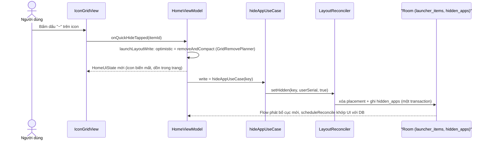

# Quy tắc làm việc nhiều agent song song — Os26Launcher

Trạng thái: **16-11-2026 ĐÃ THAY ĐỔI CÁCH LÀM VIỆC, KHÔNG DÙNG QUY TRÌNH TRONG FILE NÀY NỮA, CHỈ ĐỂ LẠI THAM KHẢO**

> Quy trình hiện hành: [Workflow.md](Workflow.md) (một tính năng một lúc, Claude trực tiếp làm, chủ dự án review/test/commit). Còn dùng được để tra: bảng phụ thuộc giữa các tính năng (mục 9), lịch sử nhánh đã merge (mục 10), mẫu sơ đồ Mermaid của knowledgement (mục 8). Các plan cũ có dòng "Dành cho agent thực thi … MultiAgent-Workflow.md" là lịch sử, không sửa.

File này **bổ sung** cho [AGENTS.md](AGENTS.md), không thay thế. Mọi quy ước ở mục "Quy ước làm việc trong dự án này" của AGENTS.md vẫn giữ nguyên: viết plan trước, code từng mốc nhỏ, không tự xóa file, không viết test tự động, commit message tiếng Anh, lệnh viết cho CMD/PowerShell, Vsmart Live 4 là máy test chính. Riêng việc tick Task và thời điểm kiểm tay được điều chỉnh ở mục 4 (chủ dự án chốt 2026-11-02). Chỗ nào khác hai file mâu thuẫn thì dừng lại hỏi chủ dự án.

---

## 1. Vai trò

| Vai | Là ai | Làm gì | Không làm |
|---|---|---|---|
| **Chủ dự án** | Người dùng | Duyệt bản plan **đã được điều phối rà và chỉnh**; kiểm tay **một lần cho cả tính năng** (cộng các Task bắt buộc kiểm tay, mục 4.2); đọc knowledgement rồi xem PR; merge PR (hoặc bảo điều phối merge một PR cụ thể); quyết định mở đợt mới; quyết khi một Task chạm giới hạn 5 vòng | Không phải rà plan thô hay review từng Task — việc đó của điều phối |
| **Agent điều phối** | Phiên Claude chính, nói chuyện trực tiếp với chủ dự án | Chọn tính năng theo đợt (mục 9); kiểm chồng lấn file; tạo nhánh + worktree; giao việc; **rà và chỉnh plan trước khi đưa chủ dự án duyệt**; **review mọi Task và mọi lần sửa lỗi ngay khi agent báo xong**, giữ agent đi đúng plan; chỉ đưa cho chủ dự án kiểm tay khi review đạt; sau khi merge thì đồng bộ tài liệu chung trên `main` và cập nhật bảng trạng thái (mục 10) | Tự code một tính năng đã giao cho agent khác; merge khi chưa được bảo |
| **Agent thực thi** | Một agent cho **một** tính năng, **một** nhánh, **một** worktree | Viết plan và knowledgement; code; build; commit và push nhánh của mình; mở và cập nhật PR | Xem mục 11 |

**Agent thực thi không nói chuyện trực tiếp với chủ dự án.** Khi tới điểm dừng (plan xong, Task xong, cần hỏi), nó dừng và trả báo cáo. Điều phối chuyển báo cáo cho chủ dự án. Khi chủ dự án trả lời, điều phối gửi tiếp cho **đúng agent đó** (giữ nguyên ngữ cảnh của nó) để làm tiếp. Không tạo agent mới cho một tính năng đang có agent, trừ khi agent cũ đã mất ngữ cảnh; khi đó agent mới đọc plan (mục Nhật ký) để nối tiếp.

## 2. Số agent chạy cùng lúc

- **Mặc định 3, tối đa 4** agent thực thi cùng lúc (chủ dự án chốt 2026-11-02). Chạy 4 chỉ khi các nhánh không chung file độc quyền (mục 5.2).
- Giới hạn còn lại: mỗi plan cần chủ dự án duyệt, nhiều agent sửa cùng file lõi sẽ xung đột, và mọi Task đều qua review của điều phối.
- Tại một thời điểm: tối đa **1** nhánh giữ khóa schema (mục 5.3), tối đa **1** nhánh cần Oppo A3x.

### 2.1 Model và effort của agent

**Mặc định khi không chỉ định:** agent thực thi dùng cùng model với phiên điều phối (hiện là Opus 5.5); effort theo cấu hình mặc định của loại agent. Có thể chỉ định model và effort cho từng agent khi tạo.

**Đã chốt (chủ dự án duyệt 2026-11-02):**

| Vai | Model | Effort | Lý do |
|---|---|---|---|
| Điều phối | Opus 5.5 | high | Là cửa kiểm chất lượng duy nhất trước khi tới tay chủ dự án: rà plan, review từng Task, bắt lỗi kiến trúc và bẫy đã ghi trong AGENTS.md |
| Agent thực thi, tính năng thường | Sonnet 5.5 | medium | Rẻ và nhanh hơn nhiều khi chạy 3–4 agent song song; plan đã duyệt và review của điều phối bù phần suy luận ít hơn |
| Agent thực thi, tính năng rủi ro | Sonnet 5.5 | high | Áp cho: R1 (tách `HomeActivity` 922 dòng, phải giữ nguyên hành vi), đổi schema Room, cử chỉ chạm/kéo-thả, kính (GL). Effort thấp dễ bỏ qua bẫy đã ghi trong AGENTS.md (vd `requestDisallowInterceptTouchEvent`, trạng thái nằm trong view của `ViewPager2`) |

Mức cho từng tính năng ghi ở bảng trạng thái (mục 10). Một agent chạm giới hạn 5 vòng (mục 4.1) vì vấn đề khó thì lần làm lại có thể nâng effort hoặc đổi sang Opus.

## 3. Đặt tên

Tên file, tên nhánh, tên tài nguyên viết **tiếng Anh**. Nội dung mọi file trong `docs/` viết **tiếng Việt**.

| Thứ | Quy tắc | Ví dụ |
|---|---|---|
| Mã tính năng (ID) | Theo bảng mốc ở `project_structure.md` mục 9; tính năng chưa có mã thì điều phối đặt (mục 9 của file này) | `G2b` |
| Slug | Tiếng Anh, chữ thường, gạch nối, 2–4 từ | `icon-styles` |
| Nhánh | `feature/<id>-<slug>` (chữ thường); refactor dùng `refactor/`, sửa lỗi dùng `fix/` | `feature/g2b-icon-styles` |
| Worktree | `E:\SourceTree\IosLauncher-wt\<ID>-<slug>`, **ngoài** thư mục dự án để Android Studio và Gradle của bản chính không quét vào | `E:\SourceTree\IosLauncher-wt\G2b-icon-styles` |
| Plan | `docs/plans/<ID>-<slug>.md` | `docs/plans/G2b-icon-styles.md` |
| Knowledgement | `docs/knowledgements/<ID>-<slug>.md`, **cùng tên gốc với plan** để dễ ghép cặp | `docs/knowledgements/G2b-icon-styles.md` |
| Pull request | **Tiêu đề và thân viết tiếng Anh** (chốt 2026-11-02). Tiêu đề cùng dạng commit `<type>: <imperative>`; thân có link tới plan và knowledgement. Plan và knowledgement vẫn viết tiếng Việt | `feat: add icon styles` |
| Chuỗi, màu, dimens | Tiền tố theo tính năng (như `search_pill_` ở M8c), thêm thành một khối liền ở **cuối** file tài nguyên | `icon_style_title` |

## 4. Vòng đời một tính năng

**Bước 0 — Điều phối mở việc.**
1. Đọc bảng trạng thái (mục 10), xác nhận tính năng thuộc đợt đã được duyệt và không chồng file nóng với nhánh đang chạy (mục 5).
2. Tạo worktree từ `main` mới nhất:
   ```powershell
   git fetch origin
   git worktree add -b feature/g2b-icon-styles ..\IosLauncher-wt\G2b-icon-styles origin/main
   ```
3. Chép `local.properties` từ thư mục chính sang worktree. File này bị gitignore (chứa `sdk.dir`), thiếu thì worktree không build được.
4. Giao việc cho agent, kèm: ID và phạm vi, đường dẫn worktree, vùng file của các nhánh đang chạy, danh sách tài liệu phải đọc (bước 1).
5. Ghi một dòng vào bảng trạng thái.

**Bước 1 — Agent đọc trước khi viết gì.** `AGENTS.md` (đã rút gọn, đọc hết), `lessons/README.md` rồi **các file chủ đề trong `lessons/` liên quan tới tính năng** (vd làm kính thì `lessons/glass.md`; không cần đọc hết), `project_structure.md`, mục TT# liên quan trong `Launcher-Features.md`, `room-schema.md` nếu đụng bố cục, plan của các mốc liên quan, và file này.

**Bước 2 — Plan.** Viết plan theo mẫu ở mục 7. Commit (`docs: add G2b plan`), push nhánh, mở **draft PR** (tiếng Anh, mục 3). Dừng và báo. **Không viết code trước khi plan được duyệt.**

**Bước 3 — Điều phối rà plan, rồi chủ dự án duyệt.**
1. **Điều phối rà plan thô trước**, đối chiếu với:
   - mục **"Vì sao chọn thiết kế này"** (mục 7) đủ sức thuyết phục: có ít nhất một phương án khác được xét thật, đánh đổi nói rõ, lý do dựa trên số đo / tài liệu / bài học của dự án chứ không phải "thường làm vậy";
   - phạm vi TT# trong `Launcher-Features.md` và các quyết định đã chốt (không làm thừa, không bỏ sót);
   - luật phụ thuộc `ui → domain ← data` và cây thư mục ở `project_structure.md`;
   - các bài học và bẫy đã ghi trong `AGENTS.md` và `lessons/` (vd trạng thái kéo-thả phải nằm ở dữ liệu, `requestDisallowInterceptTouchEvent`, kính trong `ViewPager2`);
   - vùng file so với các nhánh đang chạy (mục 5), khóa schema;
   - mỗi Task đủ nhỏ để review, có kịch bản kiểm và máy cụ thể; Task nào đánh dấu **bắt buộc kiểm tay** (mục 4.2) thì lý do có đứng vững không, và không đánh dấu thừa.
2. Plan lệch hướng hoặc thiếu thì điều phối gửi lại agent sửa, **tối đa 5 vòng** (mục 4.1). Câu hỏi mà chỉ chủ dự án trả lời được (phạm vi, hành vi UI, đánh đổi) thì gom lại, không tự quyết.
3. Khi plan đạt, điều phối đưa chủ dự án **bản đã chỉnh**, kèm tóm tắt ngắn: điều phối đã sửa gì so với bản thô và vì sao, còn câu hỏi nào cần chủ dự án quyết.
4. Chủ dự án duyệt hoặc góp ý. Agent ghi ngày duyệt vào plan.

**Bước 4 — Từng Task.**
1. Code.
2. Build `gradlew.bat assembleDebug` trong worktree (Claude build được trên máy này, đo 2026-11-02, xem AGENTS.md mục "Môi trường của Claude"). Build đỏ thì không được báo xong Task.
3. Commit (một hoặc vài commit cho mỗi Task, đúng quy ước commit của AGENTS.md), push.
4. Cập nhật plan: thêm dòng vào mục **Nhật ký**.
5. Dừng và báo cho điều phối: đã làm gì, commit nào, kịch bản kiểm tay góp vào bài kiểm cuối.
6. **Điều phối review ngay** (plan đã duyệt nên không cần chờ chủ dự án):
   - build xanh (điều phối tự chạy lại build trong worktree nếu được);
   - diff khớp đúng Task trong plan: không làm thừa, không bỏ bước, không sửa file ngoài vùng đã khai;
   - đúng kiến trúc và quy ước dự án, không lặp lại bẫy đã ghi trong AGENTS.md;
   - lỗi logic rõ ràng, trường hợp biên mà kịch bản kiểm tay sẽ không bắt được.
7. Review chưa đạt → điều phối gửi lại agent sửa, quay về bước 4.2, **tính một vòng** (mục 4.1). Agent đi lệch plan → điều phối kéo về đúng plan; nếu chính plan sai thì sửa plan và báo chủ dự án điểm thay đổi trước khi làm tiếp.
8. Review đạt → agent tick Task (nghĩa là "đã qua review của điều phối", chưa phải "đã kiểm tay") và sang Task kế, **không chờ chủ dự án** — trừ Task bắt buộc kiểm tay (mục 4.2).

**Bước 5 — Kiểm tay một lần cho cả tính năng.** Khi mọi Task đã qua review:
1. Điều phối gộp kịch bản của mọi Task thành **một bài kiểm** duy nhất: sắp theo thứ tự thao tác tự nhiên trên máy (không theo thứ tự Task), bỏ bước trùng, thêm phần hồi quy cho tính năng cũ có thể bị ảnh hưởng, ghi rõ máy và dữ liệu cần chuẩn bị. Gửi chủ dự án kèm nhánh@commit để cài.
2. Chủ dự án chạy một lượt, báo đạt hoặc báo từng mục lỗi (số mục trong bài kiểm + mô tả/log).
3. **Có lỗi:** điều phối chuyển cho agent; agent gỡ lỗi theo quy trình của AGENTS.md, sửa, build xanh, commit. **Điều phối review bản sửa trước** (như bước 4.6), đạt rồi mới đưa chủ dự án kiểm lại — chỉ **các mục lỗi + danh sách hồi quy ngắn** liên quan tới chỗ sửa, không chạy lại cả bài. Cần rải log để chẩn đoán thì điều phối nói rõ chạy gì và gửi log nào. Mỗi lần sửa–kiểm lại tính một vòng.
4. **Đạt:** agent ghi "Kết quả kiểm chứng" (máy, ngày, nhánh@commit) vào plan.

> Quy ước "chờ xác nhận mới tick" của AGENTS.md được điều chỉnh trong luồng nhiều agent (chủ dự án chốt 2026-11-02): tick Task = đã qua review của điều phối; xác nhận của chủ dự án nằm ở bước 5 cho cả tính năng.

### 4.1 Giới hạn 5 vòng

- Mỗi **Task** được tối đa **5 vòng** đạt/không đạt giữa điều phối và agent (review không đạt, hoặc sửa lỗi kiểm tay không đạt, đều tính). Vòng duyệt plan ở bước 3 cũng tối đa 5.
- Hết 5 vòng mà chưa đạt: **dừng Task đó**, không giao thêm vòng nào. Điều phối báo chủ dự án: đã thử gì ở từng vòng, vì sao vẫn hỏng, và 2–3 hướng đi (đổi thiết kế, thu hẹp phạm vi, nâng model/effort, hoãn tính năng). Chủ dự án chọn rồi mới làm tiếp.
- Điều phối đếm vòng trong cột Ghi chú của mục **Nhật ký** (vd "Task 2, vòng 3/5"). Hai vòng liên tiếp hỏng cùng một chỗ thì điều phối xem lại chính thiết kế trong plan trước khi giao vòng tiếp, đúng bài học "vá lần thứ hai thì dừng và đề xuất phương án khác" trong AGENTS.md.

### 4.2 Task bắt buộc kiểm tay

Mặc định không kiểm tay giữa chừng. Plan chỉ được đánh dấu một Task là **bắt buộc kiểm tay** (dừng lại cho chủ dự án kiểm ngay khi Task đó qua review) khi nó thuộc một trong các loại:
- Task sau xây trên một **giả định chỉ máy thật trả lời được**, sai thì phải làm lại nhiều Task (vd hệ thống có cho launcher đọc dữ liệu X không, ROM có phát callback Y không);
- **migration Room** (kịch bản cài bản cũ → tạo dữ liệu → cài bản mới phải chạy trước khi xây tiếp);
- **phép đo hiệu năng** dùng để chọn phương án (Janky của kính, thời gian nạp);
- **cử chỉ chạm/kéo-thả** mới, vì loại lỗi này review code khó thấy (bài học M7).

Plan ghi lý do cho từng Task được đánh dấu. Điều phối bỏ dấu nếu lý do không đứng vững.

**Bước 6 — Knowledgement.** Viết dần từ Task đầu tiên theo mẫu ở mục 8, hoàn chỉnh trước bước 7. Chủ dự án đọc file này **trước** khi xem code.

**Bước 7 — Đóng nhánh.**
1. Rebase lên `main` mới nhất, build lại xanh.
2. Rà Review Focus, điền bảng bằng chứng như M8a/M8c. Ca nào chỉ được code bảo vệ mà chưa ai kiểm tay thì ghi rõ.
3. Điền mục "Đề xuất cập nhật tài liệu chung" trong plan.
4. **Điều phối review toàn nhánh** lần cuối: diff tổng so với `main`, knowledgement đủ và đúng với code (sơ đồ Mermaid khớp luồng thật), plan đã tick đủ. Chưa đạt thì gửi lại agent.
5. Chuyển PR từ draft sang **Ready for review**.

**Bước 8 — Review và merge.** Chủ dự án đọc knowledgement, rồi đến diff. Merge bằng **Rebase and merge** (chốt 2026-11-02) để giữ commit từng Task và lịch sử thẳng như `main` hiện tại. Chỉ chủ dự án merge, hoặc điều phối merge khi được bảo rõ cho đúng PR đó.

**Bước 9 — Sau merge (điều phối, trên `main`).**
1. Đồng bộ tài liệu chung theo đề xuất trong plan, commit `docs: close G2b and sync project docs`.
2. Cập nhật bảng trạng thái.
3. Báo các nhánh đang chạy có đụng vùng file vừa đổi để chúng rebase.
4. Xóa worktree và nhánh (local + remote) của PR vừa merge: `git worktree remove`, `git branch -d`, `git push origin --delete`. **Chủ dự án đã duyệt sẵn việc này (2026-11-02)**, nên điều phối làm luôn và chỉ báo lại, không hỏi. Duyệt sẵn chỉ áp cho worktree và nhánh **đã merge**; nhánh bị hủy hoặc chưa merge vẫn phải hỏi, và mọi file khác vẫn theo quy ước "không tự xóa" của AGENTS.md.

## 5. Chống xung đột

### 5.1 Vùng file

Mỗi plan có mục **Vùng file**: danh sách file sẽ tạo/sửa, đánh dấu file nóng. Điều phối so vùng file của plan mới với các nhánh đang chạy **trước khi** cho bắt đầu code. Trùng file độc quyền thì không chạy song song mà xếp nối tiếp. Đang làm mà phát hiện cần sửa file ngoài vùng đã khai thì agent dừng và báo, không tự mở rộng.

### 5.2 File nóng

**Độc quyền** — mỗi lúc chỉ một nhánh được sửa:
- `ui/home/HomeActivity.kt` (còn ~200 dòng sau R1; thứ tự trong file là hành vi), `ui/home/HomeViewModel.kt`, `ui/home/HomeUiState.kt`, `res/layout/activity_home.xml`
- `data/layout/LayoutReconciler.kt`, mọi file trong `data/layout/db/`
- `core/glass/*`
- `core/ui/DragHelper.kt`, `core/ui/DragDropTarget.kt`

**Dùng chung có kiểm soát** — được sửa song song, nhưng chỉ thêm (không đổi thứ đã có), và nhánh merge sau tự rebase và giải xung đột:
- `data/settings/SettingsKeys.kt`, `SettingsRepositoryImpl.kt`, `ui/settings/*` (thêm khóa, thêm hàng)
- `res/values/strings.xml`, `colors.xml`, `dimens.xml` (khối riêng ở cuối file, mục 3)
- `AndroidManifest.xml`, `gradle/libs.versions.toml`, `app/build.gradle.kts`

### 5.3 Khóa schema Room

- Đổi schema (thêm cột, thêm bảng, tăng `version` của `LauncherDatabase`, đặt nghĩa cho một giá trị `itemType` mới) cần **khóa schema**, ghi ở bảng trạng thái. Mỗi lúc chỉ một nhánh giữ khóa.
- Hiện schema đang ở version 1. Hai nhánh cùng nâng lên version 2 sẽ sinh hai migration xung đột, không giải tay được an toàn.
- Nhánh giữ khóa phải có: migration, file schema JSON mới trong `app/schemas/`, cập nhật đề xuất cho `room-schema.md`, và kịch bản kiểm tay theo AGENTS.md (cài bản cũ → tạo dữ liệu → cài bản mới lên trên).
- Khóa được trả khi PR đã merge hoặc nhánh bị hủy.

### 5.4 Tài liệu chung — chỉ điều phối sửa, trên `main`, sau khi merge

Gồm `AGENTS.md`, `lessons/*` (các file chủ đề và `lessons/README.md`), `Launcher-Features.md`, `project_structure.md`, `room-schema.md` và file này. Agent thực thi **không** sửa các file này trên nhánh của mình. Thay vào đó:
- đề xuất thay đổi ghi vào mục "Đề xuất cập nhật tài liệu chung" của plan;
- bài học ghi vào mục "Bài học cho AGENTS.md" của knowledgement (tên mục giữ cho quen). **Điều phối** sau khi merge chép từng dòng vào **cuối file chủ đề đúng** trong `docs/lessons/` (kính, kéo-thả và bố cục, khởi động và đo, tìm kiếm, widget, icon và danh sách app, quyền và máy thật, Home/pager/hoạt ảnh, cài đặt và dữ liệu; chưa có chủ đề phù hợp thì thêm file mới và một dòng ở `lessons/README.md`), giữ ngày và nhãn nguồn. Chỉ quy ước làm việc, build/toolchain, môi trường, quy tắc máy thật, quy tắc viết docs và việc trước khi phát hành mới vào `AGENTS.md`.

Lý do: nhánh nào cũng muốn sửa các file này, để từng nhánh tự sửa thì PR nào cũng xung đột.

### 5.5 Rebase và push

- Nhánh rebase lên `main` trước khi xin review, và mỗi khi `main` vừa merge thứ đụng vùng file của nó.
- Push sau khi rebase chỉ dùng `git push --force-with-lease`, và **chỉ trên nhánh của chính mình**.
- Không bao giờ push hoặc force-push lên `main` từ agent thực thi.

## 6. Kiểm tay khi nhiều nhánh cùng chờ

- **Mỗi lần kiểm một nhánh.** APK của mọi nhánh cùng package `gambi.global.os26launcher` nên cài nhánh này sẽ đè nhánh kia.
- **Báo cáo kiểm tay ghi rõ nhánh và commit đã cài** (`git rev-parse --short HEAD` trong worktree).
- **Room không hạ version (đọc tài liệu Room, chưa đo trên dự án):** đã cài APK của nhánh có schema mới thì cài APK nhánh khác (schema cũ) sẽ crash lúc mở DB. Trước khi chuyển sang nhánh khác: gỡ app hoặc Xóa dữ liệu trong Cài đặt (`pm clear` bị chặn trên Oppo, xem AGENTS.md). Vì vậy nhánh giữ khóa schema nên được kiểm **cuối cùng** trong mỗi vòng kiểm.
- Khóa DataStore mới do một nhánh thêm không làm hại nhánh khác: nhánh không biết khóa đó thì bỏ qua nó.
- **Ai cài APK:** mặc định chủ dự án tự cài từ worktree (`gradlew.bat installDebug`). Agent chỉ cài khi chủ dự án bảo rõ nhánh nào, và `adb devices` thấy máy. Hai agent không bao giờ cài cùng lúc.
- Ghi rõ máy cho từng bước kiểm (Live 4 mặc định, Oppo chỉ khi cần kính), đúng quy ước AGENTS.md.

## 7. Mẫu plan

Giữ khung của các plan cũ (gần nhất là [M8c-search-pill.md](plans/M8c-search-pill.md)) và thêm bốn mục: dòng nhánh/trạng thái, **Vùng file**, **Nhật ký**, **Đề xuất cập nhật tài liệu chung**. Plan là nơi theo dõi agent đã làm gì: ai đọc plan cũng phải biết tính năng đang ở đâu mà không cần hỏi.

```markdown
# <ID> — <Tên tính năng> (TT#..) — Implementation Plan

> **Dành cho agent thực thi:** làm theo `docs/AGENTS.md` và `docs/MultiAgent-Workflow.md` — code từng Task, báo cáo điều phối, qua review mới tick và sang Task sau; Task "bắt buộc kiểm tay" thì chờ chủ dự án kiểm; cả tính năng kiểm tay một lần ở cuối. Tối đa 5 vòng mỗi Task. Không có test tự động; kiểm chứng tay trên Vsmart Live 4 (Oppo A3x chỉ khi cần kính). Lệnh viết cho CMD/PowerShell.

**Nhánh:** `feature/<id>-<slug>` · **Worktree:** `E:\SourceTree\IosLauncher-wt\<ID>-<slug>` · **PR:** #.. · **Bắt đầu:** YYYY-MM-DD · **Plan duyệt:** YYYY-MM-DD
**Trạng thái:** Chờ duyệt plan | Đang làm Task N | Chờ kiểm tay Task N | Chờ review | Đã merge YYYY-MM-DD
**Khóa:** không | khóa schema | cần Oppo

**Goal:** ...
**Architecture:** ...
**Tech Stack:** ... (dependency mới nếu có, kèm version đã kiểm)
**Spec:** TT#.. trong `Launcher-Features.md` + tài liệu liên quan

## Vì sao chọn thiết kế này
Phần này phải thuyết phục được chủ dự án, không chỉ mô tả. Gồm:
- **Vấn đề cần giải:** ràng buộc thật của dự án (tier máy, file nóng, bẫy trong AGENTS.md, số đo đã có).
- **Các phương án đã xét** (ít nhất 2), mỗi phương án: cách làm, ưu, nhược, chi phí, rủi ro.
| Phương án | Cách làm | Ưu | Nhược / rủi ro | Chọn? |
- **Vì sao chọn phương án này:** dựa trên số đo, tài liệu chính thức hoặc bài học của dự án (ghi nhãn nguồn). Không chấp nhận lý do kiểu "thường làm vậy".
- **Đánh đổi chấp nhận:** cái gì mất đi, khi nào nên xét lại.

## Quyết định đã chốt
| # | Quyết định | Ghi chú (ai quyết, ngày, cơ sở) |

## Ngoài phạm vi / ghi để sau

## Vùng file
| File | Tạo / Sửa | Nóng (độc quyền / dùng chung) |

## Global Constraints

## Review Focus

---

### Task N: <tên>
**Bắt buộc kiểm tay:** không | có — lý do (mục 4.2 của MultiAgent-Workflow.md)
**Files:** ...
**Interfaces:** Consumes / Produces
- [ ] **Step 1: ...**
- [ ] **Step k: Kịch bản kiểm (Live 4)** — (a), (b), ... (điều phối gộp vào bài kiểm cuối)

---

## Bài kiểm cả tính năng (điều phối gộp ở bước 5)
Máy · dữ liệu cần chuẩn bị · các mục kiểm theo thứ tự thao tác · phần hồi quy.
**Kết quả kiểm chứng (máy, ngày, nhánh@commit):** ...

## Nhật ký
| Ngày | Task | Việc đã làm | Commit | Ghi chú (vòng x/5, chặn, câu hỏi, đổi kế hoạch) |

## Bằng chứng Review Focus (điền khi đóng)
| # | Dòng Review Focus | Bằng chứng | Kết quả |

## Đề xuất cập nhật tài liệu chung (điều phối áp dụng sau merge)
- `Launcher-Features.md`: ...
- `project_structure.md`: ...
- `room-schema.md`: ...
- `AGENTS.md` / `lessons/`: xem mục "Bài học cho AGENTS.md" trong knowledgement (điều phối đưa vào file chủ đề ở `docs/lessons/`)
```

## 8. Mẫu knowledgement

Người đọc là **chủ dự án**, đọc **trước** khi review code để hiểu tính năng chạy thế nào và cần soi chỗ nào. Viết để người đọc hiểu nhanh: giải thích thuật ngữ Android ở lần đầu xuất hiện, dùng ví dụ thật của dự án (giọng như [android-task-affinity.md](knowledgements/android-task-affinity.md)). Mọi khẳng định ghi nhãn **đo được** / **đọc tài liệu** / **suy luận chưa kiểm chứng**, theo AGENTS.md.

**Luồng hoạt động của tính năng bắt buộc viết bằng Mermaid** (khối ` ```mermaid `, GitHub tự vẽ khi xem PR hoặc file):
- `sequenceDiagram` cho luồng một thao tác đi qua các tầng (người dùng → View → ViewModel → use case → repository → DB/hệ thống);
- `flowchart` cho rẽ nhánh theo điều kiện (tier máy, quyền, trạng thái);
- `stateDiagram-v2` khi tính năng có trạng thái UI chuyển qua lại (mở/đóng, chế độ chỉnh sửa).
Mỗi tính năng có ít nhất một `sequenceDiagram` cho thao tác chính. Tên trong sơ đồ dùng đúng tên class/hàm trong code để người đọc tìm được. Nhãn chữ trong sơ đồ viết tiếng Việt; chữ có dấu ngoặc hoặc ký tự đặc biệt thì đặt trong ngoặc kép để Mermaid không lỗi.

```markdown
# <ID> — <Tên tính năng>: đọc trước khi review

**Plan:** [plans/<ID>-<slug>.md](../plans/<ID>-<slug>.md) · **PR:** #.. · **Nhánh:** `feature/...`

## 1. Tóm tắt
Tính năng làm gì, người dùng thấy và thao tác gì (tối đa 5 dòng).

## 2. Kiến thức nền
Khái niệm Android / thư viện cần biết để đọc code, giải thích ngắn, kèm link tài liệu chính thức.

## 3. Luồng hoạt động
Từ thao tác người dùng → view → ViewModel → use case → repository → DB / hệ thống, viết bằng Mermaid. Ví dụ (luồng ẩn app có sẵn trong dự án):



Dưới mỗi sơ đồ: 2–5 dòng giải thích bước nào dễ sai hoặc khác với cách làm thông thường.

## 4. Thay đổi theo file
| File | Vai trò | Vì sao thêm/sửa | Đọc trước? |
Đánh dấu 2–3 file nên đọc đầu tiên.

## 5. Quyết định và đánh đổi
Phương án đã chọn, phương án bỏ, lý do (trỏ về D# trong plan).

## 6. Chỗ cần soi khi review
Chỗ dễ sai; chỗ chỉ được code bảo vệ mà chưa kiểm tay; ảnh hưởng tới tính năng cũ.

## 7. Cách kiểm lại
Kịch bản tay ngắn gọn, máy nào, cần dữ liệu gì trước.

## 8. Bài học cho AGENTS.md
Điều phối gộp vào file chủ đề đúng trong `docs/lessons/` sau khi merge (hoặc vào `AGENTS.md` nếu là quy ước chung). Mỗi dòng có ngày và nhãn nguồn, ghi sẵn chủ đề đề xuất (vd `glass`, `search`).
```

## 9. Đề xuất chia đợt cho các tính năng còn lại

Danh sách lấy từ `Launcher-Features.md` và `project_structure.md` mục 9 (đọc 2026-11-02). **Thứ tự đợt đã duyệt 2026-11-02, R1 đi trước.** ID chưa có trong bảng mốc (R1, M8d, G2d, GL) là mã Claude đặt.

| ID | Tính năng | TT# | File nóng chính | Schema | Máy | Phụ thuộc / chặn |
|---|---|---|---|---|---|---|
| **TL1** `fix/tl1-home-polish` | Góp ý tech lead (2026-11-03): chuyển trang chậm và mượt hơn; giảm biên độ rung icon; thanh nút edit mode nổi phía trên, không đẩy lưới xuống | — | `HomeActivity`, `activity_home.xml`, `Jiggler` | Không | Live 4 | Không |
| **TL2** `fix/tl2-icon-shape` | Góp ý tech lead: icon chưa bo góc → mặt nạ bo góc kiểu iOS cho mọi icon, thiết kế để G2b mở rộng | 12 (một phần) | `IconLoader`/`IconCache` | Không | Live 4 | Không; G2b xây tiếp trên TL2 |
| **R1 ✅** `refactor/r1-home-controllers` | Tách `HomeActivity` (962 dòng) thành các controller, không đổi hành vi (nợ ghi ở "Demo polish", AGENTS.md) | — | `HomeActivity`, `activity_home.xml` | Không | Live 4 (hồi quy toàn bộ) | Không |
| **AN ✅** `polish-animation` | Spring mở/đóng hai panel, icon trượt/co/nở, kính hover khi kéo, đẩy-dồn trễ 500 ms; ô nhóm Library bấm icon mở app, "+N" mở panel; kính vẽ lại khi đổi ảnh nền; dock 0×0 sau `recreate()` | — | `DragHelper`, `IconGridView`, hai panel | Không | Live 4 + Oppo | Không |
| **GS ✅** `glass-settings` | Cài đặt chọn kính theo từng phần tử (thật hay mờ): dock, panel, thanh tìm kiếm, pill. `GlassPolicy` nhận lựa chọn của người dùng, thêm khóa DataStore và hàng trong Cài đặt; mặc định giữ như hiện tại. Giới hạn: (1) ô thư mục và ô nhóm Library KHÔNG có tùy chọn ở bản đầu: kính thật ở đó cần view riêng, phá rung, ảnh kéo và kéo-thả, là thiết kế lại; pill cần đổi cấu trúc. (2) Máy API < 33: cho phép bật kính thật nhưng phải cảnh báo có thể chậm (panel kính thật trên Live 4: S1 Janky 30.7%). (3) `GlassBudget.maxRealGlass` (LENS 6, CLASSIC 1) hiện KHÔNG được code nào gọi và số 6 lấy từ app demo: plan phải quyết có áp giới hạn không và đo Oppo khi bật hết | 20 | `GlassPolicy`, `GlassEnvironment`, `SearchPillView`, Cài đặt (dùng chung) | Không (khóa DataStore) | Oppo + Live 4 | Sau AN (cùng đụng panel, pill) và G2b (cùng đụng Cài đặt) |
| **G2b** `icon-styles` | Kiểu icon (tô màu, 3D) + lựa chọn trong Cài đặt | 12, 20 | `IconLoader`/`IconCache`, Cài đặt (dùng chung) | Không (khóa DataStore) | Live 4 | Không |
| **M8d ✅** `search-extras` | Phần còn lại của tìm kiếm: danh mục Cài đặt hệ thống, shortcut trong kết quả, gợi ý/app gần đây | 9 | `domain/search`, `ui/search` | Không | Live 4 | App gần đây có thể cần quyền Usage Access (plan phải xét) |
| **GP ✅** `gap-long-press` | Nhấn giữ khoảng trống trên trang Home thì vào edit mode, kể cả khi trang không có icon. Là lối thoát khi ẩn hết app | — | `IconGridView`, `HomePagerAdapter` | Không | Live 4 | Xong trước khi G2c bắt đầu code |
| **LC ✅** `label-cache` | Cache nhãn app ra đĩa để lưới hiện sớm khi mở app (P1: Oppo 345 app, đọc nhãn ~5.4 giây trong ~6.5 giây tới lúc có lưới) | — | `data/apps/*` | Không (không dùng Room) | Oppo + Live 4 | Code sau khi GP merge (chủ dự án chốt 2026-11-05); plan viết trước |
| **IC** `icon-cache` | Cache icon để trang đầu vẽ xong sớm hơn (Oppo: icon cuối ~2.4 giây từ lúc tiến trình bắt đầu, nạp icon ~0.65 giây) | — | `data/apps/*` | Không | Oppo + Live 4 | Xếp hàng 2026-11-05, chủ dự án yêu cầu; tiếp theo trong hàng đợi |
| **G2d ✅** `settings-hub` | Màn trung tâm của app giống dashboard của app mẫu; có thể dựng lại từ màn Cài đặt (chốt lại 2026-11-05) | — | `ui/settings/*`, `res/layout` của Cài đặt, `app/build.gradle.kts` (`versionName`) | Không | Live 4 | **Bỏ chặn 2026-11-12:** luồng màn hình lấy từ bản nháp Figma ([Figma-Draft.md](Figma-Draft.md)); đợt FD-0 |
| **G2c ✅** `clock-calendar-widgets` | Widget tự vẽ: đồng hồ, lịch | 13 | `IconGridView`, `LayoutReconciler`, kéo-thả | **Có thể** (`ITEM_TYPE_WIDGET` và `spanX/spanY` đã có ở v1; cấu hình widget có thể cần cột mới — plan phải xác định) | Live 4 | Sau R1 |
| **GL ✅** `glass-pass` | Áp kính: ô và panel thư mục, ô nhóm App Library, thanh tìm kiếm, pill; đo Janky | — | `core/glass`, view thư mục, lớp tìm kiếm, pill | Không | **Oppo** + Live 4 | Sau M8d (cùng lớp tìm kiếm), nên sau G2c; đọc "Ghi chú cho mốc Áp kính" cuối plan G2a |
| **G3a** `contacts-search` | Tìm danh bạ | 18 | `ui/search`, Cài đặt, Manifest | Không | Live 4 | **Chờ quyết phạm vi** (`Launcher-Features.md` mục 5); sau M8d (cùng vùng tìm kiếm) |
| **G3d** `control-center` | Bảng tiện ích kiểu Trung tâm điều khiển (tùy chọn) | 21 | Cử chỉ ở Home | Không | Live 4 | Sau R1; tùy chọn |
| **G3b ✅** `photo-widget` | Widget ảnh 2×2/4×2: một ảnh hoặc bộ ảnh đổi mỗi giờ, cắt theo khung widget, bộ chọn ảnh hệ thống (không xin quyền), bản sao riêng trong `no_backup` | 15 | — | Không | Live 4 | ✅ Merged 2026-11-16 (#57) |
| G3f | Bộ sưu tập hình nền, tự đổi, báo hình mới | 16 | — | — | — | **Chặn:** chưa quyết nguồn hình nền được phép dùng và máy chủ phát hình mới (tách khỏi G3b 2026-11-10) |
| **G3c ✅** `appwidget-host` | AppWidgetHost: widget của app khác trên thẻ kính, chọn cỡ khi thêm (tối đa 4×4), cùng bảng "Tiện ích" | 19 | `HomeActivity`, `IconCellView`/`IconGridView`, `LayoutReconciler` | Không | Live 4 + Oppo | ✅ Merged 2026-11-16 (#59). Để sau: nút cấu hình lại, khôi phục bản sao lưu ngoài placeholder, widget hồ sơ công việc, bộ đo hiệu năng |
| G3e ✅ | Thời tiết + thông báo | 14, 17 | — | — | — | ✅ Một vị trí (G3e, 2026-11-10), nhiều địa điểm (WX #55, 2026-11-13), thông báo (WN #58, 2026-11-16) |
| P1 | Đo cold start Oppo (344 app), quyết có cache nhãn app hay không | — | — | — | Oppo | **Đã đo 2026-11-05**, số ở `lessons/startup-performance.md` mục P1. Cache nhãn nếu làm thì mở nhánh riêng, viết plan như tính năng thường |

**Đợt đề xuất:**

| Đợt | Chạy song song | Vì sao |
|---|---|---|
| **0a** (chèn 2026-11-03) | TL1 + TL2 + GL | Chủ dự án yêu cầu xong góp ý tech lead và việc còn lại của G2a trước tính năng mới. Ba vùng file tách nhau (Home/edit mode / tải icon / `core/glass` + panel). Ngoại lệ file nóng: TL1 giữ `HomeActivity` + `activity_home.xml`; GL chỉ được sửa một đoạn hẹp trong hàm gắn kính của `HomeActivity` (khai trong plan) và khối panel trong `activity_home.xml`, merge **sau** TL1 và tự rebase. GL lên trước M8d/G2c so với đề xuất cũ vì chủ dự án ưu tiên. R1 + G2b dời ra sau đợt này |
| **0b** (chốt 2026-11-04) | R1 + G2b + AN | Ba nhánh song song. R1 giữ `HomeActivity`, `activity_home.xml` độc quyền. AN làm plan và phần trong view trước; phần nối vào `HomeActivity` chờ R1 merge rồi sửa trong controller mới. G2b không sửa `HomeActivity` |
| **1** (đổi 2026-11-05) | GP + M8d + G2c + GS, cùng lúc điều phối đo P1 | Chủ dự án yêu cầu chạy tối đa 4 agent. GS gộp vào đợt này vì G2d bị hoãn. GP xong khi G2c còn ở bước plan nên không đụng nhau ở `IconGridView`. GS là nhánh duy nhất cần Oppo, nên P1 đo trước khi GS đo. G2c giữ khóa schema nếu cần |
| **Xếp hàng 2026-11-09** | DD + SM + RB | Chủ dự án yêu cầu. **DD:** sửa lỗi đọc icon app mặc định ở dock trên Oppo (Live 4 đúng, Oppo vẫn sai dù dùng cùng logic). Nghi vấn ban đầu (suy luận, chưa kiểm): `DefaultAppResolver` chỉ bỏ kết quả có package bắt đầu bằng `android.permission`, nhưng hộp chọn app của hệ thống là `android/com.android.internal.app.ResolverActivity` (package `android`) nên lọt qua và bị coi là app thật khi máy chưa đặt mặc định. Task 1 của DD đo trên Oppo trước khi sửa. **SM:** làm lại menu nhấn giữ icon theo **mẫu giao diện** (không cần giống nội dung hàng) của launcher mẫu `com.liquid.os.launcher.smart` đang hiện trên Oppo: (1) dùng kính (cùng mẫu GL/GS: `GlassPolicy`, `GlassRole`), (2) chữ nhỏ hơn bản hiện tại, (3) kích thước và vị trí menu giống mẫu (bảng bo góc lớn nổi cạnh icon, nền phía sau tối nhẹ); nội dung hàng giữ của ta. Task 1 của SM đo kích thước, vị trí, cỡ chữ của mẫu trên Oppo (đọc từ `uiautomator dump` và ảnh chụp) và của menu hiện tại. **RB (đề xuất 2026-11-09, chờ chủ dự án duyệt phạm vi):** dựng bản release đúng cách: bật R8 (`optimization.enable`), thêm baseline profile, đo lại khởi động; kèm cách cài bản release lên máy thử. Lý do: bản debug chậm ~4,4 lần release (xem `lessons/startup-performance.md`, bài học "Đừng đo khởi động trên bản debug") |
| **Xếp hàng 2026-11-09 (sau)** | DR | ✅ Xong 2026-11-10 (#25). Chủ dự án yêu cầu: **DR — tổ chức lại thư mục `docs/`**. `AGENTS.md` đã quá dài (608 dòng, ~139 KB, mỗi mốc thêm một mục "bài học") nên agent đọc tốn và khó tìm. Hướng đề xuất (plan phải so sánh ≥ 2 cách và chờ duyệt): giữ `AGENTS.md` ngắn (quy ước, build/toolchain, môi trường, máy thử, mục lục) và tách bài học theo chủ đề vào `docs/lessons/` (ví dụ kính, kéo-thả, khởi động/đo, tìm kiếm, widget, quyền và máy thử); mỗi bài học giữ ngày + nhãn đo được/đọc code/suy luận và link về plan/knowledgement gốc; không làm mất nội dung (đối chiếu từng mục cũ có nơi mới). Cân nhắc gom `plans/` + `knowledgements/` đã merge theo mốc, sửa mọi link nội bộ, cập nhật mục 5.4 của file này (tài liệu chung) và memory. Chỉ đụng tài liệu, làm khi không nhánh nào đang sửa docs chung |
| **2** | G3a (nếu được duyệt phạm vi) + G3d (nếu muốn) | GL đã xong ở đợt 0a |
| **FD-0** (chốt 2026-11-12) ✅ xong 2026-11-12 | G2d | Chủ dự án duyệt thứ tự theo bản nháp Figma ([Figma-Draft.md](Figma-Draft.md) mục 5–6). G2d đi một mình: mọi nhánh sau thêm hàng vào màn con của nó |
| **FD-1** (sau G2d) ✅ xong 2026-11-13 | AB + RN + WU + HT | Việc nhanh. PR #49–#52 |
| **FD-2** | CI, IS, GV, AE, LO, HL, TS (tối đa 4 mỗi lượt) | Việc trung bình |
| **FD-3** | TH, NB, WX, LG, PT, TR | Việc lớn; WX dùng khóa OWM hiện tại, C15 vẫn để trước phát hành |
| **Đợt 3 (2026-11-13)** | WN + G3c + G3b | WN ✅ #58, G3b ✅ #57, G3c ✅ #59 (2026-11-16); trước đây G3c đang làm. G3d do người khác làm ngoài quy trình này |
| **Xếp hàng 2026-11-13** ✅ xong 2026-11-13 (#54, #55) | WX + CP | Chủ dự án chọn làm trước G3c/G3d (quyết G3c, G3d sau khi xong hai nhánh này). WX là nhánh widget duy nhất đang chạy (G3b, G3c phải chờ: cùng tầng widget). WX tách thông báo thời tiết ra nhánh sau |
| Chờ quyết | G3b (chờ trả lời phạm vi), G3c, G3f; huy hiệu, tìm tệp (để sau, 2026-11-12) | Xem cột "Phụ thuộc / chặn" |

## 10. Bảng trạng thái nhánh

Điều phối cập nhật trên `main` mỗi khi mở nhánh, đổi trạng thái lớn (plan duyệt, chờ review, merge) hoặc cấp/trả khóa.

| ID | Nhánh | Model / effort | Trạng thái | Khóa | PR | Cập nhật |
|---|---|---|---|---|---|---|
| TL1 | `fix/tl1-home-polish` | Sonnet 5.5 / medium | ✅ Merged (rebase), nhánh + worktree đã xóa | — | #2 | 2026-11-03 |
| TL2 | `fix/tl2-icon-shape` | Sonnet 5.5 / medium | ✅ Merged (rebase), nhánh + worktree đã xóa | — | #1 | 2026-11-03 |
| GL | `feature/gl-glass-pass` | Sonnet 5.5 / high | ✅ Merged (rebase), nhánh + worktree đã xóa | — | #3 | 2026-11-04 |
| R1a | `refactor/r1-home-controllers` | Sonnet 5.5 / high | ✅ Merged (rebase), nhánh + worktree đã xóa | — | #5 | 2026-11-04 |
| R1b | `refactor/r1b-home-controllers` | Sonnet 5.5 / high | ✅ Merged (rebase), nhánh + worktree đã xóa | — | #7 | 2026-11-04 |
| G2b | `feature/g2b-icon-styles` | Sonnet 5.5 / medium | ✅ Merged (rebase), nhánh + worktree đã xóa | — | #4 | 2026-11-04 |
| AN | `feature/an-polish-animation` | Sonnet 5.5 / high | ✅ Merged (rebase), nhánh + worktree đã xóa | — | #6 | 2026-11-05 |
| GP | `fix/gp-gap-long-press` | Sonnet 5.5 / high | ✅ Merged (rebase), nhánh + worktree đã xóa | — | #8 | 2026-11-05 |
| M8d | `feature/m8d-search-extras` | Sonnet 5.5 / medium | ✅ Merged (rebase), nhánh + worktree đã xóa | — | #9 | 2026-11-05 |
| G2c | `feature/g2c-clock-calendar-widgets` | Sonnet 5.5 / high | ✅ Merged (rebase), nhánh + worktree đã xóa | — | #12 | 2026-11-05 |
| GS | `feature/gs-glass-settings` | Sonnet 5.5 / high | ✅ Merged (rebase), nhánh + worktree đã xóa | — | #10 | 2026-11-05 |
| LC | `feature/lc-label-cache` | Sonnet 5.5 / medium | ✅ Merged (rebase), nhánh + worktree đã xóa | — | #11 | 2026-11-05 |
| IC | `feature/ic-icon-disk-cache` | Sonnet 5.5 / medium | ✅ Merged (rebase), nhánh + worktree đã xóa | — | #15 | 2026-11-09 |
| B1 | `fix/b1-clock-chooser` | Sonnet 5.5 / medium | ✅ Merged (rebase), nhánh + worktree đã xóa | — | #14 | 2026-11-09 |
| CL | `fix/cl-small-fixes` | Sonnet 5.5 / medium | ✅ Merged (rebase), nhánh + worktree đã xóa | — | #16 | 2026-11-09 |
| DD | `fix/dd-dock-default-apps` | Opus 5.5 / high (plan) | ✅ Merged (rebase), nhánh + worktree đã xóa | — | #17 | 2026-11-09 |
| SM | `feature/sm-shortcut-menu-glass` | Opus 5.5 / high (plan) | ✅ Merged (rebase), nhánh + worktree đã xóa | — | #18 | 2026-11-09 |
| DG | `fix/dg-dock-glass-refresh` | Sonnet 5.5 / medium | ✅ Merged (rebase), nhánh + worktree đã xóa | — | #19 | 2026-11-09 |
| SW | `fix/sw-menu-width-fit` | Sonnet 5.5 / medium | ✅ Merged (rebase), nhánh + worktree đã xóa. Live 4 (1,15): 213 dp đủ chữ; Oppo (0,9): 200 dp như cũ | — | #20 | 2026-11-09 |
| RB | `build/rb-release-build` | Sonnet 5.5 / medium | ✅ Merged (rebase), nhánh + worktree đã xóa. Oppo: release R8 + profile 405-409 ms tới khung đầu (release không R8 422-471, debug 1198), APK 2,75 MB; hồi quy Oppo + Live 4 đạt | — | #21 | 2026-11-09 |
| G3a | `feature/g3a-contacts-search` | Sonnet 5.5 / medium | ✅ Merged (rebase), nhánh + worktree đã xóa. Kiểm Live 4 + Oppo với 5 danh bạ thử (đã xóa); sửa lỗi chọn số mặc định trên ColorOS | — | #22 | 2026-11-09 |
| G3e | `feature/g3e-weather-widget` | Sonnet 5.5 / medium | ✅ Merged (rebase), nhánh + worktree đã xóa. Khóa OWM Free đủ cho weather + forecast + geocoding; kiểm Oppo + Live 4 đạt; log G3E đã gỡ | — | #23 | 2026-11-10 |
| DR | `docs/dr-docs-reorg` | Sonnet 5.5 / medium | ✅ Merged (rebase), nhánh + worktree đã xóa. `AGENTS.md` 747 → 98 dòng; bài học theo chủ đề ở `docs/lessons/` (9 file + README tra cứu) | — | #25 | 2026-11-10 |
| AP | `feature/ap-applib-animations` | Sonnet 5.5 / high | ✅ Merged (rebase), nhánh + worktree đã xóa. Vuốt Home↔Library trượt cả hai; nhóm Library toàn màn hình kiểu iOS 27 mọc từ ô; không "+N"; Library dưới thanh điều hướng; sửa kính dock khi trượt | — | #26 | 2026-11-10 |
| IP | `feature/ip-icon-packs` | Sonnet 5.5 / high | ✅ Merged (rebase), nhánh + worktree đã xóa. Gói icon bên thứ ba (Nova/ADW), không đóng gói icon Apple; kiểm Oppo với "iOS 26 - icon pack" | — | #27 | 2026-11-10 |
| PL | `feature/pl-dots-and-launch` | Sonnet 5.5 / medium | ✅ Merged (rebase), nhánh + worktree đã xóa. Chấm trang mờ dần theo ngón tay; animation mở app **hoãn** (giới hạn Android, nghiên cứu trong plan) | — | #28 | 2026-11-10 |
| GF | `fix/gf-glass-follow-ups` | Sonnet 5.5 / medium | ✅ Merged (rebase), nhánh + worktree đã xóa. Kính mờ ô thư mục/widget/pill đúng khi Home trượt sang Library; nền nhóm Library = ảnh nền mờ; chặn vuốt rời Library khi nhóm mở. Kiểm Oppo + Live 4 | — | #29 | 2026-11-10 |
| HB | `fix/hb-home-closes-menu` | Điều phối | ✅ Merged (rebase), nhánh + worktree đã xóa. Nút Home đóng menu nhấn giữ icon (mở từ thư mục thì trước đây treo trên Home) | — | #30 | 2026-11-10 |
| WP | `feature/wp-default-wallpaper` | Sonnet 5.5 / medium | ✅ Merged (rebase), nhánh + worktree đã xóa. Ảnh nền mặc định iOS 27 (Blue sáng / Dark Blue tối) khi chưa chọn ảnh, cả debug và release; `bundleRelease` bị chặn tới khi xóa ảnh. Kiểm Oppo đạt; Live 4 chưa kiểm | — | #24 | 2026-11-09 |
| FX1 | `fix/fx1-wallpaper-safety` | Sonnet 5.5 / high | ✅ Merged (rebase), nhánh + worktree đã xóa. Ảnh nền lớn (toàn cảnh, 108 MP) không còn làm launcher sập lặp; bitmap Home đúng tỉ lệ vùng Home (~9 MB); `core/bitmap` đã tách; kính tại chỗ khớp nền. Kiểm Live 4 (trừ nhập qua bộ chọn ảnh) | — | #31 | 2026-11-11 |
| FX2 | `fix/fx2-edit-mode-home` | Sonnet 5.5 / high | ✅ Merged (rebase), nhánh + worktree đã xóa. Rung chỉ chạy khi view gắn + hiện + edit mode (hết rò animator khi recreate); nút Home và `onStop` thoát edit mode, đóng bảng widget/thời tiết; tên thư mục đang gõ không mất. Ticker `Choreographer` đã thử và bỏ (CPU không giảm). Kiểm Live 4 | — | #33 | 2026-11-11 |
| FX3 | `fix/fx3-layout-reconciler` | Sonnet 5.5 / high | ✅ Merged (rebase), nhánh + worktree đã xóa. App mới đặt sau icon cuối (C20), đổi tên activity khi cập nhật được re-point (A3), đổi cỡ lưới trong mutex (B3), một flow bố cục nhất quán (B5), gỡ nhiều app liền nhau (B4). Không đổi schema Room. Kiểm Live 4 | — | #32 | 2026-11-11 |
| FX4 | `fix/fx4-search-library` | Sonnet 5.5 / medium | ✅ Merged (rebase), nhánh + worktree đã xóa. Chuẩn hóa tìm kiếm một lượt (chỉ mục 2000 danh bạ ~114 ms), App Library/tìm kiếm hết phát `null` khi quay về Home, rời launcher giải phóng danh bạ, truy vấn số điện thoại hủy được, shortcut nạp một icon. Kiểm Live 4 bằng danh bạ giả | — | #34 | 2026-11-11 |
| FX6 | `fix/fx6-robustness-settings` | Sonnet 5.5 / medium | ✅ Merged (rebase), nhánh + worktree đã xóa. `ApplicationScope` có `CoroutineExceptionHandler`; thời tiết không còn là đường sập; `CoarseLocationSource` sang `domain`; hàng "Launcher mặc định" mở màn hệ thống khi hộp thoại role không hiện. Kiểm Live 4 (ca "Không hỏi lại" không tái hiện được). C15 hoãn tới trước phát hành (`AGENTS.md`) | — | #35 | 2026-11-11 |
| FX5 | `fix/fx5-icons-labels` | Sonnet 5.5 / high | ✅ Merged (rebase), nhánh + worktree đã xóa. Icon đổi theo cập nhật app (khóa cache mang dấu phiên bản ở mọi tầng), huy hiệu hồ sơ công việc, nhãn trợ năng, dọn hàng của hồ sơ bị gỡ theo user; không đổi schema Room. Kiểm Live 4 | — | #36 | 2026-11-12 |
| FX7 | `fix/fx7-home-gestures` | Sonnet 5.5 / high | ✅ Merged (rebase), nhánh + worktree đã xóa. Cử chỉ Home: B6, C12, C14, C18, D2 (chuyển cảnh trang cuối ↔ Library: vuốt từ trang cuối khi pager còn SETTLING, vận tốc thả vào spring, spring ngắt được); kiểm Live 4 theo tốc độ chủ dự án: trang 1 → Library trong 4 cú vuốt nhanh 18/18 (main 0/18), trang cuối ↔ Library 18/18 ở 150-400 ms | — | #38 | 2026-11-12 |
| FX8 | `fix/fx8-glass-backdrop-match` | Sonnet 5.5 / high | ✅ Merged (rebase), nhánh + worktree đã xóa. Kính tại chỗ khớp nền theo `imageMatrix`, dock CLASSIC dùng ma trận float, bản mờ theo cỡ view có `prewarm`, ô nhóm Library hiện kính ngay. Kiểm Live 4 không hồi quy | — | #39 | 2026-11-12 |
| FX3b | (đã đóng) | — | PR #40 đóng, **không có lỗi**: ô đặt sai chỗ đã đo trên APK cũ trước FX3 (APK "main" chưa cập nhật), FX3 đã đúng | — | #40 | 2026-11-12 |
| RR | `fix/rr-rotation-recovery` | Opus 5.5 / mặc định | ✅ Merged (rebase), nhánh + worktree đã xóa. Home, Cài đặt, Ứng dụng ẩn dùng `screenOrientation="nosensor"` (thay `locked`: về từ game ngang Home bị ghim ngang); `WindowSizeRecovery` chờ cỡ cửa sổ đứng yên 250 ms rồi giải mã lại ảnh nền + làm mới kính một lần, đóng menu nhấn giữ khi đổi cỡ. Kiểm Live 4: game ngang → Home dọc 13/13, khởi động nguội / Recents / khóa xoay ngang đều dọc, `wm size` đổi cỡ giải mã đúng một lần; chủ dự án kiểm tay đạt. Máy lớn (Android 16, sw ≥ 600dp) ngoài phạm vi | — | #43 | 2026-11-12 |
| LB | `fix/lb-library-back-swipe` | Opus 5.5 / mặc định | ✅ Merged (rebase), nhánh + worktree đã xóa. Vuốt ngược Library → trang cuối → trang trước: vuốt phải lúc spring ĐÓNG Library còn chạy giờ trả cho pager (trước: GRAB nuốt mất một cú). Kiểm Live 4 theo tốc độ chủ dự án: Library → trang 1 bằng 4 cú vuốt nhanh 18/18 (main 3/18), hồi quy FX7 chiều xuôi 18/18, xen kẽ 18/18; chủ dự án kiểm tay đạt | — | #44 | 2026-11-12 |
| G2d | `feature/g2d-settings-hub` | Sonnet 5.5 / medium | ✅ Merged (rebase), nhánh + worktree đã xóa. Trang chủ Cài đặt 6 nhóm theo bản nháp Figma + 5 màn con, mục chưa có màn hiện mờ "Sắp có", `versionName` 1.0.0; mục 1.2 đổi tên "Cài đặt chung" (chủ dự án). Điều phối kiểm Live 4 (sao lưu/khôi phục dữ liệu), chủ dự án kiểm tay đạt | — | #47 | 2026-11-12 |
| AB | `feature/ab-about-section` | Sonnet 5.5 / medium | ✅ Merged (rebase) 2026-11-13, nhánh + worktree đã xóa. Mọi đánh giá mở Google Play (sao chỉ minh họa, không form góp ý); "Ứng dụng khác" ẩn nếu chưa có app | — | #49 | 2026-11-13 |
| RN | `feature/rn-rename-apps` | Sonnet 5.5 / high | ✅ Merged (rebase) 2026-11-13, nhánh + worktree đã xóa. Tên riêng ở file DataStore `app_labels`, áp một lần trong `AppRepositoryImpl` | — | #51 | 2026-11-13 |
| WU | `feature/wu-weather-units` | Sonnet 5.5 / medium | ✅ Merged (rebase) 2026-11-13, nhánh + worktree đã xóa. Lưu °C chính xác, đổi lúc hiển thị; widget ghi rõ "24°C"/"75°F" (chủ dự án) | — | #50 | 2026-11-13 |
| HT | `feature/ht-home-toggles` | Sonnet 5.5 / high | ✅ Merged (rebase) 2026-11-13, nhánh + worktree đã xóa. Giữ `HomeActivity` (~4 dòng). "Lướt vòng" bỏ (chủ dự án 2026-11-13: xung đột vuốt qua trang cuối mở Library) | `HomeActivity` | #52 | 2026-11-13 |
| WX | `feature/wx-weather-cities` | Sonnet 5.5 / high | ✅ Merged (rebase) 2026-11-13, nhánh + worktree đã xóa. Tối đa 3 địa điểm (kể cả vị trí hiện tại) ở Cài đặt → Thời tiết, Cài đặt → Vị trí (Tự động/Chọn thủ công), mỗi widget chọn địa điểm bằng cách bấm widget (ánh xạ ngoài Room theo `itemId`), mỗi địa điểm làm mới tối đa 2 giờ/lần và chỉ khi có widget hiện, cập nhật vị trí im lặng ≥ 2 giờ khi đi xa > 5 km. Kiểm Live 4 (điều phối) + chủ dự án kiểm tay. Không đổi schema | — | #55 | 2026-11-13 |
| CP | `feature/cp-contacts-phone` | Sonnet 5.5 / medium | ✅ Merged (rebase) 2026-11-13, nhánh + worktree đã xóa. Tìm danh bạ theo số (từ 3 chữ số, `+84` ≡ `0`), số nạp pha 2 vào chỉ mục RAM; nguồn danh bạ giả chỉ ở `src/debug` (giữ sau merge, mặc định tắt). 2000 người/6000 số: mỗi phím p95 ≤ 12 ms (debug). Đường danh bạ thật kiểm một lần trên Live 4 với một số chủ dự án cho phép | — | #54 | 2026-11-13 |
| WN | `feature/wn-weather-notifications` | Sonnet 5.5 / medium | ✅ Merged (rebase) 2026-11-16, nhánh + worktree đã xóa. Hai thông báo 07:00 và 21:00 (công tắc riêng ở Cài đặt → Thời tiết), báo thức không chính xác `setAndAllowWhileIdle`, đăng ngay trong receiver (job chỉ để thử lại: job cần mạng bị hoãn ~18 phút khi tắt màn), dùng "Vị trí hiện tại" đã lưu, quyền `POST_NOTIFICATIONS` khi bật công tắc. Kiểm Live 4 + Oppo; bỏ ca biên (múi giờ, khởi động lại) theo chủ dự án | — | #58 | 2026-11-16 |
| G3b | `feature/g3b-photo-widget` | Sonnet 5.5 / medium | ✅ Merged (rebase) 2026-11-16, nhánh + worktree đã xóa. Rebase sau WN (giữ cả hai ở manifest, `LauncherApp`, strings; bỏ một dòng `PhotoWidgetHub.init` trùng). Chủ dự án kiểm tay Live 4: không lỗi; bỏ đo bộ nhớ/giật theo chủ dự án | `HomeViewModel` (1 dòng, ngoại lệ) | #57 | 2026-11-16 |
| G3c | `feature/g3c-appwidget-host` | Sonnet 5.5 / high | ✅ Merged (rebase) 2026-11-16, nhánh + worktree đã xóa. Phạm vi rút gọn chủ dự án duyệt (Task 1–6 + dọn khi gỡ app; Task 7 phần còn lại, 8, 9 để sau). D9 (màn cấu hình bị hủy trên Android 14) sửa bằng `ActivityOptions` cho phép khởi chạy nền. Chủ dự án kiểm tay Live 4 thấy "Không tải được widget": `RemoteViews` thổi qua inflater AppCompat (đổi `ImageView` → `AppCompatImageView`), sửa bằng context có inflater thường (d57f63d); sau đó mọi widget tải được | `HomeActivity` | #59 | 2026-11-16 |
| MV | (chưa mở) | — | **Hoãn** (chủ dự án 2026-11-09: không phải mục tiêu chính; hai bản sửa đã đo được bỏ qua; chỉ mở lại khi lỗi tái hiện). Lỗi kéo icon: chủ dự án thấy icon biến mất / hiện hai lần (Oppo, nhãn ẩn, launcher mặc định). Chưa tái hiện được bằng script (khoảng 20 phép kéo, cả nhãn hiện và ẩn). Audit đọc code xếp hạng nghi vấn: (1) `LayoutRepositoryImpl` ghép hai flow Room nên phát trạng thái nửa vời khi một lần thả tạo trang mới; (2) lật trang ở mép bỏ lại xem trước đẩy-dồn trên trang đã tách (`DragHelper.unregisterTarget` không gọi `onDragExit`); (3) hàng DB không vẽ được (đã loại trên Oppo: 317 app đều resolve); (4) id tạm (`PageId.NEW`, -1) khi kéo nhanh liên tiếp; (5) ô hạ cánh giữ alpha 0 khi trang bị tách. Nghi vấn (1) đã có bản sửa ở FX3 (B5, 2026-11-11), chưa kết luận lỗi MV hết. Thêm log `MoveDbg` theo audit nếu chủ dự án gặp lại. Hai lỗi đã đo được và chờ duyệt cách sửa: vùng gộp thư mục 90% icon quá rộng khi ẩn nhãn; kéo trên trang đầy để lại ô trống và đẩy tràn dây chuyền sang các trang sau | — | — | 2026-11-09 |

## 11. Agent thực thi không được làm

- Merge `main` vào nhánh của mình (`git merge origin/main`) khi nhánh sẽ được "Rebase and merge": rebase bỏ commit merge nên xung đột đã giải sẽ quay lại (WP, 2026-11-09). Khi cần lấy `main` mới, báo điều phối: điều phối rebase, giải xung đột, build, rồi đưa chủ dự án lệnh `git push --force-with-lease`.
- Push, force-push hoặc merge vào `main`; sửa nhánh của agent khác; force-push trừ `--force-with-lease` trên nhánh của chính mình.
- Viết code trước khi plan được duyệt; tick Task trước khi qua review của điều phối; sang Task kế khi Task bắt buộc kiểm tay chưa được chủ dự án xác nhận.
- Sửa tài liệu chung (mục 5.4); sửa file độc quyền mà plan không khai; đổi schema khi không giữ khóa.
- Xóa file (ghi tên + lý do vào plan và báo cáo, chờ duyệt — như AGENTS.md).
- Thêm test hoặc thư viện test.
- Cài APK lên máy khi chưa được bảo.
- Đoán version thư viện (lấy số thật theo AGENTS.md mục "Build và toolchain").

## 12. Quyết định đã chốt (chủ dự án, 2026-11-02)

1. **Thứ tự đợt ở mục 9:** duyệt, R1 (tách `HomeActivity`) đi trước.
2. **Ngôn ngữ PR:** tiêu đề và thân PR đều tiếng Anh (mục 3).
3. **Kiểu merge:** Rebase and merge.
4. **Xóa worktree và nhánh sau khi merge:** duyệt sẵn, điều phối làm không cần hỏi (bước 9.4).
5. **Model và effort:** theo bảng ở mục 2.1.
6. **Mục "Môi trường của Claude" trong AGENTS.md:** cập nhật theo môi trường hiện tại (đã làm 2026-11-02).
7. **Đo trên máy (2026-11-03):** điều phối được tự cài bản debug của nhánh lên máy đang cắm và chạy các script đo (`gfxinfo`, `logcat`, `meminfo`) của Task bắt buộc kiểm tay là phép đo; chủ dự án chỉ cắm máy và làm bài kiểm cuối mỗi tính năng. Kiểm bằng mắt/cảm nhận vẫn là của chủ dự án. Agent thực thi vẫn không tự cài APK (mục 11).
8. **Ngoại lệ D10 của GL (2026-11-04):** panel kính thật trên Oppo trễ một khung mỗi lần mở; chủ dự án chấp nhận để giữ kính thật.
9. **Đợt 0b (2026-11-04):** chủ dự án duyệt plan R1, G2b, AN. Điều phối được cài bản debug và chạy kịch bản hồi quy của R1 trên máy, không chỉ phép đo (chủ dự án không phản đối).
10. **Đợt 1 (2026-11-05):** chủ dự án yêu cầu chạy tối đa 4 agent. G2d đổi mục tiêu thành màn dashboard và chờ designer; GP tách ra làm lối thoát cho Home trống; GS gộp vào đợt này.
11. **Duyệt plan đợt 1 (2026-11-05):** chủ dự án duyệt GP, LC, M8d, GS, G2c. Thêm widget lấy ô trống đầu tiên, không đẩy icon. GS thêm mức kính Tùy chỉnh: công tắc từng phần tử chỉ có tác dụng ở mức này. Thứ tự dùng Oppo: LC, GS, G2c.
12. **Force-push (2026-11-05):** giữ chặn. Agent chỉ push thường, không viết lại lịch sử đã push; lấy `main` mới bằng `git merge origin/main`. Khi đóng nhánh cần rebase, điều phối đưa lệnh `git push --force-with-lease` cho chủ dự án chạy. Thay cho mục 5.5 ở điểm này.
13. **Đợt theo bản nháp Figma (2026-11-12):** G2d bỏ chặn và làm trước; giữ kiểu hiển thị Cài đặt hiện tại tới khi có thiết kế chính thức; theme là bộ cài sẵn; thứ tự FD-0 → FD-3 ở mục 9. Chi tiết ở [Figma-Draft.md](Figma-Draft.md) mục 5.
