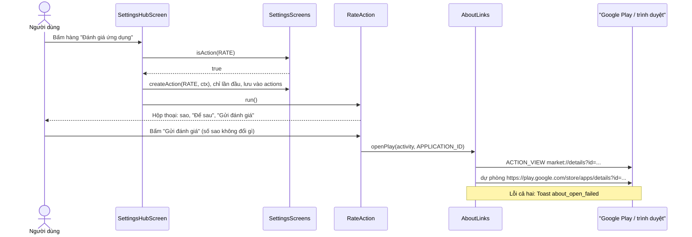
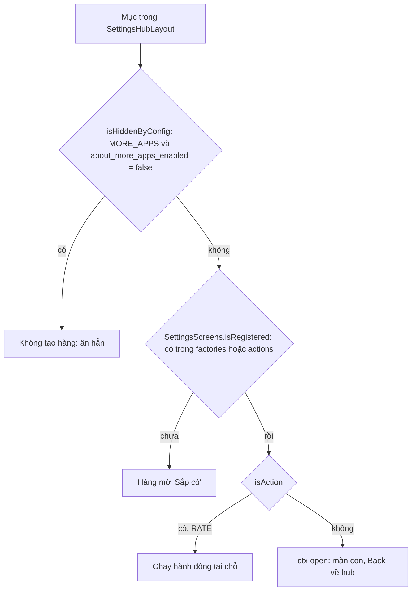
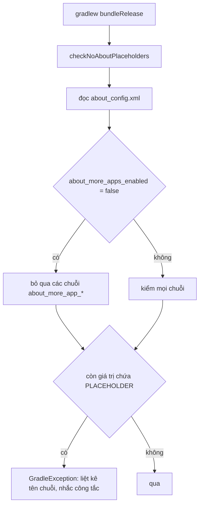

# AB — Nhóm "Liên hệ với chúng tôi" (Đánh giá, Ứng dụng khác, Chính sách bảo mật): đọc trước khi review

**Plan:** [plans/AB-about-section.md](../plans/AB-about-section.md) · **PR:** #49 · **Nhánh:** `feature/ab-about-section`

## 1. Tóm tắt

Ba mục cuối của trang chủ Cài đặt (G2d) giờ có nội dung:
- **Đánh giá ứng dụng** mở một hộp thoại có hàng sao; "Gửi đánh giá" luôn mở trang Google Play của app, bất kể số sao (sao chỉ để minh họa).
- **Tải ứng dụng khác** là danh sách một app nổi bật và năm app khác, mỗi hàng "Tải" mở trang Play của app đó. Toàn bộ là chỗ giữ chỗ; khi phát hành mà chưa có app nào thì mục này **ẩn hẳn** khỏi trang chủ.
- **Chính sách bảo mật** là màn có một hàng "Mở trong trình duyệt" mở URL chính sách.

Mọi nội dung chưa có (URL chính sách, tên nhà phát triển, danh sách app) là chỗ giữ chỗ trong một file. Một task Gradle làm `bundleRelease` thất bại chừng nào còn chỗ giữ chỗ. Chưa chạy thử trên máy (xem mục 6).

## 2. Kiến thức nền

- **Intent `ACTION_VIEW`.** Cách nhờ hệ thống mở một địa chỉ bằng app phù hợp: `market://details?id=<gói>` mở app Google Play, `https://...` mở trình duyệt. Nếu máy không có app nào nhận, `startActivity` ném `ActivityNotFoundException`; một số ROM còn ném `SecurityException`. Vì vậy mọi lần mở đều bọc `try/catch`. (đọc tài liệu: [Intents and intent filters](https://developer.android.com/guide/components/intents-filters))
- **Lọc package (Android 11+).** Ảnh hưởng tới việc app *tra cứu* app khác (`resolveActivity`), không ảnh hưởng việc gọi `startActivity` cho một intent đã dựng, nên không cần thêm `<queries>` cho các link này. (đọc tài liệu: [Package visibility](https://developer.android.com/training/package-visibility); suy luận chưa kiểm chứng trên Live 4 rằng không cần khai gì)
- **Play In-App Review.** API cho phép đánh giá ngay trong app, nhưng tài liệu nói không nên gắn nó vào một nút (có hạn mức, lần bấm sau có thể không hiện gì) và app không được hỏi gì trước thẻ đánh giá. Vì vậy dự án không dùng. (đọc tài liệu: [In-app reviews](https://developer.android.com/guide/playcore/in-app-review), đọc 2026-11-12)
- **Gói app của Play.** Link Play ghép từ `BuildConfig.APPLICATION_ID` (`gambi.global.os26launcher`); bản debug dùng cùng gói nên trước khi lên Play, Play báo không tìm thấy app. (đọc code `app/build.gradle.kts`)
- **Hộp thoại gắn với Activity.** Hộp thoại phải được đóng khi Activity bị hủy, nếu không sinh lỗi `WindowLeaked`; vì vậy hành động giữ hộp thoại và hub gọi `onDestroy()` của nó (cùng lối làm như `GeneralSettingsScreen`).

## 3. Luồng hoạt động

**Bấm "Đánh giá ứng dụng".** Đánh giá không phải màn, nên không mở Activity mới: hub chạy hành động tại chỗ.



Điểm dễ sai: `run()` được gọi mỗi lần chạm; việc bỏ qua chạm thứ hai khi hộp thoại còn mở nằm trong `RateAction.run()` (`dialog != null`). Lỗi đã gặp ở review Task 2: lúc đầu hub tự chặn bằng một biến không bao giờ được đặt lại nên lần chạm sau khi "Để sau" không làm gì.

**Vì sao mục hiện, mờ hay biến mất.** Hub vẫn quyết theo công thức G2d, thêm hai điểm của AB.



**Cổng phát hành.**



`assembleDebug` và `assembleRelease` không bị cổng này chặn (đo được, mục 7).

## 4. Thay đổi theo file

Đường dẫn dưới `app/src/main/` trừ khi ghi khác.

| File | Vai trò | Vì sao thêm/sửa | Đọc trước? |
|---|---|---|---|
| `java/gambi/global/os26launcher/ui/settings/SettingsScreen.kt` | Thêm `SettingsAction`, bảng `actions`, `isAction`, `createAction`; `isRegistered` tính cả `actions`; đăng ký `MORE_APPS` và `PRIVACY` | Hành động không màn cho 6.1; hai dòng giữ chỗ được thay | **Có (1)** |
| `.../ui/settings/SettingsHubScreen.kt` | Chạy hành động tại chỗ, `isHiddenByConfig`, `onDestroy` | Hub phải biết hành động và mục ẩn; bảng `SettingsHubLayout` không đổi | **Có (2)** |
| `.../ui/settings/RateAction.kt` | Hộp thoại đánh giá | 6.1 | **Có (3)** |
| `.../ui/settings/AboutLinks.kt` | `openPlay`, `openUrl` (chỉ https), bắt lỗi, Toast | Một chỗ mở link ngoài | Không |
| `.../ui/settings/MoreAppsSettingsScreen.kt` | 6.2: 1 hàng nổi bật + 5 hàng, chân trang tên nhà phát triển | Danh sách tĩnh theo `about_config.xml` | Không |
| `.../ui/settings/PrivacySettingsScreen.kt` | 6.3: một hàng "Mở trong trình duyệt" và chú thích | Không WebView | Không |
| `res/values/about_config.xml` | Chỗ giữ chỗ (URL, tên nhà phát triển, 6 app) và `about_more_apps_enabled` | Một file để cổng kiểm | Không |
| `res/layout/dialog_rate.xml` | Hàng sao của hộp thoại | Minh họa | Không |
| `res/values/strings.xml` | Khối `about_` ở cuối | Chữ giao diện | Không |
| `app/build.gradle.kts` (gốc repo) | Task `checkNoAboutPlaceholders` nối vào `bundleRelease` | Cổng phát hành, mô phỏng `checkNoStoreTestWallpaper` | Không |

Không đổi: `HomeActivity` và các file độc quyền khác, `AndroidManifest.xml`, `libs.versions.toml`, Room, `SettingsViewModel`, `SettingsUiState`, `SettingsKeys`. Không thêm dependency hay quyền (đối chiếu `git diff main` cho manifest và `gradle/`).

## 5. Quyết định và đánh đổi

- **Hành động không màn (A1) thay vì kiểu đích mới hoặc màn trong suốt.** Không sửa bảng hub; không mở Activity trống; nhánh sau cần hành động khác chỉ thêm một dòng vào `actions`. Đánh đổi: có hai bảng đăng ký.
- **Hộp thoại tự làm + intent Play thay vì In-App Review.** Tài liệu cấm gắn API vào nút và cấm hỏi trước thẻ; bản nháp có bước chọn sao. Đánh đổi: người dùng rời app để đánh giá.
- **Sao chỉ để minh họa, mọi sao đều tới Play (AB3, chủ dự án 2026-11-13).** Bỏ nhánh 1–3 sao đi email, nên cũng bỏ chỗ giữ chỗ email.
- **Chính sách mở trình duyệt, không WebView (AB5).** Không cần Activity riêng, xử lý offline, SSL; chính sách đổi không phải build lại. Đánh đổi: nội dung không nằm trong màn. Custom Tab (`androidx.browser`, bản 1.10.0 có trên Google Maven theo đọc `group-index.xml` 2026-11-12, chưa kiểm tương thích AGP 9.3.3 và compileSdk 37) là lựa chọn sau.
- **Mục "Tải ứng dụng khác" ẩn khi `about_more_apps_enabled` = false (AB4).** Điều kiện nằm ở `SettingsHubScreen.rows()` (một hàm `isHiddenByConfig`), không sửa `SettingsHubLayout`. Đánh đổi: hub biết riêng một mục (MORE_APPS); nếu sau này nhiều mục cần ẩn theo cấu hình thì đưa điều kiện vào `HubEntry`.
- **Chỗ giữ chỗ ở file riêng `about_config.xml`** thay vì khối cuối `strings.xml` hay `buildConfigField`: cổng chỉ quét một file; không xung đột `strings.xml`; `buildConfigField` đọc `local.properties` sẽ ra chuỗi rỗng im lặng khi quên đặt.
- **6.2 giữ kiểu hàng hiện tại (FD2, AB6):** không biểu tượng, mô tả, điểm sao, thẻ "Nổi bật".

## 6. Chỗ cần soi khi review

- **Đã kiểm một phần trên Live 4 (điều phối, 2026-11-13, bản debug 0124a70, md5 11ef5f0f).** Đạt: ba mục bật; hộp thoại đánh giá mở trên hub (task stack một `SettingsActivity`), "Để sau" rồi mở lại được, 2 sao + "Gửi đánh giá" mở `com.android.vending`; Chính sách mở Chrome trên URL giữ chỗ; Ứng dụng khác đủ 1 + 5 hàng và hàng 2 mở Play; không crash, không `WindowLeaked`. **Chưa kiểm:** tắt mạng, đổi tối/sáng khi hộp thoại mở, 0/5 sao, `about_more_apps_enabled` = false, hồi quy các màn cũ, máy không có Play/trình duyệt, `bundleRelease` thật.
- **Bản debug chưa lên Play:** "Gửi đánh giá" và các hàng "Tải" sẽ mở Play ở trang "không tìm thấy". Đó là hành vi đúng của link, không phải lỗi; trang thật chỉ có khi app lên Play. Cũng chưa biết máy kiểm có app Play hay chỉ có trình duyệt (khi đó dùng đường dự phòng web).
- **Dựng lại Activity khi hộp thoại đánh giá đang mở** (đổi giao diện tối/sáng, kill tiến trình): hộp thoại bị đóng bởi `onDestroy`, không dựng lại. Chấp nhận như hộp thoại của các màn G2d (suy luận chưa kiểm chứng về `WindowLeaked`; có trong bài kiểm).
- **Cổng phát hành chỉ kiểm bằng chuỗi `PLACEHOLDER`.** Giá trị thật nhưng sai (URL gõ nhầm, gói app không tồn tại) cổng không bắt được. Chỉ chạy `bundleRelease --dry-run` (có `checkNoAboutPlaceholders` trong đồ thị task); chưa chạy `bundleRelease` thật.
- **`about_more_apps_enabled`: ẩn mục nhưng màn `MoreAppsSettingsScreen` vẫn đăng ký.** Không có đường vào khi tắt (hàng không tồn tại). Nhưng `SettingsActivity` mở với extra `MORE_APPS` vẫn dựng màn; chỉ nội bộ, `exported=false`.
- **Quyền riêng tư:** không gửi dữ liệu nào đi; chỉ mở link. Tên nhà phát triển và URL là cấu hình công khai.
- **Ảnh hưởng tới tính năng cũ:** thay đổi duy nhất trong mã có sẵn là `isRegistered` (thêm `|| id in actions`) và hub (nhánh hành động, ẩn mục). Cần xem các mục khác của hub vẫn mở đúng màn và mục chưa có màn vẫn mờ.

## 7. Cách kiểm lại

Máy Vsmart Live 4, bản debug. Bài kiểm đầy đủ ở mục "Bài kiểm cả tính năng" của plan; tóm tắt: mở Cài đặt từ chế độ sửa Home → nhóm "Liên hệ với chúng tôi" → Đánh giá (hộp thoại, mọi số sao tới Play, "Để sau" rồi mở lại), Tải ứng dụng khác (bật rồi tắt `about_more_apps_enabled`), Chính sách bảo mật (có lượt tắt mạng). Kiểm cổng phát hành ở máy dev:

```
gradlew.bat checkNoAboutPlaceholders        (phải thất bại, liệt kê 14 chuỗi)
gradlew.bat assembleDebug assembleRelease   (phải xanh)
gradlew.bat bundleRelease --dry-run         (đồ thị có checkNoAboutPlaceholders và checkNoStoreTestWallpaper)
```

Đã chạy ở máy dev (đo được, 2026-11-13, Windows): task thất bại với đúng 14 chuỗi; lần chạy thứ hai "Reusing configuration cache"; bỏ hết `PLACEHOLDER` trên bản sao tạm thì qua; đặt `about_more_apps_enabled` = false trên bản sao tạm thì chỉ còn báo `about_privacy_url` và `about_developer_name`; `assembleDebug` và `assembleRelease` xanh.

## 8. Bài học cho AGENTS.md

Chủ đề đề xuất: `settings-and-data` (`lessons/settings-and-data.md`); dòng cuối có thể đưa vào `AGENTS.md` mục "Trước khi phát hành".

- **(2026-11-13, đọc code, AB)** Mục của hub không phải màn (hộp thoại, hành động một lần) thì đăng ký ở bảng `actions` riêng, không đăng ký như màn và không mở Activity trống. Hub dựng hành động một lần, giữ theo id, gọi `run()` mỗi lần chạm, `onDestroy` dismiss tất cả; việc bỏ qua chạm khi hộp thoại còn mở thuộc về hành động.
- **(2026-11-13, quy trình review, AB)** Biến "đã có thể đang mở" ở lớp gọi (hub) không tự đặt lại khi hộp thoại đóng thì chặn các lần mở sau: để lớp sở hữu hộp thoại tự bảo vệ, lớp gọi không giữ cờ.
- **(2026-11-13, đọc tài liệu, AB)** Không nối Play In-App Review vào nút "Đánh giá": hạn mức làm lần bấm có thể không hiện gì và app không được hỏi gì trước thẻ; dùng intent `market://` có dự phòng `https://play.google.com/store/apps/details?id=`.
- **(2026-11-13, đo được, AB)** Cổng Gradle quét một file cấu hình bằng `@InputFile` + regex chạy được với configuration cache (lần hai "Reusing configuration cache"); mẫu: `checkNoAboutPlaceholders`.
- **(2026-11-13, quy trình, AB)** Giá trị cấu hình cần thay trước khi phát hành thì đặt trong **một file riêng** với từ khóa dễ quét (`PLACEHOLDER`) và nối task kiểm vào `bundleRelease`; không dùng `buildConfigField` đọc `local.properties` vì thiếu giá trị thì ra chuỗi rỗng, không báo lỗi.
- **(2026-11-13, môi trường, AB)** Trên máy dev Windows, `/tmp` của Git Bash trỏ tới `%TEMP%` dùng chung với các phiên khác: file script có sẵn ở đó (vd `ed.py`) có thể của phiên khác. Đặt script tạm ở scratchpad của phiên, hoặc đặt tên có tiền tố nhánh.
- **(2026-11-13, môi trường, AB)** Build sạch lần đầu trong worktree mới mất khoảng 5 đến 6 phút (`assembleDebug` 5m44s, `assembleRelease` 6m15s, đo được); các lần sau 12 đến 40 giây.
- **Việc trước khi phát hành (đề xuất cho `AGENTS.md`):** thay mọi giá trị `PLACEHOLDER` trong `app/src/main/res/values/about_config.xml`, hoặc đặt `about_more_apps_enabled` = false nếu chưa có ứng dụng khác; `checkNoAboutPlaceholders` làm `bundleRelease` thất bại chừng nào còn.
