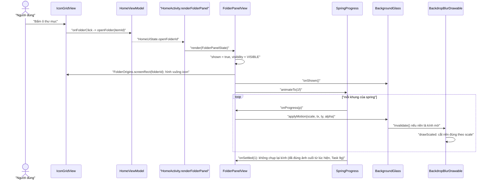
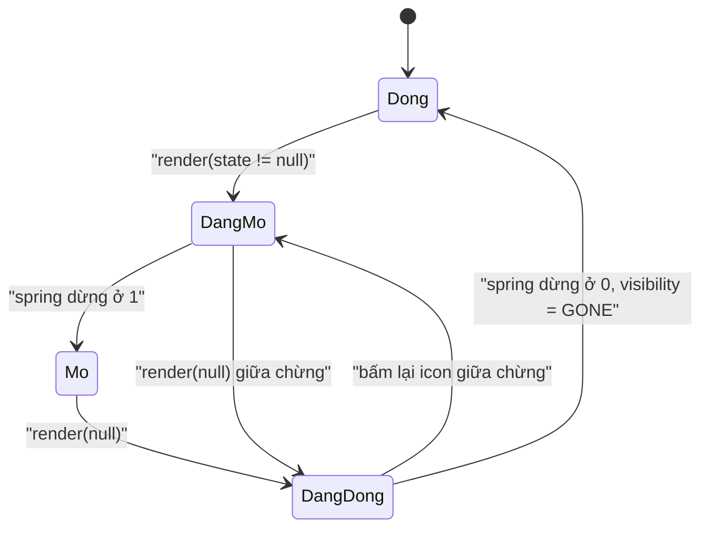
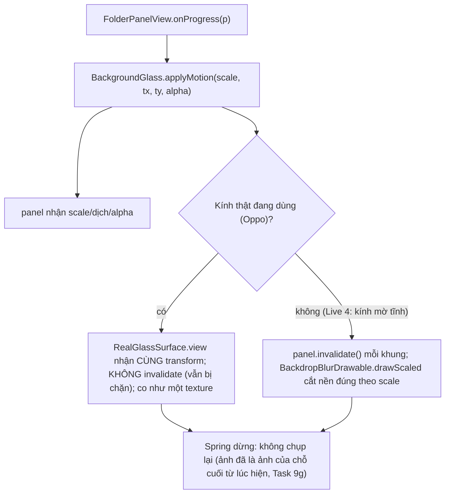
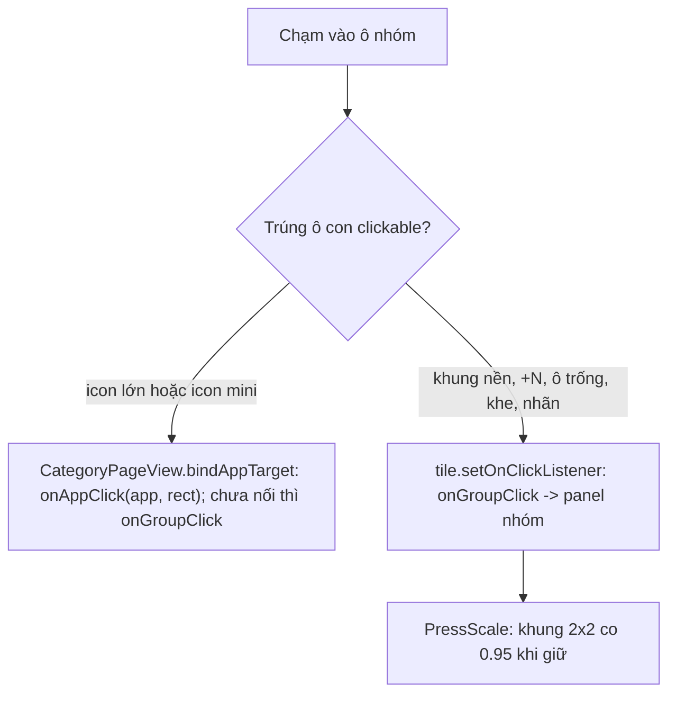
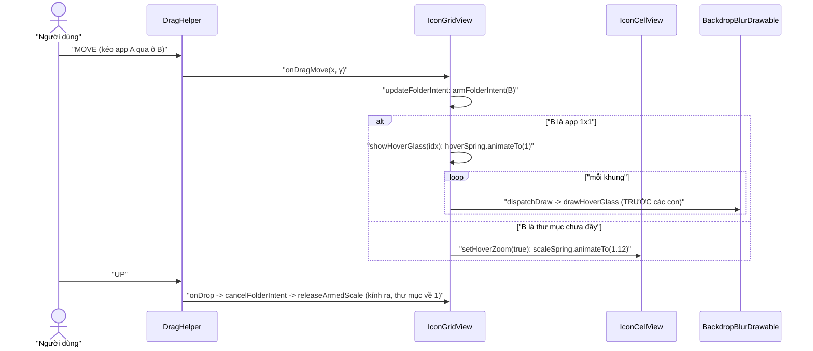
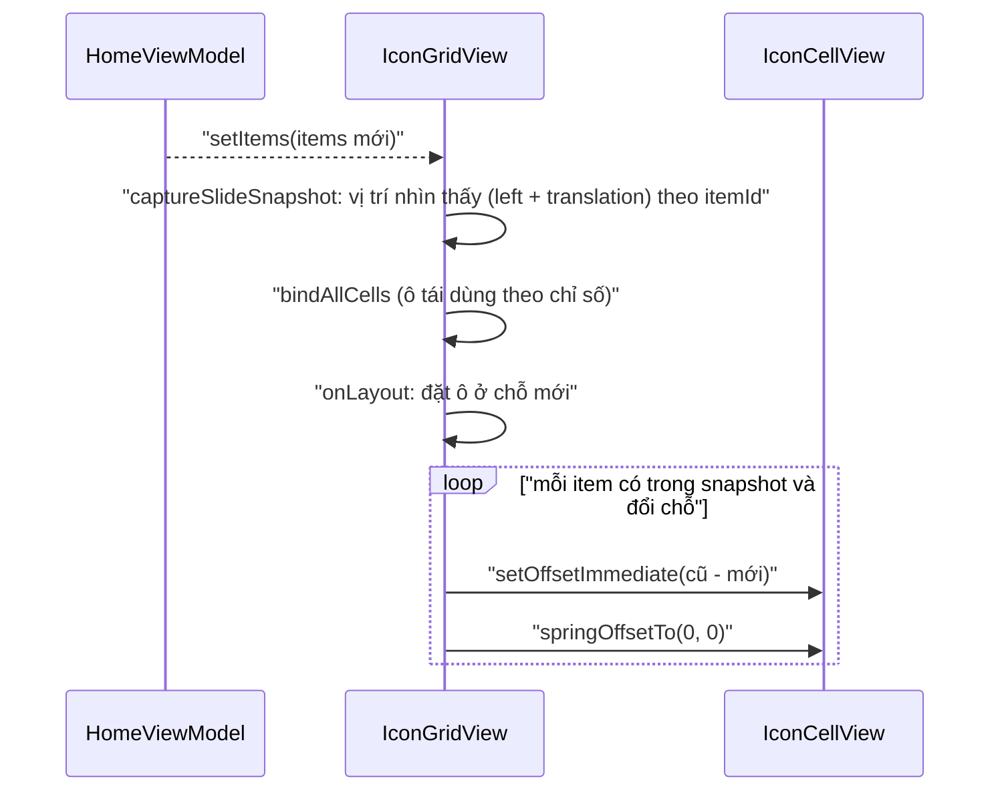
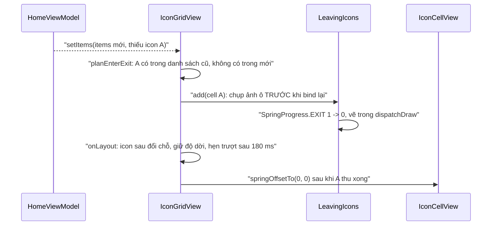

# AN — Hoạt ảnh kiểu iOS: đọc trước khi review

**Plan:** [plans/AN-polish-animation.md](../plans/AN-polish-animation.md) · **PR:** #6 · **Nhánh:** `feature/an-polish-animation`

> Bản viết dần: đã có Task 1–9h (nền tảng spring, kính khi co, thư mục và panel nhóm mở/đóng từ icon/ô, vùng chạm ô nhóm, nhấn co). Các mục còn lại được thêm khi từng Task qua review.

## 1. Tóm tắt

Thư mục mở ra từ chính icon của nó (lớn dần, nền tối dần) và đóng thu về icon, bằng spring vật lý. Bấm lại hoặc đóng giữa chừng thì đảo chiều từ chỗ đang đứng. Các Task sau thêm: panel nhóm Library mở từ ô, icon trượt vào chỗ, nhấn co, kính hover khi tạo thư mục, sửa kính không vẽ lại khi đổi ảnh nền.

## 2. Kiến thức nền

- **Spring (DynamicAnimation 1.1.0).** `SpringAnimation` chạy một số thực theo vật lý lò xo (độ cứng, tỉ lệ giảm chấn) thay cho đường cong theo thời gian. Điểm quan trọng với dự án: đổi đích khi đang chạy (`animateToFinalPosition`) giữ nguyên vị trí và vận tốc, nên "đảo chiều giữa chừng" không cần mã đặc biệt. Chỉ chạy trên main thread. Nguồn: tài liệu Android (đọc tài liệu); version `1.1.0` đọc thật từ Google Maven ngày 2026-11-04.
- **Đổi thuộc tính transform không ghi lại display list.** `scaleX`, `translationX`, `alpha` của một View chỉ cập nhật thuộc tính của `RenderNode`; nội dung đã ghi giữ nguyên. Hệ quả: một `BackdropBlurDrawable` (cắt nền theo vị trí lúc ghi) trên view đang co/dịch sẽ mang lát cắt cũ nếu không `invalidate()` (suy luận từ cách RenderNode hoạt động, chưa đo).
- **`getLocationOnScreen` của view đã co** trả góc trên-trái của hình đã co, không phải của hình gốc; vì vậy `BackdropBlurDrawable` phải bù scale (Task 2).

## 3. Luồng hoạt động

### 3.1 Mở thư mục từ icon (Task 1, 2, 3)

Điểm dễ sai: panel KHÔNG đổi layout, chỉ co/dịch từ hình vuông icon về chỗ cuối. Đích của spring là `shown` (dữ liệu), nên `visibility` chỉ về `GONE` khi spring đã dừng ở 0 và đích vẫn 0. `FolderOrigins` là sổ các `IconGridView` đang gắn (như `DragHelper.registerTarget`) nên panel tìm icon gốc mà không cần `HomeActivity`.

### 3.2 Trạng thái mở/đóng và ngắt giữa chừng

Lúc `DangDong`, `FolderPanelView.dispatchTouchEvent` trả `false` để chạm đi xuống lưới: bấm lại icon gọi `openFolder` và spring đổi đích về 1 từ vị trí hiện tại.

### 3.3 Kính của panel trong lúc co (rủi ro chính, đã đo ở Task 3)

**Vì sao ảnh kính không được đổi khi dừng (Task 9g).** `LiquidGlassView` (đường Lens, v2.0.11) lấy cửa sổ ảnh nền theo `getLocationOnScreen()` của chính view kính, hàm này tính cả scale/dịch. Kính panel đang co về icon thì lần chụp lấy nhầm vùng ảnh nền quanh icon, rồi lúc dừng chụp lại đúng vùng nên mắt thấy ảnh đổi từ cũ sang mới. Cách sửa: `SuppressibleGlassView.getLocationOnScreen` báo vị trí đã layout (cờ `setCaptureAtLayoutPosition`), nên mọi lần chụp đều là ảnh của chỗ cuối và kính chỉ co như một texture; không còn chụp lại lúc dừng. Đánh đổi: lúc co, hình trong panel là ảnh khung cuối thu nhỏ chứ không phải ảnh nền thật dưới vị trí hiện tại. Kính mờ tĩnh (`BackdropBlurDrawable.drawScaled`) đúng ở mọi scale nên không cần sửa.

**Panel nhóm Library trên Live 4 nặng hơn panel thư mục (Task 9h, đóng không sửa).** Đo Live 4 (`FORCE_HIGH`, panel kính mờ tĩnh): panel nhóm gfx p95 23–27 ms và 32–66 khung > 33 ms mỗi lượt 15 lần mở, panel thư mục 5/8 ms và 0 khung > 33 ms. Thời gian ghi lệnh chỉ khoảng 0.4 ms nên chi phí ở phía vẽ. Đã thử lớp phần cứng cho danh sách app và cho `library_view` trong lúc spring: không giúp, nên phát lại hai phần đó không phải chi phí chính. Nguyên nhân chưa tìm ra; chủ dự án chấp nhận và mã không đổi. Giả thuyết chưa kiểm chứng: diện tích khung lớn hơn, và `BackdropBlurDrawable.drawScaled` đổi hình học mỗi khung (đổ shader và viền) nên Skia không dùng lại kết quả theo hình (Oppo dùng kính thật, không có phần này, và mượt). Chi tiết ở Task 9h của plan.
Phép đo Oppo (2026-11-04, build `cacf95d`, ghép cặp với `main`, 20 lần mở/đóng): chọn **S1** (co kính thật cùng panel) vì số khung janky tuyệt đối bằng `main` (22.3 so với 22.3) và p95 tốt hơn 6 ms (17 so với 23.3). S2 (kính mờ trong lúc chuyển động, kính thật khi dừng) p95 13.7 nhưng nhiều khung > 33 ms hơn và có bước nhảy lúc dừng. Số khung janky tuyệt đối mới đúng khi số khung khác nhau 2 lần.

## 4. Thay đổi theo file

| File | Vai trò | Vì sao thêm/sửa | Đọc trước? |
|---|---|---|---|
| `core/ui/SpringProgress.kt` | Mới: spring trên một số thực, đổi đích giữ vận tốc, preset | Nền tảng cho mọi chuyển động của AN | Có |
| `core/glass/BackdropBlurDrawable.kt` | Nhánh `drawScaled` | Cắt nền đúng khi owner bị scale | Có |
| `ui/home/view/FolderPanelView.kt` | Mở/đóng bằng spring từ icon | Task 3 | Có |
| `ui/home/view/BackgroundGlass.kt` | `applyMotion`: cùng transform cho panel và kính thật | Task 3 | |
| `ui/home/view/IconGridView.kt` | `FolderOrigins`, `folderIconScreenRect` | Panel tìm icon gốc | |
| `ui/home/view/PanelMotion.kt` | Mới: spring + transform + nền tối + kính dùng chung hai panel | Task 3-4 | Có |
| `ui/home/view/CategoryGroupPanelView.kt`, `CategoryPageView.kt` | Panel nhóm mở từ ô (`tileScreenRect`); ô thứ tư là cụm mini 2×2 với `onAppClick` | Task 4-5 | |
| `ui/home/view/PressScale.kt`, `IconCellView.kt` | Nhấn co 0.95 cho ô thư mục, khung ô nhóm, pill, thanh Library; spring scale chung với hover; spring độ dời | Task 6-8 | |
| `ui/home/view/IconGridView.kt`, `DockView.kt` | Kính hover trong `dispatchDraw`; FLIP theo `itemId`; giữ độ dời xem trước sau thả | Task 7-8 | Có |

### 3.4 Ô nhóm Library: ai nhận chạm (Task 5, 6)

Quy tắc theo số app N: N tối đa 4 thì bốn ô lớn đều mở app; N từ 5 thì ba ô lớn đầu mở app, ô thứ tư là cụm 2×2 mini (R = N − 3; R tối đa 4 thì R icon mini, nhiều hơn thì 3 icon mini và +(R − 3)). Vùng chạm mini = nửa ô lớn (khoảng 26 dp ở scale 1).

### 3.5 Kéo app lên app/thư mục khác: kính hover và phóng thư mục (Task 7)

**Quy tắc "thấy gì thì được nấy" (Task 9b, chủ dự án đổi D4/D5):** kính / phóng thư mục chỉ hiện khi ngón tay ở vùng giữa icon đích (vào ở 0.9 cạnh icon, ra ở 1.1 cạnh icon để không nhấp nháy), sau 100 ms; ngoài vùng giữa không có kính, thả = chèn đẩy-dồn M7; xem trước đẩy-dồn chỉ chạy khi ngón tay đã dừng ở mép 500 ms (đếm lại nếu ngón tay dời quá 8 dp), để không có hoạt ảnh đẩy trên đường tới tâm icon (Task 9c). App vào thư mục để ô nguồn trống, không dồn trang (chủ dự án hoàn tác dồn trang ở Task 9c: chưa xác nhận iOS 26 làm vậy và mâu thuẫn với logic di chuyển thường). Không còn "thả nhanh ở mép vẫn gộp" và không còn giữ 500 ms ở mép. Trạng thái nằm trong `IconGridView` (`HoverState`, `shownHover` / `pendingHover`); độ trễ ngắn để kéo nhanh qua hàng icon không bật tắt một loạt kính và đẩy.

**Ô neo (Task 9e):** khi xem trước đẩy-dồn đã chạy, nó ở lại chừng nào ngón tay còn trong ô neo (kể cả ở giữa ô): không kính, hàng không về, thả = vào khe. Đích gộp được tìm theo vị trí NHÌN THẤY của icon (kể cả icon đang bị đẩy), không theo ô layout.

Kính hover do `IconGridView.dispatchDraw` vẽ TRƯỚC `super.dispatchDraw`, nên nằm sau icon đích, không là con của lưới (giữ "con i = ô i"), không lọt vào ảnh chụp ô và không đụng bộ đệm nội dung ô thư mục.

### 3.6 Icon trượt vào chỗ mới (Task 8, FLIP)

Điểm dễ sai: khoá theo `itemId`, không theo chỉ số con. Sau thả được nhận, độ dời xem trước KHÔNG bị reset (`clearPreview(keepOffsets = true)`) để FLIP xuất phát từ vị trí nhìn thấy; nếu `setItems` không tới trong 300 ms thì `staleOffsetCleanup` dọn. Item đang bị kéo bị loại khỏi FLIP (nó hạ cánh bằng hiệu ứng riêng, Task 9). Không trượt khi đổi trang, đổi `Cells` hoặc lần bind đầu.

### 3.7 Icon bị gỡ thu về 0, app mới phình (Task 9d)

Bỏ qua khi bind đầu, đổi trang, đổi cỡ lưới, item đang kéo / hạ cánh, và khi item bị gỡ và item mới chiếm CÙNG ô (thư mục giải tán, tạo thư mục) để không thu rồi phình. App mới (`growIds`) gọi `IconCellView.popIn()` sau layout. Panel thư mục dùng cùng `LeavingIcons`, và `Jiggler` để icon rung ở chế độ chỉnh sửa.

## 5. Quyết định và đánh đổi

Xem "Vì sao chọn thiết kế này" trong plan (mục 1: transform của panel đã layout; mục 2: spring đổi đích; mục 6: kính thật khi co). Đánh đổi: nội dung panel co theo (không có icon con bay ra kiểu iOS).

## 6. Chỗ cần soi khi review

- `FolderPanelView.render`: mở thư mục khác khi đang đóng thư mục cũ (snap về 0 rồi mở); lần `render` đầu sau recreate dựng thẳng ở trạng thái mở.
- Mọi `SpringProgress` được `cancel()` ở `onDetachedFromWindow`.
- Kính thật không bao giờ bị `invalidate()` mỗi khung.

## 7. Cách kiểm lại

Mở/đóng thư mục nhanh liên tiếp, đảo chiều giữa chừng, Back, xoay màn hình khi panel mở; Animator duration scale = off. Live 4 và Oppo.

## 8. Bài học cho AGENTS.md

(Điền khi đóng nhánh.)
