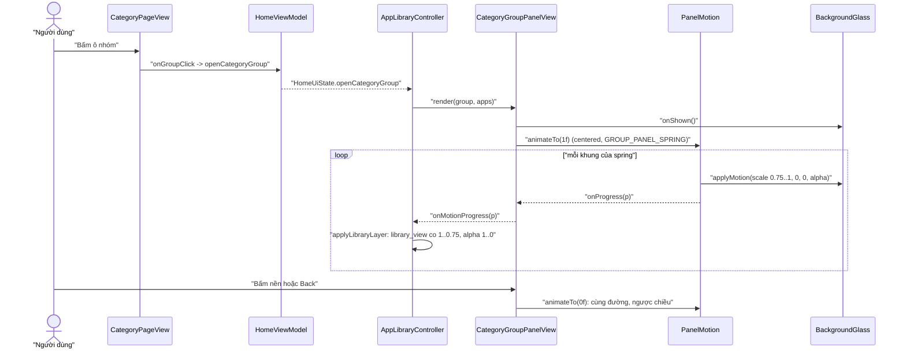
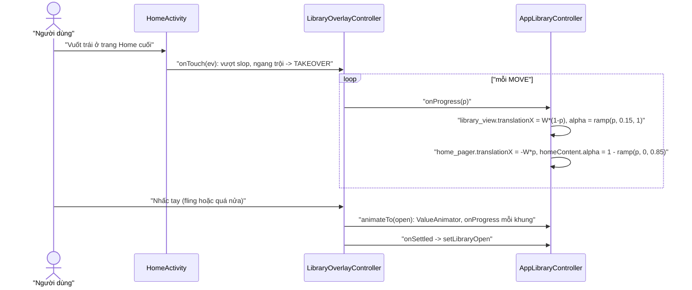
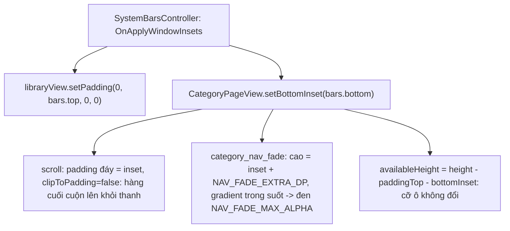
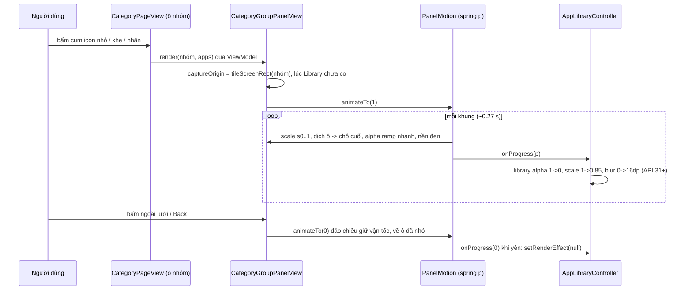

# AP — Hoạt ảnh App Library: đọc trước khi review

**Plan:** [plans/AP-applib-animations.md](../plans/AP-applib-animations.md) · **Nhánh:** `feature/ap-applib-animations` · **PR:** draft (xem PR của nhánh)

## 1. Tóm tắt

Hai thay đổi, cùng nằm ở lớp App Library:
1. **Panel nhóm** (bấm ô nhóm trong Library) không còn phình từ ô: nó co từ 75% lên 100% quanh tâm màn hình và hiện dần; đồng thời Library phía sau co từ 100% xuống 75% và mờ đi. Đóng là đảo ngược. Vẫn là spring, ngắt giữa chừng được.
2. **Vuốt từ trang Home cuối sang Library**: theo ngón tay, trang Home trượt sang trái và mờ dần, Library trượt vào và hiện dần; vuốt ngược thì đảo lại.

Mọi hằng (75%, các dải mờ, spring, tỉ lệ Home trượt) nằm ở `ui/home/view/AppLibraryMotion.kt` để chủ dự án chỉnh tay.

## 2. Kiến thức nền

- **App Library không phải trang của `ViewPager2`** (đọc code, G2a B2 D17). Nó là `library_view`, một lớp phủ ngoài pager. `LibraryOverlayController` bắt cử chỉ ở `dispatchTouchEvent`, tiếp quản chuỗi chạm khi vuốt ngang trái ở trang cuối, rồi giữ một số `progress` 0..1; `AppLibraryController.applyLibraryProgress` áp số này lên các view. Vì thế phần 2 không cần `PageTransformer`: vuốt đã "theo ngón tay" sẵn, chỉ thiếu trượt Home và mờ Library.
- **Spring giữ vận tốc khi đổi đích** (AN): mở rồi đóng giữa chừng không giật.
- **Kính** (AN Task 9): kính thật của panel co như một texture và không bị chụp lại mỗi khung; kính mờ tĩnh (`BackdropBlurDrawable`) vẽ lại mỗi khung và tự bù scale của chính owner. Nó KHÔNG bù scale của view cha (suy luận từ code, chưa đo): kính mờ trong ô nhóm/thanh tìm kiếm của Library hơi lệch so với nền khi cả Library co về 75%, nhưng Library đang mờ dần nên khó thấy.

## 3. Luồng hoạt động

### 3.1 Mở/đóng panel nhóm

Điểm dễ sai: `library_view` có hai nguồn ghi alpha (vuốt và panel), nên chỉ `applyLibraryLayer` được ghi. Đang đóng, panel trả `false` ở `dispatchTouchEvent` để bấm ô nhóm đảo chiều; đang mở/đã mở thì chặn mọi chạm.

### 3.2 Vuốt Home ↔ Library

Dock và chấm trang nằm trong `home_content` nên mờ cùng Home theo dải, nhưng không trượt (chỉ `home_pager` trượt): kính dock đứng yên, không cần invalidate; `SCROLL_STATE` của pager không đổi nên cờ chặn kính dock của TL1 không bị chạm.

### 3.3 Library chạy dưới thanh điều hướng (Task 4)

Nội dung chạy tới đáy vật lý (trước đây `library_view` có padding đáy bằng inset nên cụt trên thanh). "Dịu" bằng gradient alpha chứ không blur thật (rẻ nhất, mọi API; lý do ở plan Task 4); dải chỉ nằm trong `library_view` nên Library đóng là chi phí 0. Suy luận chưa đo: một `View` gradient không tác động đáng kể tới khung.

## 4. Thay đổi theo file

| File | Vai trò | Vì sao | Đọc trước? |
|---|---|---|---|
| `ui/home/view/AppLibraryMotion.kt` | Mới: mọi hằng chỉnh tay + `ramp` | Một chỗ để chỉnh | Có |
| `ui/home/view/PanelMotion.kt` | Thêm `centered`, `spec`, `onProgress` | Panel nhóm co quanh tâm, báo tiến độ cho Library | Có |
| `ui/home/view/CategoryGroupPanelView.kt` | Dùng chế độ tâm, bỏ tìm ô gốc | Yêu cầu 1 | |
| `ui/home/view/CategoryPageView.kt`, `res/layout/view_category_page.xml`, `ui/home/controller/SystemBarsController.kt` | Task 4: `setBottomInset`, dải `category_nav_fade`, padding đáy 0 | Library dưới thanh điều hướng | |
| `ui/home/controller/AppLibraryController.kt` | `applyLibraryProgress`, `applyLibraryLayer` | Yêu cầu 1 (Library co/mờ), 2 (vuốt) | Có |

`CategoryPageView.tileScreenRect` còn nguyên nhưng không còn nơi gọi (không xóa file/hàm theo luật dự án; báo điều phối nếu muốn dọn).

## 5. Quyết định và đánh đổi

Xem "Vì sao chọn thiết kế này" trong plan. Đánh đổi: (a) kính mờ trong Library lệch nhẹ khi Library co; (b) đóng panel vẫn cho chạm xuyên xuống Library (giữ đảo chiều bằng bấm ô), nên bấm vào Library đang co/mờ lúc đóng vẫn hoạt động; (c) Library mờ bằng `alpha` của view có nhiều con chồng nhau, hệ thống có thể dựng lớp offscreen trong lúc spring (chưa đo).

## 6. Chỗ cần soi khi review

- `PanelMotion.apply` nhánh `centered`: không có `invalidate()` cho kính thật.
- `AppLibraryController.applyLibraryLayer` là nơi duy nhất ghi alpha/scale của `library_view`.
- `home_pager.translationX` về 0 khi `p = 0`.
- Recreate khi panel mở: `render` đầu gọi `snapTo(1)`, `apply` báo `onMotionProgress`, Library co ngay.

## 7. Cách kiểm lại

Xem Task 1–3 của plan (bắt buộc kiểm tay): mở/đóng/đảo chiều/Back/xoay/tắt hoạt ảnh; vuốt chậm và fling cả hai chiều; Live 4 và Oppo.

## 8. Số đo (Oppo A3x đã đo; Live 4 chưa)

Agent không được động tới điện thoại. Điều phối đã đo trên Oppo A3x (Android 14, APK debug `a0d2ed9`, 2026-11-10); Live 4 chưa đo. Cách đo gồm `dumpsys gfxinfo gambi.global.os26launcher framestats` (lấy mẫu định kỳ, khử trùng theo `IntendedVsync`, `^\d+,`), ghi tổng khung, số khung > 33 ms, p50/p95, so với `main`, ghép cặp xen kẽ (bài học GL/AN), bản debug nói rõ là debug:
- Live 4: 15 lần mở + đóng panel nhóm; 15 lần vuốt Home→Library→Home bằng `input swipe`/FakeDrag.
- Oppo A3x: cùng kịch bản (kính thật; nghi ngờ lớn nhất là alpha trên `library_view` lúc co).
Mốc AN để so: Live 4 panel nhóm p95 23–27 ms (Task 9h); Oppo S1 p95 17 ms.

| Kịch bản | Máy | Tổng khung | Khung > 33 ms | p50 | p95 | Ghi chú |
|---|---|---|---|---|---|---|
| Mở/đóng panel nhóm | Live 4 | | | | | |
| Mở/đóng panel nhóm (nhóm "Giải trí", 5 lượt) | Oppo A3x | 260 | chưa tách | 14 ms | 57 ms (p90 23 ms) | Janky 7.31% (legacy 11.15%); bản debug |
| Vuốt Home↔Library | Live 4 | | | | | |
| Vuốt Home↔Library (3 vòng khứ hồi) | Oppo A3x | 269 | chưa tách | 13 ms | 19 ms (p90 15 ms) | Janky 2.23% (legacy 4.09%); bản debug |

Task 4 (Library dưới thanh điều hướng), điều phối đo/ngắm:

| Kịch bản | Máy | Tổng khung | Khung > 33 ms | p50 | p95 | Ghi chú |
|---|---|---|---|---|---|---|
| Cuộn Library (so với trước Task 4) | Live 4 | | | | | |
| Cuộn Library (so với trước Task 4) | Oppo A3x | | | | | |
| Nhìn: dải đáy, cử chỉ / 3 nút, ngang | cả hai | | | | | |

**Vsmart Live 4 (Android 11, kính FORCE_HIGH, `font_scale` 1,15, debug `b892042`, điều phối 2026-11-10):** vuốt Home ↔ Library 3 vòng: 200 khung, janky 21,0%, p50 7 ms, p90 19 ms, p95 20 ms. Mở/đóng panel "Năng suất" 5 lần: 186 khung, janky 36,0%, p50 12 ms, p90 26 ms, p95 57 ms (cùng cỡ số panel kính thật trên Live 4 trước đây, ~31% ở GS; chưa đo lại bản trước AP cùng phiên nên chưa tách phần do AP). Library chạy xuống dưới thanh điều hướng 3 nút: hàng cuối nằm trên thanh khi cuộn hết, nội dung hiện mờ tối dưới thanh. Oppo A3x (3 nút) cùng kết quả cho phần thanh điều hướng. Không crash.

## 9. Bài học cho AGENTS.md

- **Đề bài nói "trang của pager" thì kiểm tra trước xem nó có đúng là trang của pager không:** App Library là lớp phủ ngoài pager (G2a D17), nên "PageTransformer" không áp dụng; chuyển động vuốt chỉ cần sửa hàm áp `progress`. Đọc `activity_home.xml` và controller trước khi chọn cơ chế.
- **Một view có nhiều nguồn chuyển động (vuốt và panel) thì gộp ở MỘT hàm ghi thuộc tính** (`applyLibraryLayer`) và lưu từng tiến độ riêng; để mỗi nguồn ghi thẳng alpha/scale sẽ đè nhau.
- **Tràn dưới thanh điều hướng: đặt padding đáy của view cha về 0 và dời inset thành padding của vùng cuộn (`clipToPadding=false`), nhưng giữ công thức cỡ ô trên chiều cao đã trừ inset** (nếu không ô co/giãn). "Làm dịu" bằng gradient alpha là phương án rẻ nhất; blur thật cần API 31 hoặc kính chụp nền.
- **Hằng chỉnh tay đặt cùng một object, kèm dải (start, end) cho alpha** thay vì số rời rạc: chỉnh được "mờ sớm/muộn" mà không đụng logic.

## Cập nhật 2026-11-10 (sau video của tech lead)

- Vuốt trang Home cuối ↔ App Library giờ là **trượt cả hai, không mờ**: `AppLibraryController.applyLibraryProgress` dịch cả `home_content` (trang, pill, dock) theo `p`, alpha của Home và Library giữ 1. Chỉ nền tối `library_scrim` vẫn hiện dần. Bật lại mờ: `AppLibraryMotion.SWIPE_FADES = true`. Mục "dock và chấm trang không trượt" ở trên không còn đúng.
- Thanh tìm kiếm của Library: lề ngang = `hInset + gap`, bằng mép ngoài của ô cột trái và cột phải (chủ dự án yêu cầu).

## Cập nhật vòng 2 (2026-11-10, video iOS 27 của tech lead)

**Thay thế** phần "panel ở tâm, co 75%, Library co 75%" ở mục 1 và 3.1: không còn đúng. Hiện tại:
- Ô Library không có chữ "+N" (góc thứ tư là 2x2 tối đa 4 icon nhỏ).
- Màn nhóm **toàn màn hình, không khung kính**: tiêu đề lớn đậm góc trái, lưới 4 cột; mở/đóng **từ chính ô nhóm được bấm**.
- Library phía sau: mờ dần, thu nhẹ về 0.85 và nhoè (`RenderEffect`, API 31+); API < 31 chỉ mờ + nền đen đậm hơn.

### Luồng mở/đóng mới

### Khung video -> giá trị `p` của ta

| Khung (30 fps) | Trong video | `p` ước lượng | Ta làm |
|---|---|---|---|
| #41 | Library nghỉ, vừa chạm | 0 | Panel scale = cỡ ô, alpha 0, Library nét |
| #42–#43 | Icon nhóm hiện trên ô; Library thu ~0.93 rồi ~0.9, bắt đầu mờ | ~0.1–0.3 | Panel alpha lên 1 trong p ≤ 0.3 |
| #44 | Library ~0.81 và mờ nhiều | ~0.4–0.5 | Library scale ~0.93–0.9 ở p 0.45 (ta chậm hơn một chút) |
| #45 | Lưới ~65% cỡ cuối | ~0.65 | Scale = s0 + (1 − s0)·p |
| #47 | Lưới ~85%; Library tan hết | ~0.85 | Fade Library xong ở p = 0.7 |
| #49 | Yên, tiêu đề hiện đủ | 1 (lố ~1%) | Spring 450 / 0.82 |
| #69–#77 | Đảo ngược đúng | 1 → 0 | `animateTo(0)` về ô đã nhớ |

Ước lượng `p` là suy luận từ khung (không đo được spring của iOS). Đo bề rộng thanh tìm kiếm trong ảnh: 285 → 266 → 258 → 230 px (khung rộng 330), tức thu ~7%, ~10%, ~19%.

### Số đo (điều phối điền)

| Kịch bản | Máy | Bản | Tổng khung | Janky | p50 | p95 | Ghi chú |
|---|---|---|---|---|---|---|---|
| Mở/đóng nhóm 5 lượt (nhoè, toàn màn hình) | Oppo A3x (API 34) | | | | | | |
| Mở/đóng nhóm 5 lượt (chỉ mờ) | Live 4 (API 30) | | | | | | |
| Nhoè còn sót sau khi đóng? | cả hai | | | | | | |

### Bài học (đề xuất cho AGENTS.md)
- **Đo lại video bằng số trước khi tin bản đọc bằng mắt:** bản đọc đầu "Library không co" sai; đo bề rộng thanh tìm kiếm trên 3–4 khung cho ra co 7–19%.
- **Nhoè một lớp View động bằng `RenderEffect` (API 31+) phải gỡ bằng `setRenderEffect(null)` khi tiến độ về 0**, và bán kính cần lượng tử hoá (mỗi `createBlurEffect` là một đối tượng mới); có đường rơi về chỉ-mờ cho API < 31. Chưa đo chi phí trên máy.
- **Đích của chuyển động "mọc từ phần tử" phải nhớ toạ độ gốc lúc mở** (khi Library chưa co), vì lúc đóng lớp nền đã co và `getLocationOnScreen` trả toạ độ đã co.
- **Khối động không kính thì `PanelMotion` biến đổi thẳng `panel` (glass = null)**; khối có kính vẫn qua `glass.applyMotion` để kính thật và nội dung cùng một phép biến đổi (AN).
