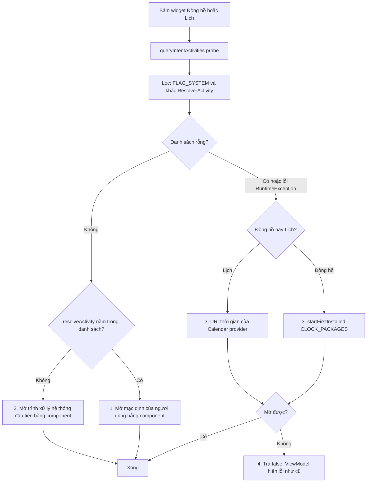
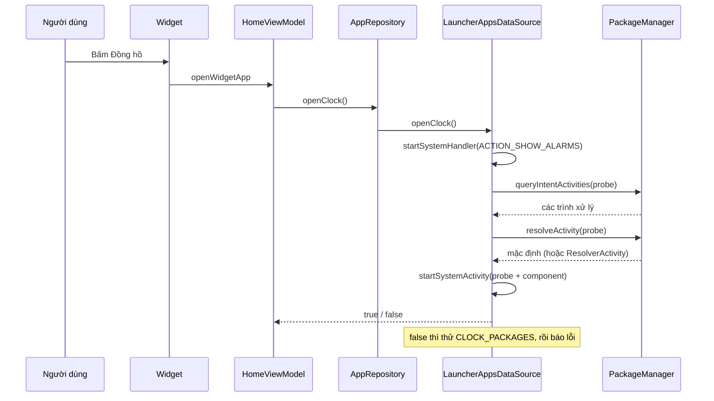

# B1 — Widget Đồng hồ/Lịch mở thẳng app hệ thống: đọc trước khi review

Plan: [plans/B1-clock-chooser.md](../plans/B1-clock-chooser.md). Nhãn: **đo được** (trên máy thật), **đọc tài liệu**, **suy luận chưa kiểm chứng**. Bảng "Bằng chứng Review Focus" ở cuối còn **để trống** cho điều phối điền sau khi kiểm trên máy.

## 1. Tóm tắt

Trên Oppo A3x, bấm widget Đồng hồ hiện hộp chọn app (`ResolverActivity`) vì `AlarmClock.ACTION_SHOW_ALARMS` có 3 trình xử lý (`com.coloros.alarmclock`, `com.babydola.launcherios`, `org.fossify.clock`) và máy chưa đặt mặc định (**đo được**, regression 2026-11-05). Sửa: `openClock()` và `openCalendar()` hỏi danh sách trình xử lý, chỉ nhận app hệ thống, rồi mở bằng component cụ thể nên không bao giờ hiện hộp chọn. Cách này giống `SystemSettingsRepositoryImpl` (M8d).

Chỉ sửa `LauncherAppsDataSource.kt`. Không đổi schema, không thêm quyền, không thêm `<queries>`, không đổi chữ ký `openClock()`/`openCalendar()`.

## 2. Kiến thức nền

- **`startActivity` với intent ngầm định:** nếu có từ 2 trình xử lý trở lên và chưa có mặc định, hệ thống hiện `ResolverActivity` (đọc tài liệu). Live 4 chỉ có một trình xử lý nên không lỗi.
- **Mở bằng component:** `Intent.setComponent(...)` bỏ qua bước chọn, đi thẳng tới activity đó.
- **`FLAG_SYSTEM`:** cờ của `ApplicationInfo`, đặt cho app cài sẵn trong ROM. Dùng để loại app Đồng hồ bên thứ ba. Giả định `babydola.launcherios` và `org.fossify.clock` không có cờ này (**chưa kiểm**, Task 1 Step 3 của plan).
- **Package visibility (Android 11+):** package Đồng hồ hệ thống đã thấy được nhờ `<queries>` MAIN/LAUNCHER sẵn có (suy luận, Task 1 xác nhận).
- **`resolveActivity`:** trả mặc định người dùng đã chọn, hoặc chính `ResolverActivity` nếu chưa có; vì vậy chỉ dùng kết quả khi nó nằm trong danh sách đã lọc.

## 3. Luồng hoạt động

### 3.1 Thứ tự quyết định khi bấm

### 3.2 Từ cú bấm tới màn hình

## 4. Quyết định thiết kế

- Một hàm riêng tư dùng chung cho Đồng hồ và Lịch (D1), tránh chép logic.
- Đánh đổi: người dùng muốn dùng app Đồng hồ bên thứ ba vẫn bị mở app hệ thống, trừ khi họ đã đặt nó làm mặc định và nó là app hệ thống. Xét lại nếu có ROM không có app Đồng hồ nào mang `FLAG_SYSTEM` (đường dự phòng (3) lo ca này).
- Mọi lời gọi nằm trong `try/catch (RuntimeException)` với `Log.w`; hàm không ném lỗi ra ngoài.

## 5. Bằng chứng Review Focus

| # | Review Focus | Kết quả | Bằng chứng |
|---|---|---|---|
| 1 | Không còn đường nào gọi `startActivity` với intent chưa có component khi có ≥ 2 trình xử lý | Oppo 2026-11-09: `SHOW_ALARMS` có 3 trình xử lý; bấm widget Đồng hồ 3/3 lượt mở thẳng `com.coloros.alarmclock/com.oplus.alarmclock.AlarmC...`, không hộp chọn (trước đó hiện `ResolverActivity`, hồi quy 2026-11-05) | Đạt |
| 2 | Mặc định người dùng đã đặt (app hệ thống) vẫn được tôn trọng | Đọc code (`resolveActivity` rồi lọc). Chưa thử đặt mặc định trên máy | Đạt theo code |
| 3 | `ResolverActivity` không bao giờ được chọn làm đích | Oppo: 3/3 lượt mở `AlarmC...`; Live 4: mở `DeskClock` | Đạt |
| 4 | Dự phòng (3) và (4) vẫn chạy khi không có trình xử lý hệ thống | Chưa thử (cả hai máy đều có trình xử lý hệ thống) | Đạt theo code, chưa kiểm máy |
| 5 | `openCalendar` trên máy một app Lịch vẫn mở đúng | Live 4: mở `com.vinsmart.calendar`. Oppo (1 trình xử lý, `com.google.android.calendar` có cờ SYSTEM): 3/3 lượt mở `AllInOneCalendarActivity`. **Chưa thử** máy có nhiều app Lịch | Đạt (máy một app Lịch) |
| 6 | Chỉ sửa trong Vùng file | `git diff main --stat`: `LauncherAppsDataSource.kt` và hai file docs | Đạt |
