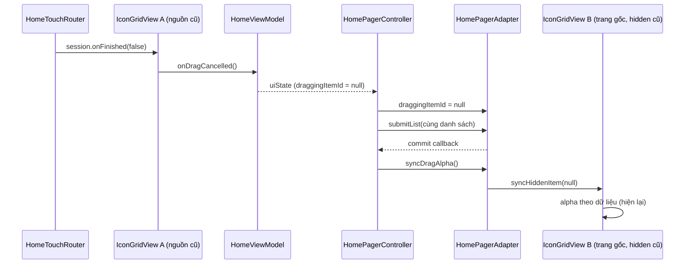
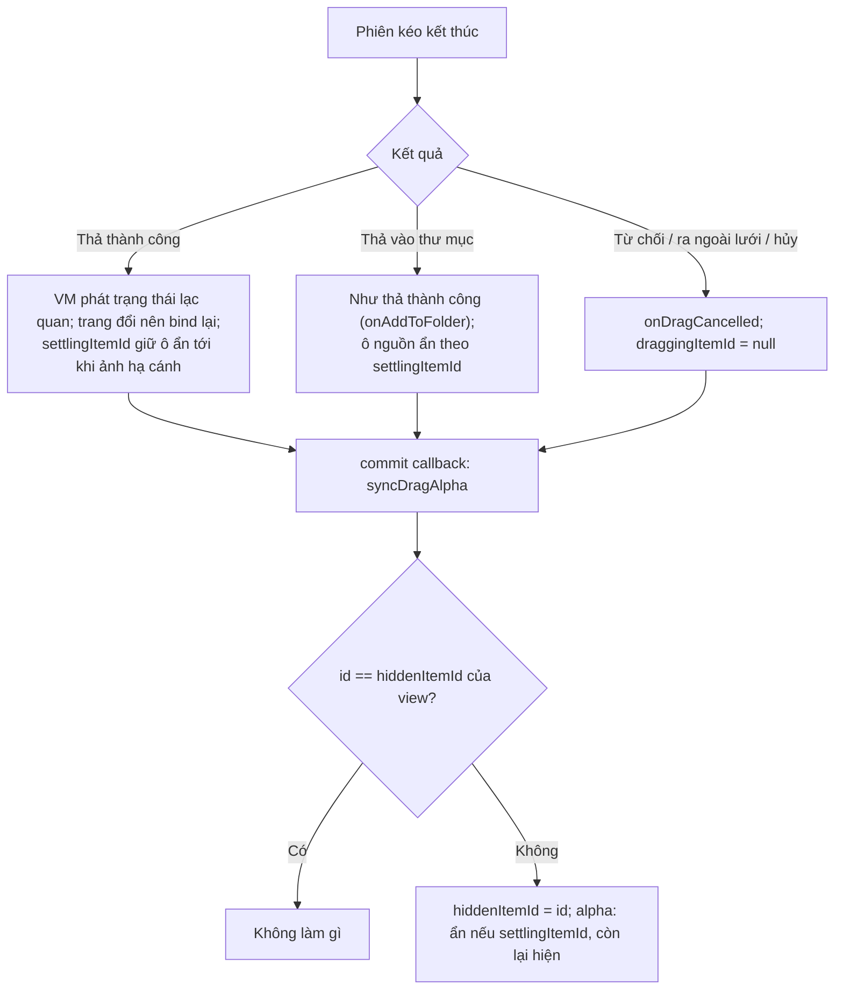

# CL — Ô kéo kẹt ẩn và dọn lint: đọc trước khi review

**Plan:** [plans/CL-small-fixes.md](../plans/CL-small-fixes.md) · **PR:** # (draft) · **Nhánh:** `fix/cl-small-fixes`

## 1. Tóm tắt
- Sửa lỗi đã biết của G2c (mục 11): kéo một item qua từ 5 trang rồi thả bị từ chối, ô gốc kẹt ẩn tới lần bind kế.
- Dọn hai cảnh báo lint an toàn: `CutPasteId` (`CategoryPageView`) và `MissingPermission` (`SystemWallpaperSource`). Không đổi hành vi.
- Không đổi luồng kéo-thả, `HomeUiState`, `DragHelper`, `HomeViewModel`, Room, Gradle.

## 2. Nguyên nhân (đọc code, chờ kiểm máy)
- `IconGridView.hiddenItemId` là bản sao của `HomeUiState.draggingItemId`, ghi đè ở mỗi `setItems`. Lúc bắt đầu kéo, view nguồn A (trang gốc) tự đặt `hiddenItemId` và `alpha = 0`.
- Kéo qua >= 5 trang: RecyclerView tái dùng A cho trang khác. Khi quay lại/được cấp view cho trang gốc, view B bind trang gốc với `draggingItemId` hiện tại nên ô gốc `alpha = 0`.
- Thả bị từ chối: `session.onFinished(false)` gọi vào `endDragVisualState` của **A** (nguồn lưu trong phiên). A đang hiển thị trang khác nên `restoreDraggedAlpha()` không tìm thấy item. `draggingItemId` về `null`, nhưng `HomePagerAdapter` chỉ `notifyItemRangeChanged` khi id liên quan thư mục con và `submitList` thấy danh sách y hệt nên không bind lại: B giữ `hiddenItemId` cũ. Ô kẹt ẩn tới lần bind kế.
- Dock không bị: `DockView` là một view duy nhất, không tái dùng; `DockController` truyền `draggingItemId` vào `setItems` ở mỗi render nên alpha luôn được áp lại theo dữ liệu.

## 3. Cách sửa
Chọn hướng (a) cải biên kết hợp (b) nhẹ, thay vì hướng (a) gốc "gọi khi chuyển sang null":
- `IconGridView.syncHiddenItem(id)`: nếu `id` khác `hiddenItemId` thì ghi lại và đặt `alpha` theo công thức cũ (ẩn nếu là `id` hoặc `DragHelper.settlingItemId`). Không bind lại.
- `HomePagerAdapter.syncDragAlpha()`: gọi `syncHiddenItem(draggingItemId)` cho mọi `IconGridView` đang gắn. `HomePagerController.renderPages` gọi nó trong **commit callback** của `submitList`, tức SAU khi danh sách trang áp xong, nên không làm ô hiện sớm trước khi bind lại ở thả thành công.
- `HomePagerAdapter.onViewAttachedToWindow`: view nằm trong cache được gắn lại không qua `onBindViewHolder`, nên cũng đọc lại `draggingItemId` (ca B đang ngoài màn hình lúc thả).

Các ca đã xét:
- **Hủy / thả từ chối:** bản sửa trả alpha cho view bind lại; nếu ảnh còn bay về (`settlingItemId` khác `null`) thì ô giữ ẩn, `onDragSettled` hiện lại như cũ.
- **Thả thành công / vào thư mục:** `settlingItemId` đã được `DragHelper.drop` đặt trước `onFinished`, và sync chạy sau khi danh sách áp xong, nên không hiện sớm.
- **Thả đúng ô cũ:** đi qua đường `onDragCancelled` như từ chối, `settlingItemId` giữ ẩn tới khi hạ cánh.
- **Ghost page:** chỉ là trang tạm trong `displayPages`; `ghostPage=false` đi cùng `draggingItemId=null`, không đổi cách sync.
- **Dock:** không đổi (xem mục 2). Nguồn ở dock hoặc đích ở dock vẫn qua `DockView.setItems`.
- **Đang kéo:** `draggingItemId` khác `null` khớp `hiddenItemId` của view nguồn nên `syncHiddenItem` không làm gì.
- Thư mục: `syncHiddenItem` chỉ chỉnh alpha cấp ô; việc bind lại ô thư mục khi kéo app con vẫn do `notifyItemRangeChanged` sẵn có.

## 4. Lint trước/sau

| Mục | Trước (hồi quy 2026-11-05) | Sau | Cách |
|---|---|---|---|
| `CutPasteId` `CategoryPageView.kt:234` | có | hết | dùng lại biến `frame` |
| `MissingPermission` `SystemWallpaperSource.kt:28` | có | hết | `@SuppressLint`, code đã bắt `SecurityException` |
| `ExifInterface`, `UseKtx`, `Overdraw`, `ClickableViewAccessibility`, `DrawAllocation` | có | giữ nguyên | ngoài phạm vi |

`lintDebug` sau sửa: 0 errors, 59 warnings.

## 5. Quyết định đã bỏ: tự dọn trang trống
Đề xuất ngày 2026-11-06 rồi hủy cùng ngày. Lý do: khảo sát iOS trước đó chạy trên iOS 18, chưa chắc iOS 26 giống; giữ luật M7 "trang trống KHÔNG tự xóa". Không sửa `exitEditMode`, `pruneEmptyPages`, `LayoutReconciler`.

## 6. Bằng chứng Review Focus
| # | Mục | Bằng chứng |
|---|---|---|
| 1 | Sau thả bị từ chối qua >= 5 trang không ô nào kẹt ẩn; kéo thường, thư mục, widget không đổi | **Một phần.** Hồi quy Live 4 2026-11-06 (bản CL): 34/36 đạt, 1 bỏ qua (E3, đã kiểm ở GP), 1 trượt (G2). G2 trượt **y hệt trên `main`** (2/2 lượt) và là hạn chế của script (ngón tay giả dừng lâu kích hoạt đẩy-dồn dính); script `g2.py` đi thẳng vào tâm icon tạo thư mục được cả trên `main` lẫn bản CL. Kéo thường, thả vào thư mục, widget từ sheet, thả lên dock đều đạt. **Chưa tái hiện lỗi kẹt ẩn thật** (cần kéo qua >= 5 trang, Live 4 có 4 trang, script chậm làm sai bài kiểm): cần chủ dự án thử tay |
| 2 | Áp lại alpha cho cả dock lẫn lưới, không đụng `settlingItemId` | Đọc code: lưới qua `syncHiddenItem` (dùng đúng luật `settlingItemId` cũ); dock không đổi vì `DockController` truyền `draggingItemId` vào `setItems` mỗi lần render. Thả thành công: hồi quy G1/G2 không có ô nào hiện sớm trong ảnh chụp dump |
| 3 | `lintDebug` hết `CutPasteId`, `MissingPermission` | Executor chạy `lintDebug`: 0 lỗi, 59 cảnh báo, hai mục trên không còn trong `lint-results-debug.txt` |
| 4 | Chỉ sửa trong Vùng file | `git diff main --stat`: `SystemWallpaperSource.kt`, `HomePagerAdapter.kt`, `HomePagerController.kt` (một dòng), `CategoryPageView.kt`, `IconGridView.kt`, hai file docs. Đạt |

## 7. Đề xuất cập nhật tài liệu chung
- G2c mục 11 và dòng "G2c" ở "Vấn đề đã biết" của báo cáo hồi quy: bỏ khi Live 4 xác nhận đã sửa.
- Bài học: trạng thái "ẩn do kéo" nằm ở view thì phải có đường áp lại khi phiên kéo kết thúc ở view khác; sync trong commit callback của `submitList`, không trước nó.
