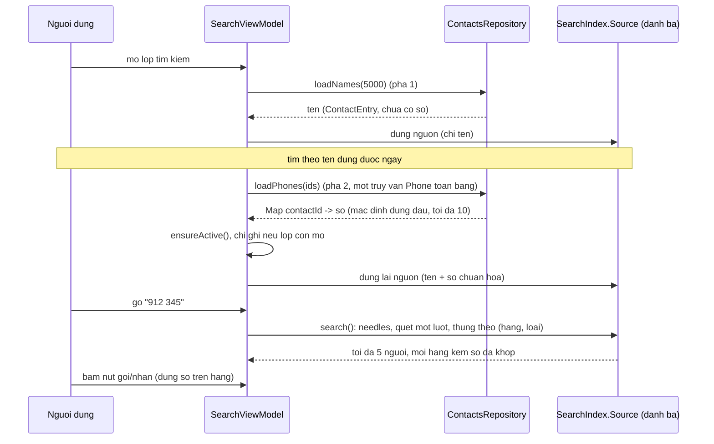
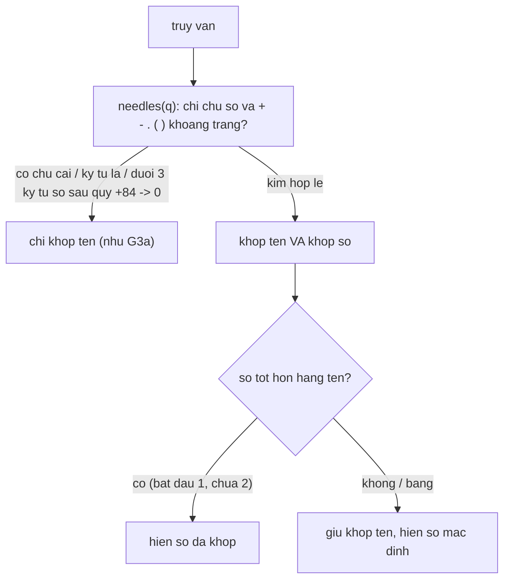

# CP — Tìm danh bạ theo số điện thoại: đọc trước khi review

Plan: [plans/CP-contacts-phone.md](../plans/CP-contacts-phone.md) (PR #54). Nối tiếp [G3a](G3a-contacts-search.md) (tìm theo tên) và [FX4](../report/FX4-search-library.md) (chỉ mục `SearchIndex.Source`). Nhãn: **đo được** (Live 4, bản debug), **đọc tài liệu**, **đọc code**, **suy luận chưa kiểm chứng**.

## 1. Tóm tắt

Trong ô tìm kiếm, gõ **từ 3 chữ số** thì hiện người trong danh bạ có số khớp:

- Khớp **ở bất kỳ đâu** trong số; bỏ khoảng trắng, `-`, `.`, ngoặc; `+84` (hoặc `0084`) đầu và `0` đầu coi là một. `0912`, `912`, `+84 912`, `(091) 2` cùng ra một người.
- Hàng kết quả hiện **số đã khớp** (đúng chữ như danh bạ lưu); nút gọi/nhắn dùng số đó. Khớp theo tên thì vẫn hiện số mặc định như G3a.
- Giữ giới hạn cũ: tối đa 5 người, sau app. Danh bạ chỉ ở RAM. Không đổi schema Room, không thêm khóa DataStore, không thêm chuỗi, không thêm quyền.
- **Nguồn danh bạ giả chỉ có trong bản debug** (`src/debug`), để thử mà không cấp `READ_CONTACTS` và không chèn gì vào danh bạ máy. Chủ dự án 2026-11-13: giữ sau khi merge, chỉ debug, mặc định tắt.

## 2. Kiến thức nền

- **Chỉ mục tìm kiếm (FX4).** Mỗi nguồn (app, Cài đặt, danh bạ, shortcut) là một `SearchIndex.Source` đã chuẩn hóa sẵn; gõ phím chỉ chuẩn hóa truy vấn rồi quét. CP thêm số điện thoại vào nguồn danh bạ theo cùng cách.
- **Dạng chuẩn của số** (`PhoneMatcher.canonical`): chỉ chữ số; `+84…`/`0084…` thành `0…`; số 0 trung gian sau mã nước (`+84 (0) 912`) bỏ một lần vì số quốc gia VN không bắt đầu bằng 0; số nước ngoài giữ nguyên chữ số, không thêm 0 (đọc code).
- **Kim tìm** (`PhoneMatcher.needles`): truy vấn chỉ gồm chữ số và `+ - . ( )` khoảng trắng; có chữ cái thì là truy vấn tên. Quy `+84` về `0` rồi mới đếm: kim phải **dài ≥ 3 ký tự** (nên `+84 9` chưa khớp, `+84 91` khớp; D7, điều phối duyệt). Truy vấn bắt đầu `84` không có `+` cho hai kim (`84…` và `0…`).
- **Hilt theo source set.** `ContactsModule` có hai bản cùng tên: `src/release` bind `ContactsRepositoryImpl`, `src/debug` bind `DebugContactsRepository` (bọc bản thật + nguồn giả). Mỗi build type chỉ biên dịch một bản; mã giả không tồn tại trong release.
- **`adb shell am broadcast` chạy dưới uid shell (2000).** Receiver debug khai `exported="true"` kèm `android:permission="android.permission.DUMP"` (shell có DUMP, app thường không). Đo được 2026-11-13 (Live 4): broadcast tới được, quyền danh bạ vẫn `granted=false`.

## 3. Luồng hoạt động

### 3.1 Nạp hai pha khi mở lớp

### 3.2 Chọn đường khớp cho một truy vấn

### 3.3 Dữ liệu trong RAM

`contactEntries` (tên + số) chỉ tồn tại khi lớp mở và đã cấp quyền: `close()`, `ON_STOP`, tắt công tắc, mất quyền, danh bạ đổi đều xóa hoặc nạp lại. Pha 2 chạy trong **cùng job** với pha 1, nên đóng lớp hủy cả hai (`loadPhones` ném `CancellationException`, `ensureActive()` trước khi ghi): số của phiên cũ không vào phiên mới.

## 4. Thay đổi theo file

| File | Việc |
|---|---|
| `domain/search/PhoneMatcher.kt` (mới) | `canonical`, `needles`, `rank`, `rankOrNone` (hàm thuần) |
| `domain/search/SearchIndex.kt` | Nguồn giữ số gốc + số chuẩn hóa; `search()` quét một lượt, thùng theo (hạng, loại) tối đa `maxResults`, bỏ sắp xếp toàn bộ; trả số đã khớp |
| `domain/model/ContactEntry.kt` | `phones` (số mặc định đứng đầu, ≤ 10); `toString` không in tên/số |
| `domain/repository/ContactsRepository.kt`, `data/search/ContactsRepositoryImpl.kt` | `loadPhones(ids)` thay `numbersFor` |
| `ui/search/SearchViewModel.kt` | Nạp hai pha; bỏ `withContactNumbers`, `numberCache`, mã phiên; log cảnh báo `G3A` khi pha 2 rỗng |
| `di/SearchModule.kt` | Gỡ một `@Binds` danh bạ (chuyển sang `ContactsModule` theo build type) |
| `src/release/.../di/ContactsModule.kt`, `src/debug/.../di/ContactsModule.kt` | Binding theo build type |
| `src/debug/.../debug/{DebugContactsRepository,FakeContactsSource,FakeContactsModeReceiver}.kt`, `src/debug/AndroidManifest.xml` | Nguồn giả + receiver, chỉ debug |

`SearchResultAdapter` và layout **không đổi**: hàng đã hiện `result.phone`, nút dùng `result.phone`, `areContentsTheSame = old == new` nên số đến muộn làm hàng bind lại (đọc code).

## 5. Quyết định và đánh đổi

- **Số vào chỉ mục RAM (A1)** thay vì hỏi provider mỗi phím (không đảm bảo "ở bất kỳ đâu", không thử được khi không có quyền) hoặc chỉ khớp số mặc định (mất ca số thứ hai). Chi tiết ở plan.
- **Hai pha:** tìm theo tên không chờ số, vì chi phí đọc provider thật chưa đo được.
- **Đánh đổi chấp nhận 1: đường đọc `ContactsContract` thật chỉ được đọc code.** Chủ dự án cấm cấp quyền và chèn danh bạ trên máy nên `loadPhones` thật chưa bao giờ chạy. Giảm rủi ro: dùng đúng cột và cách chọn số đã chạy ở G3a (Live 4 + Oppo), chỉ bỏ điều kiện `CONTACT_ID IN`. Thời gian đọc provider thật **chưa đo**; số ms ở mục 9 là trên nguồn giả.
- **Đánh đổi chấp nhận 2: không có dự phòng từng hàng.** Nếu `loadPhones` ném lỗi, chạm trần 50 000 hàng hoặc trả rỗng, hàng mất số và nút gọi/nhắn (G3a từng tra từng hàng). Không giữ dự phòng vì nó đưa lại đường provider mỗi phím mà FX4 (C7) đã gỡ. Lỗi ghi log chỉ số lượng/tên lớp (tag `G3A`: `loadPhones failed: …`, `hit the row cap`, `no numbers loaded for N contacts`).
- **Đánh đổi chấp nhận 3: số điện thoại của mọi người nằm trong RAM khi lớp mở** (G3a chỉ giữ tên, số hỏi theo hàng). Cơ chế xóa như mục 3.3; vẫn không ghi đĩa, không log.
- **Số dạng lạ** (mã vùng nước ngoài có số 0 đầu, số `84…` không `+` lưu trong danh bạ) không đảm bảo ghép đúng.
- **Không bỏ đường khớp tên khi truy vấn là số** (người tên "Cafe 24"): điều phối quyết giữ.

## 6. Chỗ cần soi khi review

1. `PhoneMatcher.canonical/needles`: `+84`↔`0`, ngưỡng 3 ký tự, hai kim khi bắt đầu `84`.
2. `SearchIndex.search`: thứ tự kết quả giống bản sắp xếp cũ (hạng, loại, thứ tự đầu vào); thùng bị chặn ở `maxResults` mà không làm mất kết quả của loại khác.
3. Pha 2 hủy được và không ghi sau khi đóng (`ensureActive()`; `isOpen` kiểm lại).
4. Không tên/số trong `Log`: log còn lại ở `data/search`, `ui/search` chỉ là số lượng/tên lớp; `ContactEntry.toString` không in số.
5. `loadPhones`: cùng cột/cách chọn số với G3a; ghép theo `contactId`; trần 50 000 hàng, 10 số/người.
6. Release không chứa mã giả (mục 7).
7. `di/SearchModule.kt` chỉ bị gỡ đúng một `@Binds`.

## 7. Cách kiểm lại

**Bản debug với nguồn giả (không cấp quyền):** `adb shell am broadcast -a gambi.global.os26launcher.CP_FAKE_MODE -p gambi.global.os26launcher --es mode off|small|load`. `small` = 16 người với các dạng số trong bảng ở plan; `load` = 2000 người, ~6000 số. `off` (mặc định) đọc danh bạ thật. Mở danh bạ/gọi/nhắn bị tắt trong chế độ giả (Toast lỗi, không mở Danh bạ/Quay số).

**Kiểm release không chứa mã giả:**
1. `gradlew.bat assembleRelease`.
2. Giải nén `classes*.dex` của APK release và tìm `FakeContactsSource`, `DebugContactsRepository`, `FakeContactsModeReceiver`, `CP_FAKE_MODE`: **không có**; APK debug **có** (đối chứng). Đã làm 2026-11-13: debug có trong classes3/4/17.dex, release không.
3. Manifest gộp của release (`build/intermediates/merged_manifests/release/…/AndroidManifest.xml`) không có `CP_FAKE_MODE` (debug có).
4. `git grep -n "os26launcher\.debug" -- app/src/main` rỗng.

Release dùng `-dontobfuscate` nên tên lớp không bị đổi; nhưng bằng chứng chính là lớp không được biên dịch vì nằm ở `src/debug`.

## 8. Bài học cho AGENTS.md

(Điều phối đưa vào `lessons/search.md` và `lessons/permissions-and-device-testing.md` sau merge.)

- **Dữ liệu thử cho tính năng cần quyền nhạy cảm: nguồn giả ở source set `debug` + Hilt `@Binds` theo build type** (`src/debug` và `src/release` mỗi nơi một `ContactsModule`, gỡ binding khỏi `main`). Mã giả không biên dịch vào release; kiểm bằng cách tìm tên lớp trong dex. Tốt hơn cờ `BuildConfig.DEBUG` (dựa vào R8 cắt) và commit tạm rồi revert (như FX4).
- **Receiver chỉ debug nhận `adb shell am broadcast`:** shell uid không phải uid app nên cần `exported="true"`; gắn `android:permission="android.permission.DUMP"` để app khác không bật được. Đo được trên Live 4.
- **`Phone.CONTENT_URI` không cần `IN`:** một truy vấn toàn bảng rồi ghép theo `contactId` trong RAM; đừng tin thứ tự provider (ColorOS bỏ ORDER BY).
- **Số điện thoại VN:** quy `+84`/`0084` về `0` và bỏ 0 trung gian; chuẩn hóa một lần vào chỉ mục.
- **Đường nóng của chỉ mục:** không sắp xếp toàn bộ hit và không dựng chuỗi trong vòng lặp từng nhãn. Sắp xếp `compareBy().thenBy()` trên ~1000 hit, `Int?` bọc và chuỗi `" $q"` dựng lại mỗi nhãn làm mỗi phím ~18 ms với 2000 người nhiều số (đo được, debug, Live 4); thùng theo (hạng, loại) tối đa `maxResults`, `Int` thay `Int?` và dựng chuỗi một lần đưa p50 xuống ~3–9 ms.
- **Tách thời gian bằng log (tên / số / ghép) trước khi đoán** nguyên nhân chậm.
- **Không tên/số trong log kể cả với dữ liệu giả**; `toString` của data class chứa số phải ghi đè.

## 9. Số đo (Live 4, Android 11, bản **debug**, nguồn giả `load`: 2000 người, ~6000 số; không đại diện release)

Điều phối đo 2026-11-13. Độ trễ đọc ở pha 1/2 là mô phỏng (300/400 ms), **không phải số đo provider**; "dựng nguồn" là thời gian dựng chỉ mục, không gồm độ trễ.

| # | Số đo | Ngưỡng | Lần 1 (trước tối ưu) | Lần 2 (sau tối ưu, `d4d1d14`) |
|---|---|---|---|---|
| 1 | Dựng nguồn pha 1 (tên) | ~15 ms (nền FX4) | 8–16 ms | 3,8–19,7 ms (mở lạnh đầu) |
| 2 | Dựng nguồn pha 2 (tên + số) | ≤ 60 ms | 12,7–17,5 ms | 9,7–25,7 ms |
| 3 | RAM tăng (pha 2 − trước nạp tên) | ≤ ~3 MB | 2558 KB lần đầu, ~2034 KB các lần sau | ~2,0–2,7 MB, không tăng khi mở lại |
| 4 | Mỗi phím, số, qlen 3 (p50/p95) | ≤ 8 / ≤ 20 ms | 17,8 / 22,2 (trượt) | 7,9 / 12,3 |
| 5 | qlen 4 | idem | 18,8 / 23,8 | 6,7 / 9,9 |
| 6 | qlen 5 | idem | 18,0 / 24,3 | 3,2 / 10,0 |
| 7 | qlen 6 | idem | 16,5 / 19,0 | 9,1 / 11,2 |
| 8 | qlen 7 | idem | 22,1 / 22,6 | 8,7 / 10,2 |
| 9 | Tên (nguyen, duc), n=10 | không tệ hơn nền | qlen2 14,1/18,0; qlen3 8,3/18,3; qlen4–6 8,5–11 p50 | qlen1 2,1/4,3; qlen2 7,0/12,1; qlen3 5,3/9,0; qlen4–6 4,3–5,9 p50, ≤ 10 p95 |
| 10 | Tách thời gian (qlen 5–7, lần 2) | — | — | name ~2,9–3,4 ms, phone ~4,5–5,5 ms (gồm chi phí `nanoTime` của chính log), ghép < 0,04 ms |

Kết luận điều phối: Task 5 đạt (nhanh khoảng 2 lần; p95 ≤ 12,3 ms cho mọi truy vấn ≥ 3 chữ số; p50 trong khoảng 1 ms của 8 ms kể cả chi phí đo; debug). Giữ A1; không bỏ đường khớp tên với truy vấn số. **Không đo được:** thời gian đọc `ContactsContract` thật; hành vi trên Oppo A3x/ColorOS (không cần kính; không chạy được khi không có quyền); cửa sổ chờ pha 2 chưa bắt được trên máy (chỉ đọc code).

## 10. Phần kiểm trên máy đã làm (điều phối, Live 4, nguồn giả, quyền danh bạ luôn `granted=false`)

Receiver DUMP nhận broadcast; bảng truy vấn Task 2 khớp; hàng hiện số đã khớp (`987654` ra số thứ hai; tên `lan` ra số mặc định; người không số hiện "Danh bạ" và không nút; hai người cùng số cùng ra; `091` tối đa 5); hàng mời "Hiện danh bạ" hiện ở chế độ `off`; bấm hàng/nút ở chế độ giả chỉ báo lỗi, lớp mở nguyên; không crash.
