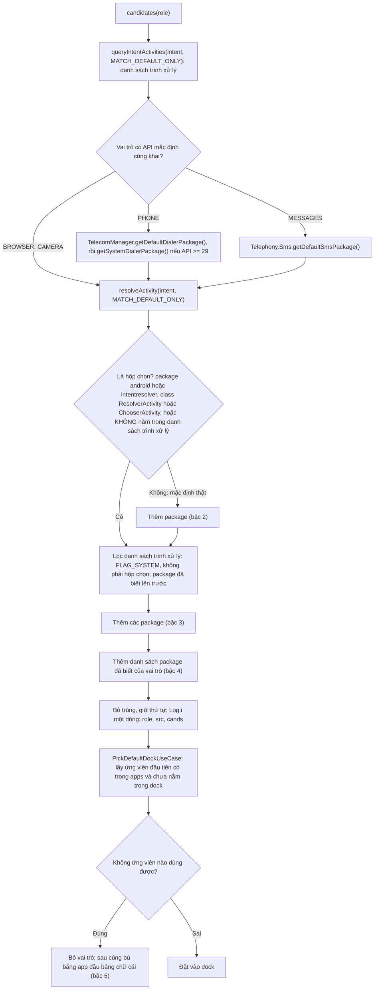
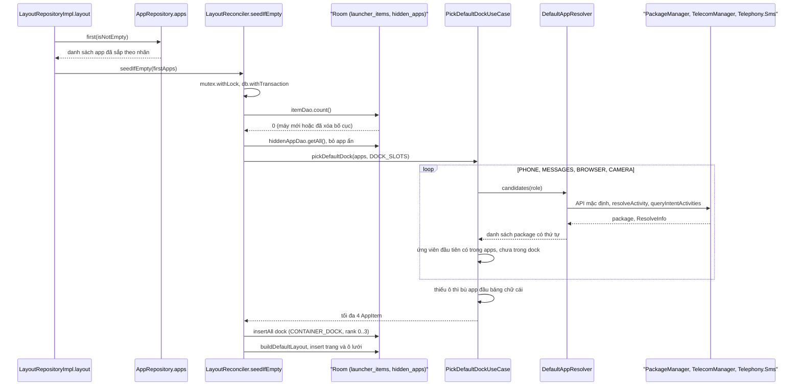

# DD — Dock chọn đúng app mặc định trên máy nhiều trình xử lý: đọc trước khi review

**Plan:** [plans/DD-dock-default-apps.md](../plans/DD-dock-default-apps.md) · **PR:** #17 (draft) · **Nhánh:** `fix/dd-dock-default-apps`

> **Trạng thái file:** hoàn chỉnh theo code thật (commit e179bb5 và bản gỡ log đo), 2026-11-09. Sơ đồ khớp `DefaultAppResolver.candidates` và `PickDefaultDockUseCase`.

## 1. Tóm tắt

Lần đầu launcher dựng bố cục, dock lấy 4 app: Điện thoại, Tin nhắn, Trình duyệt, Máy ảnh. Trên Oppo A3x, ba vai trò sau có nhiều app nhận cùng intent và máy chưa đặt mặc định, nên hệ thống trả **hộp chọn app** thay vì một app thật; code cũ coi hộp chọn là app, không tìm thấy nó trong danh sách, rồi bù bằng app đầu bảng chữ cái. DD thay "một câu hỏi `resolveActivity`" bằng một **chuỗi dự phòng theo vai trò**. Chỉ ảnh hưởng lần seed mới; dock đã có không bị đổi.

## 2. Kiến thức nền

- **`resolveActivity` và hộp chọn** (đọc tài liệu + đo shell Oppo 2026-11-09): khi một intent ngầm có ≥ 2 trình xử lý và người dùng chưa chọn "luôn dùng", `PackageManager.resolveActivity(intent, MATCH_DEFAULT_ONLY)` trả về activity của chính hệ thống, `android/com.android.internal.app.ResolverActivity`, là màn "Mở bằng...". Nó không phải một trình xử lý: danh sách `queryIntentActivities` không chứa nó. Máy có một trình xử lý (Live 4) thì trả thẳng app đó.
- **Role** (đọc tài liệu `RoleManager`): Android 10+ có role DIALER, SMS, BROWSER. App thường **không** hỏi được ai giữ role (`getRoleHolders` là system API); chỉ hỏi được chính mình có giữ không (`isRoleHeld`). Nhưng có API công khai riêng: `TelecomManager.getDefaultDialerPackage()` (API 23) và `Telephony.Sms.getDefaultSmsPackage()` (API 19). Trình duyệt và máy ảnh không có API tương đương.
- **Tầm nhìn package (Android 11+)**: app chỉ thấy package khác nếu khai `<queries>`. Dự án đã khai MAIN/LAUNCHER nên thấy mọi app có icon (đo M2). Tài liệu `getDefaultSmsPackage` đòi thêm khối `SMS_DELIVER`; Đo được (Oppo, 2026-11-09): không cần, `getDefaultSmsPackage` trả đúng từ trong app.
- **`FLAG_SYSTEM`**: cờ của app cài sẵn trong ROM, vẫn còn khi app được cập nhật qua store (kèm `FLAG_UPDATED_SYSTEM_APP`). B1 và M8d đã dùng cờ này để tránh app ngoài đăng ký cùng intent.
- **Seed**: `LayoutReconciler.seedIfEmpty` dựng bố cục khi bảng `launcher_items` rỗng (máy mới, xóa dữ liệu). Đây là nơi duy nhất gọi `PickDefaultDockUseCase`.

## 3. Luồng hoạt động

### 3.1 Chuỗi dự phòng của một vai trò (`DefaultAppResolver.candidates`)

Chỗ dễ sai:
- Mỗi bậc có `try/catch` riêng: dịch vụ Telecom không có hay `SecurityException` ở bậc 1 không được làm mất bậc 2–4.
- Bậc 2 vẫn chạy cho PHONE/MESSAGES dù bậc 1 đã có kết quả: nếu bậc 1 trả package không có trong `apps` (bị ẩn, không có icon), use case còn ứng viên khác.
- "Không nằm trong danh sách trình xử lý" là điều kiện chính để nhận hộp chọn; danh sách tên chỉ là lớp bảo hiểm và để log rõ lý do.

### 3.2 Lần seed đầu tiên

Ghi chú:
- Cả chuỗi chạy **trong** transaction Room; các IPC thêm làm transaction dài hơn một chút, chỉ một lần mỗi lần cài (đo được, Oppo, 2026-11-09: tổng khoảng 123 ms).
- Không có đường nào khác gọi `pickDefaultDock`, nên dock đã seed (như Oppo của chủ dự án) không đổi khi cài bản mới. Xem quyết định D5 / Q1 trong plan.
- Dock luôn mở app bằng khóa LAUNCHER của `AppItem`, không bằng component resolver thấy (bài học M3).

## 4. Thay đổi theo file

| File | Vai trò | Vì sao thêm/sửa | Đọc trước? |
|---|---|---|---|
| `data/apps/DefaultAppResolver.kt` | Hỏi hệ thống, dựng danh sách ứng viên | Nhận hộp chọn, chuỗi theo vai trò | **Đọc đầu tiên** |
| `domain/usecase/PickDefaultDockUseCase.kt` | Chọn 4 app từ ứng viên | Thử ứng viên kế thay vì rơi xuống bảng chữ cái | **Đọc thứ hai** |
| `domain/repository/DefaultAppResolverPort.kt` | Cổng domain | `resolve` → `candidates` | |
| `AndroidManifest.xml` | `<queries>` | Không đổi (đo được: không cần `SMS_DELIVER`) | |

## 5. Quyết định và đánh đổi

Xem D1–D8 trong plan. Tóm tắt: nhận hộp chọn bằng kiểm thành viên + danh sách tên (D1); chuỗi API công khai → resolve thật → app hệ thống → package đã biết → bảng chữ cái (D2); cổng trả danh sách package (D3); máy đã seed không tự sửa, chờ chủ dự án chọn (D5, Q1).

## 6. Chỗ cần soi khi review

- Nhận hộp chọn ở **mọi** bậc, kể cả bậc 3 (lọc hệ thống).
- Thứ tự bậc và bỏ trùng.
- Bậc lỗi không cắt chuỗi.
- Ca chỉ code bảo vệ, không kiểm được trên máy chủ dự án (không đổi app mặc định của chủ dự án): người dùng đặt trình duyệt ngoài làm mặc định; máy không có Telecom; app mặc định bị ẩn. Chưa kiểm trên máy (đọc code): các ca đó. Live 4: chưa kiểm (máy bận).

## 6b. Số đo (đo được, Oppo A3x, 2026-11-09, log của bản nhánh, seed mới)

| Vai trò | Bậc ra kết quả | Giá trị thô | ms |
|---|---|---|---|
| PHONE | API | `defaultDialer` = `systemDialer` = `com.google.android.dialer` | 30 |
| MESSAGES | API | `defaultSms` = `com.google.android.apps.messaging`; `resolve` = `android/ResolverActivity` (bị loại); trình xử lý: `com.android.mms` (SYS), Google Messages (SYS+UPD) | 70 |
| BROWSER | RESOLVE | `resolve` = `com.android.chrome/IntentDispatcher` (Chrome SYS+UPD); khác số đo shell (hộp chọn) | 12 |
| CAMERA | SYSTEM | `resolve` = `android/ResolverActivity` (bị loại); chọn `com.oplus.camera` (SYS); 2 app ngoài bị bỏ | 11 |

Tổng chuỗi khoảng 123 ms, một lần mỗi seed. Dock sau seed: Điện thoại (Google), Tin nhắn (Google Messages), Chrome, Camera (Oppo). Trước sửa: Phone, Chrome, app giao diện cuộc gọi, app tài liệu. Bố cục chủ dự án đã khôi phục, hash trùng. Live 4: chưa kiểm (máy bận).

## 7. Cách kiểm lại

Oppo A3x, bản debug của nhánh. Sao lưu bố cục bằng `run-as tar` (quy trình đầy đủ trong plan), xóa `databases/launcher.db*`, mở app, đọc 4 dòng log `DefaultAppResolver` và hàng dock trong DB; bấm 4 icon; khôi phục và so hash. Live 4 chỉ khi chủ dự án cho dùng.

## 8. Bài học cho AGENTS.md

- Đo được (Oppo, 2026-11-09): `Telephony.Sms.getDefaultSmsPackage` và `TelecomManager.getDefaultDialerPackage` trả đúng từ trong app, không cần `<queries>` `SMS_DELIVER`.
- Đo được (Oppo, 2026-11-09): `resolveActivity` trong app có thể trả app thật (Chrome) dù `cmd package resolve-activity` từ shell cho hộp chọn; đừng suy từ số đo shell.
- Ứng viên ban đầu (đo shell 2026-11-09, Oppo): `resolveActivity` trả `android/com.android.internal.app.ResolverActivity` cho intent có ≥ 2 trình xử lý mà chưa đặt mặc định; lọc theo tiền tố `android.permission` không bắt được.
