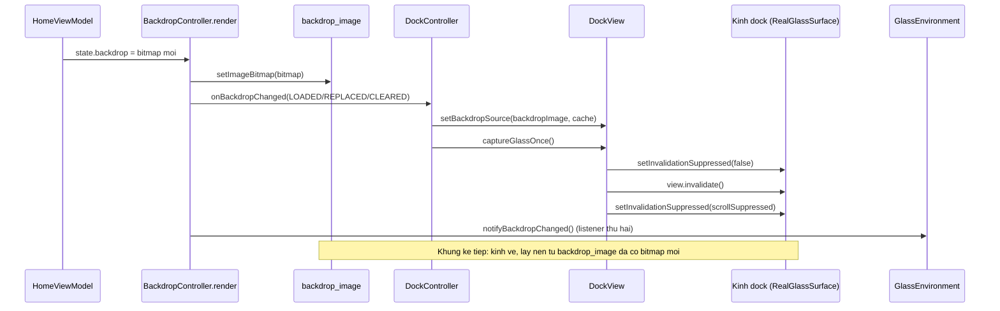

# DG — Làm mới kính dock khi nền đổi: đọc trước khi review

**Plan:** [plans/DG-dock-glass-refresh.md](../plans/DG-dock-glass-refresh.md) · **PR:** draft · **Nhánh:** `fix/dg-dock-glass-refresh`

> **Trạng thái:** xong, chờ chủ dự án merge. Đã đo trên hai máy (mục 7).

## 1. Tóm tắt
Khi ảnh nền đổi từ không có sang ảnh, kính thật của dock vẫn tối cho tới khi có một lần vẽ lại do việc khác (vuốt trang, chạm). Nguyên nhân: dock chỉ "pulse" cho `REPLACED`, còn lần nạp đầu là `LOADED`. Sửa: dock chụp lại kính đúng một lần ở mọi thay đổi nền, như kính panel.

## 2. Kiến thức nền
- Kính thật (`LiquidGlassView`) với `enableDynamicBackground = false` chỉ lấy nền ở lần vẽ kính; không có lần vẽ nào thì nó giữ ảnh chụp cũ (đọc bytecode thư viện, ghi ở `BackgroundGlass`).
- `enableDynamicBackground = true` làm thư viện `invalidate()` sau mỗi lần vẽ: vòng vẽ liên tục, nên pulse cũ tốn khung.
- `captureOnce`: bỏ chặn -> `invalidate()` -> chặn lại. Chặn là của TL1 Task 2b (cuộn view bất kỳ không được làm kính chụp lại).

## 3. Luồng hoạt động

## 4. Ai nghe tín hiệu nền đổi

| Phần tử | Kính | Nghe qua | Làm gì khi nền đổi |
|---|---|---|---|
| Dock | thật (Lens) hoặc mờ tĩnh | `BackdropController` (`DockController.onBackdropChanged`) | `setBackdropSource` + `captureGlassOnce` (DG) |
| Panel thư mục, menu icon, thanh Library, lớp tìm kiếm | thật hoặc mờ | `GlassEnvironment.addBackdropListener` (`BackgroundGlass.backdropListener`) | `apply()` chọn lại kính + `captureOnce` (AN Task 10, GS Task 3) |
| Search pill | thật hoặc mờ | `GlassEnvironment.addBackdropListener` (`SearchPillView`) | chụp lại một lần |
| Kính mờ tại chỗ (`BackdropBlurDrawable`, ô thư mục) | mờ | `BlurredBackdropCache.notifyBackdropChanged` qua `GlassEnvironment` | tự vẽ lại |

## 5. Vì sao thiết kế này
Xem mục "Vì sao chọn thiết kế này" trong plan: một cơ chế chụp cho mọi kính thật, không vòng vẽ liên tục, không phụ thuộc cửa sổ thời gian; dock giữ listener của `BackdropController` để khỏi sửa `core/glass/*` và khỏi thêm vòng đời đăng ký.

## 6. Điểm dễ sai
- Trả cờ chặn về `scrollSuppressed`, không ép `true`: dock đứng yên không bị chặn, ép `true` thì sau lần chụp đầu dock không nhận `invalidate()` thường nữa.
- `glassSurface` có thể còn null ở `LOADED` đầu app (dock dựng bất đồng bộ): `setup()` gắn nguồn sau, lần vẽ đầu của kính đã lấy đúng ảnh.

## 7. Số đo (đo được, Oppo A3x và Vsmart Live 4, 2026-11-09)
Mỗi phép đổi: chụp Home 2,5 s sau resume không chạm so với sau khi ép vẽ lại; sai khác trung bình tuyệt đối 0-255.

| Phép đổi | Dock trước (main `1fcfd33`) | Dock sau (DG, `17b2e02`) | Pill, ô thư mục |
|---|---|---|---|
| none -> ảnh | Oppo 52,0 · Live 4 7,7 | 0,0 cả hai máy | 0,0 |
| ảnh -> ảnh | 0,0 | 0,0 | 0,0 |
| ảnh -> none | 0,0 (rơi về phẳng) | 0,0 | 0,0 |

Bài học (đề xuất cho AGENTS.md): một cơ chế làm mới kính cho mọi bề mặt; pulse cũ bỏ sót `LOADED` sau khi trống.
