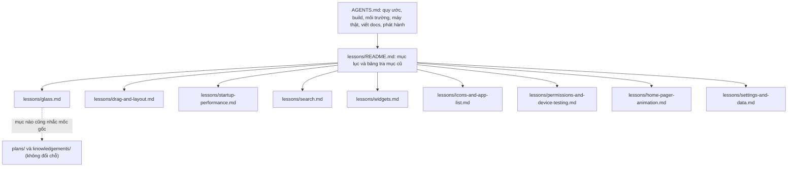
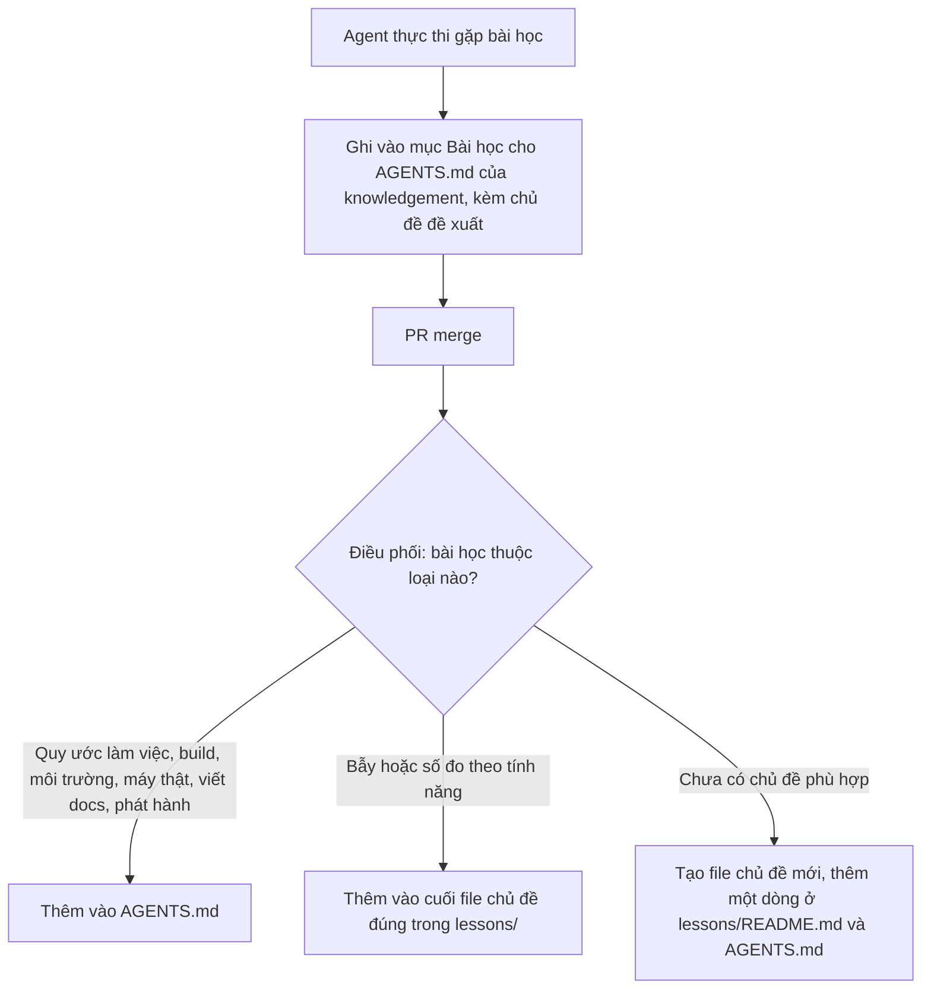

# DR — Tổ chức lại thư mục `docs/`: đọc trước khi review

**Plan:** [plans/DR-docs-reorg.md](../plans/DR-docs-reorg.md) · **Nhánh:** `docs/dr-docs-reorg` · **Chỉ tài liệu, không code**

## 1. Tóm tắt

`AGENTS.md` từng là 747 dòng, ~140 KB: quy ước, build, môi trường lẫn hơn 50 mục "bài học" nối đuôi theo mốc. Agent đọc "toàn bộ" ở bước 1 nên tốn ngữ cảnh. DR giữ `AGENTS.md` còn ~100 dòng, ~17 KB (chỉ cái mọi agent cần mỗi lần, kèm mục lục) và chuyển nguyên văn các bài học sang chín file chủ đề trong `docs/lessons/`. Không viết lại, không gộp, không mất dòng nào (đối chiếu bằng script, mục 5).

## 2. Kiến thức nền

- **Bài học** là một gạch đầu dòng ghi điều đã gặp (bẫy, số đo), kèm ngày, nhãn nguồn (**đo được** / **đọc code** / **đọc tài liệu** / **suy luận chưa kiểm chứng**) và thẻ mốc (M7, GL...).
- **Knowledgement** là bài viết cho chủ dự án đọc trước khi review một tính năng; mục "Bài học cho AGENTS.md" ở cuối nó là nơi agent đề xuất bài học. **Điều phối** (Claude chính) là người chép chúng vào nơi lâu dài.
- **Tài liệu chung** (mục 5.4 của MultiAgent-Workflow) là file mọi nhánh đều muốn sửa, nên chỉ điều phối sửa trên `main`. DR là ngoại lệ được duyệt.

## 3. Bố cục mới và luồng "bài học mới đi đâu"

Bố cục:

Bài học mới đi đâu:

Agent bắt đầu việc: đọc `AGENTS.md` (ngắn), rồi mở file `lessons/<chủ đề>` của việc mình làm (mục 4 bước 1 của MultiAgent-Workflow đã sửa theo).

## 4. Thay đổi theo file

| File | Dòng | Kích thước |
|---|---|---|
| `AGENTS.md` | 98 | 17.3 KB |
| `lessons/README.md` | 90 | 10.1 KB |
| `lessons/drag-and-layout.md` | 182 | 21.0 KB |
| `lessons/glass.md` | 137 | 21.7 KB |
| `lessons/home-pager-animation.md` | 119 | 25.5 KB |
| `lessons/icons-and-app-list.md` | 46 | 9.8 KB |
| `lessons/permissions-and-device-testing.md` | 72 | 7.9 KB |
| `lessons/search.md` | 73 | 15.5 KB |
| `lessons/settings-and-data.md` | 64 | 17.9 KB |
| `lessons/startup-performance.md` | 64 | 8.6 KB |
| `lessons/widgets.md` | 21 | 3.6 KB |

Trước DR: `AGENTS.md` 747 dòng, 140728 byte (137,4 KB). Sau: xem bảng trên. Tổng chín file chủ đề cộng README lớn hơn nội dung cũ một chút vì có tiêu đề đầu file, bảng tra và tiêu đề mục tách.

Sửa thêm: `MultiAgent-Workflow.md` (mục 4 bước 1, 5.4, mẫu plan mục 7, mẫu knowledgement mục 8, hai tham chiếu "AGENTS.md mục ..." ở mục 9), `project_structure.md` (cây docs), `Launcher-Features.md` (hai tham chiếu chữ tới mục AGENTS đã chuyển).

### Bảng đối chiếu: tiêu đề mục cũ của AGENTS.md sang nơi mới

Ba mục pha nhiều chủ đề ("B1, CL, IC", "DD, SM, DG", "RB và G3a") được tách theo từng gạch đầu dòng nên có nhiều nơi mới; tiêu đề mới ghi "tách từ «...»". Mục "Viết docs" giữ sáu gạch ở `AGENTS.md`, hai gạch chuyển đi.

| Mục cũ | Nơi mới |
|---|---|
| Quy ước làm việc trong dự án này | `AGENTS.md` mục «Quy ước làm việc trong dự án này» |
| Tên gọi và package | `AGENTS.md` mục «Tên gọi và package» |
| Build và toolchain | `AGENTS.md` mục «Build và toolchain» |
| Thư viện LiquidGlass (`com.github.QWEA0:liquidglass:v2.0.11`) | `lessons/glass.md` mục «Thư viện LiquidGlass (`com.github.QWEA0:liquidglass:v2.0.11`)» |
| Hiệu năng đã đo (demo, 2026-10-15) | `lessons/glass.md` mục «Hiệu năng đã đo (demo, 2026-10-15)» |
| Môi trường của Claude khi làm việc trên dự án này | `AGENTS.md` mục «Môi trường của Claude khi làm việc trên dự án này» |
| Kiểm chứng trên máy thật | `AGENTS.md` mục «Kiểm chứng trên máy thật» |
| Launcher mặc định (M1 Task 3) | `lessons/home-pager-animation.md` mục «Launcher mặc định (M1 Task 3)» |
| Inset và layout màn hình chính (M1 Task 5) | `lessons/home-pager-animation.md` mục «Inset và layout màn hình chính (M1 Task 5)» |
| Danh sách app (M2 Task 1, 1B) | `lessons/icons-and-app-list.md` mục «Danh sách app (M2 Task 1, 1B)» |
| Danh sách app: kết quả đo và bẫy (M2 Task 2-4, 2026-10-26) | `lessons/icons-and-app-list.md` mục «Danh sách app: kết quả đo và bẫy (M2 Task 2-4, 2026-10-26)» |
| Dock mặc định (M3 Task 4, 2026-10-26/27, đo trên Vsmart Live 4) | `lessons/permissions-and-device-testing.md` mục «Dock mặc định (M3 Task 4, 2026-10-26/27, đo trên Vsmart Live 4)» |
| "Demo kính" không mở được từ lưới launcher (M3 Task 5, 2026-10-27) | `lessons/home-pager-animation.md` mục «"Demo kính" không mở được từ lưới launcher (M3 Task 5, 2026-10-27)» |
| Nạp danh sách app: đo chi tiết sau khi chia nhỏ (M3 Task 1, 2026-10-26, Live 4, 87 app) | `lessons/startup-performance.md` mục «Nạp danh sách app: đo chi tiết sau khi chia nhỏ (M3 Task 1, 2026-10-26, Live 4, 87 app)» |
| Custom ViewGroup cho lưới icon: bẫy đã gặp (M3 Task 2-3-5) | `lessons/drag-and-layout.md` mục «Custom ViewGroup cho lưới icon: bẫy đã gặp (M3 Task 2-3-5)» |
| Đồng bộ bố cục khi cài và gỡ app (M4 Task 3, 2026-10-27, đo trên Vsmart Live 4) | `lessons/settings-and-data.md` mục «Đồng bộ bố cục khi cài và gỡ app (M4 Task 3, 2026-10-27, đo trên Vsmart Live 4)» |
| Catch-up khi khởi động lại launcher (M4 Task 4, 2026-10-27, đo trên Vsmart Live 4) | `lessons/settings-and-data.md` mục «Catch-up khi khởi động lại launcher (M4 Task 4, 2026-10-27, đo trên Vsmart Live 4)» |
| Viết docs | `AGENTS.md` mục «Viết docs» `lessons/glass.md` mục «Kính trên view trong ViewPager2 (tách từ «Viết docs»)» `lessons/drag-and-layout.md` mục «Đọc DragHelper trước khi viết plan kéo-thả (tách từ «Viết docs»)» |
| M5 — khóa xoay, system bar, polish lưới+dock | `lessons/home-pager-animation.md` mục «M5 — khóa xoay, system bar, polish lưới+dock» |
| M6 — lớp kính (Task 1, 2026-10-28, đo trên Oppo A3x) | `lessons/glass.md` mục «M6 — lớp kính (Task 1, 2026-10-28, đo trên Oppo A3x)» |
| M6 — lớp kính (Task 2, 2026-10-28, đo trên Vsmart Live 4) | `lessons/glass.md` mục «M6 — lớp kính (Task 2, 2026-10-28, đo trên Vsmart Live 4)» |
| M6 — lớp kính (Task 3, 2026-10-28, đo trên Oppo A3x + Vsmart Live 4) | `lessons/glass.md` mục «M6 — lớp kính (Task 3, 2026-10-28, đo trên Oppo A3x + Vsmart Live 4)» |
| M7 — chế độ chỉnh sửa & kéo-thả (Task 3-5, 2026-10-28, đo trên Vsmart Live 4) | `lessons/drag-and-layout.md` mục «M7 — chế độ chỉnh sửa & kéo-thả (Task 3-5, 2026-10-28, đo trên Vsmart Live 4)» |
| M7 — trạng thái kéo-thả KHÔNG được nằm trong view của RecyclerView/ViewPager2 (Task 5, 2026-10-29, Vsmart Live 4) | `lessons/drag-and-layout.md` mục «M7 — trạng thái kéo-thả KHÔNG được nằm trong view của RecyclerView/ViewPager2 (Task 5, 2026-10-29, Vsmart Live 4)» |
| M7 Task 6 — kéo-thả dock ↔ lưới: bài học triển khai | `lessons/drag-and-layout.md` mục «M7 Task 6 — kéo-thả dock ↔ lưới: bài học triển khai» |
| M7 Task 7 — lật trang khi kéo + trang tạm: bài học triển khai | `lessons/drag-and-layout.md` mục «M7 Task 7 — lật trang khi kéo + trang tạm: bài học triển khai» |
| M7 Task 8 — dấu "−" ẩn nhanh: bài học triển khai | `lessons/drag-and-layout.md` mục «M7 Task 8 — dấu "−" ẩn nhanh: bài học triển khai» |
| M7 Task 9 — Thư viện ứng dụng: bài học triển khai | `lessons/home-pager-animation.md` mục «M7 Task 9 — Thư viện ứng dụng: bài học triển khai» |
| M7 Task 10 — menu nhấn giữ icon: bài học triển khai | `lessons/drag-and-layout.md` mục «M7 Task 10 — menu nhấn giữ icon: bài học triển khai» |
| M7 Task 11 — đóng mốc: bài học | `lessons/drag-and-layout.md` mục «M7 Task 11 — đóng mốc: bài học» |
| M8a Task 2 — bỏ cỡ lưới cứng: bài học triển khai (2026-10-29) | `lessons/drag-and-layout.md` mục «M8a Task 2 — bỏ cỡ lưới cứng: bài học triển khai (2026-10-29)» |
| M8a Task 3 — màn Cài đặt: bài học triển khai (2026-10-29) | `lessons/settings-and-data.md` mục «M8a Task 3 — màn Cài đặt: bài học triển khai (2026-10-29)» |
| M8a Task 4 — mức kính: bài học triển khai (2026-10-29) | `lessons/glass.md` mục «M8a Task 4 — mức kính: bài học triển khai (2026-10-29)» |
| M8a Task 5 — đổi ảnh nền từ Cài đặt: bài học và kết quả đo (2026-10-29) | `lessons/settings-and-data.md` mục «M8a Task 5 — đổi ảnh nền từ Cài đặt: bài học và kết quả đo (2026-10-29)» |
| M8a Task 6 — đổi cỡ lưới + re-flow: bài học triển khai (2026-10-30) | `lessons/settings-and-data.md` mục «M8a Task 6 — đổi cỡ lưới + re-flow: bài học triển khai (2026-10-30)» |
| M8a Task 7 — đóng mốc: bài học (2026-10-30) | `lessons/settings-and-data.md` mục «M8a Task 7 — đóng mốc: bài học (2026-10-30)» |
| M8b Task 1 — lõi tìm kiếm: bài học (2026-10-30) | `lessons/search.md` mục «M8b Task 1 — lõi tìm kiếm: bài học (2026-10-30)» |
| M8b Task 2 — cử chỉ vuốt xuống + khung lớp tìm kiếm: bài học (2026-10-30) | `lessons/search.md` mục «M8b Task 2 — cử chỉ vuốt xuống + khung lớp tìm kiếm: bài học (2026-10-30)» |
| M8b Task 3 — danh sách kết quả + mở app: bài học (2026-10-30) | `lessons/search.md` mục «M8b Task 3 — danh sách kết quả + mở app: bài học (2026-10-30)» |
| M8c Task 1 — pill tìm kiếm + chấm ổ quay số: bài học (2026-10-30) | `lessons/search.md` mục «M8c Task 1 — pill tìm kiếm + chấm ổ quay số: bài học (2026-10-30)» |
| Sửa lỗi gỡ app làm dồn kín bố cục (2026-10-30) | `lessons/settings-and-data.md` mục «Sửa lỗi gỡ app làm dồn kín bố cục (2026-10-30)» |
| M8c Task 2 — bấm pill + trợ năng: bài học (2026-10-30) | `lessons/search.md` mục «M8c Task 2 — bấm pill + trợ năng: bài học (2026-10-30)» |
| G2a Phần B — App Library (B2): bài học (2026-10-30) | `lessons/home-pager-animation.md` mục «G2a Phần B — App Library (B2): bài học (2026-10-30)» |
| Demo polish (2026-10-30): bài học | `lessons/home-pager-animation.md` mục «Demo polish (2026-10-30): bài học» |
| TL2 — bo góc icon: bài học (2026-11-03, Vsmart Live 4) | `lessons/icons-and-app-list.md` mục «TL2 — bo góc icon: bài học (2026-11-03, Vsmart Live 4)» |
| TL1 — vuốt trang, rung, nút chỉnh sửa: bài học (2026-11-03, Vsmart Live 4) | `lessons/home-pager-animation.md` mục «TL1 — vuốt trang, rung, nút chỉnh sửa: bài học (2026-11-03, Vsmart Live 4)» |
| GL — áp kính: bài học (2026-11-03 đến 2026-11-04, Vsmart Live 4 + Oppo A3x) | `lessons/glass.md` mục «GL — áp kính: bài học (2026-11-03 đến 2026-11-04, Vsmart Live 4 + Oppo A3x)» |
| R1 — tách `HomeActivity`: bài học (2026-11-04, Vsmart Live 4) | `lessons/home-pager-animation.md` mục «R1 — tách `HomeActivity`: bài học (2026-11-04, Vsmart Live 4)» |
| G2b — kiểu icon: bài học (2026-11-04, Vsmart Live 4) | `lessons/icons-and-app-list.md` mục «G2b — kiểu icon: bài học (2026-11-04, Vsmart Live 4)» |
| AN — hoạt ảnh và đo panel: bài học (2026-11-05, Vsmart Live 4 + Oppo A3x) | `lessons/home-pager-animation.md` mục «AN — hoạt ảnh và đo panel: bài học (2026-11-05, Vsmart Live 4 + Oppo A3x)» |
| P1 — cold start Oppo A3x: số đo (2026-11-05, APK debug, 345 activity, 5 lượt sau một lượt khởi động) | `lessons/startup-performance.md` mục «P1 — cold start Oppo A3x: số đo (2026-11-05, APK debug, 345 activity, 5 lượt sau một lượt khởi động)» |
| GP — nhấn giữ khoảng trống: bài học (2026-11-05, Vsmart Live 4) | `lessons/drag-and-layout.md` mục «GP — nhấn giữ khoảng trống: bài học (2026-11-05, Vsmart Live 4)» |
| LC — cache nhãn app: bài học (2026-11-05, Oppo A3x + Vsmart Live 4, APK debug) | `lessons/startup-performance.md` mục «LC — cache nhãn app: bài học (2026-11-05, Oppo A3x + Vsmart Live 4, APK debug)» |
| G2c — widget trên lưới: bài học (2026-11-05, Vsmart Live 4 + Oppo A3x) | `lessons/widgets.md` mục «G2c — widget trên lưới: bài học (2026-11-05, Vsmart Live 4 + Oppo A3x)» |
| GS — kính theo phần tử: bài học (2026-11-05, Oppo A3x + Vsmart Live 4) | `lessons/glass.md` mục «GS — kính theo phần tử: bài học (2026-11-05, Oppo A3x + Vsmart Live 4)» |
| M8d — mở rộng tìm kiếm: bài học (2026-11-05, Vsmart Live 4 + Oppo A3x) | `lessons/search.md` mục «M8d — mở rộng tìm kiếm: bài học (2026-11-05, Vsmart Live 4 + Oppo A3x)» |
| B1, CL, IC và bài học đo bản debug (2026-11-09, Oppo A3x + Vsmart Live 4) | `lessons/widgets.md` mục «B1 — widget Đồng hồ/Lịch (tách từ «B1, CL, IC và bài học đo bản debug (2026-11-09, Oppo A3x + Vsmart Live 4)»)» `lessons/drag-and-layout.md` mục «CL — ô kéo kẹt ẩn (tách từ «B1, CL, IC và bài học đo bản debug (2026-11-09, Oppo A3x + Vsmart Live 4)»)» `lessons/icons-and-app-list.md` mục «IC — cache icon đĩa (tách từ «B1, CL, IC và bài học đo bản debug (2026-11-09, Oppo A3x + Vsmart Live 4)»)» `lessons/startup-performance.md` mục «Đừng đo khởi động trên bản debug (tách từ «B1, CL, IC và bài học đo bản debug (2026-11-09, Oppo A3x + Vsmart Live 4)»)» `lessons/permissions-and-device-testing.md` mục «Script báo exit 0 sai (tách từ «B1, CL, IC và bài học đo bản debug (2026-11-09, Oppo A3x + Vsmart Live 4)»)» `lessons/permissions-and-device-testing.md` mục «Cài lại bản debug làm mất launcher mặc định (tách từ «B1, CL, IC và bài học đo bản debug (2026-11-09, Oppo A3x + Vsmart Live 4)»)» |
| DD, SM, DG — app mặc định ở dock, menu icon kính, kính dock khi đổi nền (2026-11-09, Oppo A3x + Vsmart Live 4) | `lessons/permissions-and-device-testing.md` mục «DD — resolveActivity trả hộp chọn (tách từ «DD, SM, DG — app mặc định ở dock, menu icon kính, kính dock khi đổi nền (2026-11-09, Oppo A3x + Vsmart Live 4)»)» `lessons/permissions-and-device-testing.md` mục «DD — số đo shell khác số đo trong app (tách từ «DD, SM, DG — app mặc định ở dock, menu icon kính, kính dock khi đổi nền (2026-11-09, Oppo A3x + Vsmart Live 4)»)» `lessons/glass.md` mục «SM — công tắc phải tạo khác biệt nhìn thấy (tách từ «DD, SM, DG — app mặc định ở dock, menu icon kính, kính dock khi đổi nền (2026-11-09, Oppo A3x + Vsmart Live 4)»)» `lessons/glass.md` mục «SM — chữ trông nhỏ hơn (tách từ «DD, SM, DG — app mặc định ở dock, menu icon kính, kính dock khi đổi nền (2026-11-09, Oppo A3x + Vsmart Live 4)»)» `lessons/home-pager-animation.md` mục «SM — hoạt ảnh kết thúc bằng callback ẩn view (tách từ «DD, SM, DG — app mặc định ở dock, menu icon kính, kính dock khi đổi nền (2026-11-09, Oppo A3x + Vsmart Live 4)»)» `lessons/glass.md` mục «SM — bề rộng cố định và font_scale (tách từ «DD, SM, DG — app mặc định ở dock, menu icon kính, kính dock khi đổi nền (2026-11-09, Oppo A3x + Vsmart Live 4)»)» `lessons/glass.md` mục «DG — kính thật chỉ lấy nền ở lần vẽ kính (tách từ «DD, SM, DG — app mặc định ở dock, menu icon kính, kính dock khi đổi nền (2026-11-09, Oppo A3x + Vsmart Live 4)»)» `lessons/glass.md` mục «DG — cách đo kính sau khi đổi nền (tách từ «DD, SM, DG — app mặc định ở dock, menu icon kính, kính dock khi đổi nền (2026-11-09, Oppo A3x + Vsmart Live 4)»)» `lessons/permissions-and-device-testing.md` mục «DG — sao lưu dữ liệu app trước khi thử (tách từ «DD, SM, DG — app mặc định ở dock, menu icon kính, kính dock khi đổi nền (2026-11-09, Oppo A3x + Vsmart Live 4)»)» |
| RB và G3a — bản release R8 và danh bạ trong tìm kiếm (2026-11-09, Oppo A3x + Vsmart Live 4) | `lessons/startup-performance.md` mục «RB — số đo bản release (tách từ «RB và G3a — bản release R8 và danh bạ trong tìm kiếm (2026-11-09, Oppo A3x + Vsmart Live 4)»)» `lessons/startup-performance.md` mục «RB — kiểm keep rule bằng file (tách từ «RB và G3a — bản release R8 và danh bạ trong tìm kiếm (2026-11-09, Oppo A3x + Vsmart Live 4)»)» `lessons/startup-performance.md` mục «RB — profileinstaller (tách từ «RB và G3a — bản release R8 và danh bạ trong tìm kiếm (2026-11-09, Oppo A3x + Vsmart Live 4)»)» `lessons/startup-performance.md` mục «RB — đo khởi động lạnh khi là launcher mặc định (tách từ «RB và G3a — bản release R8 và danh bạ trong tìm kiếm (2026-11-09, Oppo A3x + Vsmart Live 4)»)» `lessons/permissions-and-device-testing.md` mục «RB — bản release không run-as được (tách từ «RB và G3a — bản release R8 và danh bạ trong tìm kiếm (2026-11-09, Oppo A3x + Vsmart Live 4)»)» `lessons/search.md` mục «G3a — danh bạ chỉ trong RAM (tách từ «RB và G3a — bản release R8 và danh bạ trong tìm kiếm (2026-11-09, Oppo A3x + Vsmart Live 4)»)» `lessons/permissions-and-device-testing.md` mục «G3a — từ chối vĩnh viễn cần cờ đã xin (tách từ «RB và G3a — bản release R8 và danh bạ trong tìm kiếm (2026-11-09, Oppo A3x + Vsmart Live 4)»)» `lessons/permissions-and-device-testing.md` mục «G3a — quyền runtime từ controller (tách từ «RB và G3a — bản release R8 và danh bạ trong tìm kiếm (2026-11-09, Oppo A3x + Vsmart Live 4)»)» `lessons/search.md` mục «G3a — ColorOS bỏ qua ORDER BY (tách từ «RB và G3a — bản release R8 và danh bạ trong tìm kiếm (2026-11-09, Oppo A3x + Vsmart Live 4)»)» `lessons/permissions-and-device-testing.md` mục «G3a — ColorOS chặn pm grant (tách từ «RB và G3a — bản release R8 và danh bạ trong tìm kiếm (2026-11-09, Oppo A3x + Vsmart Live 4)»)» `lessons/permissions-and-device-testing.md` mục «G3a — danh bạ thử trên máy thật (tách từ «RB và G3a — bản release R8 và danh bạ trong tìm kiếm (2026-11-09, Oppo A3x + Vsmart Live 4)»)» `lessons/search.md` mục «G3a — bàn phím ảo che phím (tách từ «RB và G3a — bản release R8 và danh bạ trong tìm kiếm (2026-11-09, Oppo A3x + Vsmart Live 4)»)» |
| Trước khi phát hành lên cửa hàng (WP, 2026-11-09) | `AGENTS.md` mục «Trước khi phát hành lên cửa hàng (WP, 2026-11-09)» |

## 5. Kết quả đối chiếu (script tạm, không đưa vào repo)

Cách làm: chuẩn hóa khoảng trắng mỗi dòng không rỗng của `AGENTS.md` cũ (commit `0c3fc01`), đếm số lần xuất hiện của từng dòng trong `AGENTS.md` mới cộng chín file chủ đề (không tính README), so với bản cũ.

| Chỉ số | Kết quả |
|---|---|
| Dòng không rỗng của AGENTS.md cũ (gồm tiêu đề) | 611 |
| Tìm thấy nguyên văn, đúng số lần | 608 |
| Thiếu | 0 nội dung; 3 dòng tiêu đề của mục bị tách được đặt tên mới (tiêu đề cũ nằm nguyên trong tiêu đề mới, sau chữ "tách từ") |
| Thừa bản sao (dòng xuất hiện nhiều hơn bản cũ) | 0 |
| Dòng thêm mới (tiêu đề file, mục lục, tiêu đề mục tách) | 70 |
| 60 tiêu đề `##` cũ truy được trong file mới | 60/60 |
| Link nội bộ trong `docs/` đã kiểm (ngoài khối code) | 220 link; vỡ 2, đều có từ trước, không do DR (xem dưới) |

Hai link vỡ có sẵn trên `main`: `Launcher-Features.md` trỏ `plans/G3e-weather-widget.md` (file sẽ có khi nhánh G3e merge) và mẫu plan trong MultiAgent-Workflow có `../plans/<ID>-<slug>.md` (chỗ điền). Ba link tới `AGENTS.md` (đều không có anchor) vẫn đúng. Các plan/knowledgement cũ ghi "AGENTS.md mục X" bằng chữ thường (không link) không sửa được ở đây vì không được đụng docs của nhánh khác; bảng tra ở `lessons/README.md` thay cho chúng.

## 6. Quyết định và đánh đổi

- **Chủ đề, không theo mốc:** theo mốc thì giống hệt cái cũ (đã thấy khó tìm); theo chủ đề thì làm việc về kính chỉ đọc một file.
- **Chuyển, không viết lại:** viết lại có nguy cơ làm mất chi tiết đã đo; mục tiêu là giảm ngữ cảnh nạp mặc định, không rút gọn nội dung.
- **Mục pha chủ đề tách theo gạch đầu dòng:** cách duy nhất để mỗi bài học nằm đúng chủ đề mà vẫn nguyên văn.
- **Không gom `plans/` và `knowledgements/`:** các nhánh G3e, AP, IP đang thêm file ở đó; gom lúc này gây xung đột. Làm riêng khi không còn nhánh mở.
- **Không gộp bài học trùng:** không có hai dòng giống nguyên văn; vài bài học cùng ý (vd bẫy `ViewPager2` nhắc ở M7 và GL) nằm ở chủ đề khác nhau nên giữ cả hai.
- Phân loại một số mục là phán đoán (vd M7 Task 9 Thư viện ứng dụng vào Home/pager, M8a Task 6 đổi cỡ lưới vào cài đặt/dữ liệu); sai thì chỉ cần chuyển mục và sửa bảng tra.

## 7. Chỗ cần soi khi review

1. `AGENTS.md` mới: đọc một lần có đủ để bắt đầu việc không? Đang giữ: quy ước, tên gọi/package, build/toolchain, môi trường Claude, kiểm trên máy thật, viết docs, trước khi phát hành.
2. Mục 5.4 và mục 8 của MultiAgent-Workflow nói đúng nơi bài học mới đi.
3. Các phân loại chủ đề ở bảng mục 4: chỗ nào chủ dự án muốn đặt khác.

## 8. Cách kiểm lại

Không cần máy. Mở `docs/lessons/README.md`, tra "P1 — cold start Oppo A3x" thì ra `startup-performance.md`; so một mục bất kỳ với bản cũ bằng `git show 0c3fc01:docs/AGENTS.md`.

## 9. Bài học cho AGENTS.md

- Khi chuyển chữ giữa tài liệu, đối chiếu bằng script "mỗi dòng cũ xuất hiện đúng một lần ở nơi mới" bắt được cả lỗi sót lẫn trùng (2026-11-10, đo được: 611 dòng, 0 thiếu, 0 thừa). Đề xuất chủ đề: `AGENTS.md` (viết docs).
- Chuyển theo hai bước (lập bảng ánh xạ tiêu đề trước, chuyển sau) lộ sớm các mục pha nhiều chủ đề, cần tách theo gạch đầu dòng (2026-11-10, đo được). Chủ đề: `AGENTS.md` (viết docs).
- Tham chiếu "mục X của file Y" bằng chữ thường (không link) hỏng im lặng khi file Y đổi cấu trúc; khi viết plan/knowledgement mới nên dùng link có tên file hoặc nhắc file chủ đề trong `lessons/` (2026-11-10, đọc tài liệu). Chủ đề: `AGENTS.md` (viết docs).
