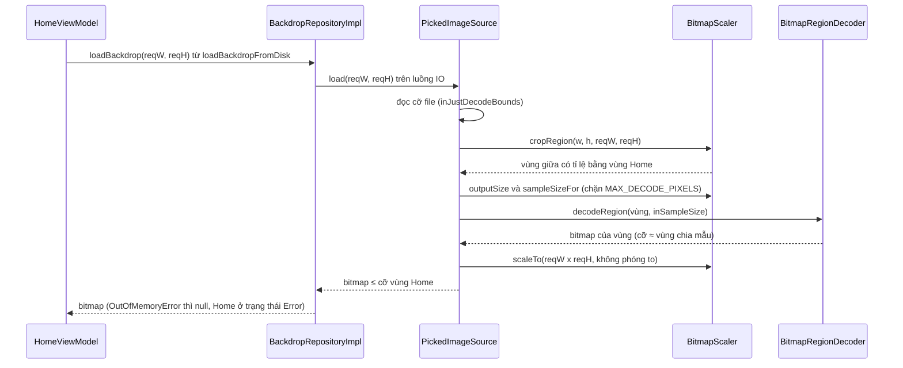
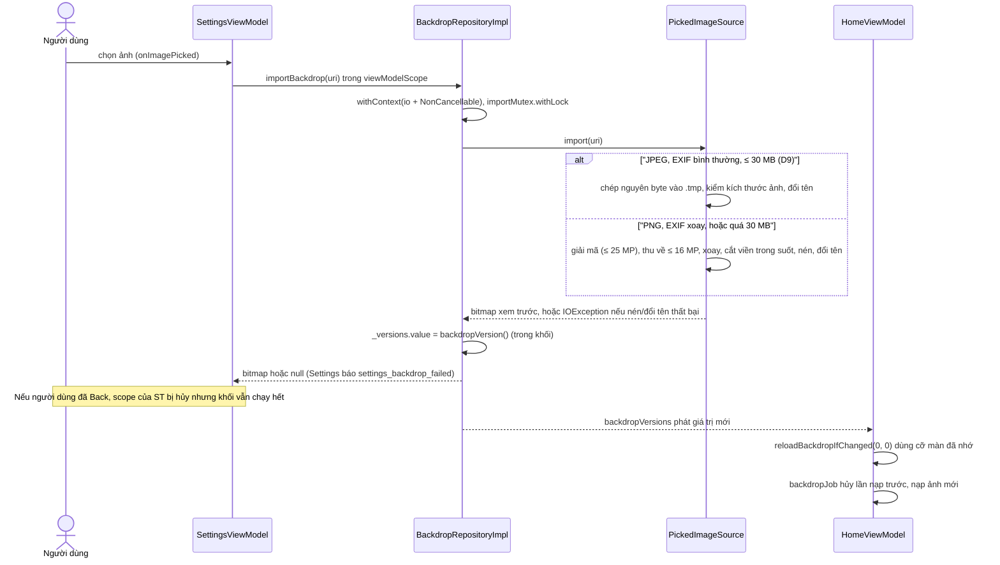
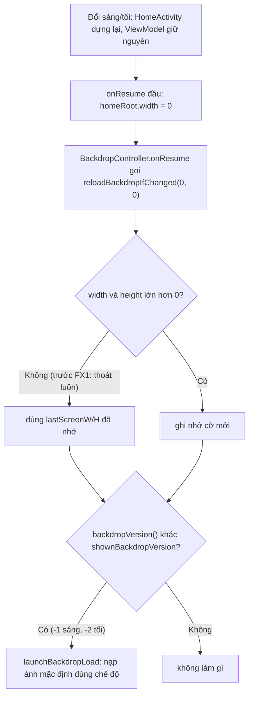
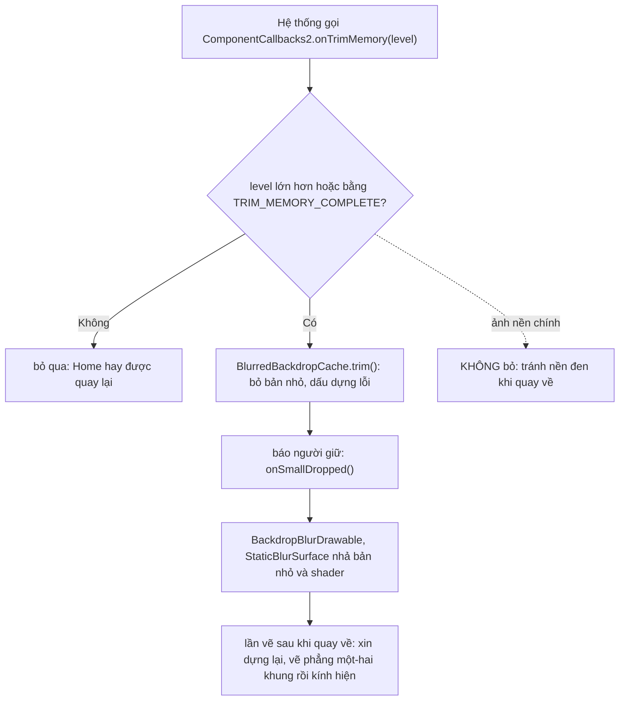

# FX1 — An toàn ảnh nền: đọc trước khi review

**Plan:** [report/FX1-wallpaper-safety.md](../report/FX1-wallpaper-safety.md) · **PR:** #31 · **Nhánh:** `fix/fx1-wallpaper-safety`

## 1. Tóm tắt
Sáu lỗi quanh ảnh nền của Home trong báo cáo rà soát 2026-11-10 (A1, A5, B2, C3, C4, C5). Việc chính: chọn ảnh toàn cảnh làm nền không còn làm launcher sập lặp; bitmap ảnh nền của Home luôn là **vùng giữa có đúng tỉ lệ vùng Home, ≤ cỡ vùng Home** (≈ 10 MB trên Live 4 thay vì 49 MB, hoặc sập), nên kính tại chỗ khớp với ảnh nó đứng trên; đổi sáng/tối nạp lại ảnh mặc định; Home nhận ảnh mới kể cả khi bấm Back giữa lúc nhập; cache blur không giữ ảnh nền cũ và nhả bản blur khi hệ thống sắp tắt app; dock ở mức kính CLASSIC dùng chung bộ đệm blur.

## 2. Kiến thức nền
- **`inSampleSize`** của `BitmapFactory`: giải mã ảnh nhỏ đi 2, 4, 8... lần ngay lúc giải mã (chỉ lũy thừa 2). Nên giải mã thường còn dư tới gấp đôi mỗi chiều so với cần, phải thu nốt bằng `createScaledBitmap`. (đọc tài liệu Android)
- **`BitmapRegionDecoder`** giải mã **một hình chữ nhật** của ảnh JPEG/PNG mà không cấp phát cả ảnh. Dùng ở `load` để lấy đúng vùng giữa mà `ImageView` `centerCrop` sẽ hiển thị. Hàm tạo theo đường dẫn file có từ API 10; bản rút gọn `newInstance(String)` chỉ từ API 31 nên dự án (`minSdk 26`) gọi bản có tham số `isShareable` và `@Suppress("DEPRECATION")`. (đọc tài liệu Android; đo trên Live 4: JPEG 12000x3000 nạp 119 ms, debug)
- **`centerCrop` so với kính tại chỗ:** `ImageView` `centerCrop` phóng ảnh cho phủ kín rồi cắt phần thừa. `BackdropBlurDrawable` và `StaticBlurSurface` lại **kéo giãn** bitmap mờ vừa đúng cỡ view ảnh nền. Hai cách chỉ cho cùng một đoạn nền khi tỉ lệ bitmap bằng tỉ lệ view; vì vậy bitmap của Home được cắt đúng tỉ lệ view ngay lúc nạp. (đọc code; xác nhận bằng ảnh vạch màu trên Live 4)
- **`withContext(NonCancellable)`:** khối chạy tới hết dù coroutine cha bị hủy; chỉ kết quả trả về bị vứt (người gọi nhận `CancellationException`). Nên việc báo "đã nhập xong" phải nằm **trong** khối. (đọc tài liệu kotlinx.coroutines)
- **`ComponentCallbacks2.onTrimMemory`:** hệ thống báo process nên trả bộ nhớ; `TRIM_MEMORY_COMPLETE` (80) nghĩa là app ở cuối hàng LRU, sắp bị tắt. Đăng ký trên Application context thì sống suốt process. Các mức nền có thể bị coi là lỗi thời từ Android 15 (suy luận chưa kiểm chứng; Android 11 của Live 4 vẫn gửi).
- **`WeakReference`:** cache chỉ cần *so danh tính* bitmap nguồn, không cần giữ nó sống; dùng tham chiếu yếu để ảnh nền cũ được thu hồi sau khi đổi ảnh.

## 3. Luồng hoạt động

Nạp ảnh nền lúc khởi động (A1, A5): file lưu giữ nguyên toàn ảnh, chỉ vùng giữa được giải mã.

Giải thích: bước dễ sai là **tỉ lệ**: vùng cắt có tỉ lệ `reqW:reqH` nên `ImageView` hiển thị trọn bitmap và kính kéo giãn đúng. `File` lưu luôn thẳng chiều (không EXIF), nên không cần ánh xạ vùng cắt qua phép xoay. Nếu `BitmapRegionDecoder` lỗi, `PickedImageSource` giải mã cả ảnh (chặn pixel) rồi cắt trong bộ nhớ.

Nhập ảnh qua bộ chọn (C4, D9) và việc Home nhận ảnh mới:

Giải thích: hai điểm khác cách làm thông thường là (1) phát version **bên trong** khối `NonCancellable`, vì kết quả `withContext` bị hủy nhưng tác dụng phụ thì không; (2) `importMutex` công bằng (FIFO) vì hai lần nhập chồng nhau (chọn, Back, mở lại, chọn tiếp) dùng chung `backdrop_image.tmp`, và nó đảm bảo ảnh chọn **sau** thắng.

Đổi sáng/tối khi Home mở (B2):

Trả bộ nhớ khi hệ thống thiếu RAM (C3):

## 4. Thay đổi theo file

| File | Vai trò | Vì sao thêm/sửa | Đọc trước? |
|---|---|---|---|
| `core/bitmap/BitmapScaler.kt` (mới) | Phép tính cắt/cỡ/mẫu/trần | Một chỗ cho cả ảnh chọn lẫn ảnh mặc định (`project_structure.md` đã dự kiến) | **Có** |
| `data/backdrop/PickedImageSource.kt` | `load` giải mã vùng; `import` chép nguyên JPEG hoặc giải mã có trần; `save` kiểm kết quả | A1, A5, C4, D9 | **Có** |
| `data/backdrop/BackdropRepositoryImpl.kt` | Bắt `OutOfMemoryError`; `backdropVersions`; `importMutex`; `NonCancellable` | A1, C4 | **Có** |
| `ui/home/HomeViewModel.kt` (phần ảnh nền) | Nhớ cỡ màn, `backdropJob`, thu `backdropVersions` | B2, C4 | Có |
| `core/bitmap/ExifReader.kt`, `TransparentTrimmer.kt` (mới) | Tách nguyên từ `PickedImageSource`, không đổi hành vi | Theo `project_structure.md` | Không |
| `data/backdrop/DefaultBackdropSource.kt` | Cắt ảnh mặc định theo tỉ lệ vùng Home (trong bộ nhớ) | Cùng quy ước bitmap | Không |
| `domain/repository/BackdropRepository.kt` | Thêm `backdropVersions: StateFlow<Long>` | C4 | Không |
| `core/glass/BlurredBackdropCache.kt` | `WeakReference`, `trim()`, `onSmallDropped`, bắt `Throwable` | A1, C3 | Có |
| `core/glass/BackdropBlurDrawable.kt`, `StaticBlurSurface.kt` | Tham chiếu yếu, nhả bản nhỏ, reset khi ảnh nền bị gỡ | C3 | Không |
| `core/glass/GlassEnvironment.kt` | Đăng ký `ComponentCallbacks2` | C3 | Không |
| `ui/home/controller/DockController.kt` | Dùng `glassEnv.blurCache` | C5 | Không |

## 5. Quyết định và đánh đổi
- **Bitmap Home = vùng giữa theo tỉ lệ (plan D2)**, thay cho "thu về cover + trần" của bản plan đầu: bộ nhớ nhỏ nhất, toàn cảnh nét, và sửa luôn lệch kính. Bỏ qua: `ImageDecoder` (API 28+), chỉ từ chối ảnh lớn.
- **File lưu giữ nguyên toàn ảnh** (có trần 16 MP khi giải mã lại; JPEG bình thường ≤ 30 MB chép nguyên, D9): để hình nền hệ thống và vùng Home đổi cỡ về sau vẫn cắt được từ ảnh đầy đủ.
- **Không bỏ ảnh nền chính khi trim (D3):** tránh nền đen khi quay về; lợi ích chỉ ≈ 10 MB. Bản blur chỉ ~0,57 MB nên trim blur chủ yếu là nhả tham chiếu.
- **`StateFlow` phiên bản ở repository** thay cho hỏi ở `onResume` hoặc chạy nhập ở `ApplicationScope`. `onResume` vẫn giữ làm lưới an toàn và cho ảnh mặc định.
- **Đánh đổi:** ảnh toàn cảnh nhập qua đường giải mã (không phải JPEG chép nguyên) bị chặn 25 MP khi giải mã nên kém nét hơn ảnh đặt thẳng vào `files/`; hai lần thu (nhập rồi nạp) làm ảnh mềm rất nhẹ; vùng Home đổi cỡ sau khi nạp (chia đôi màn hình) làm kính lệch tạm thời, như trước.

## 6. Chỗ cần soi khi review
- `BitmapScaler.cropRegion/outputSize`: vùng luôn nằm trong ảnh, sai số làm tròn ≤ 1 px; không phóng to.
- `PickedImageSource.copyOriginalJpeg`: nhiều `return null` bên trong `use` (non-local return) phải luôn đi qua `finally` dọn `.tmp`; chỉ đổi tên sau khi kiểm kích thước ảnh.
- `HomeViewModel`: khối `init` thu `backdropVersions` **phải nằm sau** các trường `screenSizeHandled`, `shownBackdropVersion`, `lastScreenW/H`, `backdropJob` (`viewModelScope` chạy `Main.immediate`).
- `BackdropBlurDrawable.prepareShader`: nhánh `drawable == null` (reset) và so danh tính qua `WeakReference`.
- Chỉ được code bảo vệ, chưa ai kiểm trên máy: các nhánh `OutOfMemoryError`; đường lui khi `BitmapRegionDecoder` lỗi; nhánh `compress`/`renameTo` thất bại; tham chiếu yếu khi GC.
- Ảnh hưởng tới tính năng cũ: ảnh mặc định WP nay là bitmap đã cắt theo tỉ lệ Home (hình nhìn thấy không đổi); `applyAsWallpaper` nhận bitmap đã cắt đúng cỡ nên nét hơn.

## 7. Cách kiểm lại
Máy: Vsmart Live 4 (Android 11), bản debug. **Sao lưu `databases files no_backup` qua `run-as` (cả `files/`) và trả lại cuối lượt.** Ảnh thử dựng bằng ffmpeg: `testsrc2` kích thước 12000x3000, 3024x4032, 4032x3024; `smptebars` 4032x3024 (vạch màu dọc, để kiểm căn kính); `testsrc2` 600x1200 `format=rgba,pad=...:color=black@0` (viền trong suốt).
- Đặt ảnh thẳng vào `files/backdrop_image` (`adb exec-in run-as ... sh -c 'cat > files/backdrop_image' < ảnh`), `force-stop`, mở Home; đo `dumpsys meminfo` (Native Heap, Graphics). **Chỉ đặt ảnh 12000x3000 trên bản đã sửa;** lệnh thoát hiểm nếu Home sập lặp: `run-as ... rm files/backdrop_image`.
- B2: xóa `backdrop_image`, `cmd uimode night no` rồi `yes`, không chạm máy, so độ sáng dải giữa ảnh chụp.
- C5: Cài đặt → Mức kính → mức tương ứng FORCE_LOW, đếm `ps -T -p <pid> | grep -c GlassBlur`.
- C3: ra app khác, `am send-trim-memory gambi.global.os26launcher COMPLETE`, `mem`, quay về Home và chụp ngay và sau 2,5 giây.
- Đã kiểm bởi điều phối 2026-11-11 (xem "Kết quả kiểm chứng" trong plan): A1, A5, B2, C5, C3, căn kính.

**Chủ dự án kiểm khi duyệt PR** (đã không chạy trên máy vì bộ chọn ảnh hiện thư viện ảnh riêng):
1. Cài đặt → Ảnh nền, chọn một ảnh toàn cảnh JPEG: Home đổi, đúng đoạn giữa, nét; không sập; hộp thoại wallpaper hiện, chọn "Không áp dụng".
2. Chọn một ảnh chụp từ camera bị xoay (chụp dọc, EXIF 90/270): hiển thị đúng chiều, không nằm ngang.
3. Chọn một PNG có viền trong suốt (nếu có): phủ kín, không lộ viền đen.
4. Chọn ảnh rồi **bấm Back ngay** (hai lần để ra Home), không chạm máy khoảng 15 giây: Home phải hiện ảnh vừa chọn (không phải ảnh cũ).
5. Chọn hai ảnh liền nhau cách vài giây: Home kết thúc ở ảnh sau.

## 8. Bài học cho AGENTS.md
Điều phối đưa vào file chủ đề đúng sau khi merge (mỗi dòng có ngày và nhãn nguồn).
- **`settings-and-data`** (2026-11-11, đọc code): dòng M8a Task 5 "đường chọn ảnh ngay tại Home cũng cập nhật biến này" đã cũ, đường đó không còn; Home biết ảnh mới qua `BackdropRepository.backdropVersions` (và `onResume` làm lưới an toàn). Việc nhập chạy `NonCancellable` + `Mutex` nên Back giữa chừng không mất ảnh.
- **`glass`** (2026-11-11, đọc code; xác nhận trên Live 4 bằng ảnh vạch màu): kính tại chỗ (`BackdropBlurDrawable`, `StaticBlurSurface`) kéo giãn bitmap mờ vừa view nền, còn `ImageView` `centerCrop` thì cắt; bitmap nền phải **cùng tỉ lệ view** (cắt vùng giữa lúc nạp). Ảnh mặc định lệch ~12% nên trước FX1 kính lệch nhẹ.
- **`glass`** (2026-11-11, đo được trên Live 4): bản blur nhỏ chỉ ~0,57 MB; `trim` ở `COMPLETE` giải phóng Native 28,3 → 22,9 MB và Graphics 13,6 → 0 MB chưa tách được phần do trim blur; theo phép tính bản blur chỉ ~0,57 MB nên phần lớn đến từ nơi khác (hệ thống/HWUI, suy luận chưa kiểm chứng), đừng kỳ vọng nhiều từ cache blur.
- **`glass`** (2026-11-11, đọc code): so `drawable !== ref.get()` với tham chiếu yếu không đủ khi drawable là null (`null !== null` là false): phải reset riêng nhánh null.
- **`startup-performance`** hoặc **`icons-and-app-list`** (2026-11-11, đo được trên Live 4, debug): `BitmapRegionDecoder` nạp vùng giữa của JPEG 12000x3000 trong ~120 ms, bitmap 1080x2340 = 10,1 MB; ảnh dọc/ngang 12 MP giữ trong RAM 72 → 35-37 MB Native, Graphics 91 → 52 MB so với bản `b1af810`.
- **`permissions-and-device-testing`** (2026-11-11): khi Os26Launcher là launcher mặc định, ảnh nền quá cỡ ở `files/` làm máy sập lặp; chỉ đặt ảnh thử trên bản đã sửa và luôn sẵn lệnh thoát hiểm `rm files/backdrop_image` (chỉ chạy được với bản debug). Bộ chọn ảnh hiện thư viện riêng của chủ dự án nên điều phối không tự chọn ảnh qua giao diện.
- **`home-pager-animation`** (2026-11-11, đọc code): sau recreate, `homeRoot.width` bằng 0 ở `onResume` đầu; ViewModel sống sót nên nhớ cỡ màn thay vì phụ thuộc cỡ do Activity truyền.
