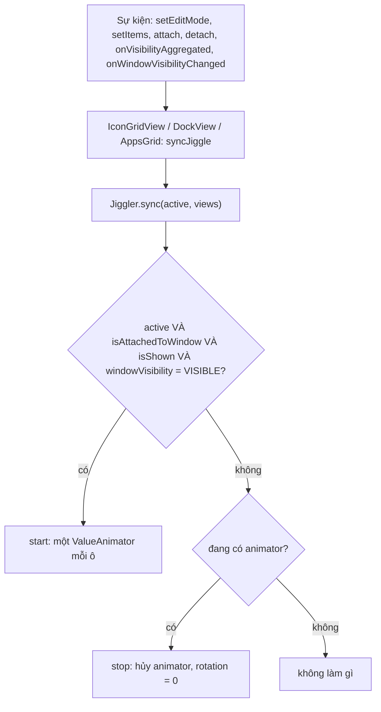
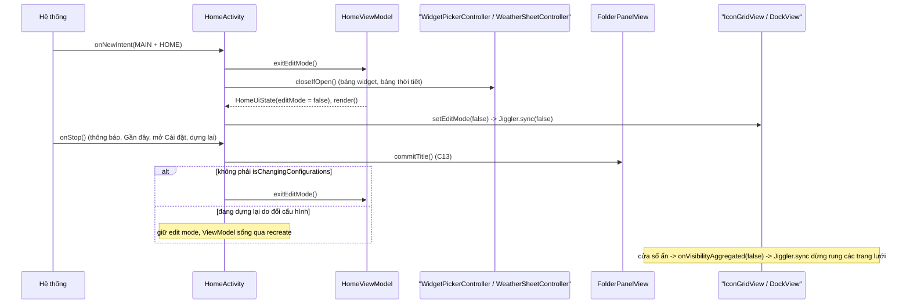
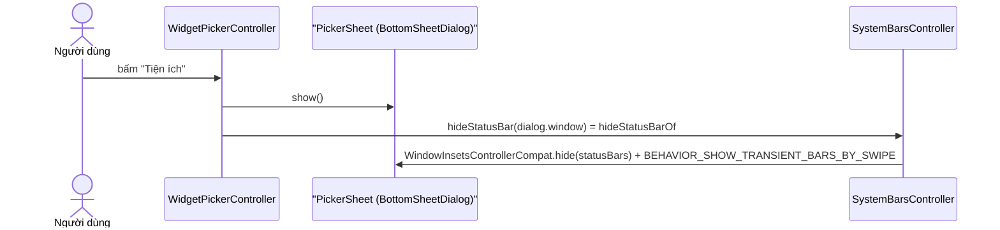

# FX2 — Edit mode và nút Home: đọc trước khi review

**Plan:** [report/FX2-edit-mode-home.md](../report/FX2-edit-mode-home.md) · **PR:** #33 · **Nhánh:** `fix/fx2-edit-mode-home`

> Trạng thái: đầy đủ (2026-11-11). Mọi số đo ở Vsmart Live 4, **bản debug**, Os26 là launcher mặc định, kính Ép cao. Ba ca chưa chạy trên máy được ghi rõ ở mục 6.

## 1. Tóm tắt

Edit mode có năm lỗi nhỏ, sửa chung một nhánh vì cùng nằm ở `HomeActivity` và các view lưới:
- **A2:** icon rung mãi sau khi thoát edit mode và làm rò cả `HomeActivity` khi Activity dựng lại giữa edit mode. Nay rung chỉ chạy khi view đang gắn, đang hiện và đang ở edit mode.
- **B10:** nút Home, hoặc rời launcher bằng cách khác (thông báo, Gần đây, mở Cài đặt), thoát edit mode như iOS; Home đóng thêm bảng chọn widget và bảng thời tiết.
- **C13:** tên thư mục đang gõ không mất khi Activity dựng lại.
- **C19:** bảng chọn widget không làm thanh trạng thái hiện lại đè lên thanh nút edit mode.
- **C16:** thử thay một `ValueAnimator` mỗi ô bằng một ticker chung. **Đã đo và bỏ** (xem mục 5).

## 2. Kiến thức nền

- **`View.onDetachedFromWindow`:** gọi khi view rời cửa sổ, kể cả khi `RecyclerView` đưa trang vào cache hoặc khi Activity bị hủy. Trong hàm này `isAttachedToWindow` còn `true`, nên muốn "dừng vì đã detach" phải truyền cờ tường minh (đọc tài liệu + code).
- **`View.onVisibilityAggregated` / `onWindowVisibilityChanged`:** báo view có đang hiện thật hay không (gồm cả tổ tiên và cửa sổ). Khi Activity dừng, cửa sổ ẩn đi nên hai hàm này chạy.
- **Cửa sổ dừng không layout:** `RecyclerView.notifyItemRangeChanged` chỉ đánh dấu, việc bind lại nằm ở lượt layout; cửa sổ Activity đã dừng thì không layout (suy luận từ `ViewRootImpl`). Vì vậy tắt edit mode ở `onStop` không tự dừng rung các trang; cổng "đang hiện" lo việc đó.
- **`Activity.isChangingConfigurations`:** `true` khi Activity sắp bị dựng lại do đổi cấu hình (đổi sáng/tối, cỡ chữ, `recreate()`).
- **Dialog là cửa sổ riêng:** có `WindowInsetsController` riêng và đang giữ focus, nên cách ẩn thanh trạng thái đặt ở cửa sổ Activity không áp cho nó. Xem `BottomSheetDialog` ở bảng "Tiện ích".

## 3. Luồng hoạt động

**Cổng quyết định rung (A2).** Mọi thay đổi có thể làm đổi kết quả đều gọi lại `Jiggler.sync`:

Ở `onDetachedFromWindow` các view gọi `sync(false, …)` tường minh vì `isAttachedToWindow` còn `true` lúc đó.

**Nút Home và rời launcher (B10, C13).**

Chỗ dễ sai: `exitEditMode()` ở `onStop` đổi state nhưng bind lại các trang của pager không chạy lúc cửa sổ đã dừng; dock thì dừng ngay vì `render()` gọi `dockView.setEditMode` trực tiếp. Phần dừng rung ở nền do cổng "đang hiện" của Jiggler, không do adapter.

**Bảng chọn widget trong edit mode (C19).**

## 4. Thay đổi theo file

| File | Vai trò | Vì sao sửa | Đọc trước? |
|---|---|---|---|
| `ui/home/view/Jiggler.kt` | Rung icon | Nhận `host`, thêm `sync(active, views)` là nơi duy nhất quyết định rung/dừng | **Có** |
| `ui/home/view/IconGridView.kt` | Lưới một trang | `syncJiggle()` ở mọi chỗ trạng thái đổi; `onVisibilityAggregated`, `onWindowVisibilityChanged`; dừng ở detach | **Có** |
| `ui/home/view/DockView.kt` | Dock | Như `IconGridView` | |
| `ui/home/view/FolderPanelView.kt` | Panel thư mục | Chỉ lưới con (`AppsGrid`) dùng `sync` | |
| `ui/home/HomeActivity.kt` | Activity (độc quyền) | `onNewIntent` thoát edit mode và đóng hai bảng; `onStop` lưu tên thư mục và thoát edit mode; nối `hideStatusBarOf` | **Có** |
| `ui/home/controller/WidgetPickerController.kt` | Bảng chọn widget | `closeIfOpen()` public; ẩn thanh trạng thái cho cửa sổ bảng | |
| `ui/weather/WeatherSheetController.kt` | Bảng thời tiết | `closeIfOpen()` | |
| `ui/home/controller/SystemBarsController.kt` | Thanh hệ thống | `hideStatusBarOf(window)` dùng chung | |

## 5. Quyết định và đánh đổi

- **Rung theo cổng, không theo cờ "đã bắt đầu":** trạng thái rung là hàm của `(editMode, gắn, hiện)`; một cờ sống sót qua việc `RecyclerView` tái dùng view chính là nguyên nhân A2.
- **C16 — ticker chung bị bỏ (đo được, Live 4, bản debug, kính Ép cao, xen kẽ 3 lượt mỗi bên, cửa sổ 10 s, pin 31,1 → 31,9 °C):**

  | Bên | Tick (10 ms) mỗi 10 s | Trung vị |
  |---|---|---|
  | A: animator từng ô (commit Task 1) | 439, 428, 407 | **428** |
  | B: một `Choreographer.FrameCallback` mỗi `Jiggler` | 389, 435, 428 | **428** |

  Luật đã chốt trước khi đo: giữ nếu trung vị B ≤ 0,85 × A và max(B) < min(A). Không đạt, nên commit ticker bị `git revert` (`a1fca8b` → `3905814`). Kết luận: animator từng ô không phải chi phí chính của rung; nhiều khả năng chi phí ở RenderThread / vẽ lại kính (khớp bài học GL). Chưa tách theo luồng và chưa đo bản release. Cái mất theo: giữ pha rung của ô qua `setItems` (Q4) vì nằm trong commit bị bỏ.
- **B10 ở `onStop`, bỏ qua `isChangingConfigurations`:** rời launcher là thoát edit mode, nhưng đổi sáng/tối không phải rời launcher. Mở Cài đặt từ thanh nút cũng thoát edit mode (chủ dự án chấp nhận, Q1).
- **C13 lưu ở `onStop`, không ở detach:** `ViewModel` còn sống ở `onStop`.
- **C19 ẩn thanh cho cửa sổ dialog**, không dịch thanh nút.

## 6. Chỗ cần soi khi review

- Mọi lời gọi dừng/bắt đầu rung đi qua `Jiggler.sync`; `grep "jiggler\.\(start\|stop\)"` ngoài `Jiggler.kt` phải rỗng.
- `onVisibilityAggregated` chạy trước khi trường `jiggler` khởi tạo? (đã nghĩ: `mParent == null` lúc dựng nên không chạy; dựa vào đọc code, bài học SM).
- `onStop`: thứ tự lưu tên rồi thoát edit mode; `isChangingConfigurations` có đúng trong `onStop` của `recreate()` không (kiểm Task 4 mục (d)).
- `closeIfOpen()` của bảng widget gọi hai lần (từ `render` và `onNewIntent`) không lỗi.
- `SystemBarsController.applyStatusBarForEditMode` nay dùng `target.decorView` thay `binding.root` làm view tham chiếu; hành vi API 30 không đổi (chỉ dùng `window.insetsController`), kiểm bằng ảnh chụp.
- **Chưa kiểm trên máy (đọc code, chủ dự án kiểm khi duyệt PR):** bảng thời tiết + Home (máy không có widget thời tiết trên Home); kéo-thả icon rồi bấm Home ngay sau khi thả; kéo một thẻ widget từ bảng chọn trong edit mode.
- Cổng "đang hiện" đã được đo là đủ ở nền: edit mode + Settings ở trước cho 23 tick trong 30 s đầu rồi 0 tick/30 s ổn định; Step 2 dự phòng của Task 4 (duyệt `IconGridView` trong `HomeActivity`) không cần.

## 7. Cách kiểm lại

Xem "Bài kiểm cả tính năng" trong plan (Live 4, bản debug, sao lưu dữ liệu trước, trả sáng/tối `yes` và tên thư mục sau). Tóm tắt: CPU bằng `/proc/<pid>/stat` sau thoát edit mode (kỳ vọng ≤ 10 tick/30 s), `dumpsys meminfo` `Activities: 1` sau khi đổi sáng/tối hai lần trong edit mode, Home và `am start` Cài đặt để thử B10, gõ tên thư mục rồi đổi sáng/tối cho C13, ảnh chụp bảng "Tiện ích" cho C19.

**Số đo đã có (Live 4, debug, 2026-11-11):**

| Lúc đo | Trước (audit) | Sau Task 1 |
|---|---|---|
| Sau edit mode + vuốt trang 2/1 + thoát, 30 s | 253 tick | 4 tick |
| Edit mode, Cài đặt ở phía trước, 30 s | 247 tick | 16 tick |
| Đổi sáng/tối hai lần trong edit mode | `Activities: 3`, Native Heap 113 MB | `Activities: 1`, Native Heap 49 MB |
| Home rảnh, 15 s | 5 tick | 0 tick |
| Đang rung, 10 s | 501 tick | 384 tick (A/B: 407 đến 439) |

**Sau Task 3–6 (APK `8c597da`, 2026-11-11 13:45–13:52):**

| Thao tác | Kết quả |
|---|---|
| Home rảnh, 15 s | 0 tick |
| Edit mode + "Tiện ích" (ảnh chụp) | Không có thanh trạng thái đè lên "Cài đặt/Tiện ích"; sau Back thanh vẫn ẩn và thanh nút edit mode vẫn hiện |
| Edit mode + `KEYCODE_HOME` | Thanh nút mất, thanh trạng thái hiện lại, 4 tick/15 s |
| Edit mode + Settings ở trước | 23 tick trong 30 s đầu (việc thoát edit mode), rồi 0 tick/30 s; về bằng Home: không ở edit mode |
| Edit mode + Gần đây → Home | Không ở edit mode |
| Edit mode + `uimode night no`, `yes` | Vẫn ở edit mode sau mỗi lần dựng lại (guard `isChangingConfigurations` đúng); `Activities: 1`, Native Heap 47 MB |
| Gõ tên thư mục `X2t` + `uimode night no` | Thư mục mở lại với `X2t`; sau `force-stop`, DB hàng id 90 title `X2t` |
| logcat | Không có FATAL |

## 8. Bài học cho AGENTS.md

- (2026-11-11, đo được; chủ đề `home-pager-animation`) Animator vô hạn trên view phải gắn vào vòng đời hiển thị của view (gắn + hiện + tính năng bật), không chỉ vào "bật/tắt tính năng": trang trong cache của `RecyclerView` và Activity bị hủy đều làm animator mồ côi (8% một nhân kéo dài, `Activities: 3`).
- (2026-11-11, đọc code; `home-pager-animation`) Edit mode cũng là lớp tạm: thoát ở Back, Home và `onStop` (trừ khi dựng lại do đổi cấu hình). Quy tắc HB mở rộng.
- (2026-11-11, suy luận chưa kiểm chứng; `home-pager-animation`) `notifyItemRangeChanged` không bind lại khi cửa sổ đã dừng; trạng thái cần dừng lúc `onStop` phải do chính view tự dừng khi ẩn, không qua adapter.
- (2026-11-11, đọc tài liệu; `home-pager-animation`) Dialog là cửa sổ riêng có `WindowInsetsController` riêng: thanh hệ thống ẩn ở Activity không áp cho dialog.
- (2026-11-11, đo được; `glass`) Thay một `ValueAnimator` mỗi ô bằng một `Choreographer.FrameCallback` mỗi lưới không giảm CPU rung (trung vị 428 so 428 tick/10 s trên Live 4, bản debug): chi phí rung không nằm ở dispatch animator ở luồng chính, khớp mục GL "chi phí kính nằm ở RenderThread".
- (2026-11-11, đo được; `permissions-and-device-testing`) Tick CPU theo luồng bằng `/proc/<pid>/task/*/stat` và script `ticks.sh` (không cần `top` hay `simpleperf`); giữ `ticks.sh` ngoài repo, đẩy bằng `adb push`.
