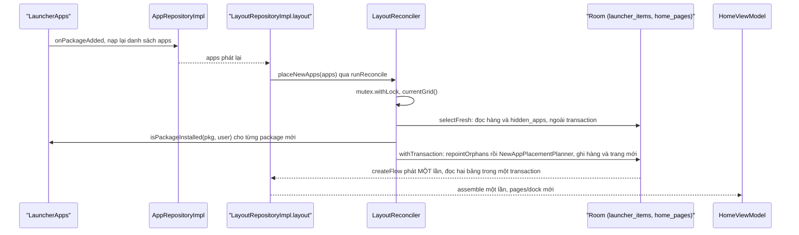
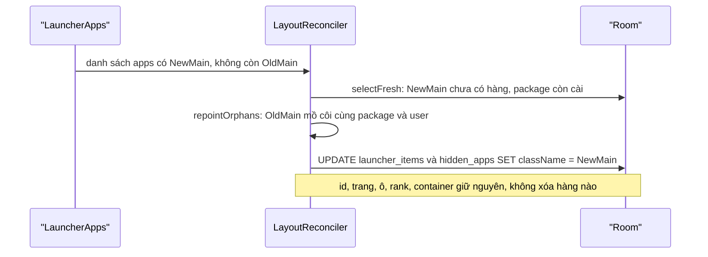
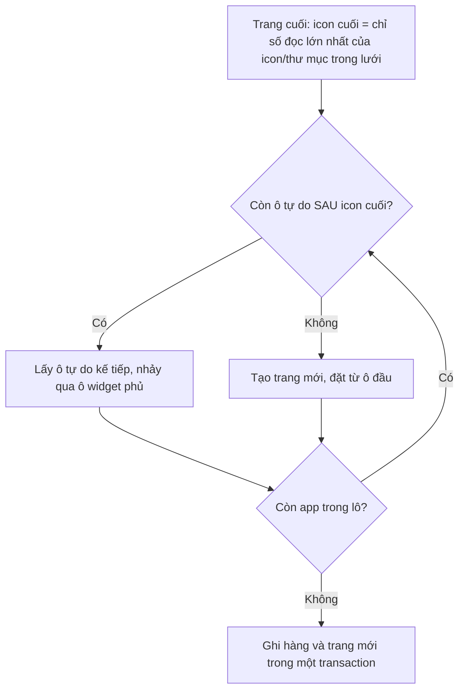

# FX3 — Bộ điều hợp bố cục: đọc trước khi review

**Plan:** [report/FX3-layout-reconciler.md](../report/FX3-layout-reconciler.md) · **PR:** #32 · **Nhánh:** `fix/fx3-layout-reconciler`

> Kiểm trên Vsmart Live 4 (bản debug, `FX3.apk`@81e3ce7, 2026-11-11 14:01-14:08, điều phối chạy). Các ca chưa chạy trên máy được ghi rõ ở mục 7.

## 1. Tóm tắt

Nhánh này sửa sáu lỗi của lớp ghi bố cục (`LayoutReconciler`, `LayoutRepositoryImpl`) trong báo cáo rà soát 2026-11-10:
- **A3:** app đổi tên activity khởi động khi cập nhật không còn để lại ô ma; hàng cũ được đổi `className`, giữ nguyên vị trí, ô dock, chỗ trong thư mục.
- **B3:** đổi cỡ lưới và ghi cài đặt cỡ lưới nằm trong một vùng khóa; bộ tính chỗ kéo-thả không sập khi trang có item ngoài lưới hoặc quá nhiều item.
- **B4:** app vừa bị gỡ không còn bị đặt lại thành ô ma.
- **B5 + C17:** UI nhận bố cục từ một flow cho cả hai bảng, mỗi lần ghi phát một lần.
- **C20:** app mới (và app bỏ ẩn) nằm **sau icon cuối cùng**, không lấp ô trống giữa trang.
- **B1 (phần bố cục):** lỗi Room trong flow bố cục không làm sập process.

Người dùng thấy: cài app thì icon xuất hiện ở cuối, bố cục tự xếp không bị xê dịch khi cài rồi gỡ; cập nhật app đổi tên activity thì icon vẫn đúng chỗ.

## 2. Kiến thức nền

- **Room `InvalidationTracker`:** Room theo dõi bảng nào vừa đổi và báo cho các flow quan tâm. `createFlow(vararg tables)` cho một flow "bảng nào đó đã đổi" (kiểu `Flow<Set<String>>`); ta tự đọc dữ liệu ở bước kế. Một lần làm mới gom mọi bảng đổi vào một lần phát ([tài liệu](https://developer.android.com/reference/androidx/room/InvalidationTracker), đọc source `room-runtime` 2.8.5).
- **Mutex và transaction:** transaction Room làm các lệnh SQL bên trong nguyên tử, nhưng không ngăn hai coroutine cùng đọc "ô trống" trước khi vào transaction; `Mutex` của `LayoutReconciler` xếp mọi lần ghi thành hàng (bài học M4, `lessons/settings-and-data.md`). Mutex không tái nhập nên hàm công khai không gọi nhau.
- **Hàng "mồ côi":** hàng `launcher_items` mà `(package, className, user)` không còn app sống trong `AppRepository.apps`. Có thể là app đã gỡ, tạm tắt, hoặc đổi tên activity. Q11 (`room-schema.md`): không xóa hàng chỉ vì app vắng mặt.
- **`ComponentKey`:** khóa của một activity khởi động; app có thể có nhiều activity khởi động.

## 3. Luồng hoạt động

**Cài một app mới (B4, C20, B5):**

Điểm dễ sai: hỏi hệ thống (`isPackageInstalled`) nằm **ngoài** transaction nhưng **trong** mutex (không giữ khóa ghi DB lúc chờ IPC); transaction lọc lại bằng dữ liệu của chính nó nên idempotent.

**App cập nhật và đổi tên activity khởi động (A3):**

**Quy tắc đặt chỗ cho app mới (C20, `NewAppPlacementPlanner`):**

**Đổi cỡ lưới (B3):** `ChangeGridPresetUseCase` chỉ chuyển tiếp xuống `LayoutRepository.changeGridPreset` → `LayoutReconciler.changeGridPreset`: dưới một `mutex.withLock`, thu nhỏ thì reflow DB rồi ghi DataStore, mở rộng thì ghi DataStore rồi reflow DB (thứ tự M8a). `placeNewApps` chờ mutex nên không thể đọc cỡ cũ giữa hai bước.

## 4. Thay đổi theo file

| File | Vai trò | Vì sao sửa | Đọc trước? |
|---|---|---|---|
| `data/layout/LayoutReconciler.kt` | Ghi bố cục | `selectFresh`, `repointOrphans`, `changeGridPreset`, đặt chỗ mới | **Có** |
| `data/layout/LayoutRepositoryImpl.kt` | Flow bố cục cho UI | Một flow hai bảng, `runReconcile`, `retryWithBackoff` | **Có** |
| `domain/layout/NewAppPlacementPlanner.kt` | Tạo: quy tắc C20 (hàm thuần) | Tách quy tắc khỏi DB | **Có** |
| `domain/layout/GridInsertPlanner.kt` | Chèn khi kéo-thả | Không ném lỗi với dữ liệu lệch | |
| `data/layout/db/LauncherItemDao.kt`, `HiddenAppDao.kt` | DAO | Thêm `renameComponent` (`@Query UPDATE`, không đổi schema) | |
| `domain/usecase/ChangeGridPresetUseCase.kt`, `domain/repository/LayoutRepository.kt` | Đổi cỡ lưới | Chuyển tiếp, đổi tên `reflowToGrid` → `changeGridPreset` | |
| `domain/model/GridPreset.kt` | Chú thích | Sửa chú thích trỏ đúng nơi chọn thứ tự ghi | |

## 5. Quyết định và đánh đổi

Chi tiết và bảng so sánh phương án ở mục "Vì sao chọn thiết kế này" của plan.
- **A3:** đổi `className` hàng mồ côi (như `PackageUpdatedTask` của Launcher3 đặt lại intent), không xóa-rồi-chèn (mất vị trí), không đổi khóa sang package (đổi schema).
- **B5:** `createFlow` hai bảng + một transaction đọc, không `debounce` (dựa vào thời gian) và không JOIN/`@Relation` (rơi dock và con thư mục).
- **B3:** một vùng khóa cho đổi cỡ lưới, không đưa cỡ lưới vào Room (đổi schema).
- **C20:** sau icon cuối của trang cuối (chủ dự án chốt 2026-11-11); không theo "ô trống đầu tiên" của Launcher3 (`WorkspaceItemSpaceFinder`).
- **Không đổi schema Room**; `app/schemas/1.json` không đổi.
- **Lỗi trong flow bố cục:** `retryWithBackoff` thay vì `.catch` cuối, vì UI thu flow suốt đời process nên flow đã dừng không bao giờ được khởi động lại (sửa theo review điều phối, vòng 1/5). Lỗi seed không bị nuốt để `catchUp`/`placeNewApps` không chạy trên DB rỗng.

## 6. Chỗ cần soi khi review

- **Ghép tuần tự của A3:** một package có nhiều activity khởi động cùng đổi tên (đặc biệt cả activity hiện **và** activity đang ẩn) có thể bị ghép chéo giữa hàng hiện và hàng ẩn; chấp nhận, chưa kiểm trên máy.
- **Alias bị tắt rồi bật alias khác** (app đổi icon bằng `activity-alias`) cũng đi qua A3 như một lần đổi tên; đúng ý, nhưng một alias tạm tắt kèm một alias mới bật cùng lúc sẽ bị coi là đổi tên.
- **`GridInsertPlanner`:** không có test, nên tính "y hệt cũ khi tràn đúng một item" chỉ được bảo vệ bằng đối chiếu từng nhánh (Nhật ký Task 4) và kiểm tay.
- **Đua B3/B4:** không ép được xác định trên máy thật; bằng chứng là đọc code và log thứ tự.
- **Seed lỗi:** Home ở trạng thái đang nạp cho tới khi DB hồi phục (flow chạy lại sau 0,5 s tăng tới 5 s).
- **Hàng mồ côi đã có từ trước khi sửa** (hàng cũ và hàng mới cùng package đã đặt) không được dọn.

## 7. Cách kiểm lại

Bài kiểm Live 4 (điều phối chạy, sao lưu trước, khôi phục sau) nằm ở mục "Bài kiểm cả tính năng" của plan; log lọc bằng `adb logcat -s LayoutRepository:D LayoutReconciler:D`.

| # | Việc | Kết quả mong đợi | Kết quả thực tế (Live 4, đo được) |
|---|---|---|---|
| 1 | Khởi động | Một `snapshot`, một `assemble`, không `FATAL` | `snapshot #1 pages=4 items=97`, `assemble #1`, không `FATAL` |
| 2 | Cài hai app thử (B5/C17) | Một lần phát `snapshot` mỗi lần ghi | `placeNew: fresh=1 grid=4x6`; `snapshot #2` rồi `#3`; `assemble` thừa chỉ do danh sách app phát lại |
| 3 | C20 trên bố cục có khe giữa trang | Sau icon cuối của trang cuối, không lấp khe | `b4a`, `b4b` vào (1,4) và (2,4) trang rank 3 (icon cuối ở (0,4)); khe trang 1 (4,2), (4,3), (5,0) còn nguyên. Gỡ cả hai: dump bố cục giống hệt trước khi cài |
| 4 | A3: `install -r` v2 đổi tên activity | 1 hàng, cùng `id` và ô, `className` mới | `id 123` rank 3 (1,4) giữ nguyên, `className = ...NewMain`; log `repoint ... items=1 hidden=0` |
| 5 | Q11: `pm disable-user` rồi `pm enable` | Hàng giữ nguyên, về đúng ô | Đúng; gỡ app: bố cục giống hệt lúc đầu |
| 6 | Đổi cỡ lưới 4x6 → 4x5 → 4x6, gỡ hai app liền nhau, trang có hàng trùng ô, A3 dock/hidden, ép lỗi Room | Không mất hoặc chồng icon; không crash | **Chưa chạy trên máy.** Đọc code + review độc lập; đổi cỡ lưới do chủ dự án kiểm khi duyệt PR |

Log giữ trong code (cùng kiểu `reflow to ...` đã có ở `LayoutReconciler`): `changeGrid A->B done`, `placeNew: fresh=N grid=CxR`, `placeNew: skipped N not installed`, `repoint ...` (chỉ số đếm và tên package). Log đếm `assemble #n`/`snapshot #n` chỉ dùng để đo B5/C17 nên đã gỡ khỏi code.

## 8. Bài học cho AGENTS.md

- `drag-and-layout` (đọc code, 2026-11-11): planner thuần được gọi trên luồng chính phải chịu được dữ liệu lệch (item ngoài lưới, hơn `columns*rows` item); hàng trùng ô là cách tái hiện không cần đua.
- `settings-and-data` (đọc code + tài liệu Room, 2026-11-11): hai flow Room không chung transaction thì dùng `invalidationTracker.createFlow` trên nhiều bảng và đọc trong một transaction; ghi dữ liệu ở hai nơi (DataStore, Room) phải chung một vùng khóa khi có đường đọc khác ở giữa.
- `settings-and-data` (đọc code, 2026-11-11): `.catch` cuối flow dùng chung chạy trên `ApplicationScope` làm flow chết vĩnh viễn nếu UI thu cả đời process; dùng `retryWhen` có backoff. Bước khởi tạo (seed) không được bị nuốt lỗi rồi chạy tiếp các bước sau.
- `drag-and-layout` (đọc tài liệu AOSP, 2026-11-11): Launcher3 đặt app mới vào ô trống đầu tiên (`WorkspaceItemSpaceFinder`), nên "sau icon cuối" là lựa chọn có chủ ý của dự án, không phải mặc định của Android.
