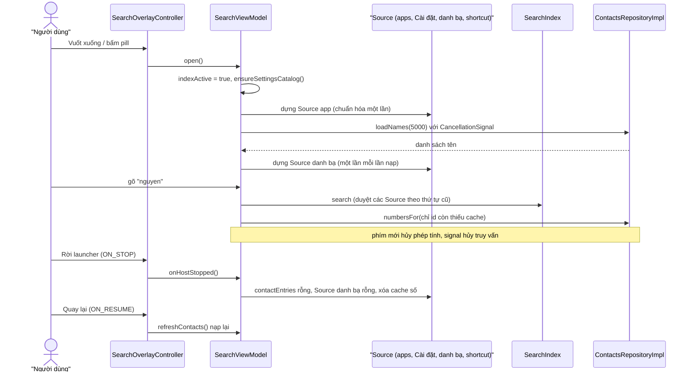
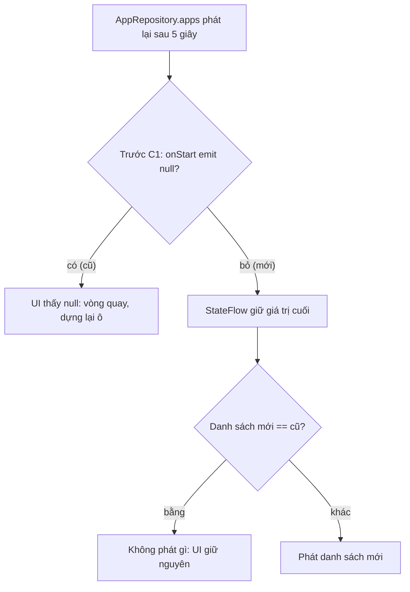

# FX4 — Tìm kiếm và App Library: đọc trước khi review

**Plan:** [report/FX4-search-library.md](../report/FX4-search-library.md) · **PR:** #34 · **Nhánh:** `fix/fx4-search-library`

## 1. Tóm tắt

Sáu mục của báo cáo rà soát 2026-11-10 (B11, C1, C6, C7, C8, C9), không đổi gì nhìn thấy được ngoài việc bớt chớp và bớt việc ngầm:
- chỉ mục tìm kiếm chuẩn hóa mỗi nguồn **một lần** (danh bạ 2000 người: dựng nguồn ~9–15 ms thay vì ~114 ms mỗi lần dựng cả chỉ mục);
- quay về Home sau hơn 5 giây không còn phát `null` (vòng "Đang tải" + dựng lại ô) ở App Library và tìm kiếm;
- rời launcher khi ô tìm kiếm còn mở thì tên danh bạ rời RAM, `ContentObserver` được gỡ; quay lại nạp lại;
- truy vấn số điện thoại hủy được, có cache theo phiên;
- hàng shortcut trong tìm kiếm chỉ nạp một icon, có cache 60 giây;
- danh mục Cài đặt hệ thống và chỉ mục không dựng lúc khởi động lạnh, chỉ từ lần mở tìm kiếm đầu tiên.

## 2. Kiến thức nền

- **`StateFlow` + `stateIn(WhileSubscribed(5_000))`:** khi hết người thu 5 giây thì upstream dừng, nhưng `StateFlow` **giữ giá trị cuối** (`replayExpiration` mặc định không hết hạn) và lọc trùng theo `equals`. Nếu flow chạy lại mà phát một giá trị khác (như `null`) thì UI thấy giá trị đó; nếu phát lại giá trị bằng nhau thì UI không thấy gì. Đó là cả cơ chế của C1 (đọc tài liệu kotlinx.coroutines).
- **`android.os.CancellationSignal`:** `ContentResolver.query` là lời gọi chặn; hủy coroutine không dừng nó. Truyền một `CancellationSignal` rồi gọi `cancel()` khiến truy vấn ném `OperationCanceledException` (hạng `RuntimeException`) (đọc tài liệu Android).
- **`LifecycleEventObserver` / `ON_STOP`:** Activity dừng khi người dùng rời launcher (Recents, thông báo, mở app). Hộp thoại xin quyền của hệ thống chỉ làm `ON_PAUSE`, không `ON_STOP`.
- **Nguồn danh bạ giả (chỉ khi đo):** chủ dự án cấm cấp `READ_CONTACTS` và cấm ghi vào danh bạ máy, nên khi đo dùng `FakeContactsRepository` gắn thế qua Hilt trong một commit tạm, rồi revert (`git log` có cặp commit thêm/revert). Bản cuối không còn nó.

## 3. Luồng hoạt động

- `searchIndex` chỉ là phép ghép các `Source` (`SearchIndex(listOf(apps, settings, contacts, shortcuts))`), không chuẩn hóa gì. Thứ tự bốn nguồn **là** thứ tự cùng hạng của kết quả, nên không được đổi.
- Trước `open()` đầu tiên: nguồn app chờ `indexActive`, danh mục Cài đặt chưa dựng; chỉ có app list và gợi ý như cũ.

## 4. Thay đổi theo file

| File | Vai trò | Vì sao sửa | Đọc trước? |
|---|---|---|---|
| `ui/search/SearchViewModel.kt` | Điều phối tìm kiếm | Nguồn `Source` theo từng loại; cổng `indexActive` (C9); `onHostStopped` (C6); cache số + mã phiên (C7); `visibleApps` là `StateFlow` (C1) | **Có** |
| `domain/search/SearchIndex.kt` | Chỉ mục | `Source` bất biến, `SearchIndex(List<Source>)` | **Có** |
| `domain/search/AppSearchMatcher.kt` | Chuẩn hóa | Vòng ký tự một lượt + bảng tra, dự phòng `normalizeSlow` (bản cũ) | **Có** |
| `data/search/ContactsRepositoryImpl.kt` | Đọc danh bạ | `queryCancellable` với `CancellationSignal`; `OperationCanceledException` bắt riêng | |
| `domain/usecase/GetCategoryGroupsUseCase.kt` | Nhóm Library | Bỏ `onStart { emit(null) }` | |
| `data/apps/ShortcutRepositoryImpl.kt`, `domain/repository/ShortcutRepository.kt` | Shortcut | `shortcutIcon` một icon + `LruCache` (32 mục, TTL 60 s) | |
| `ui/home/controller/SearchOverlayController.kt` | Nối tìm kiếm với Activity | Một nhánh `ON_STOP` trong observer sẵn có | |

## 5. Quyết định và đánh đổi

Chi tiết và so sánh phương án: mục "Vì sao chọn thiết kế này" trong plan (B11: nguồn riêng + chuẩn hóa nhanh, không memo toàn cục, không chỉ đường tắt ASCII; C9: dựng ở `open()` đầu, không "sau khung đầu"; nguồn danh bạ giả để đo). Đánh đổi: lần mở đầu tiên của một process trễ vài chục ms để mục Cài đặt hiện; khi quay về với ô tìm kiếm còn mở, hàng danh bạ biến mất một thoáng tới khi nạp lại (điều phối chấp nhận, D7).

## 6. Chỗ cần soi khi review

- `normalizeFast`: chỉ nhận ASCII in được, dấu tổ hợp 0x300–0x36F và ký tự có trong `TABLE`; mọi ký tự khác trả `null` để cả chuỗi chạy `normalizeSlow`. `TABLE` dựng bằng chính `normalizeSlow` trên từng ký tự. Đối chiếu bằng log một lần (10064 ca dải ký tự + nhãn thật + 2000 tên giả): 0 lệch (đo được trên Live 4, bản debug).
- Thứ tự `listOf(apps, settings, contacts, shortcuts)` trong `searchIndex`.
- `numberCache` + `contactSession`: mã phiên tăng ở `close()`, `onHostStopped()` và khi `changes()` phát; truy vấn chỉ ghi cache nếu mã phiên không đổi; "không có số" chỉ ghi khi truy vấn có trả gì (tránh nhớ nhầm một lỗi).
- `queryCancellable`: hủy `signal` khi `await()` bị hủy; không để `OperationCanceledException` thành log lỗi.
- **Chỉ được code bảo vệ, chưa kiểm trên máy:** `CancellationSignal` thật trên `ContentResolver.query`, nhánh `OperationCanceledException`, và việc gỡ `ContentObserver` thật (không có quyền danh bạ trên Live 4; trên máy chỉ kiểm bằng nguồn giả có độ trễ mô phỏng, log đăng ký/hủy của nguồn giả và `stopContactsWatch()`).
- `setShortcutIds` kèm `setPackage` (luôn đặt `setPackage`); chưa đối chiếu tài liệu AOSP xem có bắt buộc không.

## 7. Cách kiểm lại

Live 4 (debug), Os26Launcher là launcher mặc định, không cấp quyền danh bạ:
1. Khởi động lạnh, chưa mở tìm kiếm: không có việc dựng chỉ mục/danh mục (cần bản có log; bản sạch chỉ kiểm hành vi).
2. Bản sạch: ô trống và gõ từ 2 ký tự có hàng mời "Hiện danh bạ" khi chưa cấp quyền; tắt công tắc "Tìm trong danh bạ" thì hàng mời mất; tìm `nguyen`, `đức`, `wifi`, `chrome` cho kết quả như `main`.
3. Library → app khác 9 giây → quay lại: không chớp "Đang tải".

## 8. Bài học cho AGENTS.md

Chủ đề `search` (điều phối đưa vào `docs/lessons/search.md`):
- 2026-11-11, đo được (Live 4, debug): với 2000 danh bạ, một lần dựng cả chỉ mục ~114 ms (0,05 ms/nhãn), thấp hơn nhiều so với ngoại suy 0,2 ms/nhãn của M8d (Oppo); dựng riêng nguồn danh bạ ~9–15 ms sau khi chuẩn hóa một lượt.
- 2026-11-11, suy luận từ số đo: đường tắt "chỉ ASCII" cho `normalize` vô ích với tên người Việt (đa số có dấu); chuẩn hóa nhanh phải dựng bảng tra bằng chính thuật toán cũ và rơi về bản cũ khi gặp ký tự lạ.
- 2026-11-11, đọc tài liệu: `stateIn(WhileSubscribed)` giữ giá trị cuối và lọc trùng; `onStart { emit(null) }` trong flow nguồn làm UI thấy `null` mỗi lần flow chạy lại, nên đặt giá trị "chưa nạp" ở `stateIn`, không ở nguồn.
- 2026-11-11, quy trình (chủ đề `permissions-and-device-testing`): khi cấm cấp quyền danh bạ thật, kiểm tính năng danh bạ bằng nguồn giả gắn thế qua Hilt trong một commit tạm có dấu rồi `git revert`; ghi rõ phần không kiểm được (provider thật, `CancellationSignal` thật).
- 2026-11-11, quy trình: log đo tạm nên ghi vào tag riêng và gỡ bằng grep dấu; số đo debug không nói thay trải nghiệm người dùng (`startup-performance`).
