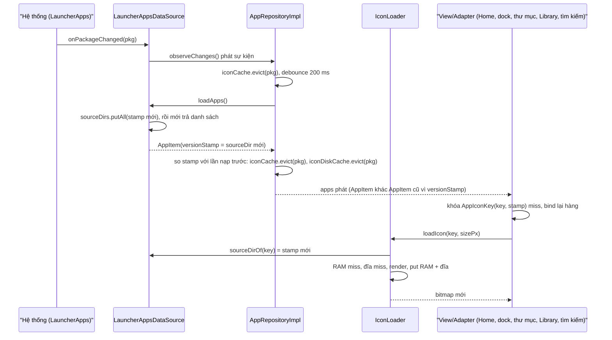
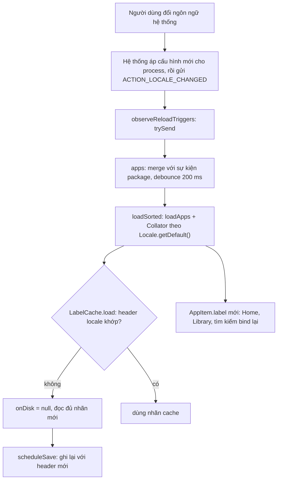
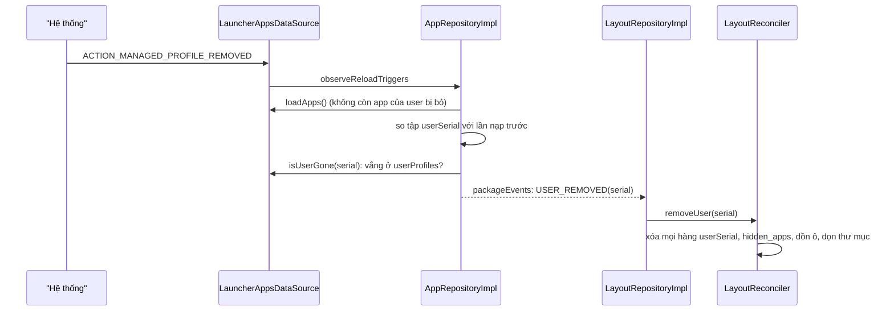

# FX5 — Icon và nhãn sau khi app cập nhật: đọc trước khi review

**Plan:** [report/FX5-icons-labels.md](../report/FX5-icons-labels.md) · **PR:** #36 · **Nhánh:** `fix/fx5-icons-labels`

## 1. Tóm tắt

Bảy mục của báo cáo rà soát 2026-11-10 (A4, B7, B8, B9, C2, C10, C11), một mục phụ (trim RAM) đã thử rồi bỏ:
- **A4/B7:** app cập nhật icon thì icon mới hiện ở Home, dock, thư mục, App Library và tìm kiếm trong vài giây, không cần khởi động lại launcher.
- **B8:** kiểu icon Tô màu không còn gắn bộ lọc màu lên drawable dùng chung của hệ thống (`mutate()`).
- **B9:** đổi ngôn ngữ hệ thống thì nhãn và thứ tự sắp xếp nạp lại ngay; cache nhãn không còn kẹt header cũ.
- **C2:** cache icon đĩa xóa theo lần dùng gần nhất, và dọn file của APK cũ.
- **C10:** app trong hồ sơ công việc có huy hiệu cặp táp; bỏ hồ sơ thì hàng của nó trong bố cục được dọn ngay.
- **C11:** gói icon đã bỏ chọn được giải phóng.
- **Đã bỏ:** trả RAM của `IconCache` khi process vào danh sách nền (đo không đạt, xem mục 5).

## 2. Kiến thức nền

- **`sourceDir`:** đường dẫn APK của app, ví dụ `/data/app/~~AvB3.../pkg-xxx/base.apk`. Từ Android 8 có hậu tố ngẫu nhiên và **đổi mỗi lần cài hoặc cập nhật**. Dự án dùng nó làm "dấu vân tay" (stamp) từ LC (cache nhãn) và IC (cache icon đĩa). FX5 đưa nó vào `AppItem.versionStamp`. **Đo được (Live 4, 2026-11-11):** `adb shell pm path` đổi qua mỗi lần `install -r` (`~~AvB3…/base.apk` → `~~6hhb…/base.apk`).
- **`ConstantState` và `mutate()`:** các `Drawable` tạo từ cùng một resource chia sẻ một "trạng thái hằng" (`BitmapState`, trong đó có `Paint`). `setColorFilter` ghi vào `Paint` dùng chung đó. `Drawable.mutate()` tạo bản trạng thái riêng. Đọc tài liệu và mã AOSP; chưa tái hiện được lỗi trên máy (xem mục 6).
- **`BroadcastReceiver` đăng ký động:** `ACTION_LOCALE_CHANGED` và năm `ACTION_MANAGED_PROFILE_*` (gửi cho user chính). Chỉ sống khi flow còn được thu; process không chạy lúc đó thì lần khởi động sau tự nạp lại.
- **Hồ sơ công việc (managed profile):** user phụ của cùng thiết bị, có `userSerial` riêng. `UserManager.getUserProfiles()` liệt kê hồ sơ của user chính, **loại hồ sơ đang gỡ dở** nhưng còn hồ sơ ở chế độ yên lặng. `PackageManager.getUserBadgedIcon(drawable, user)` trả icon có huy hiệu của hệ thống cho hồ sơ, và nguyên icon cho user chính.

## 3. Luồng hoạt động

### 3.1 App cập nhật icon (A4, B7, C2)

Ba chỗ dễ sai:
1. **Có hai tầng chặn, không phải một.** Tầng 1: bản đồ bitmap riêng của từng view khóa theo `ComponentKey` trần. Tầng 2: các phép so sánh bằng `==` (`DockView.setItems`, `AppsGrid.setApps`) và điều kiện `holder.boundKey == key && drawable != null` ở ba adapter. Sửa một tầng mà quên tầng kia thì lỗi vẫn còn. Đưa stamp vào dữ liệu (`AppItem`) làm cả hai tầng tự thấy thay đổi.
2. **Thứ tự registry và danh sách.** `sourceDirs` được cập nhật *trước* khi danh sách mới phát, nên một view còn cầm `AppItem` stamp cũ có thể nhận bitmap đã render theo stamp mới và cất dưới khóa cũ; khi `AppItem` mới tới, khóa mới miss rồi nạp lại từ `IconCache`. Chiều ngược lại (icon cũ dưới khóa mới) không xảy ra.
3. **`iconDiskCache.evict` chạy trước khi danh sách mới phát** và vào hàng đợi luồng ghi đơn, nên mọi file ghi theo stamp mới đều nằm sau lệnh xóa.

### 3.2 Đổi ngôn ngữ (B9)

- **Vì sao `onDisk = null`:** `scheduleSave` bỏ qua khi `entries == onDisk`. Nếu header lệch mà `onDisk` vẫn giữ bản cũ và nhãn mới trùng nhãn cũ (ví dụ `en-US` → `en-GB`), file không được ghi lại, header kẹt ở locale cũ và mọi lần nạp sau đọc đủ nhãn.
- **Ba dòng `apps emitted` mỗi lần đổi ngôn ngữ (đo Live 4):** chưa kiểm nguyên nhân. Suy luận: một từ broadcast, còn lại từ các sự kiện package khi Play cài lại gói ngôn ngữ, mỗi sự kiện qua debounce riêng. Vô hại: nhãn đúng, không chớp.
- **Cách thường dùng đã đúng từ trước:** đổi ngôn ngữ qua màn Cài đặt mất hơn chục giây nên các flow `WhileSubscribed(5_000)` dừng và nạp lại khi quay về (suy luận). Lỗi thật là đổi nhanh khi Home còn hiện.

### 3.3 Hồ sơ công việc (C10)

- **Huy hiệu vẽ lên bitmap đã render** (`IconLoader`, sau `renderer.render`, trước cache): đường vẽ adaptive/Tô màu/3D/gói icon giữ nguyên, huy hiệu đến cuối. Tên file đĩa của hồ sơ có hậu tố `|badge1`, của user chính giữ nguyên chuỗi nên cache cũ không mất. Nhãn trợ năng "YouTube làm việc" lấy từ `PackageManager.getUserBadgedLabel`, đưa vào `AppItem.a11yLabel` chỉ để làm `contentDescription` (không đổi nhãn hiển thị, không vào `LabelCache`).
- **Bài học 28 gói so với 30 hàng:** lần kiểm đầu, sự kiện giả chỉ liệt kê package (28) nên 2 hàng của hồ sơ (tổng 30) còn lại tới khi khởi động lại. Không biết hàng nào sót, nên đổi sang xóa **theo user** (`USER_REMOVED`, `removeUser(serial)` xóa mọi hàng `userSerial = serial`, kể cả hàng không có trong danh sách package đã biết). Dùng danh sách "những gì ta biết" làm phạm vi xóa thì luôn có nguy cơ sót; khi khóa của nhóm đã rõ (user) thì xóa theo khóa đó.
- **Vì sao không dùng `getUserForSerialNumber` để xác nhận:** vòng 1 FAIL vì hàm này vẫn trả user lúc đang gỡ dở (suy luận từ AOSP, chưa kiểm trực tiếp), nên không bao giờ kết luận được. Chỉ cần "vắng ở `userProfiles`, danh sách không rỗng, không phải user chính". Hồ sơ yên lặng vẫn có trong `userProfiles` nên không bị xóa (**đọc code**, chưa thử tạm dừng hồ sơ trên máy).

## 4. Thay đổi theo file

| File | Vai trò | Vì sao thêm/sửa | Đọc trước? |
|---|---|---|---|
| `domain/model/AppItem.kt` | `versionStamp`, `iconKey`, `AppIconKey`, `a11yLabel` | Dữ liệu mang dấu APK để mọi so sánh tự thấy thay đổi | **Có** |
| `data/apps/AppRepositoryImpl.kt` | So stamp và tập user sau mỗi lần nạp; hợp trigger; sự kiện giả | Chỗ duy nhất biết cả nguồn thay đổi lẫn các cache | **Có** |
| `data/apps/LauncherAppsDataSource.kt` | Gắn stamp; `observeReloadTriggers`; `isUserGone`; huy hiệu, nhãn trợ năng | Nguồn dữ liệu hệ thống | **Có** |
| `data/apps/IconCache.kt`, `IconLoader.kt` | Stamp trong khóa RAM; stamp đọc một lần; huy hiệu | Sửa B7 từ gốc | Có |
| `data/apps/IconDiskCache.kt` | Chạm `lastModified` khi đọc trúng; `evict` theo stamp đổi | C2 | |
| `data/apps/IconRenderer.kt` | `mutate()` trước thăm dò và bộ lọc | B8 | |
| `data/apps/LabelCache.kt` | `onDisk = null` mọi đường trả null | B9 | |
| `data/apps/IconPackManager.kt`, `IconStyleSource.kt` | `retainOnly` khi đổi gói | C11 | |
| `ui/home/view/IconGridView.kt`, `DockView.kt`, `FolderPanelView.kt` | Map bitmap theo `AppIconKey`; `AppsGrid` thêm `retainAll` | A4 tầng 1 | |
| `ui/home/view/CategoryGroupPanelView.kt`, `ui/library/AppLibraryAdapter.kt`, `ui/search/SearchResultAdapter.kt` | `boundStamp` / khóa `stableId#stamp` | A4 tầng 2 | |
| `ui/home/view/IconCellView.kt`, `CategoryPageView.kt` | `contentDescription` dùng `a11yLabel` | C10 | |
| `domain/model/PackageEvent.kt`, `data/layout/LayoutReconciler.kt`, `LayoutRepositoryImpl.kt`, `db/HiddenAppDao.kt` | `USER_REMOVED`, `removeUser`, `deleteByUser` | C10 (chỉ thêm; không đổi schema Room) | Có |

## 5. Quyết định và đánh đổi

- **Dấu phiên bản = `sourceDir`** (không phải `lastUpdateTime`, không phải tín hiệu "icon đổi", không phải tham số `icon(key, stamp, size)`): không IPC thêm, không trạng thái phải giữ đồng bộ, chữ ký `loadIcon` giữ nguyên ở 7 chỗ. Đánh đổi: `AppItem` đổi nên `apps` phát thêm một lần mỗi khi app cập nhật; không bắt được đổi icon mà `sourceDir` không đổi (chủ đề icon của ROM).
- **Receiver cho locale** thay vì so thẻ locale ở `onCreate` (cần sửa file độc quyền) hay `onConfigurationChanged` (cơ chế thứ hai). Dự phòng không phải dùng: trên Live 4 cấu hình tới trước broadcast.
- **Huy hiệu trên bitmap đã render** thay vì `getBadgedIcon` trước khi render (sẽ làm phẳng icon adaptive, suy luận từ mã AOSP).
- **Trim `IconCache` đã thử và bỏ (đo được, Live 4, debug, 2026-11-11):** sau Library và tìm kiếm, foreground Native 67,5 MB, Graphics 64,1 MB. Process ở nền: `HIDDEN` không có dòng trim (đúng); `BACKGROUND` → `IconCache trim level=40 size=10007856 -> 0`, nhưng Native Heap chỉ 61,7 → 60,7 MB sau 10 s và một tín hiệu GC (Graphics không đổi): dưới ngưỡng 3 MB đã đặt, vì map bitmap riêng của các view giữ cùng các bitmap đó. `git revert 01f0a4c` (`e04acb9`). Muốn trả RAM thật thì phải thu cả map của view, việc khác.
- **Xóa hồ sơ theo user, không theo danh sách package** (mục 3.3).

## 6. Chỗ cần soi khi review

- **Chưa kiểm trên máy (chỉ có code bảo vệ):** panel nhóm Library, dock, mini icon thư mục sau `install -r` (chủ dự án kiểm lần cuối); B8 (không tái hiện, cần đổi kiểu Tô màu); C11 (cần hai gói icon); chế độ yên lặng của hồ sơ; cập nhật qua cửa hàng Play (cùng cơ chế, suy luận).
- **Giới hạn của C2 (đã đo, Live 4):** `trim` chỉ chạy khi có lần ghi, nên thư mục có thể ở trên trần 8 MB lúc nghỉ (đo thấy 725 file, 9,7 MB). LRU theo lần đọc bảo vệ icon Home từ phiên khởi động kế tiếp; trong chính phiên làm vượt trần lần đầu, file icon Home (ghi đầu tiên) vẫn là file cũ nhất. Kết quả đo: 700 file đệm mới hơn, `force-stop`, Home, một lần ghi: tổng 1425 → 661; đệm 700 → 623; file của package có trên Home 415 → 18 (18 file giữ lại đúng là icon Home nạp sau khởi động lại, các cỡ khác cũ hơn đệm nên bị xóa đúng).
- **`AppItem` đổi nên `apps` phát thêm khi cập nhật:** kiểm không phát thừa khi không có gì đổi (log đã gỡ; đã đo 1 dòng `apps emitted` mỗi lần `install -r`).
- **Sửa ngoài vùng ban đầu của FX5:** hai dòng `contentDescription` (`IconCellView`, `CategoryPageView`) và `data/layout/*` (chỉ thêm), có sự cho phép của điều phối. PR #39 (FX8) cũng sửa `CategoryPageView.kt`: có thể phải rebase.
- Receiver chỉ `trySend`; `RECEIVER_NOT_EXPORTED` (system broadcast vẫn tới, đã thấy trên Live 4).

## 7. Cách kiểm lại

APK thử không code (icon đỏ v1, xanh v2, cùng khóa debug) như phần "Công cụ kiểm" của plan.
1. Đặt app thử lên lưới, dock (kéo), trong thư mục; `adb install -r` v2, chờ ~6 s, **không** `force-stop`: mọi chỗ đổi từ đỏ sang xanh. Mở panel nhóm Library và tìm kiếm trước khi cài: cũng đổi.
2. Đổi ngôn ngữ `vi-VN` ↔ `en-US` (công cụ `app_process` gọi `updatePersistentConfiguration`), Home hiện: nhãn đổi trong vài giây, `no_backup/app_label_cache.json` có header locale mới. Lần đổi sang ngôn ngữ chưa từng dùng thì Play cài gói ngôn ngữ và che lỗi: kiểm chiều đã có gói.
3. `adb shell pm create-user --profileOf 0 --managed Work`, `am start-user <id>`: icon app hồ sơ có huy hiệu; `pm remove-user <id>`: icon biến, 0 hàng với serial đó trong `launcher_items` (đọc DB bản kéo về, kèm `-wal`, `-shm`).
4. Sao lưu `databases/ files/ no_backup/` trước và trả lại sau (tạo hồ sơ làm launcher đặt hàng chục icon vào bố cục thật).

## 8. Bài học cho AGENTS.md

Điều phối đưa vào file chủ đề đúng sau merge (chủ đề đề xuất trong ngoặc):
- (`icons-and-app-list`, đo được 2026-11-11, Live 4) Mọi cache theo khóa phải mang dấu phiên bản APK ở **mọi** tầng (RAM, đĩa, map của view) và dữ liệu hiển thị phải mang dấu đó để so `==` tự phát hiện đổi; chỉ "xóa đúng khóa" ở một chỗ không đủ vì còn các điểm chặn bind lại (`boundKey`, `==` trong `setItems`).
- (`icons-and-app-list`, đo được) `adb install -r` APK tự dựng đổi `sourceDir` trên Android 11 (`pm path` khác trước/sau); icon Home không đổi trước FX5 là lỗi tái hiện được.
- (`icons-and-app-list`, đọc tài liệu/mã AOSP) `Drawable` lấy từ framework chung `ConstantState` (và `Paint`) với mọi bản của cùng app: gọi `mutate()` trước mọi `setColorFilter`/sửa trạng thái, kể cả trước lần vẽ thăm dò.
- (`icons-and-app-list`) Huy hiệu hồ sơ vẽ lên bitmap cuối bằng `PackageManager.getUserBadgedIcon`, không lên drawable gốc; khóa cache tách theo `userSerial` sẵn nên chỉ cần hậu tố tên file đĩa.
- (`settings-and-data`, đo được) Hồ sơ bị bỏ không bắn sự kiện gỡ từng app; phát hiện bằng so tập `userSerial` với `UserManager.userProfiles` (không dùng `getUserForSerialNumber`, vẫn trả user lúc đang gỡ dở). Xóa hàng **theo user**, không theo danh sách package: dùng danh sách đã biết làm phạm vi xóa để sót hàng (28 gói so với 30 hàng).
- (`permissions-and-device-testing`, đo được) Tạo hồ sơ công việc tạm bằng `pm create-user --profileOf 0 --managed Work` + `am start-user`, gỡ bằng `pm remove-user`; tạo hồ sơ làm launcher đặt ~30 icon mới vào bố cục thật nên phải sao lưu và trả DB. Đổi ngôn ngữ bằng công cụ `app_process`: lần đổi sang ngôn ngữ mới bị Play cài gói che lỗi, kiểm chiều đã có gói và cặp `en-US` ↔ `en-GB`.
- (`startup-performance`, đo được) Cache RAM của launcher không phải nơi giữ bộ nhớ chính: `evictAll` 10 MB của `IconCache` ở nền chỉ giảm Native Heap ~1 MB vì map bitmap của view giữ cùng các bitmap. Đừng thêm trim cho cache khi chủ sở hữu thật là view.
- (`startup-performance`, đo được) `IconDiskCache.trim` chỉ chạy khi ghi, nên thư mục có thể vượt trần lúc nghỉ; LRU theo lần đọc bảo vệ từ phiên sau, không bảo vệ trong phiên làm vượt trần.
