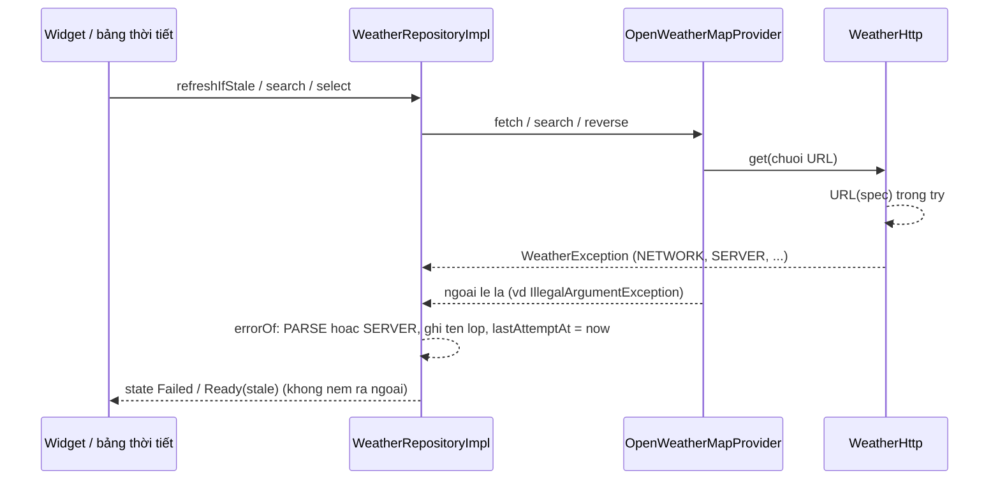
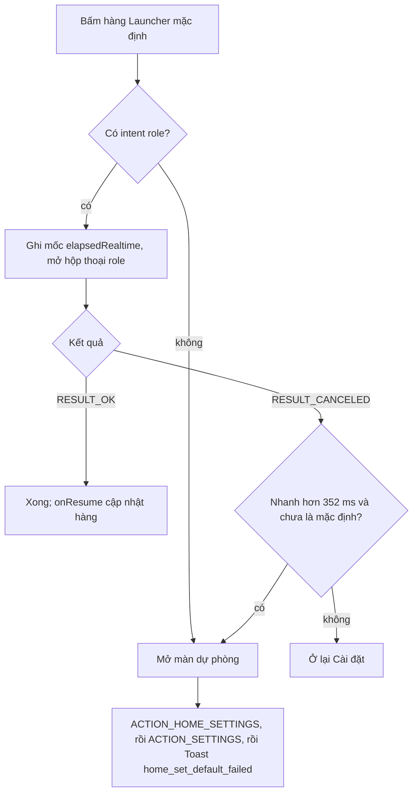

# FX6 — Độ bền coroutine, thời tiết và hàng "Launcher mặc định": đọc trước khi review

Plan: [../report/FX6-robustness-settings.md](../report/FX6-robustness-settings.md). Nguồn việc: audit 2026-11-10, mục B1 (phần scope ứng dụng và thời tiết), B12, và S1 (`ui → data` duy nhất). Số đo ở dưới đều là bản **debug**, Vsmart Live 4 (Android 11), 2026-11-11.

## 1. Tóm tắt

- **B1:** một ngoại lệ lạ trong `ApplicationScope` trước đây làm sập launcher. Nay scope có `CoroutineExceptionHandler` chỉ ghi tên lớp và một khung stack. Thời tiết không còn là đường sập: mọi lỗi lạ thành `WeatherError`; JSON có `"NaN"` thành `PARSE`; URL hỏng thành `SERVER`.
- **S1:** `WeatherSheetViewModel` không còn import `data`; vị trí thô đi qua interface `CoarseLocationSource` ở `domain`, nối ở `di/WeatherModule`.
- **B12:** bấm hàng "Launcher mặc định" mà hệ thống không hiện hộp thoại (quay về nhanh) thì mở màn "Ứng dụng màn hình chính" của hệ thống; người dùng tự bấm Hủy thì ở lại.

## 2. Kiến thức nền

- `SupervisorJob` chỉ cô lập các coroutine con với nhau. Lỗi chưa bắt của một coroutine gốc vẫn đi tới handler của luồng và giết process, trừ khi context có `CoroutineExceptionHandler` (đọc tài liệu kotlinx.coroutines; đo được ở Task 1).
- `viewModelScope` cũng không có handler. Vì vậy `catch (e: WeatherException)` ở ViewModel chỉ an toàn khi repository bảo đảm không ném gì khác: hợp đồng này nay có ghi ở KDoc của `WeatherRepository`.
- Hộp thoại xin vai trò Home (`RoleManager.createRequestRoleIntent`) trả `RESULT_CANCELED` cả khi người dùng hủy lẫn khi hệ thống không hiện hộp thoại; không có tín hiệu nào khác trong kết quả. Cách phân biệt: thời gian trôi qua.

## 3. Luồng hoạt động

## 4. Thay đổi theo file

| File | Thay đổi |
|---|---|
| `di/AppModule.kt` | `uncaughtHandler` nối vào scope; ném lại `VirtualMachineError` |
| `data/weather/WeatherHttp.kt` | `get(spec: String)`; `URL` dựng trong try; `MalformedURLException`/`RuntimeException` → `SERVER` |
| `data/weather/OpenWeatherMapProvider.kt` | `url()` trả `String` |
| `data/weather/OwmParser.kt` | `finite()` cho nhiệt độ và tọa độ; `guard` bắt thêm `IllegalArgumentException` |
| `data/weather/WeatherRepositoryImpl.kt` | `doRefresh` bắt `Exception` (ném lại hủy), tính một lần thử; `search`/`reverse` qua `mapFailures`; `init` dùng `finally` |
| `domain/weather/CoarseLocationSource.kt`, `domain/model/weather/CoarseFix.kt` | mới (S1) |
| `data/weather/CoarseLocationSourceImpl.kt` | đổi tên từ `CoarseLocationSource.kt`; `getLastKnownLocation` bắt `Exception` |
| `di/WeatherModule.kt` | `@Binds` cho `CoarseLocationSource` |
| `domain/repository/DefaultLauncherRepository.kt`, `data/system/DefaultLauncherRepositoryImpl.kt` | tách `createRoleRequestIntent()` và `createFallbackIntents()` |
| `ui/settings/SettingsActivity.kt`, `SettingsViewModel.kt` | đo thời gian và mở màn dự phòng; ViewModel chỉ thêm ba hàm |

## 5. Quyết định và đánh đổi

- Handler **không** crash ở bản debug (khác `if (DEBUG) throw`): chủ dự án dùng bản debug làm launcher mặc định. Đổi lại, một flow `stateIn` lỗi sẽ đứng yên với giá trị cuối thay vì sập; chữa thật là `.catch` từng flow (FX3 làm cho bố cục).
- Lỗi lạ cũng tính là một lần thử (cập nhật `lastAttemptAt`) để giữ hợp đồng D2 (thử lại sau 5 phút, không mỗi phút). `WeatherException` mới không mang `cause` (quy tắc bí mật G3e).
- B12 chọn "thời gian trôi qua" thay vì bộ đếm hay bỏ hộp thoại: sửa được cả lần bấm đầu, không lưu trạng thái. Ngưỡng `T = 352 ms` = max(300, 2 x 176 ms); lần Hủy thật nhanh nhất đo được ~1309 ms.
- **Giới hạn đã biết của B12:** trên Live 4 **không tái hiện được** ca "Không hỏi lại": tick "Không hỏi lại" rồi Hủy, lần bấm sau hộp thoại role vẫn hiện đầy đủ (PermissionController của Google trên ROM Android 11 này). Nên nhãn B12 với máy này vẫn là **suy luận**; bản sửa bảo vệ ROM/phiên bản có tôn trọng "Không hỏi lại" và ca `RESULT_CANCELED` tức thì (đã kiểm bằng role giả, quay về 49–176 ms).

## 6. Chỗ cần soi khi review

- Handler nằm trong context của scope và không ghi thông điệp ngoại lệ.
- Mọi đường `provider.*` ở repository chỉ ném `WeatherException` hoặc hủy; `CancellationException` được ném lại trước nhánh `Exception`.
- `roleRequestAt` chỉ đặt khi mở intent role; màn dự phòng mở bằng `startActivity` (không chờ kết quả, nên không vòng lặp).
- Commit `2b4330a` chỉ là bước đổi tên file, đứng riêng không build; `c30a729` hoàn tất (HEAD build xanh).

## 7. Cách kiểm lại

- B1 handler: bản vá tạm có cổng `files/fx6_boom` (ngoài repo, `E:\SourceTree\IosLauncher-wt\apk\*.patch`). Trước sửa: `FATAL EXCEPTION IllegalStateException`; sau sửa: một dòng `E/AppScope: uncaught ...` và process sống (đo được).
- Parser NaN: cổng `fx6_nan`: trước `IllegalArgumentException`, sau `WeatherException PARSE` (đo được).
- `MalformedURLException` qua làm mới/tìm kiếm (cổng `fx6_badurl`): **chưa chạy trên máy** (chủ dự án không có widget thời tiết và `weather.json`); chỉ đọc code. Chủ dự án kiểm khi duyệt PR nếu dùng widget thời tiết.
- B12: role giả (`fx6_fakerole`) → mở "Ứng dụng màn hình chính"; Hủy thật bình thường → ở lại Cài đặt.

## 8. Bài học cho AGENTS.md

- `SupervisorJob` không chặn lỗi tới handler của luồng: scope dùng chung cần `CoroutineExceptionHandler`, chỉ log tên lớp và một khung stack (không thông điệp: có thể chứa URL/khóa). Đo được trên Live 4 (2026-11-11).
- Hợp đồng repository phải nói rõ ngoại lệ nào thoát ra: `viewModelScope` không có handler nên `catch` ở ViewModel chỉ đúng khi repository bảo đảm.
- Lỗi lạ cũng phải tính là một lần thử nếu có hợp đồng chặn tần suất, nếu không nhịp phút gọi lại mỗi phút.
- `RESULT_CANCELED` của hộp thoại xin vai trò không phân biệt "người dùng hủy" với "hệ thống không hiện"; phân biệt bằng thời gian (không hiện: 49–176 ms; Hủy thật nhanh nhất ~1309 ms; Live 4, debug). Trên Live 4 + PermissionController Google (Android 11) "Không hỏi lại" không làm hộp thoại role biến mất.
- Cách thử "không hiện hộp thoại" không đụng trạng thái từ chối thật: xin một role không tồn tại (`createRequestRoleIntent("android.app.role.X")`) trả `RESULT_CANCELED` tức thì (đo được).
- Bản vá thử có cổng theo cờ file trong `files/` (một lần, tự xóa) cho phép ép đường lỗi mà không gây vòng sập trên launcher mặc định.
