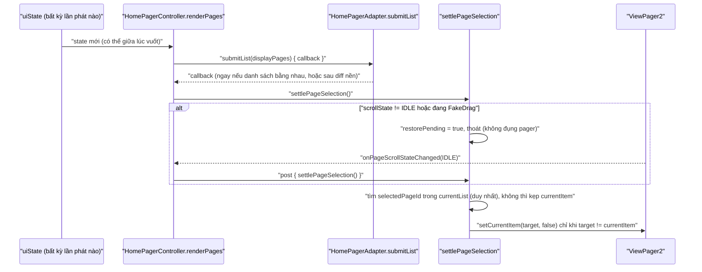
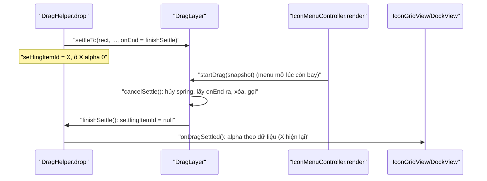
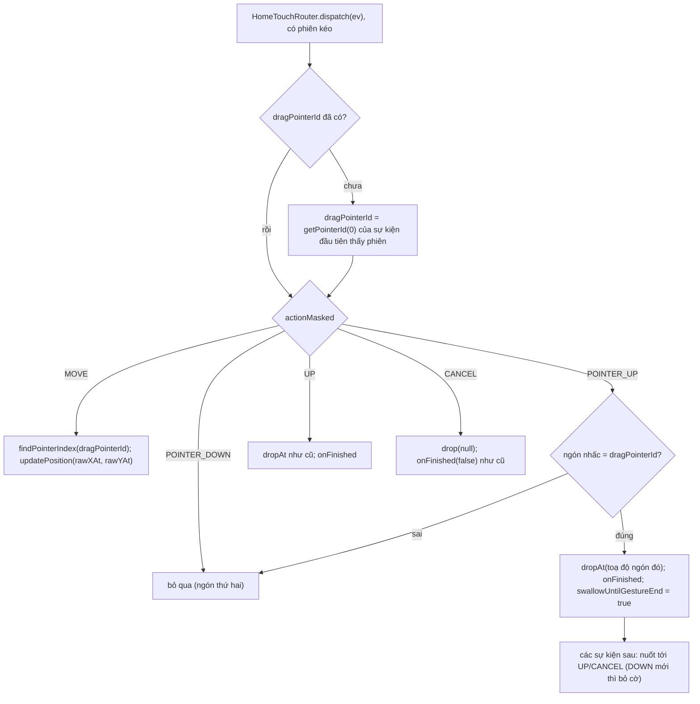

# FX7 — Cử chỉ Home: pager, menu icon, kéo-thả, chuyển Home → Library: đọc trước khi review

**Plan:** [report/FX7-home-gestures.md](../report/FX7-home-gestures.md) · **PR:** #38 · **Nhánh:** `fix/fx7-home-gestures`

## 1. Tóm tắt

Năm sửa nhỏ, độc lập, đều ở tầng `ui/home`, không đổi schema, không thêm thư viện, không đổi chữ ký công khai:
1. **B6:** trạng thái đổi giữa lúc vuốt trang không còn làm pager giật về 0 dưới ngón tay hay bỏ hoạt ảnh trượt. Việc "đặt lại trang đang xem" chỉ chạy khi pager rảnh, theo `pageId`.
2. **C14:** mở menu nhấn giữ lúc ảnh thả còn đang hạ cánh không để ô vừa thả kẹt alpha 0.
3. **C12:** kết quả shortcut tải chậm của app A không hiện trong menu của app B cùng thư mục.
4. **C18:** phiên kéo chỉ theo ngón đã bắt đầu kéo; ngón thứ hai bị bỏ qua; nhấc ngón kéo thì thả tại chỗ ngón đó.
5. **D2:** vuốt nhanh từ trang cuối sang App Library đi theo tốc độ ngón tay (hoạt ảnh kết thúc nhận vận tốc thả tay), và cử chỉ được nhận cả khi pager còn trượt nốt về trang cuối.

Task 8 của plan (làm nóng bố cục Library) **không làm**: FX8 (PR #39) đã chuyển việc dựng ô Library sang idle handler trước lần hiện đầu. Phần kính của Library cũng thuộc FX8.

## 2. Kiến thức nền

- **`ViewPager2.setCurrentItem(item, false)`** (đo bytecode `viewpager2-1.1.0`): thoát sớm chỉ khi `item == currentItem` và pager rảnh, hoặc khi `item == currentItem` và `smoothScroll`. Ca còn lại, kể cả "cùng trang" lúc đang kéo, đi tới `RecyclerView.scrollToPosition` và cắt ngang chuyển động. Vì thế lời gọi chạy ở mọi lần `uiState` phát (callback `submitList` chạy ngay khi hai danh sách bằng nhau: đọc nguồn `AsyncListDiffer`, chưa kiểm trên máy) là nguồn giật.
- **Ba trạng thái cuộn** của pager: `IDLE`, `DRAGGING` (tay hoặc `FakeDrag` của `PagerFlipAnimator`), `SETTLING` (trượt nốt sau nhả tay/fling). Chạm vào pager đang `SETTLING` làm RecyclerView chặn ngay và báo `DRAGGING` (đọc nguồn `onInterceptTouchEvent`).
- **`pageId` không duy nhất tuyệt đối:** layout nháp dùng `0`, trang cascade có id tạm âm, trang tạm khi kéo là `PageId.NEW`. Khôi phục theo `pageId` chỉ khi khớp đúng một trang.
- **`MotionEvent` nhiều ngón:** `rawX/rawY` là ngón ở **chỉ số 0**; khi ngón đứng trước nhấc (`ACTION_POINTER_UP`), ngón còn lại thành chỉ số 0. Theo ngón phải theo `pointerId` và `findPointerIndex`. `getRawX(int)` có từ API 29 (minSdk 26 nên có nhánh dự phòng).
- **`SpringProgress`** (AN Task 1, AndroidX DynamicAnimation): đổi đích giữ vận tốc, nhận `startVelocity` khi đứng yên, tự snap khi tắt hoạt ảnh hệ thống.
- **App Library là lớp phủ ngoài pager** (G2a D17, AP): `LibraryOverlayController` giữ một `progress` 0..1, `AppLibraryController.applyLibraryProgress` áp lên Library và Home từ cùng `p` nên hai bên luôn khớp theo thiết kế.

## 3. Luồng hoạt động

### 3.1 B6: đặt lại trang đang xem



`selectedPageId` cập nhật ở `onPageSelected` (đủ ba đường: kéo, `setCurrentItem`, FakeDrag) và sau mỗi lần khôi phục. Nhánh "lật tới trang tạm" (kéo icon ra mép phải) **không** bị cổng rảnh chặn, như trước. Cuộn tới trang vừa thêm widget (G2c) nay đi chung `settlePageSelection`, nên cũng hoãn tới lúc rảnh.

### 3.2 C14: hạ cánh bị hủy vẫn báo xong



### 3.3 C18: phiên kéo theo `pointerId`



### 3.4 D2: vuốt nhanh vào Library

```mermaid
sequenceDiagram
    actor U as "Người dùng"
    participant R as "HomeTouchRouter"
    participant AC as "AppLibraryController"
    participant LO as "LibraryOverlayController"
    participant SP as "SpringProgress"
    U->>R: "ACTION_DOWN (pager có thể còn SETTLING)"
    R->>AC: "onTouch(DOWN): pagerQualifiedAtDown = isSettledOnLastPage()"
    AC->>LO: "onTouch(DOWN): candidate = OPEN nếu canOpen()"
    U->>R: "MOVE vượt slop, ngang trội"
    R->>LO: "TAKEOVER (ACTION_CANCEL giả xuống cây view)"
    loop "mỗi MOVE"
        LO->>AC: "onProgress(p): Library và Home cùng p"
    end
    U->>R: "UP"
    LO->>SP: "animateTo(open, startVelocity = -vx / width)"
    SP-->>LO: "onUpdate(p kẹp 0..1) mỗi khung; onSettled một lần"
```

Điểm dễ sai: cổng pager chỉ xét ở `ACTION_DOWN`. Chạm lúc pager `SETTLING` làm RecyclerView chặn và báo `DRAGGING`, nên kiểm lại ở `MOVE` sẽ hủy ứng viên oan. Các điều kiện khác (menu, kéo icon, panel, tìm kiếm) vẫn kiểm lại ở `MOVE`.

### 3.5 D2 vòng 3: cú vuốt trang "mất" là lỗi của bộ bơm cử chỉ (đã hoàn tác)

Ma trận `Swiper` vòng 2 (27 lần) cho thấy Library chỉ mở ở cú vuốt thứ 4 trong 10/27 lần, phần phí nằm ở các cú vuốt TRANG thường. Giả thuyết đầu (router hủy/nuốt `UP` khi bỏ ứng viên Library) đã kiểm trong code: sai (`ACTION_CANCEL` giả chỉ ở `TAKEOVER` và tìm kiếm). Giả thuyết thứ hai: `RecyclerView` của `ViewPager2` tự tính fling từ `VelocityTracker`, mà `VelocityTracker` xóa lịch sử khi hai mẫu cách nhau >= 40 ms; bộ bơm cũ đóng dấu giờ lúc bơm và chờ app xử lý xong (`WAIT_FOR_FINISH`), nên một khung nặng của bản debug tạo đúng khoảng hở đó, pager thấy vận tốc 0 và `SnapHelper` căn theo vị trí (bật về trang cũ khi chưa qua nửa trang). Bộ bơm mới (giờ `down + k·8 ms`, ASYNC) xác nhận: bản vòng 2 mở Library ở cú vuốt thứ 4 **18/18**, mọi cú vuốt trang tiến một trang. Cùng lỗi công cụ đã gây `vx = 0.0` ở vòng 1 (7b). Thử nghiệm `PageFlingAssist` (hoàn tất trang kề khi tracker nhân bản báo 0) đã viết rồi hoàn tác (`c72d8ed`): không cần cho ngón thật và thêm rủi ro. Bài học cho `AGENTS.md`: bộ bơm cử chỉ phải đóng dấu giờ phần cứng và bơm ASYNC, nếu không khoảng hở do luồng chính bận làm hỏng vận tốc (và chính nó có thể tạo ra "lỗi" không có trên máy thật).

## 4. Thay đổi theo file

| File | Vai trò | Vì sao thêm/sửa | Đọc trước? |
|---|---|---|---|
| `ui/home/controller/HomePagerController.kt` | `selectedPageId`, `restorePending`, `settlePageSelection()`; `isSettledOnLastPage` mới | B6; D2/H1 | **Có** |
| `ui/home/LibraryOverlayController.kt` | Hoạt ảnh kết thúc bằng `SpringProgress` có vận tốc đầu; cờ `settling` | D2/H3 | **Có** |
| `ui/home/controller/HomeTouchRouter.kt` | `dragPointerId`, nuốt `POINTER_DOWN`, thả khi nhấc ngón kéo, `swallowUntilGestureEnd` | C18 | **Có** |
| `ui/home/controller/AppLibraryController.kt` | `pagerQualifiedAtDown` ghi ở `ACTION_DOWN` | D2/H1 | |
| `ui/home/view/AppLibraryMotion.kt` | `SWIPE_SETTLE_SPRING` | D2/H3 | |
| `ui/home/view/DragLayer.kt` | `cancelSettle()` gọi callback đã lưu một lần | C14 | |
| `core/ui/DragHelper.kt` | Chỉ KDoc của `DragVisual.settleTo` (hợp đồng mới) | C14 | |
| `ui/home/HomeViewModel.kt` | Một điều kiện ở `onIconLongPressed` (so thêm `container`, `key`) | C12 | |

## 5. Quyết định và đánh đổi

Xem "Vì sao chọn thiết kế này" và "Quyết định đã chốt" trong plan. Tóm tắt: B6 chọn hoãn tới `IDLE` + khôi phục theo `pageId` (không chỉ bỏ qua, không hoãn cả `submitList`); C18 chọn theo `pointerId` và thả khi nhấc ngón kéo (Q1, mặc định giữ), không chuyển giao ngón, không hủy phiên khi ngón hai chạm; C14 sửa ở nơi giữ spring (`DragLayer`) thay vì thêm API vào `DragHelper`; C12 so `itemId`+`container`+`key` thay vì mã yêu cầu; D2 giữ lớp phủ và một `p` duy nhất, sửa theo giả thuyết đã xác nhận (H3 vận tốc, H1 cổng nhận cử chỉ). Đánh đổi: (a) khôi phục theo `pageId` có thể nhảy trang không animation sau khi pager rảnh nếu trang đang xem đổi chỉ số; (b) menu mở lúc hạ cánh cắt ảnh bay ngang; (c) ngón thứ hai không bao giờ làm gì trong lúc kéo; (d) spring kết thúc không hủy khi Activity hủy (như `ValueAnimator` cũ, yên sau ~0,25 s).

## 6. Chỗ cần soi khi review

- `grep -n setCurrentItem HomePagerController.kt` chỉ còn trong `settlePageSelection()` (và nhánh lật trang tạm dùng `PagerFlipAnimator`).
- `DragLayer.cancelSettle()`: xóa `settleOnEnd` trước khi gọi; `startDrag` đặt bitmap mới sau `cancelSettle()`.
- `HomeTouchRouter`: `dragPointerId` đặt ở sự kiện đầu tiên thấy phiên và xóa khi `session == null`; `POINTER_UP` của ngón khác không làm gì.
- `LibraryOverlayController.animateTo`: `spring.snapTo(progress)` trước khi chạy (cờ `settling` đang false nên callback bị bỏ qua), dấu vận tốc `-vx / width`.
- **Chỉ được code bảo vệ, chưa kiểm trên máy:** C14 và C12 (cần hook làm chậm), C18 hai ngón (`input` không có đa điểm), H1 (flick liên tiếp trong lúc pager còn trượt: adb mỗi lệnh tốn 0,3-0,6 s), B6-d (lật trang tạm), B6-e (cuộn tới trang widget), pager về đúng lưới sau khi Library tiếp quản lúc `SETTLING`.
- Nghi vấn MV: B6 giảm tác hại phía pager của trạng thái hai flow Room nhưng không sửa gốc (B5/FX3); C14 đóng thêm một đường làm ô kẹt alpha 0, không phải cơ chế "trang bị tách".

## 7. Cách kiểm lại

Máy: Vsmart Live 4, launcher mặc định, debug. Sao lưu dữ liệu app trước.
- **B6:** trang 2, `input swipe 900 1300 150 1300 2500` trong lúc `pm disable-user` một app thử lúc 0,8 s; quay màn hình, đo độ dời từng khung: tăng liên tục, không về 0.
- **C14:** bản có hook làm chậm hạ cánh; kéo thả icon X, ngay sau đó bấm "Xong" và nhấn giữ icon Y; ô X phải hiện.
- **C12:** bản có hook `delay(4000)`; trong thư mục nhấn giữ Chrome, đóng menu, nhấn giữ app khác: menu không có shortcut của Chrome.
- **C18:** hai ngón (`sendevent` hoặc tay): nhấc ngón đầu, icon thả tại chỗ ngón đó.
- **D2:** `input swipe 900 1300 150 1300 80` và `120` liên tiếp từ trang 1; log `UP`: `startVelocityPerSec` khớp tốc độ ngón; độ dời Library và Home khớp.

## 8. Bài học cho AGENTS.md

Điều phối chép vào file chủ đề (đã liệt kê ở mục "Đề xuất cập nhật tài liệu chung" của plan):
- (home-pager-animation, đo được bytecode, 2026-11-11) `setCurrentItem(item == currentItem, false)` lúc không rảnh vẫn gọi `scrollToPosition`; mọi `setCurrentItem` không do người dùng phải chờ `IDLE`; khôi phục theo `pageId`, không theo chỉ số.
- (home-pager-animation, đo được Live 4) Hoạt ảnh kết thúc của cử chỉ phải nhận vận tốc thả tay: bản dùng thời lượng cố định cho hoạt ảnh bắt đầu ở ~8330 px/s bất kể ngón (30 ms: ngón 25000 px/s, hoạt ảnh chậm gấp ~3 lần; 80 ms: ngón từ 1875 tới 9375 px/s tùy lần, nên hoạt ảnh lúc nhanh gấp ~4 lần lúc cùng tốc độ).
- (home-pager-animation, đọc nguồn) Cổng nhận cử chỉ theo trạng thái pager chỉ xét ở `ACTION_DOWN`: chạm lúc `SETTLING` làm RecyclerView chặn và báo `DRAGGING`.
- (drag-and-layout, đọc code) Hợp đồng hoạt ảnh có callback "xong" phải gọi callback cả khi bị hủy; người gọi đi vòng qua lớp điều phối (`IconMenuController` → `DragLayer`) là chỗ hợp đồng vỡ.
- (drag-and-layout, đọc code) Phiên kéo theo `pointerId`; `rawX/rawY` là ngón chỉ số 0; `getRawX(int)` cần API 29.
- (permissions-and-device-testing, đo được) `adb shell input swipe 30 ms` chỉ có 1-2 `MOVE` (khung đầu `p = 0,24`): artifact, dùng 80/120 ms và tay thật; mỗi lệnh `input` tốn 0,3-0,6 s nên không dựng được "hai flick cách 120 ms"; `input` không có đa điểm.
- (permissions-and-device-testing) Hook làm chậm gắn nhãn `FX7TMP` trong patch ngoài repo để tái hiện lỗi cửa sổ hẹp; `git pull --rebase` trên nhánh đã push viết lại lịch sử: dùng `reset --hard origin/<nhánh>` để quay lại.
