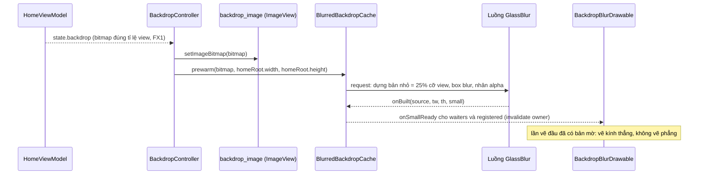
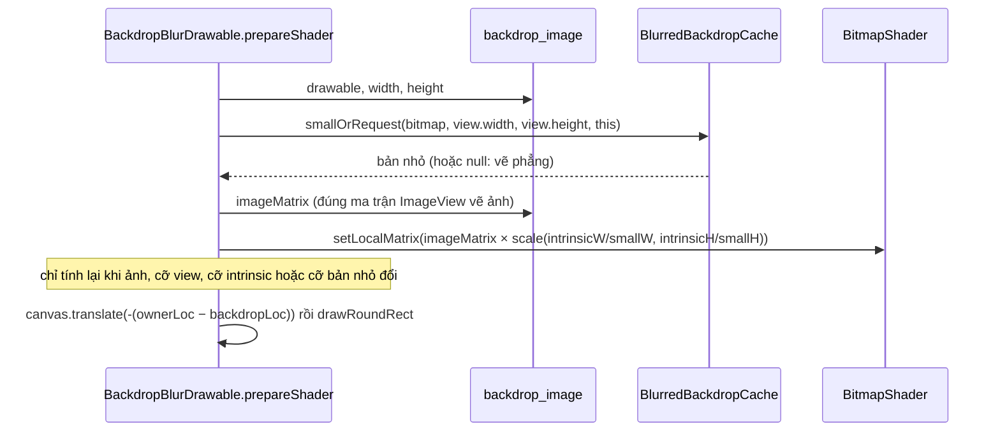
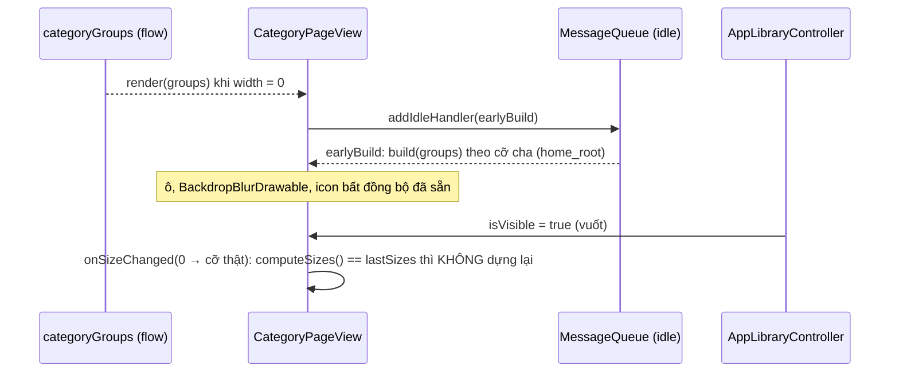

# FX8 — Kính khớp nền ảnh và kính Library sẵn sàng: đọc trước khi review

**Plan:** [report/FX8-glass-backdrop-match.md](../report/FX8-glass-backdrop-match.md) · **PR:** #39 · **Nhánh:** `fix/fx8-glass-backdrop-match`

## 1. Tóm tắt
- **D1 (kính hiện sai mảng nền):** lỗi chủ dự án thấy trên bản trước FX1 (bitmap ảnh nền chưa cắt theo tỉ lệ màn); FX1 đã sửa nguồn. Số đo "k ≈ 1,2" của điều phối lúc đầu hóa ra đo trên một APK cũ cài nhầm. FX8 vẫn **gia cố**: kính mờ tại chỗ lấy ánh xạ từ chính ma trận vẽ của `ImageView` ảnh nền, nên dù bitmap có sai tỉ lệ về sau, kính vẫn khớp nền.
- **Độ mờ nhất quán:** bản mờ nhỏ tính theo cỡ **view** (σ ≈ 10 px màn hình với mọi ảnh), không theo cỡ bitmap (ảnh nhỏ trước đây bị mờ gấp ~2 lần). Ảnh PNG có alpha không còn sáng hơn nền.
- **D2 (kính Library):** bản mờ được dựng ngay khi ảnh nền nạp xong (`prewarm`), các ô nhóm Library được dựng sẵn khi luồng chính rảnh, và nếu một ô vẫn phải vẽ phẳng trước thì kính hiện mờ dần trong 150 ms thay vì đổi hẳn trong một khung (hết "nháy").

## 2. Kiến thức nền
- **`ImageView.getImageMatrix()`**: ma trận đưa toạ độ drawable sang toạ độ view mà `ImageView` dùng khi vẽ (với `centerCrop`: scale đồng đều + dịch làm tròn; `Matrix.IDENTITY` khi ảnh vừa khít). [Tài liệu](https://developer.android.com/reference/android/widget/ImageView#getImageMatrix()).
- **`BitmapShader.setLocalMatrix`**: ma trận đưa toạ độ bitmap của shader sang toạ độ vẽ. Bản mờ nhỏ phủ **toàn bộ** bitmap nguồn, nên ma trận = `imageMatrix × scale(intrinsic / cỡ bản nhỏ)`.
- **`MessageQueue.IdleHandler`**: callback chạy khi hàng đợi luồng chính rỗng; dùng để dựng việc nặng nhưng chưa cần ngay mà không tranh với khung hình.
- **`Bitmap.getPixels` không premultiply**: trả màu không nhân alpha, trong khi `ImageView` vẽ bitmap premultiplied lên nền đen (`home_root`), nên màu hiển thị là RGB·α/255.
- **View GONE không được layout**: `library_view` GONE tới lần vuốt đầu nên `width = 0`, mọi thứ dựa vào cỡ riêng của nó (dựng ô) chỉ chạy ở lượt layout đầu tiên lúc hiện.

## 3. Luồng hoạt động

**Nạp ảnh nền và làm nóng bản mờ (D2):**

Bước dễ sai: `backdropImage` vừa chuyển từ GONE sang VISIBLE nên chưa có cỡ; `prewarm` dùng cỡ `home_root` (cùng `match_parent`). Cache khóa theo (bitmap, cỡ đích); cỡ khác thì bản cũ vẫn được trả (hình học còn đúng) trong lúc dựng lại.

**Một lần vẽ của kính tại chỗ (D1):**

**Library hiện lần đầu (D2):**

## 4. Thay đổi theo file
| File | Vai trò | Vì sao sửa | Đọc trước? |
|---|---|---|---|
| `core/glass/BackdropBlurDrawable.kt` | Kính mờ tại chỗ | Ma trận shader qua `imageMatrix`; chuyển pha phẳng → kính 150 ms (`saveLayerAlpha`) | **Có** |
| `core/glass/BlurredBackdropCache.kt` | Bản mờ nhỏ dùng chung | Cỡ theo view, khóa (bitmap, cỡ đích), `prewarm`, alpha, báo cả `registered` | **Có** |
| `core/glass/StaticBlurSurface.kt` | Dock ở mức CLASSIC | Vẽ bằng ma trận float, bỏ `Rect` nguyên | Không |
| `ui/home/controller/BackdropController.kt` | Đặt ảnh nền | Gọi `prewarm` sau `setImageBitmap` (6 dòng) | Không |
| `ui/home/view/CategoryPageView.kt` | Trang Library | Dựng ô sớm khi rảnh, `Sizes` data class, bỏ dựng lại ở lần layout đầu | **Có** |

## 5. Quyết định và đánh đổi
- **Ánh xạ qua `imageMatrix`** (D1, phương án B trong plan): một nguồn sự thật, miễn nhiễm với mọi lần bitmap/view lệch tỉ lệ. Bỏ: chỉ sửa nguồn ở `HomeViewModel` (không cần: log chứng minh `onScreenSize` nhận đúng cỡ), tự tính centerCrop (hai bản công thức dễ lệch), thay `ImageView` (đụng nhiều file nóng).
- **Độ mờ theo view** (điều phối duyệt Q3): ảnh nhỏ sẽ "nét" hơn kính cũ khoảng 2 lần; đổi lại kính nhìn như nhau với mọi ảnh.
- **Prewarm + dựng ô sớm + chuyển pha** (D2): bỏ lưu bản mờ ra đĩa (thêm IO, phiên bản), dựng đồng bộ trên main (hụt khung), đổi `GONE` → `INVISIBLE` ở `AppLibraryController` (file của FX7, và INVISIBLE không vẽ nên không làm nóng cache).
- **Đánh đổi:** vài trăm KB cho ô Library dựng sẵn và 0,57 MB bản mờ dựng cả khi chẳng ai dùng; ô Home vẽ phẳng khoảng 60 ms ở khởi động lạnh rồi mờ vào (chấp nhận).
- **D1-1 bị bác trên `main`:** giả thuyết "bitmap chưa cắt" (H-A..H-E) không xảy ra ở bản FX1; kính trước FX1 sai tới ±116 px với ảnh 1632x2912 (phép tính e(x) trong plan vẫn dùng được để hiểu lỗi cũ).

## 6. Chỗ cần soi khi review
- `BackdropBlurDrawable.prepareShader`: `matrix.set(view.imageMatrix)` (sao chép, không giữ `mDrawMatrix`), khóa dựng lại đủ 6 trường; `draw` vẫn không cấp phát (nhánh chuyển pha dùng `saveLayerAlpha` không cấp phát ngoài lớp tạm của hệ thống, chỉ ~150 ms).
- `BlurredBackdropCache.onBuilt` nay báo cả `registered`: đo thấy `registered` tối đa 20, không tăng; ô cũ chưa bị GC được bảo vệ bằng `isAttachedToWindow` trong `onSmallReady`.
- `CategoryPageView.earlyBuild`: chỉ chạy khi `width <= 0` và đã gắn vào cửa sổ; gỡ ở `onDetachedFromWindow`; nếu cha chưa có cỡ thì không dựng (lần hiện đầu dựng như cũ).
- **Chỉ được code bảo vệ, chưa kiểm tay:** dock Ép thấp (`StaticBlurSurface`), PNG alpha, chuyển pha sau `trim`, σ đo trực tiếp của ảnh 527x1140. Chủ dự án kiểm khi duyệt PR.

## 7. Cách kiểm lại
Live 4, mức Ép cao: chọn một ảnh nhỏ và một ảnh rộng làm ảnh nền, nhìn mép widget đồng hồ/lịch và ô thư mục (kính phải liền mạch với nền); `force-stop`, mở Home, vuốt nhanh vào App Library và xem các ô nhóm (phải có nền mờ ngay, không nhợt rồi đổi màu). Kiểm tự động bằng ảnh lưới + tương quan (plan, mục "Bài kiểm cả tính năng" B, D, E) và log `FX8TMP` của `FX8-d2log.apk`.

## 8. Bài học cho AGENTS.md
Điều phối đưa vào `docs/lessons/glass.md` sau khi merge:
- **`glass`** (2026-11-11, đo được trên Live 4): lỗi "kính sai nền" tưởng tái hiện được thực ra đo trên APK cũ (output build của worktree chính ngày 2026-11-10 bị cài nhầm). Ghi md5/commit của APK đã cài trong mọi phép đo và xác nhận bằng log của đúng bản đang chạy trước khi kết luận nguyên nhân.
- **`glass`** (2026-11-11, đọc code, đo được trên Live 4 không hồi quy): kính tại chỗ nên ánh xạ qua `ImageView.imageMatrix` + cỡ intrinsic, không giả định bitmap cùng tỉ lệ view; dock CLASSIC dùng ma trận float thay `Rect` nguyên (trước lệch tới 4-8 px).
- **`glass`** (2026-11-11, tính từ code): bản mờ nhỏ tính theo cỡ view để độ mờ tính bằng px màn hình nhất quán; trước đây σ = 9,8·viewW/bitmapW (20 px với ảnh 527x1140).
- **`glass`** (2026-11-11, đọc code): `Bitmap.getPixels` trả màu không premultiply; ảnh có alpha phải được nhân alpha vào RGB trước khi mờ để khớp việc `ImageView` vẽ lên nền đen.
- **`home-pager-animation`** hoặc **`glass`** (2026-11-11, đo được trên Live 4): `library_view` GONE nên ô chỉ được dựng ở lượt layout đầu lúc hiện; dựng sớm bằng `IdleHandler` theo cỡ view cha, và bỏ qua dựng lại ở `onSizeChanged` nếu `Sizes` không đổi. Làm nóng bản mờ ngay khi ảnh nền nạp (prewarm: dựng ~358 ms trong khi Library hiện sau ~11,8 s) đã đủ để ô nhóm hiện kính ngay.
