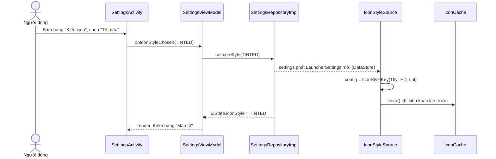
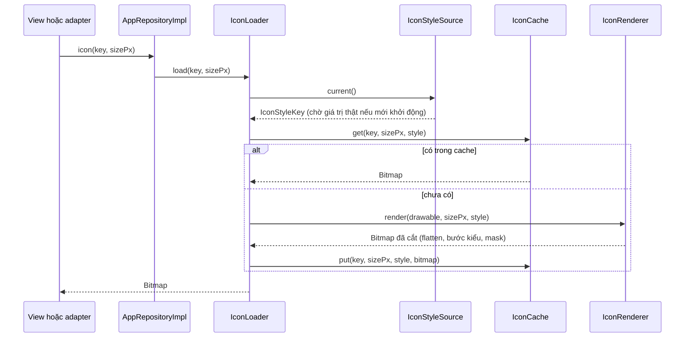
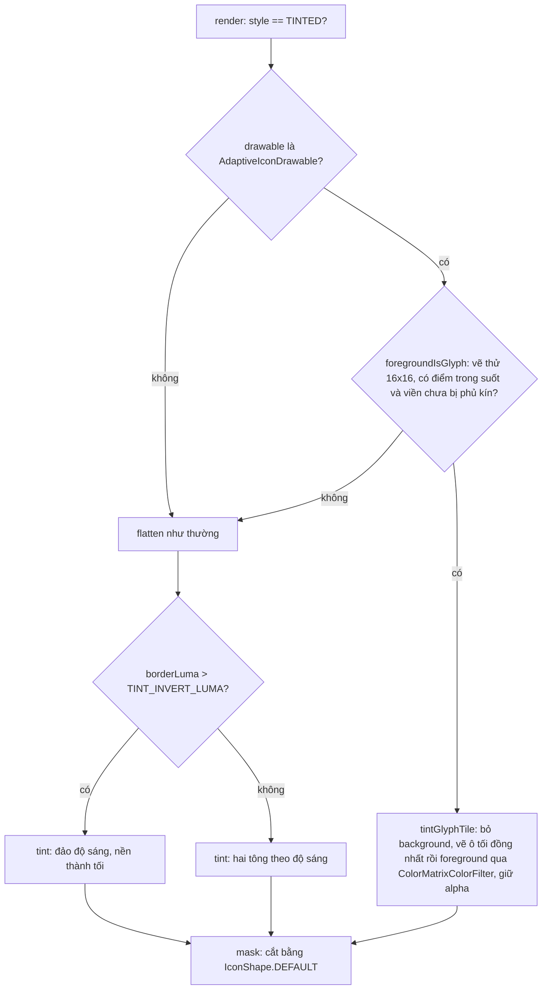
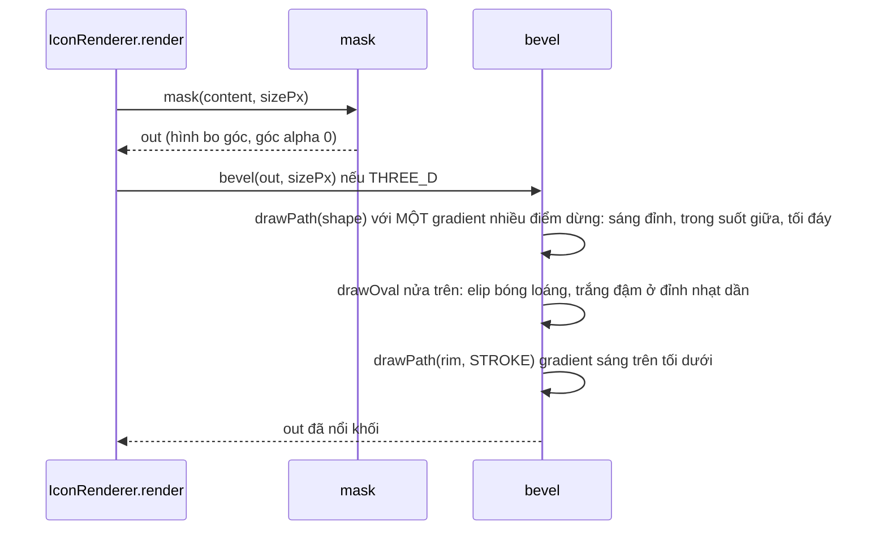

# G2b — Kiểu icon (Tô màu, 3D): đọc trước khi review

**Plan:** [plans/G2b-icon-styles.md](../plans/G2b-icon-styles.md) · **PR:** #4 · **Nhánh:** `feature/g2b-icon-styles`

> Viết dần theo từng Task. Mục nào còn "chưa làm" là Task đó chưa tới.

## 1. Tóm tắt
Thêm hai kiểu icon ngoài kiểu mặc định của TL2: **Tô màu** (hai tông của một màu, nền tối hình sáng, giống Tinted của iOS; chọn một trong 5 màu) và **3D** (vệt sáng trên, bóng dưới, viền nổi). Chọn ở Cài đặt → Giao diện → "Kiểu icon", lưu bằng DataStore. Pha A (nhánh này) làm mọi thứ trừ việc tự làm mới Home đang chạy: Home thấy kiểu mới sau khi dựng lại (mở nguội lại app); App Library, tìm kiếm, Ứng dụng đã ẩn nạp icon mới mỗi lần mở nên thấy ngay. Pha B (đã làm sau khi R1a merge): hook `recreateGuard.add { … }` trong khối "Dòng nối cho AN/G2b" của `HomeActivity.onCreate`; khi quay từ Cài đặt, `RecreateGuard.onResume` thấy kiểu đã đổi và gọi `recreate()` (ViewModel giữ trang và edit mode).

## 2. Kiến thức nền
- **Cache bitmap ở hai tầng.** `IconCache` (RAM, trong `data`) giữ bitmap theo khóa `package/class#user@size`. Nhưng `IconGridView`, `DockView`, `FolderPanelView` còn giữ `HashMap<ComponentKey, Bitmap>` riêng, chỉ xóa khi cỡ icon đổi (**đọc code**, `IconGridView.bindAllCells`). Vì vậy xóa `IconCache` thôi thì Home đang chạy vẫn giữ icon cũ; phải `recreate()` Activity (cách đổi mức kính đang dùng).
- **`StateFlow` với giá trị đầu `null`.** `IconStyleSource.config` bắt đầu là `null` chứ không phải kiểu mặc định, để lần nạp đầu sau khi process khởi động phải chờ giá trị thật từ DataStore thay vì vẽ nhầm kiểu mặc định.
- `getMonochrome()` của `AdaptiveIconDrawable` chỉ có từ API 33 (**đọc tài liệu**, ghi chú TL2); Live 4 là API 30 và phần lớn app không khai lớp này, nên Tô màu dựa vào độ sáng của ảnh đã `flatten`, chạy giống nhau trên mọi API.

## 3. Luồng hoạt động

Đổi kiểu trong Cài đặt (pha A):

Chọn đúng kiểu đang dùng thì `onIconStyleChosen` thoát sớm, không ghi. Màu tô được chuẩn hóa về mặc định khi kiểu không phải Tô màu, để đổi màu lúc đó không xóa cache vô ích.

Nạp một icon:

Kiểu nằm trong khóa cache (`cacheKey` thêm `~STYLE.TINT`), nên một lần nạp đang bay lúc đổi kiểu ghi vào khóa cũ và không bao giờ bị trả cho kiểu mới.

Bước Tô màu trong `IconRenderer.render` (làm lại ở Task 5; bản Task 2 áp ma trận màu lên cả ảnh nên ô nền mỗi app một tông, chủ dự án thấy không đẹp):

Đường chính (`tintGlyphTile`): mọi icon cùng một ô tối (gradient nhẹ của màu tô); hình là foreground của app, độ sáng của nó ánh vào khoảng [`TINT_GLYPH_LO_VALUE`, 1,0] của màu tô (không bao giờ tối hơn nên luôn đọc được trên ô tối), alpha giữ nguyên nên rìa hình mịn, hình thu `TINT_GLYPH_SCALE`. Cách này theo hướng dẫn "hình và nền xác định rõ" của Tinted iOS và hình-trên-ô của Android themed icons (nguồn trong plan, Task 5). Đường dự phòng (`tint`, cũ từ Task 2) dành cho icon legacy và foreground phủ kín (ảnh, icon game): hai tông theo độ sáng của cả ảnh, đo độ sáng ở viền. Các icon dự phòng có thể trông lệch so với phần còn lại (**suy luận chưa kiểm chứng**, điều phối xem trên máy).

Bước 3D trong `IconRenderer.render` (Task 3) chạy SAU `mask`, trên bitmap kết quả:

Cả ba lượt vẽ nằm trong hình icon (lớp khối và viền là `drawPath` của `IconShape.DEFAULT.path(...)`, viền dùng bản thu vào nửa bề rộng nét; elip bóng loáng nằm gọn bên trong): cạnh chống răng cưa, và vì vẽ trong hình nên góc ngoài vẫn alpha 0. Không dùng `clipPath` (canvas phần mềm không chống răng cưa khi clip) và không có bóng đổ ra ngoài vì bitmap đã bằng đúng hộp icon (plan D1 của 3D). Hằng số nằm trong khối "CHỈNH TAY (kiểu 3D)".

## 4. Thay đổi theo file
| File | Vai trò | Vì sao thêm/sửa | Đọc trước? |
|---|---|---|---|
| `data/apps/IconStyleSource.kt` | Giữ kiểu hiện tại trong `StateFlow`, xóa cache khi đổi | Tránh đọc DataStore mỗi icon, không dùng nhầm mặc định lúc khởi động | Có |
| `data/apps/IconLoader.kt`, `IconCache.kt` | Kiểu vào khóa cache và vào `render` | Một đường nạp duy nhất cho mọi bề mặt | Có |
| `domain/model/IconStyle.kt` | `IconStyle`, `IconTint`, `IconStyleKey` | Mô hình thuần Kotlin, `fromName` an toàn với giá trị lạ | |
| `data/settings/*`, `domain/.../Settings*` | Hai khóa DataStore `icon_style`, `icon_tint` | Theo mẫu `GridPreset` | |
| `ui/settings/*`, `strings.xml` | Hàng "Kiểu icon", hàng "Màu tô" khi chọn Tô màu | | |
| `data/apps/IconRenderer.kt` | Bước kiểu icon (Task 2, 3) | | Có |

## 5. Quyết định và đánh đổi
Xem D1–D6 và bảng phương án trong plan. Tóm lại: Tô màu bằng độ sáng (không `getMonochrome()`), 3D nướng vào bitmap không có bóng đổ ngoài, trạng thái trong `IconStyleSource` thay vì đọc DataStore mỗi icon, làm mới Home bằng `recreate()` theo mẫu kính ở pha B thay vì `CLEAR_TASK` từ Cài đặt.

## 6. Chỗ cần soi khi review
- Cửa sổ vài ms giữa lúc DataStore commit và lúc `IconStyleSource` cập nhật: icon nạp trong cửa sổ đó mang khóa kiểu cũ (**suy luận chưa kiểm chứng**).
- Hook pha B: `appliedIconStyle` là biến cục bộ trong `onCreate`, null tới khi `currentIconStyleKey()` đọc xong (theo mẫu `DockController.appliedGlassOverride`); null thì check trả false, không dựng lại vô ích. Đổi cả mức kính và kiểu icon cùng lúc chỉ dựng lại một lần (`RecreateGuard` dừng ở check đầu tiên báo đổi).

## 7. Cách kiểm lại
**Chi phí đo được** (Live 4, API 30, 144 px, bản `c5bc520`, 3 lượt mở nguội mỗi kiểu, ms mỗi icon, **đo được**):

| Kiểu | flatten | bước kiểu | mask |
|---|---|---|---|
| Mặc định | 1,76 / 2,65 / 2,43 | 0,01 | 0,81 / 0,83 / 2,96 |
| Tô màu | 2,35 / 2,14 / 1,58 | **4,67 / 4,42 / 3,84** | 1,50 / 2,05 / 2,36 |
| 3D | 1,17 / 1,48 / 4,20 | **3,18 / 2,26 / 3,69** | 1,06 / 3,69 / 1,70 |

**Trượt mục tiêu:** plan đặt bước kiểu <= khoảng 1,5 lần `mask`; cả hai kiểu đều trên mức đó (Tô màu ~4,3 ms, 3D ~3,0 ms, so với `mask` ~1–3 ms), và ước tính ban đầu (+0,5–1 ms, +1–2 ms) thấp hơn thực tế. Điều phối chấp nhận: chạy ở luồng nền, một lần cho mỗi icon rồi vào cache, chỉ khi người dùng chọn kiểu đó, kiểu Mặc định không bị ảnh hưởng. Nguyên nhân chưa phân tích (**suy luận chưa kiểm chứng**: `createScaledBitmap` + `getPixels` ở `borderLuma` và lượt vẽ có `ColorMatrixColorFilter` trên canvas phần mềm; ba `drawPath` gradient ở 3D). Nếu cần giảm: bỏ ảnh thu nhỏ (đo viền bằng `getPixels` vài dòng), hoặc gom lớp 3D.
Xem "Bài kiểm cả tính năng" trong plan. Pha A: đổi kiểu, `adb shell am force-stop gambi.global.os26launcher`, mở lại bằng `adb shell am start -n gambi.global.os26launcher/.ui.home.HomeActivity`.

## 8. Bài học cho AGENTS.md
- 2026-11-04 (đọc code): xóa `IconCache` ở tầng data không làm mới icon trên Home; các view giữ cache bitmap riêng theo `ComponentKey`. Đổi nguồn icon cần `recreate()` hoặc để view tự xóa cache.
