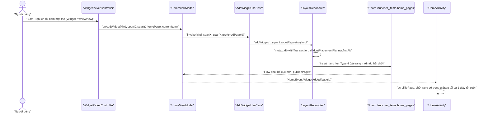
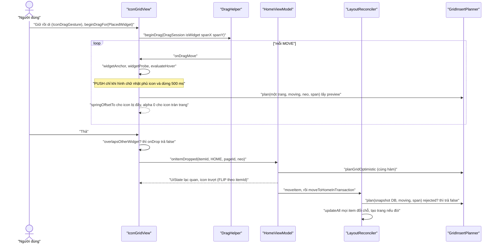
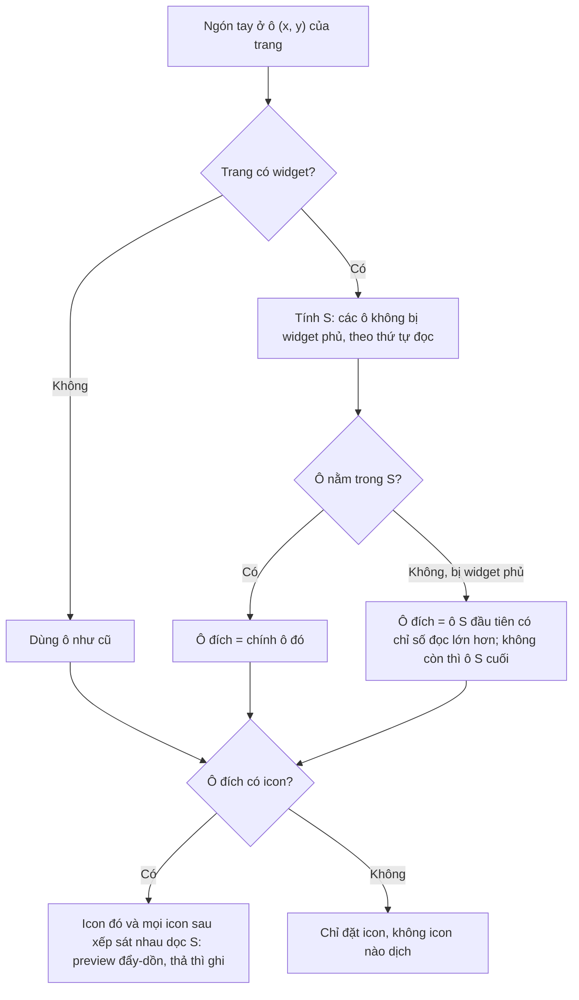
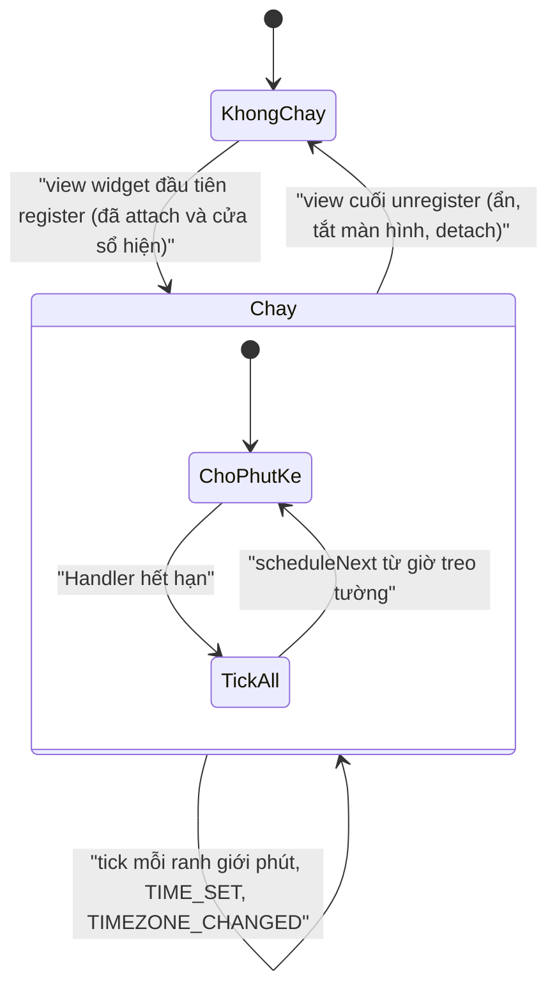

# G2c — Widget tự vẽ: đồng hồ và lịch trên lưới Home: đọc trước khi review

**Plan:** [plans/G2c-clock-calendar-widgets.md](../plans/G2c-clock-calendar-widgets.md) · **PR:** #12 · **Nhánh:** `feature/g2c-clock-calendar-widgets`

Nhãn nguồn dùng trong file này: **đo được** (có log hoặc số trong Nhật ký của plan), **đọc code**, **đọc tài liệu**, **suy luận chưa kiểm chứng**. Mục 8 ghi kết quả đã có (Task 1, 2, 3, 6, 8, 10 và một phần Task 13); ca chưa ai chạy được ghi rõ là "Chưa chạy" ở mục 6 và mục 8.

## 1. Tóm tắt

Từ edit mode bấm "Tiện ích" để thêm một trong bốn widget: Đồng hồ 2×2 (kim), Đồng hồ 4×2 (số), Lịch 2×2 (thứ và ngày), Lịch 4×2 (ngày và lưới tháng). Widget nằm trên lưới như icon nhưng chiếm nhiều ô; kéo được (icon quanh nó tự nhường chỗ), xóa bằng dấu "−" sau hộp thoại xác nhận, bấm (ngoài edit mode) thì mở app Đồng hồ hoặc Lịch của máy. Nội dung đổi mỗi phút, khi đổi múi giờ, ngôn ngữ, 12/24 giờ. Không có thời tiết, không có sự kiện lịch, không phải AppWidgetHost (G3c).

## 2. Kiến thức nền

- **`itemType`, `spanX`, `spanY` của bảng `launcher_items`** (đọc `room-schema.md` mục 3): widget là một hàng như app, loại mới `itemType = 4`, mã loại (`"clock"`, `"calendar"`) ở cột `className`, kích thước ở `spanX/spanY`. Không thêm cột, nên không có `Migration`. Số 3 vẫn để dành cho widget của app khác (AppWidgetHost, G3c).
- **Chỉ số đọc** của một ô là `y * columns + x`. Trước G2c mọi thuật toán lưới dựa vào nó. Widget phủ hình chữ nhật ô nên chỉ số đọc không còn liền nhau; G2c dựng **dãy ô tự do S** = các ô không bị widget phủ, theo thứ tự đọc (`PageGeometry`). Trang không có widget thì S là mọi ô và mọi kết quả y hệt cũ.
- **Kính tại chỗ (`BackdropBlurDrawable`)** lấy vị trí view trên màn hình **lúc ghi display list**, không lúc vẽ. View trong `ViewPager2` ở trang chưa hiện nằm lệch một bề rộng màn hình, nên nếu không bị `invalidate()` khi pager cuộn thì giữ lát cắt nền sai (xem mục 6, lỗi Task 5).
- **`BroadcastReceiver` cho thời gian:** `ACTION_TIME_CHANGED` và `ACTION_TIMEZONE_CHANGED` là broadcast hệ thống được bảo vệ, đăng ký động bằng `ContextCompat.registerReceiver(..., RECEIVER_NOT_EXPORTED)` (đọc tài liệu Android 14).
- **`java.time` có sẵn từ minSdk 26**: `ZonedDateTime`, `YearMonth`, `WeekFields.of(locale)` (đầu tuần theo ngôn ngữ, tiếng Việt: thứ Hai).
- **`BottomSheetDialog`** (Material 1.14, có sẵn) cho bảng chọn: là cửa sổ riêng nên mất khi `recreate()`.

## 3. Luồng hoạt động

### 3.1 Thêm widget



Không có cập nhật lạc quan cho việc *thêm*: hàng mới chưa có id thật, id tạm khác id thật sẽ làm lưới thu rồi phình lại ô vừa thêm; DB phát lại rất nhanh. Việc *xóa* và *kéo* thì có lạc quan như icon.

### 3.2 Kéo widget và thả



Ba nơi (preview ở view, lạc quan ở ViewModel, ghi DB ở Reconciler) gọi **cùng một hàm** `GridInsertPlanner.plan`; nhờ vậy không lệch nhau. Chỗ dễ sai: preview chỉ thấy một trang (`pages = [trang này]`), nên icon tràn sang trang kế được ẩn tạm bằng alpha 0 chứ không có ô đích.

### 3.3 Ô đích của icon khi có widget



### 3.4 Nhịp cập nhật của widget



`KhongChay` nghĩa là không có `Handler` chờ và không có `BroadcastReceiver` (Review Focus 8). Mỗi view khi đăng ký làm mới ngay (quay về từ Cài đặt, bật lại màn hình: đọc lại 12/24 giờ, múi giờ).

### 3.5 Kéo một thẻ từ bảng chọn xuống lưới (Task 13)

```mermaid
sequenceDiagram
    actor U as "Người dùng"
    participant C as "CardDragGesture (thẻ trong PickerSheet)"
    participant P as "WidgetPickerController"
    participant S as "PickerSheet (BottomSheetDialog)"
    participant DH as "DragHelper"
    participant HR as "HomeTouchRouter"
    participant G as "IconGridView"
    participant VM as "HomeViewModel"
    participant R as "LayoutReconciler"
    U->>C: "Nhấn giữ thẻ (rung nhẹ) rồi di vượt slop"
    C->>P: "beginNewWidgetDrag(kind, size, rawX, rawY)"
    P->>P: "snapshotWidget: IconCellView rời cửa sổ, đúng cỡ ô"
    P->>DH: "beginDrag(DragSession isWidget newWidgetKind itemId tạm)"
    P->>VM: "onDragStarted(idTạm)"
    P->>S: "startForwarding(): mờ dần, bỏ lớp tối, GIỮ cửa sổ"
    loop "mỗi MOVE"
        U->>S: "MOVE (cửa sổ bảng còn nhận chuỗi chạm)"
        S->>HR: "Activity.dispatchTouchEvent(ev)"
        HR->>DH: "updatePosition(rawX, rawY)"
        DH->>G: "onDragMove (nhánh widget của Task 8: neo, PUSH sau 500 ms)"
    end
    U->>S: "Thả"
    S->>HR: "Activity.dispatchTouchEvent(UP)"
    HR->>DH: "dropAt"
    DH->>G: "onDrop (chồng widget? thì false)"
    G->>VM: "onNewWidgetDrop, rồi onNewWidgetDropped(kindId, span, idTạm, trang, ô)"
    VM-->>G: "UiState lạc quan: PlacedWidget id tạm, icon bị đẩy trượt"
    VM->>R: "addWidgetAt (một transaction: kế hoạch, trang, hàng, icon dời)"
    HR->>P: "session.onFinished(accepted) thì đóng bảng; không nhận thì onDragCancelled"
```

Điểm dễ sai: chuỗi chạm thuộc **cửa sổ của bảng** (một `Dialog`), nên bảng không được đóng lúc bắt đầu kéo. Nó chỉ ẩn đi và chuyển tiếp sự kiện cho Activity cho tới khi thả. Hàng DB chỉ được tạo lúc thả; trước đó widget chỉ là một phiên kéo với id tạm âm.

## 4. Thay đổi theo file

| File | Vai trò | Vì sao thêm/sửa | Đọc trước? |
|---|---|---|---|
| `domain/layout/PageGeometry.kt` | Dãy ô tự do S, ánh xạ ô bị phủ | Nền của mọi planner | **Đọc đầu tiên** |
| `domain/layout/GridInsertPlanner.kt` | Chèn icon / thả widget, tràn khối sang trang kế, `rejected` | Một hàm cho DB, lạc quan, preview | **Đọc đầu tiên** |
| `domain/layout/GridRemovePlanner.kt`, `GridReflowPlanner.kt` | Gỡ icon dọc S; đổi cỡ lưới đóng gói vị trí đầu tiên còn vừa, kẹp span | Widget phá giả định chỉ số đọc | Sau |
| `domain/layout/WidgetPlacementPlanner.kt`, `domain/model/WidgetKind.kt`, `PlacedItem.kt` (`PlacedWidget`) | Chỗ trống đầu tiên khi thêm; danh mục loại và cỡ; mô hình | | Sau |
| `data/layout/LayoutReconciler.kt` | `toSlot()` mang span, `moveItem` trả false khi từ chối, reflow không còn thoát sớm, `ensureFitsGrid` cộng span, `deleteAndCompact` bỏ chốt toàn lưới, `addWidget` | Mọi đường ghi DB phải biết span | **Đọc đầu tiên** |
| `data/layout/LayoutRepositoryImpl.kt`, `db/LauncherItemEntity.kt` | Đọc hàng loại 4, hằng `ITEM_TYPE_BUILTIN_WIDGET = 4` | Khóa schema nhẹ, không DDL | Sau |
| `ui/home/HomeViewModel.kt`, `HomeEvent.kt` | `Slot` có span, `planGridOptimistic` bỏ qua khi `rejected`, `onAddWidget`, `onRemoveWidget`, `onWidgetTapped`, `WidgetAdded` | | Sau |
| `core/ui/DragHelper.kt` | `DragSession` có `isWidget`, `spanX`, `spanY` | | Sau |
| `ui/home/view/IconCellView.kt` | Chế độ thứ ba: widget (`bindWidget`, `tickWidget`, `drawWidget`) | Giữ mọi `as? IconCellView` của AN | **Đọc đầu tiên** |
| `ui/home/view/IconGridView.kt` | Ô theo span, `bindWidgetCell`, preview theo planner, `resolveInsertCell`, neo và điểm dò của widget, từ chối chồng widget, hộp thoại xóa, kính vẽ lại khi cuộn | | **Đọc đầu tiên** |
| `ui/widget/*` | `WidgetRenderer` và bốn renderer, `WidgetFormat`, `WidgetText`, `WidgetTicker`, `WidgetPreviewView` | Vẽ Canvas, không cấp phát trong `draw` | Sau |
| `ui/home/controller/WidgetPickerController.kt`, `HomeActivity.kt`, `activity_home.xml`, `HomePagerAdapter.kt`, `HomePagerController.kt` | Nút "Tiện ích", bảng chọn, cuộn tới trang, nối hai callback | | Sau |
| `core/ui/DragHelper.kt` (Task 13), `ui/home/controller/WidgetPickerController.kt` (`CardDragGesture`, `PickerSheet`), `LayoutReconciler.addWidgetAt`, `HomeViewModel.onNewWidgetDropped` | Kéo thẻ từ bảng chọn: phiên kéo với id tạm, chuyển tiếp chạm, tạo hàng lúc thả; ảnh bay về chỗ cũ cho thả không được nhận | Task 13 | Sau |
| `data/apps/LauncherAppsDataSource.kt`, `AppRepository(Impl)` | Mở app Đồng hồ / Lịch | Intent ở tầng data | Sau |
| `DockView.kt`, `Jiggler.kt`, `LeavingIcons.kt` (qua `IconGridView`) | Dock từ chối widget, rung 1°, widget thu quanh tâm | | Sau |

## 5. Quyết định và đánh đổi

- **D1 (schema):** `itemType = 4`, không cột, không migration. Đánh đổi: `className` mang nghĩa "mã loại" khi `itemType = 4`; chưa có chỗ lưu cấu hình từng widget (xét lại khi cần đồng hồ thành phố: cột `widgetConfig` và `Migration`).
- **D2 (planner theo S):** giữ một hàm cho ba nơi, trùng bit với bản cũ trên trang không widget (đo được bằng harness một lần, Task 1: insert, remove, reflow, mỗi cái 3000 trang, 0 khác biệt). Đánh đổi: đuôi trang dồn sát khi chèn gần widget; widget không chồng widget.
- **D3 (vẽ):** chế độ thứ ba của `IconCellView` thay vì lớp ô riêng. Đánh đổi: `IconCellView` lớn thêm, phải xóa trạng thái widget ở `bind`/`bindFolder`.
- **D4 (nhịp):** ticker chung theo ranh giới phút, không kim giây.
- **D5 (nền):** kính tại chỗ vai trò `FOLDER_CELL`, đường lùi nền phẳng; quyết bằng đo Task 6 (kết quả ở mục 8).
- **Q4 đổi:** dấu "−" trên widget hỏi xác nhận trước khi xóa (chủ dự án, 2026-11-05).
- Chi tiết và phương án đã bỏ: mục "Vì sao chọn thiết kế này" của plan.

## 6. Chỗ cần soi khi review

1. **KDoc `GridInsertPlanner` trước G2c sai so với code** (ghi "dịch 1 bậc", code dồn sát đuôi). Plan lấy code làm chuẩn, KDoc đã sửa. Đọc kỹ `plan()`.
2. **Lỗi kính widget trang vuốt tới (đã sửa, đo được trên Live 4):** `IconGridView.invalidateGlass()` thoát sớm khi trang không có thư mục, nên widget trên trang mới vuốt tới giữ lát cắt nền sai, bị kẹp (CLAMP) thành vệt ngang. Nguyên nhân đọc từ code, xác nhận bằng bản sửa. Soi: mọi chỗ khác dựa vào `glassFolderIds` để quyết định có làm mới kính không.
3. **`moveToHomeInTransaction`:** trang tạm (`PageId.NEW`) được chèn TRƯỚC khi planner có thể từ chối; ca duy nhất từ chối trên trang mới là span lớn hơn lưới, mà cỡ widget luôn ≤ 4×2 nên không xảy ra (suy luận). Nếu thêm cỡ lớn hơn thì phải đổi thứ tự.
4. **Ticker:** chỉ giữ view đang hiện; kiểm `onAttachedToWindow`, `onWindowVisibilityChanged`, `onDetachedFromWindow` đối xứng. Đổi múi giờ dựa vào `TimeZone.setDefault(null)` (suy luận chưa kiểm chứng rằng cần thiết; Task 5 kiểm trên máy).
5. **Chữ hoa chữ đầu tiếng Việt** (`replaceFirstChar`) và đầu tuần thứ Hai: **đo được** trên Live 4 ("Thứ Năm, 5 tháng 11", "Tháng 11 2026", lưới bắt đầu T2).
6. **Đã kiểm tay / đo, và chỗ còn chỉ có code bảo vệ (cập nhật 2026-11-05):**
   - Đã: kéo widget và icon quanh widget, hồi quy AN (chủ dự án, Live 4, `42105ff`); đổi cỡ lưới 4×6 → 4×5 → 5×6 → 4×6 trên bố cục thử 326 item (Oppo, 0 mất item, 0 chồng, 0 ngoài lưới); ẩn icon bằng "−" ở trang có widget; recreate khi bảng chọn mở (0 `WindowLeaked`); một lần thả được nhận từ bảng chọn (Oppo, điều phối); số đo kính (mục 8).
   - Đã (mô phỏng): gỡ app qua `catchUp` (Oppo): vòng `deleteAndCompact` theo từng trang chạy đúng, icon lùi một ô, widget đứng yên, 0 chồng, 0 ngoài lưới; KHÔNG phải gỡ thật (`removePackages` chưa kích hoạt).
   - Đã (lần kiểm tay thứ hai của chủ dự án, `37157fe`): kéo thẻ từ bảng chọn, thả bị từ chối / hủy / ghost page, hoạt ảnh mới, ảnh bay về và hồi quy của icon và thư mục. Đã (kịch bản, `3e82320`): Back, Recents, recreate khi đang kéo thẻ: không hàng nào được thêm.
   - **Chưa ai chạy:** split-screen; nút nguồn và cuộc gọi khi đang kéo; `ensureFitsGrid` sau khi ép DataStore và DB lệch; hộp thoại "−" mở lúc recreate; ca "ô thật không hiện đôi lúc ảnh hạ cánh" bằng mắt; giới hạn đã biết số 11; rung S3 cộng vuốt và cảnh đứng yên với widget.
7. **Ảnh hưởng tới tính năng cũ:** `IconGridView.applyPreview` (AN) giờ lấy từ planner; đã chứng minh trùng bit ở mức hàm, chưa chứng minh ở mức cảm giác kéo. `Jiggler` đọc `jiggleScale` mỗi khung. `LeavingIcons` nhận tâm thu theo loại ô.
8. **Seed và cờ tạm** KHÔNG nằm trong commit nào (`LauncherApp.kt` seed, `G2cFlat`); `git log` không chứa chúng. Harness Task 1/2 cũng không commit.
9. **Task 13 đổi `DragHelper.drop` cho MỌI phiên kéo từ lưới:** thả không được nhận (hoặc về đúng ô) giờ bay về chỗ cũ bằng spring `SETTLE` thay vì biến mất tức thì (trước đó chú thích ghi "bay về" nhưng code gọi `endDrag()`). Soi: `returnRectOf` chỉ trả chỗ khi trang đang nằm trên màn hình; `endDragVisualState` không trả alpha khi ảnh còn đang bay (ô hiện lại ở `onDragSettled`); nhánh `else` của `drop` gọi `onDragSettled` để ô không kẹt ẩn.
10. **Chuyển tiếp chạm từ cửa sổ bảng chọn (Task 13)** chạy được: Oppo A3x (`input motionevent`, điều phối) và Live 4 (chủ dự án kiểm tay lần hai, `37157fe`); phiên bị ngắt (Back, Recents, recreate) kết thúc như hủy, không hàng nào được thêm (kịch bản Live 4, `3e82320`). Nếu sau này lỗi: phương án B của plan (lớp phủ trong `home_root`).
11. **Giới hạn đã biết (không sửa):** kéo một item qua ≥ 5 trang có thể làm RecyclerView tái dùng view nguồn; nếu thả bị từ chối, view của trang gốc đã bind lại giữa lúc kéo giữ `hiddenItemId` cũ nên ô đó kẹt ẩn tới lần bind kế (cuộn đi rồi quay lại). Có từ trước G2c, hiếm; bản sửa gọn phụ thuộc thứ tự phát `uiState` và `settlingItemId` đã được AN chỉnh nên không đụng.
12. **Phiên kéo bị ngắt (`ACTION_CANCEL`, Activity hủy, đóng bảng giữa lúc kéo)** nay kết thúc như hủy cho mọi phiên (`HomeTouchRouter`, `DragHelper.detachDragVisual`, `WidgetPickerController.cancelDragOf`); trước đó CANCEL được xử lý như thả.

## 7. Cách kiểm lại

Máy: Vsmart Live 4. Có sẵn một bố cục thật có thư mục, dock, ≥ 3 trang. Mở: `adb shell am start -n gambi.global.os26launcher/.ui.home.HomeActivity`.

1. Edit mode → "Tiện ích" → thêm bốn biến thể; kiểm giờ, ngày, tuần bắt đầu thứ Hai, chữ phụ đọc được trên ảnh nền sáng.
2. Kéo widget: chỗ trống, chỗ có icon (giữ yên 0.5 s), lên widget khác (bị từ chối), sát mép (bị kẹp), sang trang khác, ghost page, dock (bị từ chối).
3. Kéo icon quanh widget: ô dưới, ô bị phủ, đẩy-dồn đi vòng, không gộp thư mục lên widget.
4. "−" trên widget: hộp thoại; Hủy và Xóa.
5. Đổi 24 giờ, đổi ngôn ngữ, đổi múi giờ, tắt màn hình 2 phút.
6. Bấm widget (ngoài edit mode): mở Đồng hồ / Lịch.
7. Cài đè: `main` → nhánh → `main` → nhánh, kiểm CUỐI cùng (khóa schema nhẹ).

## 8. Kết quả đo và kiểm lưới (điều phối điền)

| Mục | Kết quả |
|---|---|
| Task 1: planner chèn/gỡ trùng bit trên trang không widget | **Đo được** (Live 4, harness, 2026-11-05): insert 3000 trang diff 0, remove diff 0; W1, W1b, W2, W3, E, E2, F PASS |
| Task 2: reflow trùng bit, bất biến trên trang có widget | **Đo được**: reflow 3000 diff 0; 4000 trang ngẫu nhiên có widget, 556 lần thả widget, 265 bị từ chối, 0 vi phạm; 25 PASS |
| Task 3: hàng loại 4 trong DB thật | **Đo được** (Live 4, dữ liệu thật của chủ dự án): 2 hàng đúng định dạng, `user_version` 1, 0 ô chồng; `main` cài đè mở bình thường |
| Task 5: hiển thị (giờ, ngày, tuần, kính sau sửa) | Một phần **đo được** bằng ảnh Live 4; danh sách kiểm đầy đủ chưa ghi |
| Task 6: kính hay nền phẳng, Live 4 | **Đo được** (S2 vuốt, 2 widget, 2 lượt mỗi cấu hình): kính so với phẳng cùng dải (janky 2.19–5.42% so với 2.95–4.94%; gfx p95 14–16 so với 15–16 ms; khung > 33 ms 2–5 so với 2–3); bản widget so với `main` trong nhiễu |
| Task 6: Oppo A3x | **Đo được** (bố cục thử 4 widget, trường hợp xấu nhất): janky `main` 0.90–0.94%, phẳng 1.32–1.41%, kính 1.36–1.44%; p95 13.7–14.1 / 14.9–15.2 / 16.0–16.1 ms; khung > 33 ms 2–3 / 3–5 / 8–11. Kính so với `main` +0.5 điểm, +2.1 ms (D10: +1.0, +4): đạt. **Quyết: giữ kính**, không bộ đệm. Chưa đo: rung S3 cộng vuốt, đứng yên |
| Task 8: kéo widget, hồi quy AN | **Kiểm tay đạt** (chủ dự án, Live 4, `42105ff`, mọi mục) |
| Task 10: đổi cỡ lưới (Oppo A3x, bố cục thử 4 widget, 326 item, 14 trang) | **Đo được** (DB sau mỗi lần): 4×6 → 4×5: 17 trang; 4×5 → 5×6: 11 trang; 5×6 → 4×6: 14 trang; mỗi lần 326 item, chồng 0, ngoài lưới 0. Widget 4×2 thứ hai về (0,3) thay vì (0,2) sau vòng đi-về: re-flow một chiều nén khe (đúng thiết kế M8a) |
| Task 10: ẩn bằng "−" ở trang có widget | **Đo được** (Oppo): 325 item, ẩn 29 → 30, icon sau lùi dọc ô tự do, bốn widget đứng yên |
| Task 10: gỡ app mô phỏng qua `catchUp` (Oppo) | **Đo được:** id app trang 1 [31,32,33,45,370,47,249,34,35,36] → [32,33,45,370,47,249,34,35,36,398]; mỗi icon lùi một ô, hai widget 2×2 đứng yên (y=4), chồng 0, ngoài lưới 0. Không phải gỡ thật: `removePackages` chưa kích hoạt |
| Task 10: split-screen, `ensureFitsGrid` ép lệch, hộp thoại "−" lúc recreate | **Chưa chạy** (split-screen: lần kiểm tay thứ hai) |
| Task 10: recreate khi bảng chọn mở | **Đo được** (Oppo, `cmd uimode night yes`): bảng đóng, vẫn edit mode, 0 `WindowLeaked`, không crash |
| Task 13: kéo thẻ từ bảng chọn, hoạt ảnh, ảnh bay về | **Kiểm tay đạt** (chủ dự án, Live 4, `37157fe`): kéo thẻ, hoạt ảnh mới, thả bị từ chối bay về, hồi quy. Trước đó Oppo (điều phối, `input motionevent`): một lần thả được nhận. Bản sửa review 2 (`3e82320`) kiểm bằng kịch bản (Live 4): Back, Recents, recreate khi đang kéo: không hàng nào được thêm (4 widget, 101 item trước và sau), ảnh biến mất, icon về chỗ cũ, giữ edit mode; chưa chạy: nút nguồn, cuộc gọi, split-screen, ca không hiện ô đôi lúc hạ cánh bằng mắt |

## 9. Bài học cho AGENTS.md

(Điều phối gộp vào AGENTS.md sau khi merge; ngày 2026-11-05 trừ khi ghi khác.)

- **KDoc không phải bằng chứng:** `GridInsertPlanner` ghi "dịch đúng 1 bậc" nhưng code dồn sát đuôi; khi viết plan đọc code, không đọc chú thích (nhãn: đọc code).
- **Một hàm thuần cho nhiều nơi cho phép chứng minh "không hồi quy":** giữ bản sao nguyên văn hàm cũ trong harness tạm, so trên vài nghìn đầu vào ngẫu nhiên (nhãn: đo được, Live 4).
- **Vị trí kính tại chỗ được tính lúc ghi display list:** view trong `ViewPager2` ở trang chưa hiện phải được `invalidate()` khi pager cuộn, kể cả khi nó không phải thư mục; thiếu thì vệt ngang vì CLAMP ngoài bản mờ (nhãn: đo được trên Live 4, nguyên nhân đọc code).
- **Thêm một loại item vào bảng phẳng: rà MỌI chỗ có `as PlacedApp`, `when` trên `PlacedItem`, và mọi guard `spanX > 1`:** có chỗ thoát sớm toàn lưới (`reflow`, `deleteAndCompact`) che lỗi cho tới khi có item nhiều ô.
- **Tương lai cho thao tác sửa tài liệu:** `sed` với số dòng tính từ `grep` làm hỏng file khi `grep` rỗng (áp thao tác lên mọi dòng, nhân đôi file); dùng công cụ sửa file hoặc kiểm số trước khi chạy, và kiểm `wc -l` sau khi sửa.
- **Harness log tạm và seed tạm không vào commit:** để ngoài cây hoặc dạng diff lưu riêng; commit chọn từng file bằng `git add <đường dẫn>`.
- **Chữ có bóng phải dùng bán kính theo dp:** bóng 2 px vô hình ở mật độ cao; lấy đúng `icon_label_shadow_radius` (nhãn: đo được, bài kiểm Live 4).
- **Một chuỗi chạm gắn với cửa sổ đã nhận ACTION_DOWN:** đóng cửa sổ (Dialog) giữa chừng thì phần còn lại của cử chỉ bị CANCEL. Muốn kéo từ một Dialog ra Activity thì giữ cửa sổ, ẩn nó, chuyển tiếp sự kiện tới `Activity.dispatchTouchEvent`, đóng sau khi thả (nhãn: đọc tài liệu, đo được một lần trên Oppo bằng `input motionevent`).
- **Đọc code, không đọc chú thích "bay về":** `DragHelper.drop` luôn gọi `endDrag()` khi thả không được nhận dù chú thích nói ngược; kiểm toán hoạt ảnh bằng cách tra từng trạng thái trong code (nhãn: đọc code).
- **Re-flow đổi cỡ lưới nén khe nên không đảo ngược được:** 4×6 → 4×5 → 5×6 → 4×6 trả icon đủ nhưng widget có thể về ô khác (0,3 thay vì 0,2); đây là thiết kế M8a, không phải lỗi (nhãn: đo được trên Oppo, 326 item).
