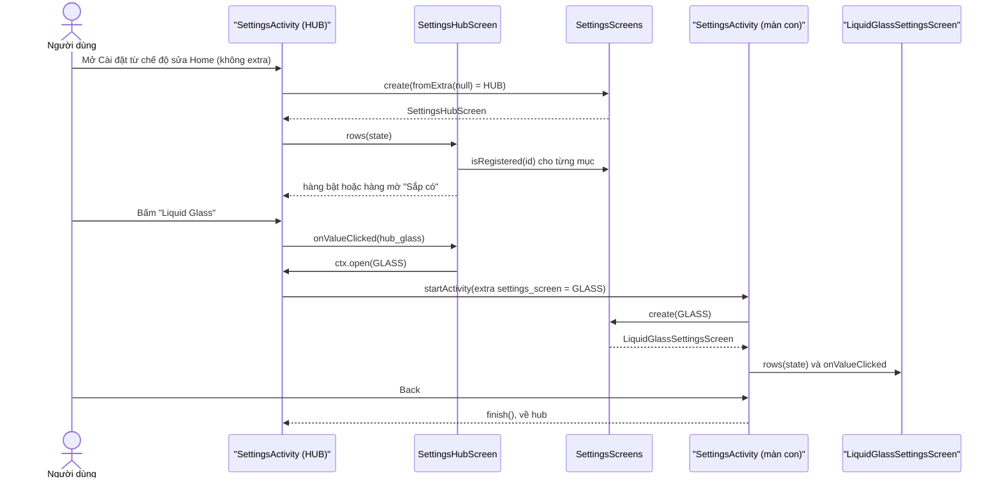
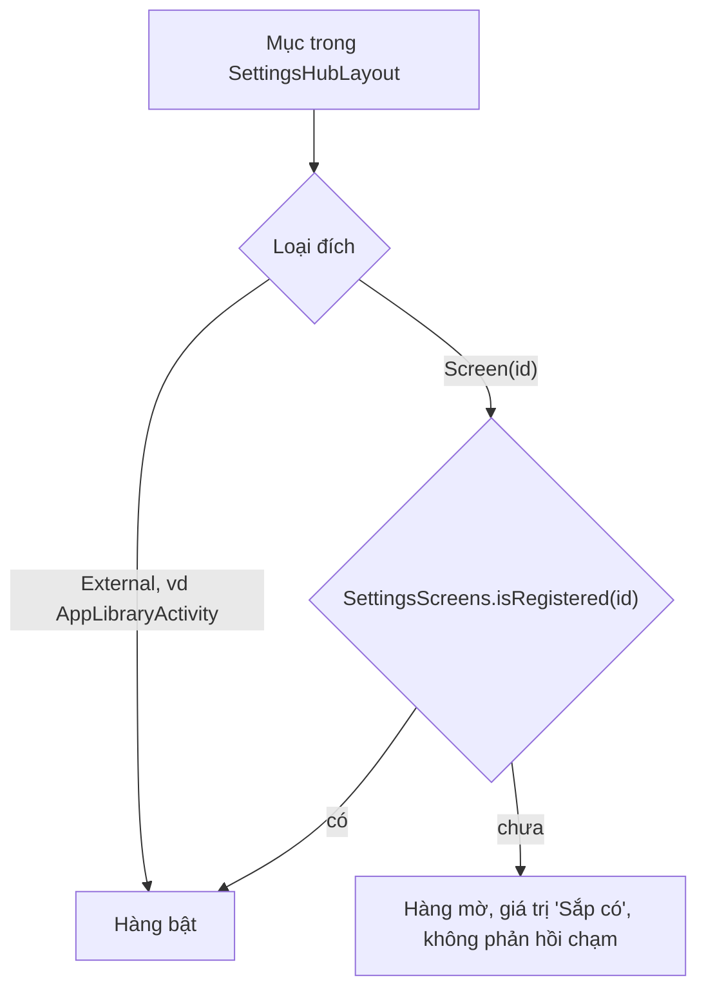
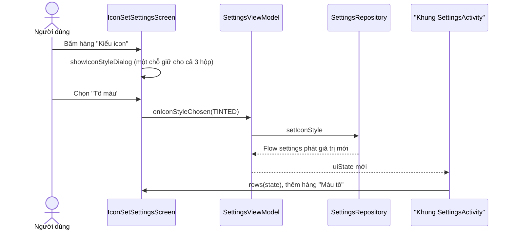

# G2d — Trung tâm Cài đặt (settings hub): đọc trước khi review

**Plan:** [plans/G2d-settings-hub.md](../plans/G2d-settings-hub.md) · **PR:** #47 · **Nhánh:** `feature/g2d-settings-hub`

## 1. Tóm tắt

Màn Cài đặt trước đây là **một danh sách phẳng** dài. Từ G2d, bấm "Cài đặt" ở chế độ sửa Home mở **trang chủ Cài đặt**: một hàng "Launcher mặc định", sáu nhóm theo bản nháp Figma (Chung · Giao diện · Màn hình nền · Chuyển cảnh · Tùy chỉnh biểu tượng · Liên hệ với chúng tôi) và chân trang "Phiên bản 1.0.0". Mỗi mục đã có nội dung mở **một màn con** (Chung, Liquid Glass, Hình nền, Bộ biểu tượng, Cài đặt tìm kiếm) hoặc màn "Ứng dụng đã ẩn" có sẵn. Mục của bản nháp chưa có nội dung hiện **mờ với chữ "Sắp có"** và không bấm được. Kiểu hiển thị hàng/danh sách giữ nguyên như trước; không có tính năng cài đặt mới.

## 2. Kiến thức nền

- **Activity và back stack.** Mỗi lần `startActivity` tạo một Activity mới đặt lên đầu "ngăn xếp" của task; nút Back (hoặc `finish()`) bỏ Activity trên cùng và hiện cái bên dưới. Hub → màn con là hai Activity chồng nhau, nên Back từ màn con về hub là hành vi miễn phí của hệ thống. (đọc tài liệu: [Tasks and the back stack](https://developer.android.com/guide/components/activities/tasks-and-back-stack))
- **`registerForActivityResult`.** Cách mở bộ chọn ảnh hay hộp thoại hệ thống rồi nhận kết quả. Hàm này phải được gọi **trước khi Activity sang trạng thái STARTED** (thường là trong `onCreate`), và hệ thống ghép kết quả với launcher bằng một khóa sinh theo **thứ tự đăng ký**; Activity bị dựng lại thì thứ tự phải y như cũ. (đọc tài liệu: [Get a result from an activity](https://developer.android.com/training/basics/intents/result))
- **`nosensor` và dựng lại Activity.** Nhờ `screenOrientation="nosensor"` (mốc RR) xoay máy không dựng lại Activity; việc dựng lại còn xảy ra khi đổi giao diện tối/sáng, cỡ chữ, ngôn ngữ, hoặc tiến trình bị hệ thống kill.
- **`SettingsRow` và `SettingsAdapter`** (từ M8a): danh sách kiểu iOS; các hàng liền nhau giữa hai `Header` thành một khối bo góc. G2d thêm đúng một loại hàng mới: `Footer` (chữ nhỏ cuối danh sách, đứng ngoài mọi khối).

## 3. Luồng hoạt động

**Mở một màn con từ trang chủ.** Màn nào hiện được quyết định bởi extra của intent, không phải bởi trạng thái nhớ trong RAM; vì vậy Activity bị dựng lại vẫn dựng đúng màn.

Điểm dễ sai: `HomeActivity` vẫn mở `SettingsActivity` **không có extra**, nên mặc định phải là hub (`SettingsScreenId.fromExtra`: thiếu hoặc lạ thì về `HUB`). Mục chưa đăng ký không có đường vào: hàng mờ bị tắt ở adapter, `SettingsHubScreen.onValueClicked` còn chặn thêm một lần nữa.

**Vì sao một mục bật hay mờ.**

**Thao tác trong màn con (ví dụ đổi kiểu icon)** đi theo đường cũ của M8a/G2b, chỉ khác là hộp thoại và hàng nằm trong lớp màn:

Ghi lỗi hoặc Hủy thì giá trị không đổi nên danh sách không tự vẽ lại: màn gọi `ctx.rerender(true)` để khung bind lại mọi hàng từ trạng thái thật (đúng như `forceRebind` trước G2d).

## 4. Thay đổi theo file

Đường dẫn dưới `app/src/main/java/gambi/global/os26launcher/ui/settings/` trừ khi ghi khác.

| File | Vai trò | Vì sao thêm/sửa | Đọc trước? |
|---|---|---|---|
| `SettingsScreen.kt` | Interface `SettingsScreen`, `SettingsScreenContext`, enum `SettingsScreenId`, bảng đăng ký `SettingsScreens` | Khung chung; bảng đăng ký có một dòng giữ chỗ cho mỗi màn bản nháp | **Có (1)** |
| `SettingsActivity.kt` | Khung: toolbar, inset, danh sách, thu state/event, chọn màn theo extra | Từ 591 dòng còn khoảng 120; không còn logic của màn cụ thể | **Có (2)** |
| `SettingsHubScreen.kt` | Trang chủ + `SettingsHubLayout` (bảng nhóm/mục theo thứ tự bản nháp) | Mục chưa có màn hiện mờ; thêm màn không phải sửa file này | **Có (3)** |
| `DefaultLauncherAction.kt` | Luồng đặt launcher mặc định (B12/FX6) | Chuyển nguyên từ Activity để hub và màn Tìm kiếm dùng chung một launcher | Không |
| `GeneralSettingsScreen.kt`, `LiquidGlassSettingsScreen.kt`, `WallpaperSettingsScreen.kt`, `IconSetSettingsScreen.kt`, `SearchSettingsScreen.kt` | Năm màn con | Chuyển nguyên hàng, hộp thoại, bộ chọn từ Activity cũ (chỉ đổi `this` thành `activity` và dựng lại qua `ctx.rerender`) | Không |
| `SettingsRow.kt`, `SettingsAdapter.kt` | Thêm loại hàng `Footer` và `ID_HUB_FOOTER` | Chân trang phiên bản | Không |
| `SearchSettingsBlock.kt` | Bỏ `Header` đầu khối | Tiêu đề trùng tên màn | Không |
| `res/layout/activity_settings.xml`, `item_settings_footer.xml` | Đệm đầu danh sách 8dp; layout chân trang | Màn con không có Header đầu | Không |
| `res/values/strings.xml` | Khối `settings_hub_` ở cuối; bỏ 4 chuỗi nhóm cũ không còn dùng | Chữ cho mọi mục bản nháp, "Sắp có", "Phiên bản %1$s" | Không |
| `app/build.gradle.kts` | `versionName = "1.0.0"` | Quyết định FD9 | Không |

Không đổi: `HomeActivity`, `AndroidManifest.xml`, `ui/library/*`, `SettingsViewModel`, `SettingsUiState`, `SettingsEvent`, domain, data.

## 5. Quyết định và đánh đổi

- **Chọn:** một Activity khung + một lớp `SettingsScreen` cho mỗi màn; màn chọn bằng extra; vào màn con bằng `startActivity` cùng lớp. **Bỏ:** Fragment cho mỗi màn (kéo hạ tầng chưa dùng trong dự án), Activity cho mỗi màn (mỗi màn sửa manifest), danh sách phẳng có thêm header (không đạt yêu cầu "trang chủ + màn con"). Lý do và bảng so sánh đầy đủ ở plan, mục "Vì sao chọn thiết kế này".
- **Bảng trang chủ khai sẵn mọi mục bản nháp.** Nhánh sau (FD-1/2/3) chỉ cần tạo một lớp màn và thay một dòng giữ chỗ ở `SettingsScreens`; mục tự bật, không đụng hub, `strings.xml` cho hàng hub, manifest hay `HomeActivity`.
- **Mục chưa có nội dung: hiện mờ, không ẩn** (chủ dự án, 2026-11-12; đề xuất ban đầu của agent là ẩn). Đánh đổi: người dùng bản dựng này thấy nhiều hàng "Sắp có"; bù lại thấy đủ bố cục bản nháp.
- **Giữ kiểu hiển thị hiện tại** (quyết định FD2): hàng điều hướng là `SettingsRow.Value` (giá trị bên phải là mô tả ngắn hoặc rỗng), không có mũi tên.
- **Mỗi Activity có `SettingsViewModel` riêng** (chấp nhận; xem mục 6 về `applyingGrid`).
- **Chuỗi:** giữ "Đang là mặc định" / "Chưa đặt" cho hàng launcher mặc định; giữ "Ứng dụng đã ẩn" cho hàng Ứng dụng ẩn (khớp tiêu đề màn đó).

## 6. Chỗ cần soi khi review

- **Launcher đăng ký đúng thứ tự (Review Focus 4).** Khung đăng ký `DefaultLauncherAction` trước, màn đăng ký launcher của mình sau (chỉ `WallpaperSettingsScreen` có `pickImage`). Thứ tự cố định vì màn xác định bởi extra. Mở bộ chọn ảnh rồi Back đã chạy trên Live 4 (đo được), nhưng **dựng lại Activity khi bộ chọn đang mở và kill tiến trình chỉ được code bảo vệ** (suy luận chưa kiểm chứng).
- **Hàng launcher mặc định và gợi ý "cần launcher mặc định" của màn Tìm kiếm** gọi cùng `DefaultLauncherAction.request()`. Trên Live 4 Os26 đang là launcher mặc định nên hàng mờ và gợi ý không xuất hiện; luồng hộp thoại vai trò và dự phòng FX6 sau khi chuyển **chưa chạy lại** (code chuyển nguyên văn, điều phối đã đối chiếu diff). Cần kiểm trên máy mà Os26 không phải mặc định.
- **Nhập ảnh nền bị hủy khi rời màn Hình nền** (suy luận chưa kiểm chứng): việc nhập ảnh chạy trong `viewModelScope` của `SettingsViewModel` của **Activity đó**. Rời màn Hình nền (Back về hub) khi đang nhập thì ViewModel bị hủy và việc nhập cũng bị hủy. Giống hành vi rời Cài đặt trước G2d, nhưng nay dễ gặp hơn vì Back chỉ về hub chứ không rời hẳn Cài đặt. Chưa kiểm trên máy.
- **`applyingGrid` không chia sẻ giữa hai Activity (H8).** Thoát màn Chung khi đang đổi lưới rồi vào lại: ViewModel mới có `applyingGrid = false`. Đo được trên Live 4 (2026-11-12): bấm Áp dụng 4×6 → 4×5, Back rồi bấm lại "Chung" trong khoảng 0,7 giây; màn mở lại đã hiện giá trị cuối, không có tiến trình, không crash — việc đổi xong nhanh hơn người dùng kịp rời và vào lại. Đường `Mutex` tuần tự hóa hai lần đổi chồng nhau (FX3) **chưa bị thử** (suy luận từ tài liệu, chưa kiểm chứng).
- **Mở màn con có chậm không?** Mỗi màn con tạo thêm một `SettingsViewModel` (nhiều flow `combine`, có truy vấn gói icon ở luồng IO). Quan sát trên Live 4 (bản debug, **không đo bằng đồng hồ**): mở từng màn con thấy hàng ở ảnh chụp đầu tiên sau khoảng 0,4 đến 2 giây kể từ lúc bấm, không thấy trạng thái đang tải; bản debug khởi động chậm hơn release vài lần (xem `lessons/startup-performance.md`), nên đây là cận trên. Chưa có số đo so với trước G2d.
- **Ảnh hưởng tới tính năng cũ:** Home không đổi (`HomeActivity` không sửa). Home vẫn tự áp lại kính, kiểu icon, nền ở `onResume` như trước (đọc code, RecreateGuard). Chưa chạy: chọn và áp ảnh nền, đổi kiểu và màu icon rồi nhìn Home, hiện nhãn, đổi mức kính rồi nhìn Home (nằm trong bài kiểm tay ở plan).

## 7. Cách kiểm lại

Máy Vsmart Live 4. Bài kiểm đầy đủ ở mục "Bài kiểm cả tính năng" của plan; tóm tắt: mở Cài đặt từ chế độ sửa Home, đi qua hub và từng màn con, kiểm từng nhóm cài đặt có tác dụng thật lên Home, rồi kiểm hàng launcher mặc định trên máy mà Os26 không phải mặc định. Bài kiểm đã chạy một phần bởi điều phối trên Live 4 (kết quả ở "Nhật ký" và "Bằng chứng Review Focus" của plan).

## 8. Bài học cho AGENTS.md

Chủ đề đề xuất: `settings-and-data` (`lessons/settings-and-data.md`).

- **(2026-11-12, đọc code, G2d)** Muốn thêm nhiều màn cài đặt mà các nhánh không xung đột: để Activity làm khung, mỗi màn là một lớp riêng, **khai sẵn toàn bộ bảng mục và chuỗi một lần** để nhánh sau chỉ thêm một file và thay một dòng giữ chỗ (mỗi ô cách nhau một dòng trống). Thêm giá trị enum ở cuối.
- **(2026-11-12, đọc tài liệu, G2d)** `registerForActivityResult` được ghép với kết quả bằng khóa sinh theo thứ tự đăng ký: đăng ký không điều kiện, theo thứ tự cố định, ngay lúc dựng; không đăng ký lười hoặc theo trạng thái.
- **(2026-11-12, đọc code, suy luận chưa kiểm chứng, G2d)** Màn chọn theo extra của intent (thiếu hoặc lạ thì về trang chủ) nên Activity bị dựng lại vẫn dựng đúng màn, không cần `onSaveInstanceState`. Chưa chạy dựng lại Activity trên máy.
- **(2026-11-12, đo được trên Live 4, G2d)** Mục điều hướng chưa có đích hiện mờ và bị chặn ở cả adapter lẫn handler: chạm không mở thêm Activity nào (task stack vẫn một `SettingsActivity`).
- **(2026-11-12, suy luận chưa kiểm chứng, G2d)** Việc chạy trong `viewModelScope` của Activity con bị hủy khi Activity đó đóng. Khi tách một màn khỏi Activity cũ, rà các việc dài (nhập ảnh) xem chúng có sống qua nút Back mới thêm không.
- **(2026-11-12, quy trình, G2d)** Khi một nhánh làm chuỗi hoặc ID thành mã chết, nhánh đó xóa chúng và grep xác nhận không còn tham chiếu (`settings_group_*`, `settings_search_group`); không để dành cho "dọn sau".
