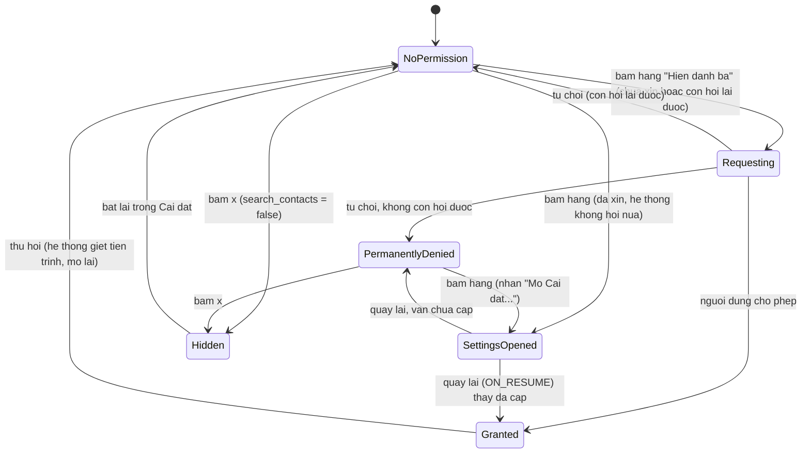
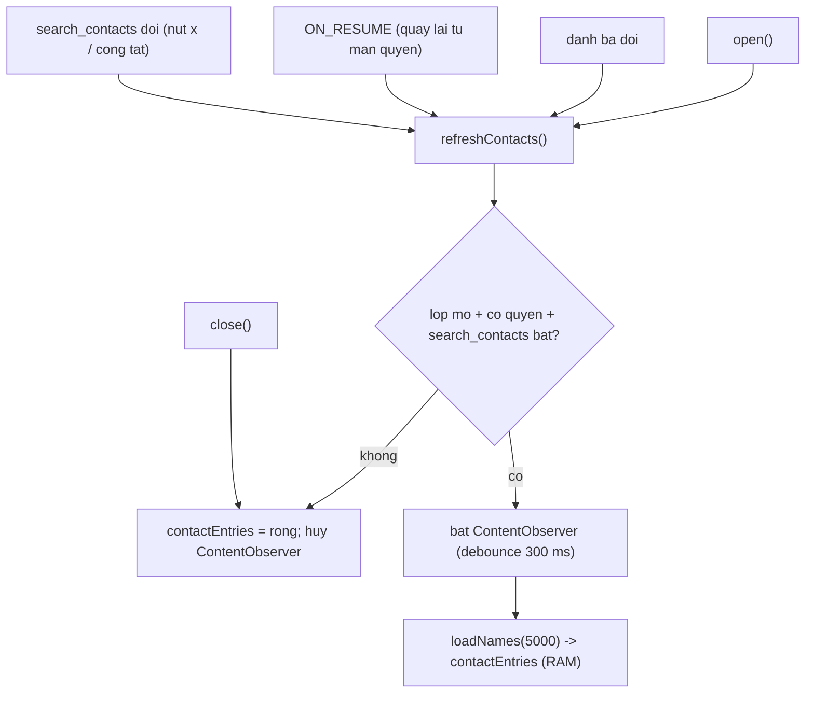

# G3a — Tìm danh bạ trong ô tìm kiếm: đọc trước khi review

Plan: [plans/G3a-contacts-search.md](../plans/G3a-contacts-search.md). Nhãn: **đo được** (trên máy thật), **đọc tài liệu**, **đọc code**, **suy luận chưa kiểm chứng**. Mục "Số đo" ở cuối còn **để trống** cho điều phối điền sau khi chạy trên máy.

## 1. Tóm tắt

Ô tìm kiếm của M8d tìm được app, Cài đặt hệ thống, shortcut. G3a thêm **người trong danh bạ**:

- Chưa cấp quyền `READ_CONTACTS`: ô tìm kiếm chỉ có một hàng "Hiện danh bạ" (cuối ô trống, hoặc cuối kết quả khi gõ từ 2 ký tự; thay dòng "Không có kết quả" nếu không có gì khớp). Bấm hàng thì xin quyền; nếu hệ thống không hỏi nữa thì mở màn "Thông tin ứng dụng". Nút "x" trên hàng tắt tính năng (bật lại ở Cài đặt, khối Tìm kiếm).
- Đã cấp quyền: gõ từ 2 ký tự ra tối đa 5 người, khớp tên bỏ dấu tiếng Việt (cùng hàm `AppSearchMatcher.normalize`). Hàng có ảnh tròn hoặc vòng tròn xám chữ cái đầu, tên, số điện thoại (hoặc chữ "Danh bạ" nếu không có số). Bấm hàng mở danh bạ hệ thống; hai nút nhỏ gọi (`ACTION_DIAL`) và nhắn (`ACTION_SENDTO smsto:`), ẩn nếu người đó không có số.
- **Không lưu bản sao nào.** Tên chỉ nằm trong RAM khi lớp tìm kiếm mở; số chỉ hỏi provider cho tối đa 5 hàng đang hiện. Chỉ có hai cờ bool mới trong DataStore.

Không đổi schema Room, không thêm thư viện, không sửa `HomeActivity`, không thêm `<queries>`. Thêm quyền `READ_CONTACTS` (runtime).

## 2. Kiến thức nền

- **Contacts provider.** `ContactsContract.Contacts` là bảng người đã gộp từ nhiều tài khoản. `LOOKUP_KEY` bền khi danh bạ gộp/tách, `_ID` thì không; mở một người bằng `Contacts.getLookupUri(id, lookupKey)`. Số điện thoại nằm ở `CommonDataKinds.Phone`, mỗi số một hàng, có cờ `IS_SUPER_PRIMARY` (số mặc định người dùng đặt) và `IS_PRIMARY` (đọc tài liệu).
- **`ACTION_DIAL` không cần quyền `CALL_PHONE`:** chỉ mở trình quay số với số đã điền, người dùng bấm gọi tiếp. Launcher không bao giờ tự gọi (đọc tài liệu).
- **Quyền runtime và "từ chối vĩnh viễn".** Không có API trực tiếp. Dấu hiệu: `shouldShowRequestPermissionRationale` trả `false` **sau khi đã từng xin** (từ Android 11, từ chối lần hai thì hệ thống không hiện hộp thoại nữa). Trước lần xin đầu tiên nó cũng trả `false`, nên cần cờ "đã xin" mới phân biệt được (đọc tài liệu; hành vi cụ thể từng ROM **chưa đo**, xem Số đo).
- **Thu hồi quyền runtime từ Cài đặt hệ thống giết tiến trình của app** (đọc tài liệu, **chưa đo** trên hai máy). Nên "thu hồi khi đang mở" thực tế là app tự khởi động lại; mọi truy vấn provider vẫn bắt `SecurityException` phòng trường hợp ROM không giết.
- **`startActivity` không bị lọc tầm nhìn package, chỉ `resolveActivity`/`queryIntentActivities` bị lọc.** G3a chỉ `startActivity` (try/catch) nên không khai `<queries>`. Bài học M8d: `<queries>` mở theo package, không theo action.
- **Auto Backup** (`allowBackup="true"`) sao lưu DataStore; vì vậy danh bạ không bao giờ được ghi vào đó. Hai cờ mới (`search_contacts`, `search_contacts_asked`) chỉ là bool, không phải dữ liệu danh bạ.

## 3. Luồng hoạt động

### 3.1 Trạng thái quyền và hàng mời



Trong code: `NoPermission/PermanentlyDenied` = `contactsGranted == false`, phân biệt bằng `contactsPermanentlyDenied` (chỉ trong RAM của ViewModel, mất khi tiến trình chết) → `ContactsPermissionPrompt(openSettings)`. `Hidden` = `prefs.contacts == false`. Quyết định xin hay mở Cài đặt nằm ở `SearchOverlayController.onRequestContactsPermission`: `asked && !shouldShowRationale` → mở Cài đặt, ngược lại `launch(READ_CONTACTS)`.

### 3.2 Mở lớp và gõ truy vấn

```mermaid
sequenceDiagram
    participant U as Nguoi dung
    participant C as SearchOverlayController
    participant VM as SearchViewModel
    participant R as ContactsRepository
    participant P as ContactsContract
    U->>VM: mo lop (vuot xuong / pill)
    VM->>R: hasPermission()
    alt chua cap quyen hoac search_contacts tat
        VM-->>C: hang moi (neu search_contacts bat)
    else da cap quyen
        VM->>R: loadNames(5000) tren IO
        R->>P: query Contacts (ID, LOOKUP_KEY, ten, anh), IN_VISIBLE_GROUP = 1
        P-->>R: cac hang
        R-->>VM: ContactEntry (chi RAM)
        VM->>VM: SearchIndex.build (app + cai dat + shortcut + danh ba)
    end
    U->>VM: go "nguyen"
    VM->>VM: SearchIndex.search (chuan hoa bo dau, toi da 5 Contact)
    VM->>R: numbersFor(ids) tren IO (mapLatest huy phim cu)
    R->>P: query Phone theo CONTACT_ID (IS_SUPER_PRIMARY, IS_PRIMARY, _ID)
    P-->>R: so
    VM-->>C: SearchUiState(results co so dien thoai)
    U->>VM: bam hang / nut goi / nut nhan
    VM->>R: openContact / dial / message
    VM->>VM: thanh cong: close() xoa ten khoi RAM; that bai: Toast, giu lop
```

### 3.3 Vòng đời dữ liệu danh bạ trong RAM



## 4. Thay đổi theo file

| File | Việc |
|---|---|
| `AndroidManifest.xml` | Thêm `READ_CONTACTS`; không thêm `<queries>` |
| `domain/model/ContactEntry.kt`, `domain/repository/ContactsRepository.kt` | Mô hình và giao diện nguồn danh bạ |
| `data/search/ContactsRepositoryImpl.kt` | Nơi duy nhất chạm `ContactsContract`: tên (limit 5000), số, ContentObserver, avatar, intent view/dial/sms |
| `data/search/ContactAvatar.kt` | Cắt tròn ảnh, vẽ vòng tròn xám chữ cái đầu |
| `di/SearchModule.kt` | `@Binds` repository |
| `domain/search/SearchResult.kt` | `SearchKind.CONTACT` (priority 1), `Contact`, `ContactsPermissionPrompt`; Cài đặt thành 2, Shortcut thành 3 |
| `domain/model/SearchPreferences.kt`, `SearchPreferencesRepository(Impl)`, `SearchPrefsKeys.kt` | Cờ `contacts` (mặc định bật) và `contactsAsked` |
| `ui/search/SearchViewModel.kt` | Nạp/xóa tên theo vòng đời lớp, hàng mời, gắn số, hành động gọi/nhắn/mở |
| `ui/search/SearchUiState.kt` | Sự kiện `RequestContactsPermission`, `ContactActionFailed` |
| `ui/search/SearchResultAdapter.kt`, `res/layout/item_search_result.xml`, drawable `ic_contact_*`, `ic_search_*` | Hàng danh bạ, hàng mời, nút gọi/nhắn/x |
| `ui/home/controller/SearchOverlayController.kt` | Xin quyền (`ActivityResultRegistry`), ON_RESUME, Toast lỗi |
| `ui/settings/*` | Công tắc "Tìm trong danh bạ" và hàng gợi ý cấp quyền |
| `res/values/strings.xml`, `dimens.xml` | Chuỗi, kích thước nút |

## 5. Quyết định và đánh đổi

- **Tên trong RAM, số hỏi provider theo hàng.** Giữ chuẩn hóa tiếng Việt của M8b/M8d (một chỉ mục chung), không có gì ra đĩa. Đánh đổi: tên nằm trong RAM khi lớp mở; mở lớp tốn một truy vấn. Phương án B (hỏi provider mỗi phím, không giữ gì) bị loại vì `CONTENT_FILTER_URI` không đảm bảo bỏ dấu `đ` như M8b (suy luận chưa kiểm chứng) và tốn binder mỗi phím.
- **Cờ `search_contacts_asked` trong DataStore** để biết "từ chối vĩnh viễn". Nhược: sau khi khôi phục backup sang máy mới, cờ có thể là `true` dù chưa xin; hậu quả chỉ là bấm hàng mở màn Thông tin ứng dụng thay vì hộp thoại, người dùng vẫn cấp được. Chủ dự án chấp nhận 2026-11-09.
- **`contactsPermanentlyDenied` chỉ ở RAM.** Sau khi tiến trình chết, nhãn hàng về "Hiện danh bạ" cho tới lần bấm kế (khi đó `askedBefore && !shouldShow` mở Cài đặt).
- **Xin quyền từ `SearchOverlayController`, lấy `ComponentActivity` bằng cách tháo `ContextWrapper`** của `binding.root.context`: không phải sửa `HomeActivity` (file độc quyền). Nếu không tháo ra được thì `activity == null` và bấm hàng không làm gì (phương án dự phòng đã duyệt: truyền `this` một dòng ở `HomeActivity`; chưa cần).
- **Một số cho mỗi người** (mặc định, rồi số chính, rồi số thêm đầu tiên). Muốn số khác thì mở danh bạ.
- **Giới hạn 5000 người** theo `SORT_KEY_PRIMARY`; người ngoài giới hạn không tìm ra.
- **Khớp theo số điện thoại bị cắt** khỏi nhánh (chủ dự án, 2026-11-09), ghi để sau trong plan.
- **Log tag `G3A`** chỉ còn các `Log.w` ghi tên lớp ngoại lệ (không in tên/số). Log đo thời gian nạp đã gỡ khi đóng nhánh.
- **Tắt công tắc "Tìm trong danh bạ" không thu hồi quyền hệ thống**, chỉ ngừng đọc; dòng mô tả dưới công tắc (thêm `description` tùy chọn cho `SettingsRow.Switch`, các hàng khác không đổi) nói rõ điều này.

## 6. Chỗ cần soi khi review

1. `ContactsRepositoryImpl`, `SearchViewModel`: không có chỗ nào ghi tên/số ra đĩa, `Log`, thông báo lỗi. (Log hiện có: số lượng, thời gian, tên lớp ngoại lệ.)
2. `close()` và `refreshContacts()` đều xóa `contactEntries`; `IndexBundle` được dựng lại từ `contactEntries` rỗng nên không còn `SearchResult.Contact` trong chỉ mục. Kết quả đã hiển thị chỉ biến mất khi `render` kế tiếp (lớp đóng nên không thấy).
3. `numbersFor` chạy trong `mapLatest` (đã `flowOn(Default)`), truy vấn thật chạy `withContext(io)`; không chạy trên Main.
4. `SearchOverlayController`: đăng ký `ActivityResultRegistry` trong `setup()` (gọi ở `onCreate`), không muộn sau STARTED; observer ON_RESUME gắn vào lifecycle của Activity.
5. `SecurityException` được bắt ở mọi truy vấn; `loadNames` rỗng + mất quyền thì `contactsGranted` về `false` (hiện hàng mời).
6. Hàng không có số: `phone == null` nên không nút; máy không có `FEATURE_TELEPHONY` cũng không nút.
7. Không có `<queries>` mới; không sửa `HomeActivity`; không sửa tài liệu chung.

## 7. Cách kiểm lại

Xem "Bài kiểm cả tính năng" trong plan (mục A đến H). Tóm lược ca khó:

- Gỡ quyền → bấm hàng → từ chối hai lần → hàng đổi nhãn → bấm → cấp quyền → Back về launcher: lớp tìm kiếm vẫn mở và tìm được ngay.
- Bấm "x" rồi mở lại tìm kiếm; vào Cài đặt kiểm công tắc tắt; bật lại.
- Gõ "nguyen", "duc", "dang", "van an" với dữ liệu thử có dấu.
- Sửa danh bạ khi lớp mở: người mới hiện trong khoảng 1 giây.
- `adb shell run-as gambi.global.os26launcher` (bản debug) tìm tên danh bạ trong dữ liệu app: không có.

## 8. Bài học cho AGENTS.md

(Điều phối áp dụng sau merge; mục có "chờ đo" điền khi có số.)

- **Dữ liệu danh bạ không nằm trong DataStore/Room/file khi `allowBackup="true"`.** Chỉ cờ bool. Tên giữ trong RAM theo vòng đời lớp tìm kiếm, bỏ khi đóng.
- **Phân biệt "từ chối vĩnh viễn" cần cờ "đã xin".** `shouldShowRequestPermissionRationale == false` đứng một mình không đủ vì nó cũng `false` trước lần xin đầu tiên.
- **Quyền runtime từ một controller không phải Activity:** tháo `ContextWrapper` lấy `ComponentActivity`, đăng ký `activityResultRegistry.register(key, lifecycleOwner, ...)` trong `onCreate` (trước STARTED). Tránh sửa file độc quyền chỉ để truyền `this`.
- **Hộp thoại quyền và Cài đặt hệ thống có thể giữ lớp tìm kiếm ở trạng thái mở:** `isOpen` sống trong ViewModel nên khi quay lại phải đọc lại quyền ở ON_RESUME.
- **Không in tên/số vào logcat**, dù chỉ để gỡ lỗi; chỉ in số lượng và thời gian.
- **Contacts provider:** `LIMIT_PARAM_KEY` trên URI để giới hạn; `IN_VISIBLE_GROUP = 1` để khớp app Danh bạ (chờ đo xem có khớp số người).
- **ColorOS bỏ qua ORDER BY trên `Phone.CONTENT_URI` cho truy vấn này** (đo 2026-11-09, Oppo A3x: người có hai số quay nhầm số đầu dù số hai là super primary; Live 4 đúng). Chọn số bằng code từ `IS_SUPER_PRIMARY`, `IS_PRIMARY`, `_ID`; không tin thứ tự provider trả về.
- (Chờ đo) thời gian nạp tên ở 500/1000 người; hành vi thu hồi quyền khi đang chạy; `shouldShowRationale` sau lần từ chối thứ nhất/thứ hai trên Android 11 (Live 4) và Android 14 (Oppo).

## 9. Số đo (để điều phối điền)

Máy, ngày, bản cài (debug/release, `git rev-parse --short HEAD`), số người trong danh bạ thử.

(Log đo đã gỡ khi đóng nhánh; các số dưới đây do điều phối đo bằng bản có log.) Cách đo thời gian nạp tên: cấp quyền bằng `adb shell pm grant gambi.global.os26launcher android.permission.READ_CONTACTS` (hoặc qua hàng "Hiện danh bạ"), mở lớp tìm kiếm vài lần, rồi `adb logcat -d -s G3A` (dòng `loaded N contacts in X ms`). Oppo bỏ dòng khi in dồn: mở từng lần một và đọc ngay (AGENTS.md M8d).

| # | Số đo | Live 4 | Oppo A3x | Mục tiêu |
|---|---|---|---|---|
| 1 | Số người nạp được so với số người trong app Danh bạ | | | bằng nhau |
| 2 | Thời gian `loadNames` (ms), 500 người | | | ≤ 150 (chưa đo) |
| 3 | Thời gian `loadNames` (ms), ~1000 người (nếu nhập vCard) | | | ghi nhận |
| 4 | Gõ nhanh 5 ký tự: số khung chậm so với M8d (Oppo) | | | không tệ hơn |
| 5 | Từ chối lần 1 rồi lần 2: hộp thoại có hiện nữa không; nhãn hàng sau lần 2 | | | lần 2 là vĩnh viễn |
| 6 | Thu hồi quyền khi đang mở: tiến trình bị giết hay còn sống | | | ghi nhận |
| 7 | `CONTENT_FILTER_URI` với "duc"/"nguyen" (chỉ để đối chiếu phương án B) | | | ghi nhận |
| 8 | Người có hai số, một số mặc định: hàng hiện số mặc định | | | đúng |
| 9 | `grep` tên danh bạ trong dữ liệu app (`run-as`, bản debug) | | | không có |

### Kết quả điều phối đo (2026-11-09, bản debug, nhánh feature/g3a-contacts-search)

**Vsmart Live 4 (Android 11):**
- Nạp 17 người trong 21-55 ms.
- Luồng quyền: cấp, từ chối, từ chối lần hai thì hàng đổi thành "Mở Cài đặt để cấp quyền Danh bạ", bấm mở màn Thông tin ứng dụng; cấp rồi Back thì lớp tìm kiếm vẫn mở và tìm được danh bạ.
- "nguyen", "van an", "duc", "dang" đều khớp đúng.
- Người không có số: dòng phụ "Danh bạ", không nút. Nút gọi mở trình quay số điền đúng số mặc định; nút nhắn mở SMS với số; bấm hàng mở QuickContact.
- Thu hồi quyền khi đang mở: tiến trình khởi động lại, không crash, hàng mời trở lại.
- "x" ẩn hàng và tắt công tắc; dòng mô tả của công tắc và hàng "Chưa cấp quyền Danh bạ, bấm để cấp" hiển thị.
- Không có tên hay số danh bạ trong dữ liệu app hoặc log của app.

**Oppo A3x (Android 14, ColorOS):**
- Cùng luồng từ chối, từ chối, Thông tin ứng dụng (nút "Cho phép"/"Từ chối"; màn cấp quyền có lựa chọn "Luôn luôn"). `pm grant` qua adb bị ColorOS chặn.
- Nạp 12 người trong 28-362 ms; tìm kiếm hoạt động.
- **Lỗi đã thấy:** người có hai số bị quay số đầu (0901000003) dù số hai (0901000004) có `is_primary=1` và `is_super_primary=1`. Đã sửa bằng chọn số trong code (commit `fix: pick the default number in code, not by provider order`); chờ đo lại trên Oppo.

**Chưa kiểm:** avatar ảnh (người thử không có ảnh).

**Đo lại trên Oppo sau sửa (2026-11-09, APK 16:37, `3fdaea2`):** người có hai số giờ quay đúng số mặc định (0901000004). Avatar ảnh và TalkBack chưa kiểm. Log đo thời gian nạp đã gỡ ở commit `chore: drop the G3a load-time log`; muốn đo lại phải gắn log tạm.
