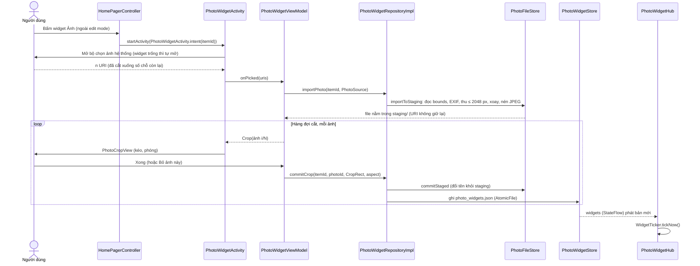
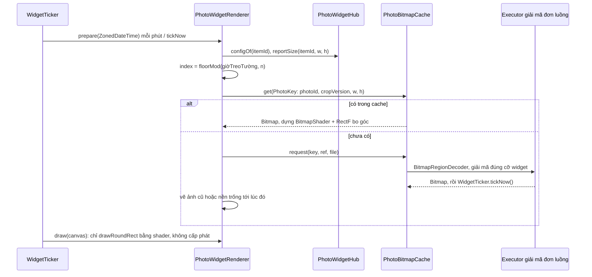
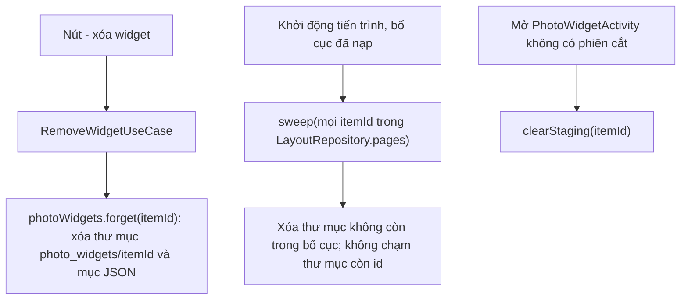

# G3b — Widget ảnh: đọc trước khi review

**Plan:** [plans/G3b-photo-widget.md](../plans/G3b-photo-widget.md) · **PR:** #57 · **Nhánh:** `feature/g3b-photo-widget`

## 1. Tóm tắt

Widget **Ảnh** cỡ 2×2 và 4×2 trong bảng "Tiện ích". Một widget hiện một ảnh, hoặc một bộ tối đa 10 ảnh đổi mỗi giờ đúng đầu giờ (chỉ khi Home đang hiện, không việc nền). Bấm widget mở màn "Ảnh của tiện ích": chọn ảnh bằng bộ chọn ảnh của hệ thống (không xin quyền đọc ảnh), kéo/phóng để chọn vùng cắt cho từng ảnh, thêm, cắt lại, xóa ảnh. App giữ bản sao thu nhỏ riêng, không sao lưu, không EXIF. Không đổi schema Room, không dependency và không quyền mới. (đo được trên Live 4, 2026-11-16: mọi trường hợp chính đạt.)

## 2. Kiến thức nền

- **Bộ chọn ảnh của hệ thống (Photo Picker)**: `PickMultipleVisualMedia` của `activity-ktx` mở bộ chọn hệ thống, app không cần `READ_MEDIA_IMAGES`. Trả về URI **tạm** (hết hạn khi app dừng hoặc máy khởi động lại), nên phải chép ngay. Nơi không có bộ chọn hệ thống thì rơi về `ACTION_OPEN_DOCUMENT` và bỏ qua `maxItems`, nên app tự cắt danh sách (đọc tài liệu: developer.android.com/training/data-storage/shared/photopicker).
- **`noBackupFilesDir`**: thư mục riêng của app nằm ngoài sao lưu đám mây. Cùng chỗ với `WeatherPlacesStore` (WX).
- **`BitmapRegionDecoder`**: giải mã đúng một vùng của file JPEG mà không cấp phát cả ảnh (đã dùng ở FX1). `inSampleSize` chỉ là lũy thừa của 2 nên phải thu nốt.
- **`BitmapShader`**: tô một hình bằng bitmap; renderer vẽ `drawRoundRect` bằng shader nên ảnh có góc bo mà không cần mặt nạ.
- **`WidgetTicker`**: nhịp mỗi phút của lớp widget, chỉ chạy khi có widget hiện (G2c). Nhờ nó, "đổi ảnh đầu giờ" không cần báo thức hay việc nền.

## 3. Luồng hoạt động

### 3.1 Chọn, nhập, cắt, cam kết, lưu

Bước dễ sai: URI chỉ tạm nên chép sang `staging/` **trước** mọi việc khác. Mỗi lần "Xong" ghi ngay, nên thoát giữa chừng vẫn giữ ảnh đã cắt; ảnh chưa cam kết còn ở `staging/` và bị dọn lần sau. Home không nhận kết quả qua `onActivityResult` mà qua Flow (D6), nên chạy đúng cả khi Home bị tạo lại.

### 3.2 Vẽ trên Home và đổi ảnh theo giờ

Không có trạng thái "ảnh hiện tại" nào được lưu: ảnh là hàm của giờ treo tường. Vì vậy không có Handler/receiver/báo thức riêng của G3b; quay về Home sau 3 giờ vẫn thấy ảnh đúng giờ. `prepare` không bao giờ chặn hay I/O.

### 3.3 Dọn dữ liệu

## 4. Thay đổi theo file

Đường dẫn dưới `app/src/main/java/gambi/global/os26launcher/`.

| File | Vai trò | Vì sao thêm/sửa | Đọc trước? |
|---|---|---|---|
| `ui/widget/PhotoWidgetRenderers.kt` | Renderer: chọn ảnh theo giờ, shader, trạng thái trống | Phần chạy mỗi phút trên Home | **Có** |
| `ui/photo/PhotoWidgetViewModel.kt` | Hàng đợi nhập → cắt → cam kết | Trạng thái sống qua xoay màn hình | **Có** |
| `data/photo/PhotoFileStore.kt` | Nhập ảnh: bounds, EXIF, thu nhỏ, flatten alpha, JPEG, staging/commit | Chỗ lỗi `inJustDecodeBounds` từng nằm | **Có** |
| `ui/photo/PhotoCropView.kt` | View cắt tự viết (kéo/phóng, kẹp trong ảnh, lớp tối) | Cử chỉ mới | Có |
| `ui/widget/PhotoBitmapCache.kt` | LRU theo byte + Executor đơn luồng + `onTrimMemory` | Bộ nhớ nhiều widget | |
| `ui/widget/PhotoWidgetHub.kt` | `object` nối repository với widget, `reportSize`/`sizeOf` | Cùng mẫu `WeatherWidgetHub` | |
| `data/photo/PhotoWidgetStore.kt`, `PhotoWidgetRepositoryImpl.kt`, `domain/photo/PhotoWidgetRepository.kt`, `domain/model/photo/PhotoWidgetConfig.kt`, `di/PhotoWidgetModule.kt` | Kho cấu hình + repository + mô hình | Lưu ngoài Room theo `itemId` | |
| `ui/photo/PhotoWidgetActivity.kt`, `PhotoGridAdapter.kt`, `res/layout/activity_photo_widget.xml`, `item_photo_widget_thumb.xml`, `drawable/bg_photo_*.xml` | Màn riêng: danh sách, bộ chọn, màn cắt | Không đụng `HomeActivity` (G3c) | |
| `domain/model/WidgetKind.kt`, `ui/widget/WidgetRenderer.kt`, `WidgetPickerController.kt`, `HomePagerController.kt` | Thêm `PHOTO`, nhánh `create`, tên thẻ, nhánh bấm | DÙNG CHUNG, chỉ thêm | |
| `ui/home/HomeViewModel.kt` | **Một dòng** `PHOTO -> true` trong `onWidgetTapped` | `when` vét cạn buộc phải có; ngoại lệ điều phối cho phép | Có (xác nhận chỉ 1 dòng) |
| `domain/usecase/RemoveWidgetUseCase.kt`, `LauncherApp.kt`, `AndroidManifest.xml`, `strings.xml`, `dimens.xml` | Dọn file khi xóa, nối hub + sweep + trim, một `<activity>`, chuỗi `ph_` | DÙNG CHUNG | |

## 5. Quyết định và đánh đổi

- **D1: lưu ngoài Room**, `no_backup/photo_widgets/<itemId>/<photoId>.jpg` + `photo_widgets.json`, khóa theo `itemId`. Bỏ cột Room (khóa schema, brief cấm) và `filesDir` (bị sao lưu đám mây). Đánh đổi: khôi phục máy thì widget về "chưa có ảnh".
- **D2: giữ nguồn thu nhỏ ≤ 2048 px + vùng cắt chuẩn hóa** thay vì chỉ lưu ảnh đã cắt: cắt lại được mà không chọn lại, giải mã đúng cỡ widget. Không chép nguyên byte như ảnh nền (FX1) để bỏ EXIF/GPS. Đánh đổi: lệch tỉ lệ nhỏ giữa lúc cắt và lúc vẽ xử lý bằng cách phủ kín quanh tâm.
- **D3: ảnh hiện tại = `floorMod(giờ, n)`** trong `prepare`, không lưu trạng thái, không việc nền. Đánh đổi: thêm/xóa ảnh hoặc đổi múi giờ làm chỉ số nhảy.
- **D4: `PhotoCropView` tự viết** thay vì thư viện cắt (dependency, giao diện khó khớp, muốn vùng chuẩn hóa) hay intent CROP của hệ thống (hầu như không còn).
- **D5: bấm widget mở màn riêng** (như WX), không sửa `IconGridView`.
- **D6: Activity riêng + Flow**, vì `HomeActivity` thuộc G3c; không có kênh trả kết quả.
- **Bộ chọn hệ thống, không xin quyền media**; chỉ khai thêm backport nếu đo thấy cần (quyết định 13, không cần).
- **Ngoại lệ một dòng ở `HomeViewModel`** do `when` vét cạn; đã được điều phối cho phép.
- **Không làm**: hiệu ứng chuyển ảnh, Mosaic, các phép đo bộ nhớ/Janky/Oppo của Task 5 (chủ dự án bỏ 2026-11-13).

## 6. Chỗ cần soi khi review

1. `git diff main...HEAD --stat` không có `HomeActivity`, `activity_home.xml`, `IconGridView`, `IconCellView`; `HomeViewModel` chỉ +1 dòng.
2. `PhotoWidgetRenderer.prepare` không I/O, không giải mã; ảnh đến muộn cho widget đã đổi `itemId`/`cropVersion` không bị vẽ nhầm (khóa cache có `photoId` + `cropVersion`).
3. `bindItem(itemId)` đặt lại bitmap/shader; ô từng là widget ảnh rồi thành app không giữ bitmap.
4. `sweep` không xóa thư mục của widget còn tồn tại và không chạy khi bố cục chưa nạp.
5. Không `Log` URI/đường dẫn; không `takePersistableUriPermission`; thư mục dưới `noBackupFilesDir`.
6. Chỗ **chỉ được code bảo vệ, chưa đo**: bộ nhớ 6–8 widget, Janky trên Oppo (kính dưới ảnh đục), tuyến bộ chọn API 34, xoay ảnh qua mốc giờ thật bằng đồng hồ máy (chỉ thấy ảnh 2/2 lúc 17h), sweep thư mục giả `999999` và xóa tay file ảnh.
7. Nghi vấn "bấm widget trong edit mode" của điều phối không tái hiện được; hành vi hiện tại là nuốt chạm như cũ.

## 7. Cách kiểm lại

Live 4, bản debug (ghi rõ debug), máy rảnh; đẩy ảnh thử vào máy: dọc EXIF 6, PNG alpha, panorama, tệp hỏng đặt tên .jpg. Chạy sau `content call --uri content://media/none --method scan_volume --arg external_primary` (xem bài học). Kịch bản: thêm widget từ bảng "Tiện ích" → bấm → chọn 3–5 ảnh → cắt từng ảnh (Xong, Bỏ ảnh này, Back hỏi "Bỏ N ảnh chưa cắt?") → Home hiện đúng vùng → bấm thumbnail cắt lại / Hủy → xóa ảnh → `force-stop` mở lại → "−" xóa widget và `run-as ... ls no_backup/photo_widgets` không còn thư mục. Kiểm file chỉ qua tên và kích thước, đếm `grep -c -a -E 'Exif|GPS'` kỳ vọng 0.

## 8. Bài học cho AGENTS.md

Chủ đề đề xuất: `widgets`, `permissions-and-device-testing`, `bitmaps`.

- 2026-11-13 [đo được, Live 4] `BitmapFactory.decodeStream` với `inJustDecodeBounds = true` **luôn trả null**; kết quả nằm ở `outWidth`/`outHeight`. Kiểm `== null` làm mọi ảnh hợp lệ bị loại ngay bước đọc cỡ (staging rỗng, không báo lỗi). Chủ đề `bitmaps`.
- 2026-11-13 [đo được, Live 4 API 30] Ảnh đẩy bằng `adb push` nằm ở `is_pending=1` nên bộ chọn không thấy; chạy `adb shell content call --uri content://media/none --method scan_volume --arg external_primary`. Module Google Photo Picker trên API 30 chỉ hiện các album Camera/Screenshots/Downloads; để ảnh thử vào một trong các thư mục đó. Chủ đề `permissions-and-device-testing`.
- 2026-11-13 [đo được, Live 4] Lỗ trong lớp tối vẽ bằng `Path.FillType.EVEN_ODD` **không hoạt động** (vùng trong khung vẫn tối). Dùng `WINDING` với hai đường có hướng ngược nhau (ngoài CW, trong CCW). Chủ đề `widgets`/`glass`.
- 2026-11-13 [đo được, Live 4] Item gốc của `RecyclerView` đặt `match_parent` theo chiều cao làm ô cao thấp không đều (tile cao). Dùng `ConstraintLayout` với tỉ lệ 1:1 cho ô vuông. Chủ đề `widgets`.
- 2026-11-13 [đọc tài liệu + đo được] `Bitmap.compress` không mang EXIF; lưu ảnh widget bằng nén lại là cách bỏ GPS (đếm EXIF/GPS = 0). Chủ đề `bitmaps`.

## Đề xuất cập nhật tài liệu chung

Xem mục cuối của [plan](../plans/G3b-photo-widget.md): `Launcher-Features.md` mục 15 xong; `project_structure.md` thêm file mới của G3b; `room-schema.md` ghi cấu hình widget ảnh nằm ngoài Room theo `itemId` như WX.
