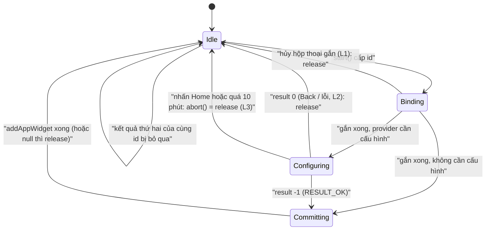
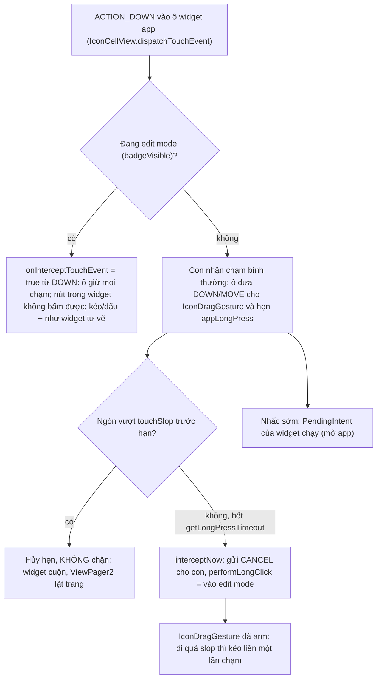
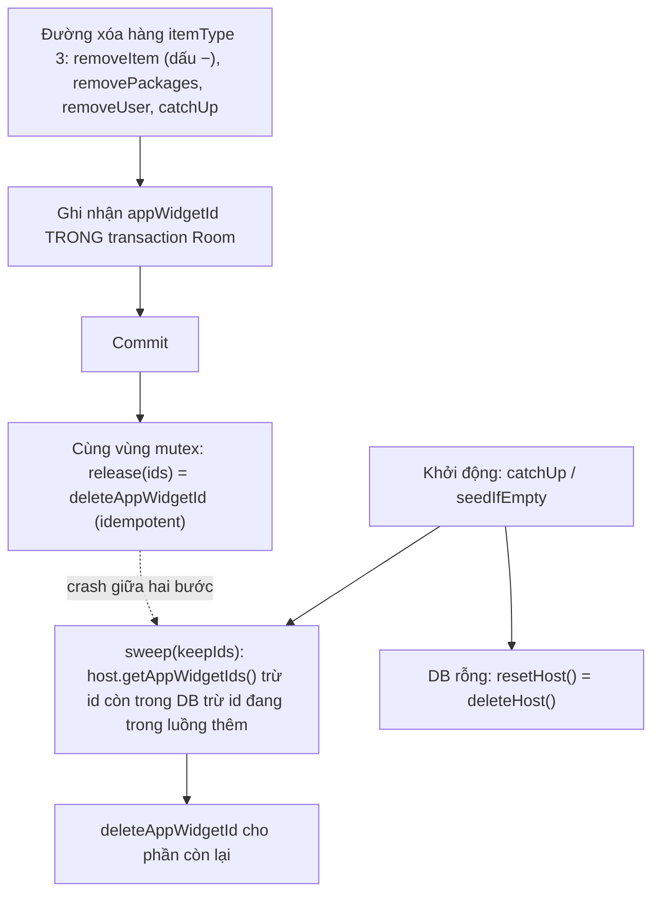

# G3c — AppWidgetHost: widget của app khác trên Home: đọc trước khi review

**Plan:** [plans/G3c-appwidget-host.md](../plans/G3c-appwidget-host.md) · **PR:** #59 · **Nhánh:** `feature/g3c-appwidget-host`

Nhãn nguồn: **đo được** (log/số trên máy), **đọc tài liệu** (developer.android.com), **đọc code** (code trong nhánh), **suy luận chưa kiểm chứng**. Mọi số đo dưới đây là bản **debug**.

## 1. Tóm tắt

Người dùng mở bảng "Tiện ích": phần trên là widget tự vẽ của ta (đồng hồ, lịch, thời tiết, ảnh), phần dưới "Tiện ích của ứng dụng" liệt kê mỗi app một hàng gập (icon, tên, số widget). Mở hàng ra thấy thẻ widget với ảnh xem trước và các chip cỡ (tối đa 4×4). Bấm chip thì hệ thống hỏi quyền gắn (nếu cần), mở màn cấu hình của widget (nếu có), rồi widget thật xuất hiện trên lưới, nằm trên một thẻ kính giống widget thời tiết. Bấm vào widget dùng như bình thường; nhấn giữ vào edit mode, widget rung nhẹ, có dấu "−" để xóa, kéo sang ô/trang khác được. Gỡ app thì hàng widget tự biến mất và id được trả cho hệ thống.

Phạm vi v1: chọn cỡ khi thêm (không đổi cỡ trên Home), thêm bằng chip chứ không kéo thẻ xuống lưới, chỉ hồ sơ chính. Chưa làm (để sau): bánh răng cấu hình lại, hồ sơ công việc, bộ đo hiệu năng chính thức.

## 2. Kiến thức nền

- **AppWidget** là một cây `View` do app khác mô tả bằng `RemoteViews`; tiến trình của app đó gửi nội dung qua binder, launcher chỉ dựng lại. Launcher đóng vai **host** ([tài liệu AppWidgetHost](https://developer.android.com/develop/ui/views/appwidgets/host)).
- **`AppWidgetHost`** có một host id cố định ("OS26" = `0x4F533236`, D5). Hệ thống nhớ mọi id đã cấp cho host id đó, kể cả khi ta chết (**đọc tài liệu**, rồi **đo được**: id sống qua `force-stop` và `pm clear` trên Live 4).
- **Id vòng đời:** `allocateAppWidgetId` cấp id; `bindAppWidgetIdIfAllowed` gắn id vào một provider; `deleteAppWidgetId` trả id. Id cấp mà không trả thì rò mãi (hệ thống không tự dọn).
- **Quyền gắn (`BIND_APPWIDGET`)** chỉ dành cho hệ thống. Launcher thường xin qua hộp thoại `ACTION_APPWIDGET_BIND` ("Tạo tiện ích và cho phép truy cập?"); ô "Luôn cho phép" ghi nhớ theo package.
- **Màn cấu hình:** provider có thể khai activity `configure`; host phải mở nó bằng `startAppWidgetConfigureActivityForResult` và chỉ giữ widget khi kết quả là `RESULT_OK`. Từ API 31 có cờ `WIDGET_FEATURE_CONFIGURATION_OPTIONAL` (bỏ qua cấu hình lúc thêm).
- **`<queries>`:** từ Android 11 (API 30) ứng dụng chỉ thấy app khác khi khai trước (package visibility). Provider widget cũng bị lọc.
- **Chạm trong `ViewGroup`:** `ViewGroup.dispatchTouchEvent` đưa sự kiện cho con trước; `OnTouchListener`/`OnLongClickListener` của chính cha chỉ chạy khi không con nào nhận. Cha muốn giành lại phải ghi đè `onInterceptTouchEvent`.

## 3. Luồng hoạt động

### 3.1 Luồng thêm: cấp id, gắn, cấu hình, đặt lên lưới

```mermaid
sequenceDiagram
    actor U as "Người dùng"
    participant P as "WidgetPickerController"
    participant VM as "HomeViewModel"
    participant F as "AppWidgetFlowController"
    participant ST as "AppWidgetFlowState (singleton)"
    participant R as "AppWidgetRepositoryImpl"
    participant H as "OsAppWidgetHost"
    participant L as "LayoutReconciler"
    U->>P: "Bấm chip cỡ của một widget app"
    P->>F: "start(AppWidgetAddRequest)"
    F->>ST: "từ chối nếu luồng khác đang chạy"
    F->>R: "allocate rồi markInFlight(id)"
    F->>H: "bindAppWidgetIdIfAllowed(id, provider, options)"
    alt "true (đã Luôn cho phép)"
        H-->>F: "đã gắn"
    else "false"
        F->>U: "ACTION_APPWIDGET_BIND (hộp thoại hệ thống)"
        U-->>F: "RESULT_OK hoặc CANCELED"
        Note over F,R: "CANCELED: fail(id) = release(id), luồng về Idle"
    end
    alt "provider có configure (và không OPTIONAL+RECONFIGURABLE)"
        F->>H: "startConfigure(activity, id) ở onResume (RESUMED)"
        H-->>F: "onActivityResult: -1 hoặc 0"
        Note over F,R: "code 0: fail(id) = release(id); kết quả thứ hai bị bỏ qua vì state đã Idle"
    end
    F->>VM: "onAddAppWidget(request, id)"
    VM->>L: "addAppWidget(ref, id, spanX, spanY, preferredPageId)"
    L-->>VM: "pageId hoặc null"
    Note over VM,R: "null: release(id). Có hàng: clearInFlight(id)"
    VM-->>P: "HomeEvent.WidgetAdded(pageId), pager cuộn tới"
```

Chỗ dễ sai: (1) Oppo (API 34) trả kết quả cấu hình có thể hai lần cho cùng id nên mọi bước kết thúc phải idempotent; (2) `startConfigure` chạy ở `onResume` vì Activity phải đang RESUMED mới được phép mở activity của app khác; (3) ghi hàng nằm trong `NonCancellable` để `recreate()` giữa chừng không bỏ rơi id; (4) edit mode được giữ suốt luồng (D11).

### 3.2 Các nhánh hủy và trạng thái luồng



Tên trạng thái trong sơ đồ rút gọn từ `AppWidgetFlowState`; trạng thái nằm ở singleton Hilt nên sống qua `recreate()`.

### 3.3 Chạm: nhấn giữ vào edit mode dù con widget ăn chạm



### 3.4 Dọn id: sau commit và quét lúc khởi động



`deleteAppWidgetId` là lệnh binder, không nằm trong transaction SQLite; lần quét khởi động là lưới an toàn cho cửa sổ giữa commit và release.

## 4. Thay đổi theo file

Đường dẫn gốc `app/src/main/java/gambi/global/os26launcher/`. Đánh dấu (*) là nên đọc đầu tiên.

| File | Vai trò | Vì sao thêm/sửa | Đọc trước? |
|---|---|---|---|
| `ui/home/view/IconCellView.kt` | Ô lưới đổi từ `View` sang `ViewGroup`; ô widget app có con `AppWidgetHostView`, thẻ kính, chạm có điều kiện, placeholder | Phương án A của Quyết định 1; chạm theo Quyết định 2 | (*) |
| `ui/widget/host/AppWidgetFlowController.kt`, `AppWidgetFlowState.kt` | Luồng thêm, trạng thái singleton, abort/hết hạn | Luồng 3.1, 3.2 | (*) |
| `data/layout/LayoutReconciler.kt` | `addAppWidget`, xóa phẳng hàng loại 3 ở 4 đường, giải phóng sau commit, quét | Dọn id (3.4) | (*) |
| `core/appwidget/OsAppWidgetHost.kt`, `OsAppWidgetHostView.kt` | Host id cố định, `onCreateView`, `startConfigure` kèm `ActivityOptions` BAL, listener provider đổi | D5, D9 | |
| `core/appwidget/AppWidgetAssets.kt` | Nhãn, ảnh xem trước, icon app tải lười nền IO, thu đúng cỡ | Bảng chọn không cầm drawable lớn | |
| `data/appwidget/AppWidgetRepositoryImpl.kt`, `domain/repository/AppWidgetRepository.kt` | `catalog`, `release`, `sweep`, `resetHost`, `markInFlight` | Ranh giới domain/data (không lộ `AppWidgetProviderInfo`) | |
| `domain/layout/AppWidgetSizePlanner.kt`, `AppWidgetLimits.kt`, `domain/model/AppWidgetModels.kt` | Hàm thuần tính chip cỡ, trần 4×4 một chỗ | D1, D16 | |
| `domain/model/PlacedItem.kt` | `PlacedWidgetBase` (họ hình học), `PlacedAppWidget` | Mọi chỗ "widget nhiều ô" dùng họ chung | |
| `domain/usecase/AddAppWidgetUseCase.kt`, `domain/repository/LayoutRepository.kt`, `data/layout/LayoutRepositoryImpl.kt`, `db/LauncherItemDao.kt` | Thêm/đọc hàng loại 3, truy vấn `appWidgetIdOf` | Không đổi schema | |
| `ui/widget/host/HostedWidgetViews.kt` | Sổ Activity: một `AppWidgetHostView` mỗi id, đẩy cỡ dp, `clear()` | D12 | |
| `ui/widget/host/AppWidgetSection.kt`, `ui/home/controller/WidgetPickerController.kt` | Mục theo app gập/mở lười, chip cỡ; phần dựng sẵn tách thành `addBuiltinSection` giữ nguyên thân | Quyết định 5; ít xung đột với G3b | |
| `ui/home/view/IconGridView.kt` | Bind ô widget app, đo EXACTLY, nhánh chạm chung với widget tự vẽ, `invalidateGlass` tính cả widget app | | |
| `ui/home/HomeActivity.kt`, `HomeViewModel.kt`, `HomeEvent.kt`, `HomePagerAdapter.kt`, `controller/HomePagerController.kt` | Launcher kết quả gắn, `onActivityResult`, `onNewIntent` abort, D11, nối sổ view | Độc quyền G3c | |
| `di/AppWidgetModule.kt`, `di/RepositoryModule.kt` | Binding host và repository | | |
| `AndroidManifest.xml`, `res/values/strings.xml`, `dimens.xml` | `BIND_APPWIDGET`, `<queries>` APPWIDGET_UPDATE, chuỗi `aw_*`, `aw_card_inset` | D7 | |
| `app/src/debug/**` | Công cụ đo chỉ có ở bản debug: provider thử A-E, activity cấu hình thử, receiver `AW_PROBE` (addrow, rows, rmitem, catchup, removepkg, flow...) | Không nằm trong bản release | |

## 5. Quyết định và đánh đổi

- **Ô là `ViewGroup` (Quyết định 1, phương án A):** giữ "con i = ô i" của lưới nên mọi `as IconCellView` còn đúng và mọi biến đổi của ô (lò xo, rung, co phình, alpha khi kéo) tự áp xuống con widget. Đánh đổi: mọi ô icon đổi lớp cha (Task 3 làm riêng và kiểm hồi quy, **đo được** Live 4: không đổi nhìn thấy, Jank trong nhiễu). Bỏ B (lớp ô riêng), C (lớp phủ), D (con cuối lưới).
- **Thẻ kính sau MỌI widget (D15, chủ dự án chốt):** cùng `widgetGlass`, cùng bán kính, host view cắt bằng `clipToOutline`; không thêm `GlassRole`. Widget nền đục vẫn tốn lệnh vẽ kính; **đo được** Oppo Janky +0.3 điểm (một phần, xem mục 6).
- **Trần 4×4 (D16):** một cặp hằng `AppWidgetLimits`. Widget đòi lớn hơn hiện "Quá lớn cho lưới".
- **Chip cỡ, không kéo thẻ (D1):** hộp thoại quyền và màn cấu hình là Activity chen giữa cử chỉ nên không làm được trong một nét kéo; kéo thẻ để v2.
- **D9, Android 14 BAL:** `startConfigure` truyền `ActivityOptions` với `setPendingIntentBackgroundActivityStartMode(MODE_BACKGROUND_ACTIVITY_START_ALLOWED)` (API 34+). Không có thì ColorOS/Android 14 trả `RESULT_CANCELED` hai lần và không hiện màn.
- **Id (Quyết định 3):** giải phóng ngay sau commit trong cùng vùng khóa + quét lúc khởi động (+ `deleteHost` khi DB rỗng). Bỏ nhật ký file.
- **`<queries>` (D7):** cần trên API 34 (197 so với 201 provider), không cần `QUERY_ALL_PACKAGES`.
- **Luật cuộn:** ô không bao giờ giành cử chỉ cuộn; chỉ giành khi hết hạn nhấn giữ mà ngón đứng yên.
- **Không xóa hàng khi provider vắng (D14):** hiện placeholder; chỉ xóa khi app thật sự bị gỡ.
- **Giữ edit mode lúc luồng chạy (D11):** `HomeActivity.onStop` không thoát edit mode khi luồng thêm đang chạy.

## 6. Chỗ cần soi khi review

1. `IconCellView` đổi lớp cha: `setWillNotDraw(false)`, `onLayout`, lớp trợ năng `android.view.View`, ô trong dock/panel thư mục (Review Focus 1).
2. Chạm (Review Focus 2): `dispatchTouchEvent` đưa DOWN thủ công cho `IconDragGesture`, `requestDisallowInterceptTouchEvent` chỉ chuyển lên cha, bất biến "UP/CANCEL luôn tới `IconDragGesture`". **Chưa kiểm máy:** cuộn danh sách trong widget, kéo widget thật sang trang khác, cử chỉ bị ngắt giữa kéo (chỉ có code bảo vệ).
3. Id (Review Focus 3): quét khởi động không xóa id của luồng đang chạy (`inFlight`) và id còn trong DB; kết quả cấu hình kép.
4. Không rò Activity và một view mỗi id: `clear()` ở `onDestroy`, `parent.removeView` trước `addView`. Có đo ở Live 4/Oppo trong kịch bản gộp phần A ở mức rút gọn; xem bảng bằng chứng trong plan.
5. `PlacedWidgetBase` thay `is PlacedWidget` ở mọi chỗ hình học; chỗ "tự vẽ" (renderer, `onWidgetClick`) vẫn chỉ `PlacedWidget`.
6. Riêng tư log: không log tên package/lớp provider, chỉ số đếm, id số, mã kết quả (grep toàn diff).
7. Ảnh hưởng tới tính năng cũ: mọi ô icon, bảng "Tiện ích" của G3b (`addBuiltinSection` giữ nguyên thân), `HomeViewModel.onWidgetTapped`.
8. **Chưa làm / chưa kiểm** (xem Nhật ký plan 2026-11-16): bánh răng cấu hình lại và khôi phục sao lưu (Task 7), hồ sơ công việc (Task 8), hiệu năng chính thức (Task 9), cuộn danh sách trong widget, kéo chéo trang một widget thật, gỡ thật một app có widget.

## 7. Cách kiểm lại

Máy: Vsmart Live 4 (API 30) và Oppo A3x (API 34, Os26 là launcher mặc định). Cần máy rảnh và sao lưu `databases` + `files/datastore` nếu dùng dữ liệu thật.
1. Mở bảng "Tiện ích" (nút ở thanh edit mode): cuộn xuống "Tiện ích của ứng dụng", mở một app có widget (đồng hồ Google trên Live 4): chip cỡ hiện, chip đầu là cỡ mặc định.
2. Bấm chip: nếu hộp thoại gắn hiện, chọn Tạo. Widget phải ở ô trống đầu tiên của trang đang xem (hết chỗ thì trang mới), nằm trên thẻ kính, edit mode còn.
3. Ngoài edit mode: bấm widget mở app; nhấn giữ vào edit mode, widget rung; "−" rồi "Xóa tiện ích?" rồi Xóa: widget biến, id được trả (log `release requested=1 released=1`).
4. Hủy các nhánh: bản debug, mở hàng "Os26", provider C (màn cấu hình không bao giờ kết thúc): Back phải hủy sạch; nhấn Home giữa màn cấu hình phải hủy sạch (log `configure cancelled`), `hostIds` rỗng.
5. Provider B (cấu hình tự trả OK): màn thoáng qua, widget được thêm, log `configure result code=-1 active=true` một lần.
6. Công cụ debug: `adb shell am broadcast -a gambi.global.os26launcher.AW_PROBE -p gambi.global.os26launcher --es cmd rows` (hoặc `counts`, `flow`, `removepkg`); app phải đang chạy.

## 8. Bài học cho AGENTS.md

Chủ đề đề xuất: `widgets` (W), `permissions-and-device-testing` (P), `drag-and-layout` (D). Điều phối gộp sau merge.

- (W, 2026-11-16, **đo được** Oppo A3x API 34) Mở màn cấu hình widget trên Android 14 phải kèm `ActivityOptions` có `setPendingIntentBackgroundActivityStartMode(MODE_BACKGROUND_ACTIVITY_START_ALLOWED)`; không có thì `RESULT_CANCELED` tới hai lần và màn không hiện. Mọi bước kết thúc luồng thêm phải idempotent.
- (W, 2026-11-13, **đo được**) Khối `<queries>` với `android.appwidget.action.APPWIDGET_UPDATE` cần trên API 34 (thấy 197 provider thay vì 201) nhưng không cần trên API 30 (85/85). Không cần `QUERY_ALL_PACKAGES`.
- (W, 2026-11-13 và 2026-11-16, **đo được** Live 4) Id widget của host sống qua `pm clear` và qua `force-stop`; nhấn Home giữa lúc màn cấu hình chạy không trả `RESULT_CANCELED` và không `onDestroy`, nên id rò nếu ta không tự `abort()` (xử lý ở `HomeActivity.onNewIntent` và hết hạn 10 phút). Cần quét `getAppWidgetIds()` lúc khởi động.
- (P, 2026-11-13, **đo được**) Broadcast tường minh `-p <package>` không tới app đang ở trạng thái stopped (sau `force-stop`) cho tới khi app được mở lại; công cụ đo debug qua `AW_PROBE` cần app đang chạy.
- (P, 2026-11-13, **đo được** Live 4) Lựa chọn "Luôn cho phép" của hộp thoại gắn widget được cấp theo package và sống qua cài đè; muốn thấy lại hộp thoại thì dùng widget của app khác chưa từng cho phép.
- (D, 2026-11-13, **đọc code**) `ViewGroup` chỉ gọi `OnTouchListener`/`OnLongClickListener` của chính nó khi không con nào nhận chạm; ô chứa widget phải tự theo dõi ở `dispatchTouchEvent` và hủy con rồi nhấn giữ khi hết hạn.
- (W, 2026-11-16, **đọc code**) `deleteAppWidgetId` là lệnh binder, không nằm trong transaction Room: ghi nhận id trong transaction, giải phóng ngay sau commit, quét khởi động là lưới an toàn.
