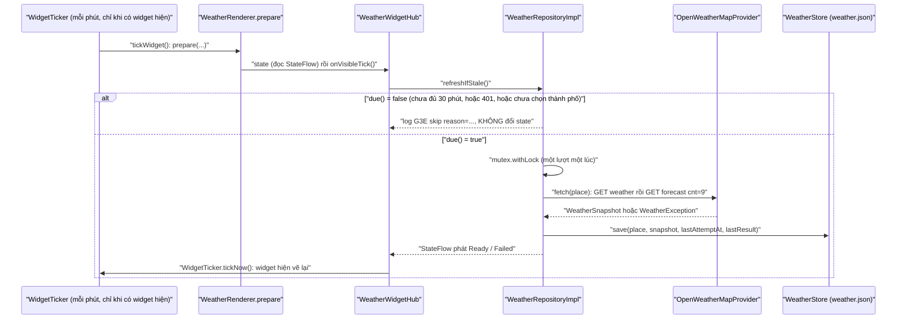
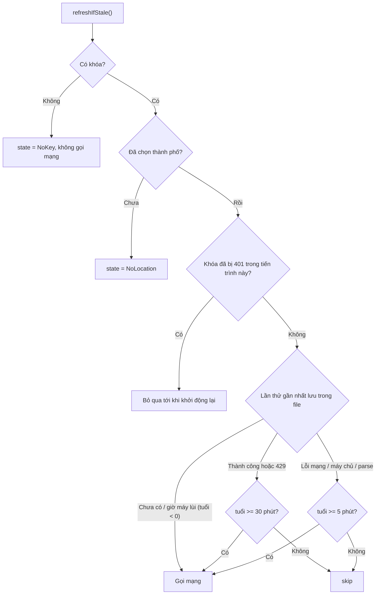

# G3e — Widget thời tiết (OpenWeatherMap): đọc trước khi review

**Plan:** [plans/G3e-weather-widget.md](../plans/G3e-weather-widget.md) · **PR:** #23 · **Nhánh:** `feature/g3e-weather-widget`

Nhãn nguồn: **đo được** (có log/số), **đọc tài liệu**, **đọc code**, **suy luận chưa kiểm chứng**. Số đo thật (API với khóa Free và Oppo A3x) đã ghi ở mục 9, ngày 2026-11-10. **Chưa kiểm:** Live 4 (Android 11), chế độ tối, máy bay/ngoại tuyến, gõ tiếng Việt có dấu trên máy, thử lại 30 phút sau lỗi, khóa sai trên máy.

## 1. Tóm tắt

Từ edit mode bấm "Tiện ích" thêm widget **Thời tiết** 2×2 (thành phố, nhiệt độ, biểu tượng, tình trạng, cao/thấp) hoặc 4×2 (thêm dải 4 mốc theo 3 giờ). Bấm widget mở bảng nhỏ: gõ tên thành phố (hoặc "Dùng vị trí hiện tại", một lần), chọn, làm mới. Số liệu từ OpenWeatherMap, một vị trí, °C; tự làm mới tối đa mỗi 30 phút và chỉ khi widget đang hiện; có cache nên mở app là có số ngay. Cao/thấp là **24 giờ tới**, không phải cả ngày. Không có thông báo thời tiết (TT#17).

## 2. Kiến thức nền

- **Widget tự vẽ của G2c** (đọc `knowledgements/G2c-…`): ô `itemType = 4` trong `launcher_items`, `className` = mã loại, `spanX/spanY` = cỡ; vẽ bằng `IconCellView` chế độ widget, nội dung do một `WidgetRenderer` Canvas vẽ; `WidgetTicker` nhịp mỗi phút chỉ khi có widget hiện. G3e chỉ **thêm một loại** (`WidgetKind.WEATHER`), không đổi schema Room, không đổi planner/`LayoutReconciler`.
- **Geocoding và tọa độ:** OpenWeatherMap coi `weather?q=` là deprecated, nên app đổi tên thành phố ra tọa độ qua `geo/1.0/direct`, rồi gọi `data/2.5/weather` và `data/2.5/forecast` bằng `lat/lon` (đọc tài liệu, 2026-11-09).
- **Gói Free:** 60 lệnh/phút, 1.000.000 lệnh/tháng; One Call 3.0 cần gói riêng nên không dùng (đọc tài liệu).
- **Quyền vị trí thô (`ACCESS_COARSE_LOCATION`) là quyền chạy:** phải xin lúc dùng; xin một lần từ nút bấm, không có quyền nền (đọc tài liệu Android).
- **`AtomicFile`:** ghi file nguyên tử (ghi ra file phụ rồi đổi tên) — cùng cách `LabelCache` lưu nhãn app.
- **`BuildConfig`:** lớp Java sinh lúc build chứa hằng; khóa API đi vào đó. Hằng chuỗi nằm trong APK nên **trích ra được** (xem mục 5).

## 3. Luồng hoạt động

### 3.1 Làm mới khi Home hiện và chặn 30 phút



`refreshIfStale` chỉ so một số nguyên nên gọi mỗi phút không tốn; không có `Handler`/receiver/WorkManager riêng của thời tiết. Chỗ dễ sai: `prepare` có tác dụng phụ (kích hoạt làm mới); an toàn vì lần gọi thừa trả về "skip" và không phát trạng thái mới, nên không vòng lặp `tickNow` → `prepare` → `refresh`.



Sau khi gọi: thành công ghi `lastAttemptAt = now`, `result = ok`; lỗi (trừ thiếu khóa) ghi `lastAttemptAt = now`, `result = <loại lỗi>`; 401 đặt cờ `keyDead` (chỉ trong RAM, nên khởi động lại là thử lại đúng một lần). Hiển thị: có số cũ thì giữ số và chuyển "dữ liệu cũ" (mờ + biểu tượng ngoại tuyến), không có số thì trạng thái lỗi.

### 3.2 Chọn thành phố và vị trí thô một lần

```mermaid
sequenceDiagram
    actor U as "Người dùng"
    participant W as "IconGridView / HomePagerController"
    participant C as "WeatherSheetController"
    participant VM as "WeatherSheetViewModel"
    participant L as "CoarseLocationSource"
    participant Repo as "WeatherRepository"
    U->>W: "Bấm widget thời tiết (ngoài edit mode)"
    W->>C: "onWeatherClick() thì show() bottom sheet"
    alt "Gõ tên"
        U->>C: "Nhập Hà Nội, bấm Tìm / phím Search"
        C->>VM: "search(text)"
        VM->>Repo: "search: NFC, geo/1.0/direct (rỗng thì thử lại không dấu)"
        Repo-->>VM: "tối đa 5 địa điểm"
        VM-->>C: "1 kết quả: chọn luôn; nhiều: danh sách để chọn"
        U->>C: "Chọn một dòng"
        C->>VM: "pick(place)"
        VM->>Repo: "select(place): lưu, làm mới ngay (không bị chặn 30 phút)"
    else "Dùng vị trí hiện tại"
        U->>C: "Bấm nút"
        alt "Chưa có quyền"
            C->>U: "Hộp quyền hệ thống (ACCESS_COARSE_LOCATION)"
            U-->>C: "Từ chối: thông báo, giữ lựa chọn cũ"
        end
        C->>VM: "useCurrentLocation()"
        VM->>L: "getOnce(): NETWORK_PROVIDER, tối đa 10 giây"
        L-->>VM: "tọa độ làm tròn 2 số thập phân, hoặc null"
        VM->>Repo: "reverse(lat, lon) lấy tên, rồi select(place)"
    end
```

Điểm dễ sai: launcher xin quyền phải đăng ký lúc dựng controller ở `HomeActivity.onCreate` (trước STARTED); bảng là cửa sổ riêng nên `recreate()` làm mất nó (như bảng "Tiện ích"); đóng bảng giữa chừng thì hủy việc tìm/lấy vị trí (listener vị trí được gỡ khi hủy) nhưng không hủy việc chọn thành phố đã bắt đầu.

## 4. Thay đổi theo file

| File | Vai trò | Vì sao | Đọc trước? |
|---|---|---|---|
| `data/weather/WeatherRepositoryImpl.kt` | Trạng thái, chặn tần suất, một-lượt-một-lúc | Toàn bộ quy tắc D2 nằm ở đây | **Đọc đầu tiên** |
| `ui/widget/WeatherWidgetRenderers.kt` | Vẽ 2×2/4×2 và sáu trạng thái | Bố cục dựng ở `prepare`, `draw` không cấp phát | **Đọc đầu tiên** |
| `data/weather/OpenWeatherMapProvider.kt`, `OwmParser.kt`, `WeatherHttp.kt` | Gọi và parse OWM (`HttpURLConnection` + `org.json`) | Không thêm thư viện; che khóa | **Đọc đầu tiên** |
| `data/weather/WeatherStore.kt` | File `weather.json` trong `noBackupFilesDir` | Cache + vị trí, ngoài sao lưu | Sau |
| `domain/model/weather/WeatherModels.kt`, `domain/weather/*` | Mô hình, `WeatherProvider`, `WeatherRepository`, ánh xạ mã OWM | Domain thuần, đổi nguồn không đụng UI | Sau |
| `ui/widget/WeatherIcons.kt`, `WeatherWidgetHub.kt` | Biểu tượng Canvas; cầu nối repository → widget hiện | Không dùng ảnh OWM; không Handler mới | Sau |
| `ui/weather/*`, `res/layout/view_weather_sheet.xml` | Bảng Thời tiết | Nhập tên, vị trí một lần, làm mới | Sau |
| `data/weather/CoarseLocationSource.kt` | Vị trí thô một lần | `LocationManager`, không Fused | Sau |
| `domain/model/WidgetKind.kt`, `WidgetRenderer.kt`, `WidgetPreviewView.kt`, `WidgetPickerController.kt`, `WidgetTicker.kt` | Thêm loại `WEATHER`, bản xem trước dữ liệu mẫu, `tickNow()` | Tái dùng hạ tầng G2c | Sau |
| `app/build.gradle.kts`, `AndroidManifest.xml`, `res/values/*` | Khóa vào BuildConfig; `INTERNET` + `ACCESS_COARSE_LOCATION`; chuỗi khối `weather_` | Lần đầu app có quyền mạng/vị trí | Sau |
| **`ui/home/HomeViewModel.kt` (1 dòng)** | Nhánh `WidgetKind.WEATHER -> true` trong `onWidgetTapped` | `when` biểu thức phải đủ nhánh; thật sự không dùng vì pager chặn trước | Soi |
| **`ui/home/HomeActivity.kt` (5 dòng)** | import, field, dựng `WeatherSheetController(this)` + truyền `onWeatherClick`, `weatherSheet.onDestroy()` | Launcher xin quyền phải đăng ký ở `onCreate`; đóng cửa sổ khi hủy | Soi |
| `ui/home/controller/HomePagerController.kt`, `LauncherApp.kt` | Chặn bấm `WEATHER` mở bảng; khởi tạo hub | Nối | Sau |

Không đụng: `data/layout/*`, `data/layout/db/*`, `core/glass/*`, `domain/layout/*`, `IconGridView`, `IconCellView`, `app/schemas/*` (đọc `git diff --stat`).

## 5. Quyết định và đánh đổi (trỏ về D# trong plan)

- **D1** `itemType = 4`, `className = "weather"`: không đổi Room; một vị trí dùng chung cho mọi widget thời tiết.
- **D2** làm mới theo nhịp phút của ticker + chặn 30 phút lưu ở file (không WorkManager): chỉ chạy khi Home hiện; số có thể cũ ≤ 30 phút lúc mở.
- **D3** cache ở file JSON `noBackupFilesDir` (không Room, không DataStore): tọa độ không vào sao lưu.
- **D4** `HttpURLConnection` + `org.json`, không thư viện mới. **D5** khóa từ `local.properties` vào BuildConfig. **D6** bảng bottom sheet + vị trí thô một lần. **D7** biểu tượng Canvas. **D8** dải theo giờ 4 mốc, cao/thấp 24 giờ tới.
- **Khóa API nằm trong APK và trích ra được** (giải nén APK, đọc `BuildConfig.class`; đọc tài liệu/thực tế ngành). Chủ dự án chấp nhận lúc này; nếu lộ thì xoay khóa trên OpenWeather và phát hành lại; đường dài là proxy (đổi `WeatherModule`).
- **Hai bản debug và release dùng cùng khóa**; R8 đang tắt nên không che giấu gì thêm.

## 6. Chỗ cần soi khi review

1. **`WeatherRepositoryImpl.due()`/`doRefresh()` đúng bảng D2** (30 phút, 5 phút, 429, 401 chết, giờ lùi); 401 không thử lại; `NO_KEY` không ghi `lastAttemptAt`.
2. **Không log khóa/URL/tọa độ:** các dòng `Log.d` tag `G3E` (dùng khi đo ngày 2026-11-10) đã **gỡ** trước khi merge; chỉ còn `Log.w` của `WeatherStore` (loại ngoại lệ, không nội dung). `WeatherHttp` không đọc thân lỗi ra ngoài. Muốn kiểm lại chặn 30 phút bằng logcat phải dựng bản có log tạm (các dòng đã dùng: `skip reason=…`, `start`, `ok points=… ms=…`, `err=<loại>`, `select`, `cache loaded …`).
3. **`prepare()` có tác dụng phụ** (gọi `onVisibleTick`): xác nhận không vòng lặp (mục 3.1).
4. **`CoarseLocationSource`:** đường API 30+ và 26–29 (`requestSingleUpdate`), gỡ listener khi hủy/hết giờ; chỉ **đọc code**, chưa chạy.
5. **Hồi quy G2c:** `when (kind)` ở ba nơi; đồng hồ/lịch không đổi.
6. **Chưa được kiểm tay:** mọi thứ liên quan hiển thị và vị trí (xem mục 7); chưa có phép đo mạng thật (mục 9).

## 7. Cách kiểm lại (cho điều phối, ngày kế khi khóa đã kích hoạt)

Máy: Live 4 trước (ghi `FORCE_HIGH` hay mức kính), Oppo sau; máy dùng chung với việc khác của chủ dự án nên xác nhận rảnh. Ghi bản debug hay release.

**A. Phép đo mạng của Task 3 (trên máy dev, KHÔNG in khóa).** PowerShell, đọc khóa vào biến mà không hiển thị:
```powershell
$k = ((Get-Content E:\SourceTree\IosLauncher\local.properties | Where-Object { $_ -like 'OWM_API_KEY=*' }) -replace '^OWM_API_KEY=','').Trim()
# (a) geocoding có dấu và không dấu: chỉ in mã HTTP rồi thân (thân không chứa khóa). KHÔNG dùng curl -v và KHÔNG echo $k.
curl.exe -s -w "`nHTTP %{http_code}`n" "https://api.openweathermap.org/geo/1.0/direct?q=H%C3%A0%20N%E1%BB%99i&limit=5&appid=$k"
curl.exe -s -w "`nHTTP %{http_code}`n" "https://api.openweathermap.org/geo/1.0/direct?q=%C4%90%C3%A0%20N%E1%BA%B5ng&limit=5&appid=$k"
curl.exe -s -w "`nHTTP %{http_code}`n" "https://api.openweathermap.org/geo/1.0/direct?q=Ha%20Noi&limit=5&appid=$k"
# (b) dự báo với khóa Free: ghi HTTP, số phần tử list, kích thước (lat/lon lấy từ kết quả (a), 2 số thập phân)
curl.exe -s -o NUL -w "HTTP %{http_code} bytes %{size_download} ms %{time_total}`n" "https://api.openweathermap.org/data/2.5/forecast?lat=21.03&lon=105.85&cnt=9&units=metric&appid=$k"
curl.exe -s -o NUL -w "HTTP %{http_code} bytes %{size_download}`n" "https://api.openweathermap.org/data/2.5/weather?lat=21.03&lon=105.85&units=metric&appid=$k"
# (c) khóa sai và không khóa: mã lỗi
curl.exe -s -o NUL -w "HTTP %{http_code}`n" "https://api.openweathermap.org/data/2.5/weather?lat=21.03&lon=105.85&appid=bad"
curl.exe -s -o NUL -w "HTTP %{http_code}`n" "https://api.openweathermap.org/data/2.5/weather?lat=21.03&lon=105.85"
Remove-Variable k
```
Ghi vào Nhật ký của plan (không ghi khóa): (a) có kết quả đúng cho "Hà Nội"/"Đà Nẵng" không (tên, quốc gia, có `local_names.vi` không); "Ha Noi"; (b) `/forecast` HTTP 200 hay 401/403 với khóa Free, số mốc, kích thước; (c) 401 cho khóa sai/không khóa. Nếu "Hà Nội" rỗng nhưng "Ha Noi" có → đường dự phòng bỏ dấu của `OpenWeatherMapProvider.search` đã đủ; nếu `/forecast` không chạy với khóa Free → dừng và báo: 4×2 và cao/thấp phải đổi (D8).

**B. Trên máy** (bản debug có khóa: copy `local.properties` của thư mục chính vào worktree, `installDebug`; sau đó trả lại bản không khóa để thử mục 1):
1. Không khóa (build không có dòng `OWM_API_KEY`): thêm widget 2×2 và 4×2 từ "Tiện ích" → "Chưa cấu hình khóa"; bấm → bảng có dòng giải thích, ô nhập bị khóa; `adb logcat -s G3E` không có `start`.
2. Khóa sai (`OWM_API_KEY=bad`): chọn thành phố → "Khóa không hợp lệ", `err=INVALID_KEY` một lần rồi chỉ `skip reason=keyDead`; `force-stop` và mở lại → đúng một lần thử.
3. Khóa đúng, chưa chọn thành phố → "Chọn thành phố"; bấm → bảng.
4. Gõ "Hà Nội", "Đà Nẵng" (cả Telex và gõ tổ hợp), "Ha Noi", một tên mơ hồ ("Springfield"): danh sách/chọn; số hiện trong vài giây ở cả hai widget.
5. "Dùng vị trí hiện tại": Cho phép → có tên; Từ chối → thông báo, giữ lựa chọn cũ; tắt dịch vụ vị trí → hết 10 giây có thông báo, không treo; đóng bảng khi đang lấy vị trí → `adb shell dumpsys location | findstr gambi` không còn yêu cầu của app.
6. Máy bay: mở Home (đã có cache): số cũ hiện ngay, chuyển mờ + biểu tượng ngoại tuyến; tắt máy bay → trong khoảng 5 phút tự cập nhật; xóa cache khi chưa có mạng → "Không có mạng", không crash.
7. Khởi động nguội: `force-stop` rồi mở: số hiện trước khi có phản hồi (logcat `cache loaded hasSnapshot=true` trước `start`).
8. Chặn 30 phút: mở/đóng Home nhiều lần trong 30 phút → chỉ `skip reason=throttled ageSec=…`; qua 30 phút → đúng một `start`+`ok`; để Home hiện 65 phút → không quá 3 lần thử; Home ở nền → không dòng nào.
9. Thêm/kéo/xóa widget như G2c (bấm thẻ, kéo thẻ, kéo sang trang khác, "−" có xác nhận); xóa hết widget → không còn `skip`/`start`.
10. Giao diện: ảnh nền sáng/tối, giao diện hệ thống sáng/tối, kính thật vs mờ (Oppo/Live 4); nhãn "24h ↑ ↓" (2×2) và "24 giờ tới: cao…, thấp…" (4×2) đọc được; biểu tượng khác nhau theo tình trạng.
11. Hồi quy: đồng hồ/lịch, bảng "Tiện ích", kéo icon quanh widget, App Library, tìm kiếm, thư mục; quyền ứng dụng chỉ có Vị trí (khi cấp), không quyền nền.

## 8. Bài học cho AGENTS.md (điều phối gộp sau merge)

- (2026-11-09, đọc tài liệu) Khóa API đưa vào build: dùng `providers.fileContents(rootProject.layout.projectDirectory.file("local.properties")).asText` (tương thích configuration cache) rồi `Properties`, kèm `buildConfig = true`; thiếu khóa thì chuỗi rỗng và build vẫn xanh; **không in khóa** ra console/log/commit (kiểm bằng cách đọc BuildConfig và thay giá trị bằng `<nonempty>`).
- (2026-11-09, đọc code) Lệnh shell có heredoc chứa dấu nháy và tiếng Việt trong Git Bash của Claude Code có thể báo `unexpected EOF` và **không chạy gì cả**; ghi file bằng công cụ Write/Edit thay vì heredoc dài.
- (2026-11-09, đọc code) Hằng chuỗi trong `BuildConfig` nằm trong APK: coi mọi khóa nhúng là có thể bị trích ra; thiết kế để đổi sang proxy bằng một dòng DI.
- (2026-11-09, đọc tài liệu) OpenWeatherMap: `weather?q=` deprecated (dùng geocoding + lat/lon); khóa mới có thể 401 tới 2 giờ; `temp_min/temp_max` của `/weather` không phải cao/thấp cả ngày; gói Free có 60 lệnh/phút và 1.000.000 lệnh/tháng.
- (2026-11-09) Mọi dòng log mạng của dự án phải không chứa URL (có `appid`), khóa, tọa độ.

## 9. Số đo (2026-11-10)

**Kiểm API trên máy dev, khóa thật gói Free (điều phối chạy; không có khóa trong kết quả):**

| Việc | Kết quả | Nhãn |
|---|---|---|
| `geo/1.0/direct` "Hà Nội" và "Ha Noi" | Ra Hà Nội; có `local_names.vi` | đo được |
| "Đà Nẵng" / "Da Nang" | 3 kết quả: thành phố (16.07, 108.21) và hai làng trùng tên | đo được |
| "Thành phố Hồ Chí Minh" | Ra Ho Chi Minh City | đo được |
| `data/2.5/weather` | 200, 500 byte; `name` là "Xom Pho" cho tọa độ Hà Nội (tên trạm) nên widget dùng tên từ geocoding là đúng | đo được |
| `data/2.5/forecast?cnt=9` | 200, 3,9 KB, 9 mốc: **chạy được với khóa Free** (xác nhận giả định D8) | đo được |
| `geo/1.0/reverse` | 200, có tên tiếng Việt | đo được |
| Khóa sai / không khóa | 401 cả hai | đo được |

Geocoding tiếng Việt có dấu **chạy ở phía API** nên đường dự phòng bỏ dấu hiện không cần cho "Hà Nội"; vẫn giữ.

**Oppo A3x (Android 14), bản debug dựng từ `c982270` có khóa (điều phối chạy):**

| Ca | Kết quả | Nhãn |
|---|---|---|
| Bảng "Tiện ích" | Có Thời tiết 2×2 và 4×2; thêm 4×2 vào lưới | đo được |
| Chưa chọn thành phố | "Chọn thành phố / Bấm để chọn", log `skip reason=noPlace` | đo được |
| Gõ "Da Nang" trong bảng | "Thành phố Đà Nẵng, VN", "Đà Nẵng, VN" ×2 và một kết quả lạ "Tai Kek, Hong Kong, CN" (do API trả) | đo được |
| Chọn thành phố | `select` → `start` → `ok points=4 ms=205`, rồi `skip reason=throttled ageSec=0` | đo được |
| Widget sau khi chọn | Thành phố, 24°, "Mưa", 4 mốc (10/13/16/19 giờ), "24 giờ tới: cao 24°, thấp 23°"; bảng có giờ cập nhật, ghi chú 24 giờ và câu ghi công OpenWeather | đo được |
| Khởi động nguội sau `force-stop` | `cache loaded hasPlace=true hasSnapshot=true`, không gọi mạng (chặn 30 phút) | đo được |
| "Dùng vị trí hiện tại" | Hộp quyền Android 14 (Cho phép khi sử dụng / Chỉ lần này / Từ chối); chọn "Chỉ lần này": nhà cung cấp mạng đăng ký 10 giây, **0 vị trí mới**, yêu cầu được gỡ sau 10 giây (`dumpsys location`); địa điểm đổi và lấy được thời tiết (`ok ms=139`) | đo được |
| Vì sao có vị trí dù 0 vị trí mới | **Đọc code (`CoarseLocationSource.getOnce`):** hết 10 giây `single()` trả null, rồi rơi xuống `getLastKnownLocation(NETWORK_PROVIDER)`; nhiều khả năng vị trí đến từ đó (suy luận, log không nói rõ) | đọc code |
| Xóa bằng "−" | Hộp "Xóa tiện ích?" → xóa được | đo được |
| Crash | Không | đo được |

**Chưa kiểm:** Live 4 (Android 11, API 30, đường `getCurrentLocation`), chế độ tối, máy bay/ngoại tuyến, gõ tiếng Việt có dấu trên máy (adb không gõ được dấu; phía API đã kiểm), thử lại sau 5 phút khi lỗi mạng, khóa sai trên máy, đo chi phí vẽ (gfxinfo).
