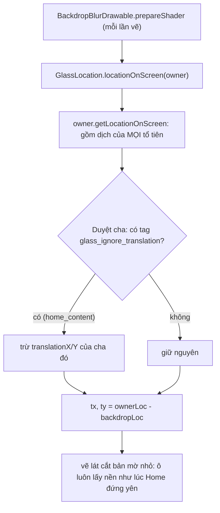
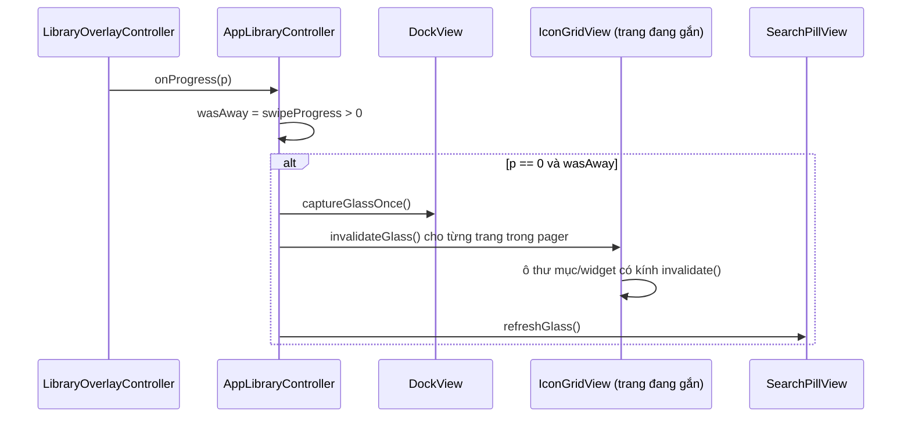

# GF — Kính ô trang cuối, nền mờ màn nhóm, chặn vuốt rời Library: đọc trước khi review

**Plan:** [plans/GF-glass-follow-ups.md](../plans/GF-glass-follow-ups.md) · **Nhánh:** `fix/gf-glass-follow-ups` · **PR:** draft (xem PR của nhánh)

## 1. Tóm tắt

1. **Sửa lỗi:** sau khi vuốt từ trang Home cuối sang App Library rồi về, nền kính của ô thư mục/widget (và pill, dock) có thể sai (lệch, vệt ngang, đen). Nay lát cắt nền không còn tính theo phép dịch của lớp `home_content`.
2. **Nền màn nhóm** của Library = ảnh nền đã làm mờ + tối nhẹ trên mọi máy (trước: đen 0,35/0,65, trên Live 4 gần đen).
3. **Vuốt rời Library bị bỏ qua** khi màn nhóm đang mở hoặc đang mở/đóng.

## 2. Kiến thức nền

- `BackdropBlurDrawable` (kính mờ tại chỗ) KHÔNG chụp nền: nó vẽ lát cắt của bản mờ nhỏ của ảnh nền, chọn bằng `owner.getLocationOnScreen − backdrop.getLocationOnScreen` MỖI LẦN VẼ. `getLocationOnScreen` cộng cả `translationX/Y` của mọi tổ tiên.
- Display list chỉ ghi lại khi view bị invalidate; đổi `translationX` của tổ tiên KHÔNG làm con ghi lại. Vì thế con giữ lát cắt của lần vẽ cuối, dù lần đó diễn ra giữa lúc trượt.
- Dock dùng kính thật (`RealGlassSurface`) đã sửa ở AP bằng cờ riêng; kính mờ của ô/pill chưa.

## 3. Luồng hoạt động

### 3.1 Tính vị trí lát cắt

Không trừ: dịch/scale/xoay của chính owner (push-preview, hover, rung) và cuộn của pager (đổi vị trí layout của con).

### 3.2 Làm mới khi Home về chỗ

Vì lát cắt nay không phụ thuộc phép dịch, bước làm mới là lớp phòng thủ (rẻ: chỉ ô có kính bị vẽ lại).

### 3.3 Nền màn nhóm

`CategoryGroupPanelView.background = BackdropBlurDrawable` full màn (không bo, không viền). `PanelMotion.apply` gọi `scrim.alpha = p·255` mỗi khung; drawable nhân alpha vào cả shader, tint và màu phẳng rồi `invalidateSelf()`. Hết spring: không còn vẽ lại. Chưa có ảnh nền: `prepareShader` trả false và drawable vẽ màu phẳng `GROUP_BG_FLAT_*`.

### 3.4 Cổng vuốt

`LibraryOverlayController.onTouch`: lúc DOWN, nếu đang mở mà `host.canClose()` sai thì không có ứng viên; lúc MOVE, ứng viên CLOSE bị hủy nếu `canClose()` sai (màn nhóm mở sau lúc DOWN). `canClose = !(openCategoryGroup != null || panelProgress > 0)`: ViewModel đổi ngay lúc bấm ô, spring về 0 lúc đóng hẳn nên không có khe hở.

## 4. Thay đổi theo file

| File | Vai trò | Vì sao | Đọc trước? |
|---|---|---|---|
| `core/glass/GlassLocation.kt` (mới) | Vị trí màn hình bỏ dịch của tổ tiên có tag | Việc 1 | Có |
| `res/values/ids.xml` (mới) | id tag `glass_ignore_translation` | Việc 1 | |
| `core/glass/BackdropBlurDrawable.kt` | Dùng `GlassLocation`; `setAlpha` nhân vào tint/phẳng; bỏ viền trong suốt | Việc 1, 2 | Có |
| `core/glass/StaticBlurSurface.kt` | Dùng `GlassLocation` | Việc 1 (dock chế độ mờ) | |
| `ui/home/view/SearchPillView.kt` | Kính thật bỏ phép biến đổi tổ tiên; `refreshGlass()` | Việc 1 | |
| `ui/home/controller/AppLibraryController.kt` | Gắn tag, `refreshHomeGlass`, `isGroupOpenOrAnimating` | Việc 1, 3 | Có |
| `ui/home/view/CategoryGroupPanelView.kt`, `PanelMotion.kt`, `AppLibraryMotion.kt` | Nền mờ, hằng, `Drawable` | Việc 2 | Có |
| `ui/home/LibraryOverlayController.kt` | `Host.canClose()` | Việc 3 | |

## 5. Quyết định và đánh đổi

Xem plan. Đánh đổi chính: kính ô "dính" theo ô lúc trượt thay vì trượt trên nền (đổi lấy: không cần vẽ lại mỗi khung, đúng ở mọi thời điểm). `library_view` không gắn tag vì tự invalidate khi dịch. `RenderEffect` blur Library tắt (hằng 0).

## 6. Chỗ cần soi khi review

- `GlassLocation`: tag chỉ cha, không phải owner.
- `setAlpha` của drawable: không phát sinh đệ quy `invalidateSelf`.
- Ô đang push-preview (dịch riêng) vẫn đúng.
- Thứ tự khởi tạo `scrim` trước `motion` trong `CategoryGroupPanelView`.

## 7. Cách kiểm lại

Xem "Bài kiểm cả tính năng" trong plan.

## 8. Số đo (điều phối điền; agent không động tới điện thoại)

| Kịch bản | Máy | Bản | Tổng khung | Janky | p50 | p95 | Ghi chú |
|---|---|---|---|---|---|---|---|
| Mở/đóng nhóm 5 lượt, nền mờ | Live 4 | debug | | | | | |
| Mở/đóng nhóm 5 lượt, nền mờ | Oppo A3x | debug | | | | | |
| Vuốt Home↔Library 3 vòng, có thư mục + widget trang cuối | Live 4 | debug | | | | | |

## 9. Bài học cho AGENTS.md

- **Kính mờ tại chỗ phụ thuộc vị trí màn hình lúc vẽ, nên mọi lớp tổ tiên trượt bằng `translation` mà display list của con không ghi lại sẽ để lại lát cắt sai.** Cách chắc: bỏ phép dịch của lớp trượt (tag `glass_ignore_translation`) thay vì tin vào một lần vẽ lại.
- **`Paint.alpha` không nhân vào `ColorFilter` chạy sau shader:** tint bằng `PorterDuffColorFilter` vẫn hiện ở alpha 0; muốn mờ vào phải nhân alpha vào màu tint.
- **Cử chỉ có điều kiện cho phép phải kiểm lúc DOWN và lúc vượt slop** vì trạng thái có thể đổi ở giữa.
- **Khi đã có nền ảnh mờ phủ kín, nhoè `RenderEffect` lớp phía sau là chi phí vô hình.**
