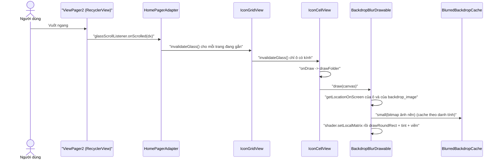
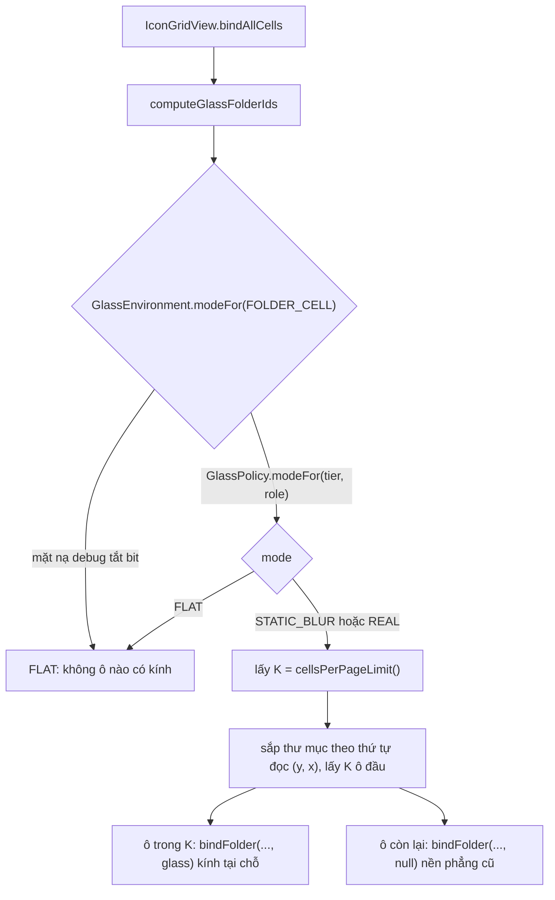
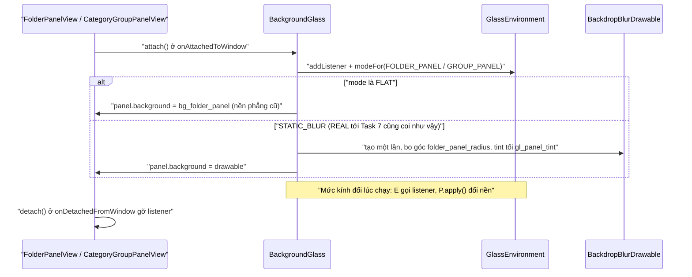
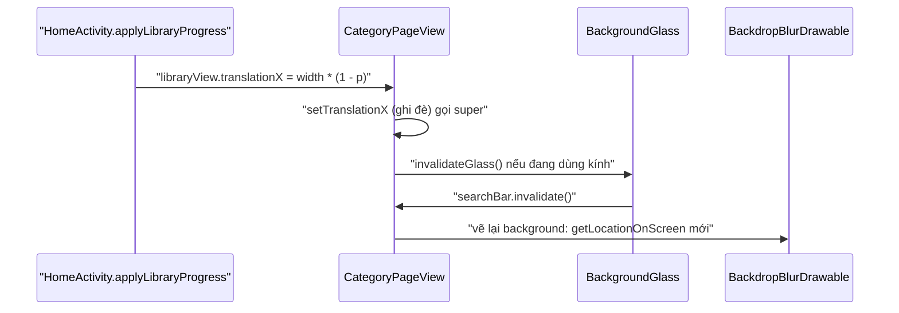
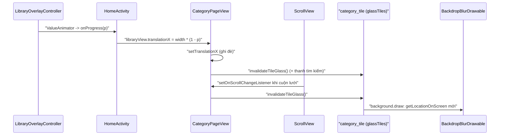
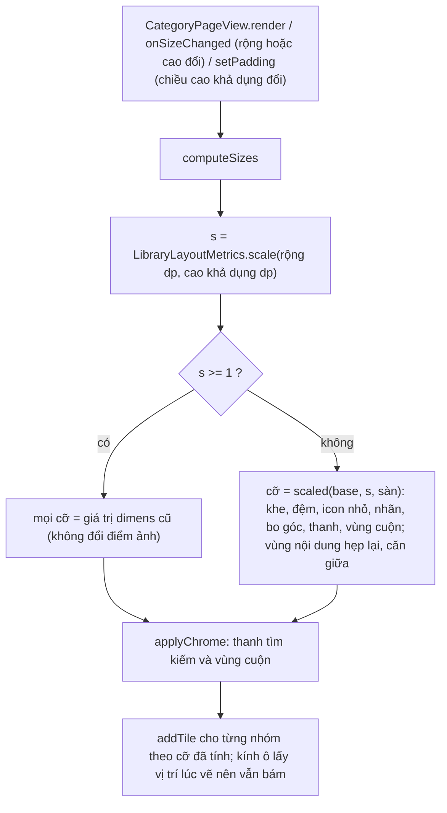
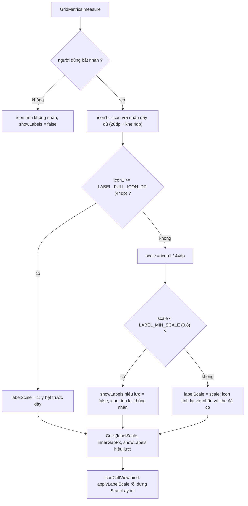
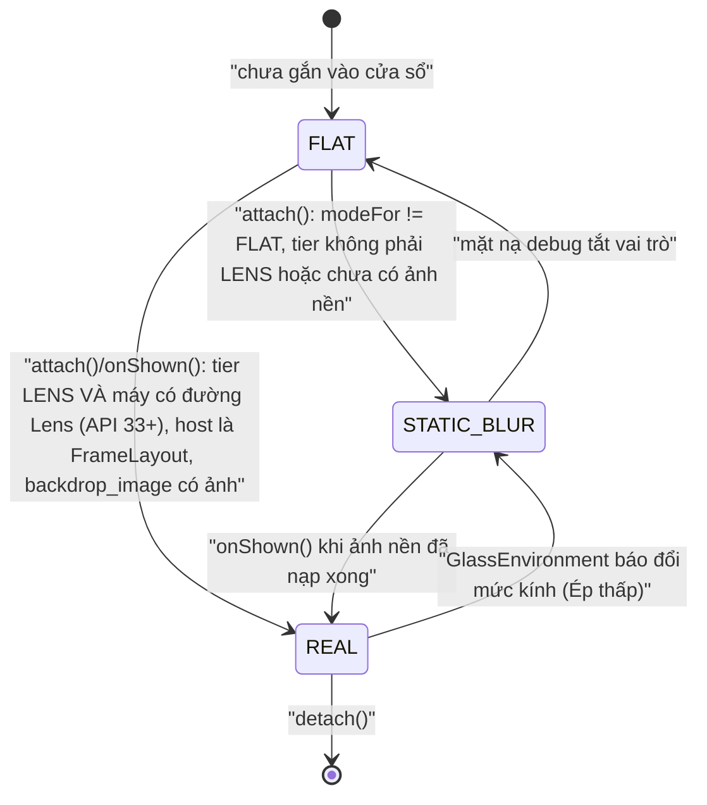

# GL — Áp kính: đọc trước khi review

**Plan:** [plans/GL-glass-pass.md](../plans/GL-glass-pass.md) · **PR:** #3 · **Nhánh:** `feature/gl-glass-pass`

> Đã đủ Task 1-11 (móc debug đã gỡ ở Task 9; Live 4 chạy lại 2026-11-04 đạt). Còn lại: lượt kiểm mắt của chủ dự án (bài kiểm cuối 12 mục trong plan) và máy Android 12 thật cho `CLASSIC_GPU` (chưa đo).

## 1. Tóm tắt

Sau G2a, ô thư mục, panel, ô nhóm App Library, thanh tìm kiếm và pill đều là nền phẳng. Mốc GL cho chúng nền **kính mờ**: ảnh nền của Home được làm mờ, cắt đúng chỗ phần tử đang đứng, phủ một lớp tint nhạt và viền sáng mảnh. Bây giờ **mọi phần tử đó** có kính (ô thư mục đóng, hai panel, ô nhóm, thanh tìm kiếm của Library và lớp tìm kiếm, pill); phần tử vượt ngân sách của tier tự về nền phẳng cũ. Riêng **hai panel trên tier LENS (Oppo)** là kính thật khúc xạ, giữ fade 150 ms và đủ hiệu ứng, chấp nhận một khung trễ mỗi lần mở như một ngoại lệ ghi nhận của D10. Tier `CLASSIC_GPU` (API 31-32) chạy đường kính mờ tĩnh + dock classic GPU, đã chạy thử trên Oppo bằng `debugApiLevelCap = 32` (chưa đo trên máy thật). App Library và nhãn icon Home co theo kích thước cửa sổ (Task 10, 11).

## 2. Kiến thức nền

- **Kính thật vs kính mờ tĩnh.** `LiquidGlassView` (thư viện) chụp thứ nằm sau nó rồi khúc xạ; đắt trên máy tier thấp (Live 4: 10.29% Janky chỉ với 1 kính, **đo được** ở M6 Task 2). `StaticBlurSurface` (dock) chỉ cắt một mảnh ảnh nền đã mờ sẵn: rẻ hơn (2.13%, **đo được**). GL dùng kiểu thứ hai cho mọi phần tử mới, làm thành một `Drawable` thay vì một `View`.
- **Vì sao không dùng `StaticBlurSurface` cho ô thư mục.** Nó cắt vùng nền **một lần** theo vị trí lúc vẽ đầu (đọc code). Ô thư mục nằm trong `ViewPager2` nên bị đẩy đi khi vuốt, bị `Jiggler` xoay khi rung, và được chụp bằng `draw()` của chính ô khi kéo; một `View` kính đứng cạnh ô sẽ không xoay, không có trong ảnh kéo, và làm lệch chỉ số con của `IconGridView`.
- **`BitmapShader`.** Cho phép `drawRoundRect` tô bằng một bitmap kèm ma trận; đổi ma trận mỗi lần vẽ là cách rẻ để "trượt" lát cắt nền, không cần cắt bitmap mới hay `clipPath`.
- **Hilt `EntryPoint`.** Cách để class không do Hilt tạo (view) lấy một singleton Hilt. Dùng để `IconGridView` lấy `GlassEnvironment` mà không phải sửa `HomeActivity`.
- **Display list và `invalidate()`.** Khi cha dịch chuyển con (cuộn), view con **không** được vẽ lại; GPU phát lại lệnh đã ghi, nên nội dung đi "dính" với con. Muốn lát cắt nền đổi theo vị trí mới thì phải `invalidate()` ô để nó ghi lại lệnh vẽ.

## 3. Luồng hoạt động

### 3.1 Vuốt trang: kính ô thư mục bám nền (Task 1)



**Bộ đệm nội dung (Task 6c):** ô thư mục có kính vẽ 9 icon nhỏ + nhãn một lần vào bitmap cỡ view; mỗi lần cuộn chỉ ghi lại lệnh kính + một `drawBitmap`. Bộ đệm bị bỏ (đặt null) khi `bind`/`bindFolder`, đổi cỡ, detach hoặc tắt kính; không `recycle()` vì display list đang chờ vẽ có thể còn giữ bitmap. Bộ nhớ ~0.2-0.3 MB mỗi ô thư mục có kính (tối đa 6 ô/trang trên CLASSIC, 24 trên LENS chưa giới hạn). Khi xoay (rung) bitmap bị lọc nên chữ hơi mềm hơn; lúc đứng yên vẽ 1:1.

**Số lệnh vẽ (Task 6a):** mỗi ô kính đứng thẳng vẽ 2 lệnh (tô shader đã gộp tint bằng `PorterDuffColorFilter`, và viền); ô đang xoay do `Jiggler` chỉ vẽ lệnh tô, vì chi phí khi rung nằm ở RenderThread (`IssueDraw→Swap`), không ở ghi display list (phép đo Live 4, plan Task 5).

Điểm dễ sai: `invalidateGlass()` chỉ chạy khi pager **đang cuộn**; lúc đứng yên không có gì được vẽ lại (chi phí bằng 0, display list tái dùng). Ô được tái dùng giữa app và thư mục nên `IconCellView.bind` phải xóa `folderGlass` (bài học A1a).

### 3.2 Quyết định chế độ vẽ theo tier và ngân sách (Task 1, bảng cuối chốt ở Task 6)



Task 1 chưa có `REAL` (chỉ panel, Task 7) và mọi vai trò là `STATIC_BLUR`; `GlassBudget.maxLiteGlassCellsPerPage` đang là giá trị tạm 24 (chưa giới hạn), chốt ở Task 6 theo số đo.

### 3.3 Panel thư mục / panel nhóm (Task 2)



Panel đứng yên nên không cần `invalidate()` theo cuộn; vị trí đổi (panel nhóm ôm nội dung, cao thay đổi) đã kéo theo `layout` -> vẽ lại -> drawable tự tính lại vị trí. Tint **tối** vì panel nằm dưới lớp tối 80% và mang chữ trắng (chủ dự án giữ lớp tối, 2026-11-03).

### 3.4 Thanh tìm kiếm Library trượt cùng lớp (Task 3)



`HomeActivity` và `LibraryOverlayController` không bị sửa: `HomeActivity` đặt `translationX` bằng thuộc tính Kotlin nên gọi vào setter bị ghi đè. Ô nhập của lớp tìm kiếm M8b (`SearchOverlayView`) và pill (`SearchPillView`) đứng yên nên chỉ cần gắn kính; pill vẽ kính ngay trong `onDraw` nên chuyển ô tìm kiếm <-> chấm vẫn chỉ là `invalidate()`.

### 3.5 Ô nhóm Library: trượt và cuộn (Task 4)



**Guard cho thay đổi sau này (điều phối kiểm 2026-11-03):** `library_view` chỉ dịch bằng thuộc tính `translationX` do `HomeActivity.applyLibraryProgress` đặt (từ `ValueAnimator` của `LibraryOverlayController`, không dùng `ViewPropertyAnimator`), nên ghi đè `setTranslationX` thấy mọi khung. Nếu ai đổi sang `animate().translationX(...)` thì setter không được gọi và lát cắt nền của thanh và ô nhóm lệch trong lúc trượt.

Ô nhóm được dựng lại ở mỗi `render()` (cài/gỡ app, đổi bề rộng) nên danh sách ô có kính (`glassTiles`) cũng dựng lại; chỉ `GlassBudget.maxLiteGlassTiles` ô đầu có kính, ô còn lại giữ `bg_category_tile`. Kính nằm ở khung 2x2 icon, nhãn nhóm bên dưới vẫn trên lớp tối.

### 3.6 App Library co theo cửa sổ (Task 10)



Hệ số `s` chỉ phụ thuộc kích thước cửa sổ, không phụ thuộc số nhóm, nên cỡ ô không nhảy khi cài/gỡ app; danh sách vẫn cuộn. Hằng tham chiếu (360 x 640 dp), sàn và `FLOOR` nằm trong `LibraryLayoutMetrics`, điểm xuất phát chưa đo.

### 3.7 Nhãn icon Home co theo icon (Task 11)



`Cells` là data class nên khi cửa sổ đổi (labelScale hoặc showLabels hiệu lực đổi) `IconGridView.bindAllCells` và `FolderPanelView.AppsGrid` tự bind lại. Dock ép `showLabels = false` như cũ nên không đổi. Ngưỡng 44dp và 0.8 là điểm xuất phát (chưa đo), chỉnh theo mắt.

### 3.8 Panel kính thật trên LENS (Task 7)



```mermaid
sequenceDiagram
    participant V as "FolderPanelView.render"
    participant B as BackgroundGlass
    participant R as RealGlassSurface
    participant L as "LiquidGlassView (SuppressibleGlassView)"
    V->>B: "onShown()"
    B->>B: "apply(): kính thật hay kính mờ tĩnh (có ảnh nền chưa)"
    V->>V: "onLayout -> layoutGlass(): đo EXACTLY, layout đúng khung panel"
    B->>B: "host.post(captureOnce)"
    B->>R: "captureOnce: setInvalidationSuppressed(false); invalidate(); setInvalidationSuppressed(true)"
    L->>L: "vẽ một lần: lấy nền ngay lúc vẽ (không chế độ động)"
    V->>B: "hết hoạt họa hiện: captureOnce() lần nữa"
    Note over L: "Cuộn bất kỳ view nào trong cửa sổ không còn làm kính chụp lại nền"
    V->>B: "onHidden(): huỷ lệnh chờ"
```

**Vì sao không dùng chế độ động (đo được + đọc bytecode):** `enableDynamicBackground = true` làm thư viện gọi `invalidate()` sau mỗi lần vẽ (vòng vẽ liên tục): xung nhịp 1 giây thêm ~90 khung mỗi lần mở panel trên Oppo (S1 p95 +5 ms). Kính lấy nền ở MỖI lần vẽ nên chỉ cần vẽ lại một lần sau khi panel đã hiện.

Kính thật là con đầu tiên của chính panel host (`FrameLayout`), dưới khung `panel` (khung này không còn nền). Kính thật của panel và dock là hai kính thật đồng thời tối đa trên LENS (`GlassBudget`: 6). Ảnh nền chưa có thì dùng kính mờ tĩnh (phẳng) và `onShown()` chọn lại. Quy tắc `invalidate()` dùng lại API của TL1 (`GlassSurface.setInvalidationSuppressed`).

**Vòng 3 và ngoại lệ D10 (2026-11-04).** Thử bỏ lớp `alpha` của host (hiện/ẩn tức thì) và thử kính nhẹ (bỏ dispersion/sensor highlight/`edgeSoftness`, blur/bevel/khúc xạ nhỏ hơn) bằng cờ `variant` của `gl_mask`; đo Oppo S1:

| Cấu hình (`127 24 0 <forceLite> <variant>`) | Số khung | Khung Janky | gfx p50 / p95 |
|---|---|---|---|
| `lite` (`... 1 0`) | 741 | 1.7 | 9 / 14 |
| `real`, variant 0 | 746 | 21.3 | 11 / 23.3 |
| bit 0 (hiện/ẩn tức thì, bỏ lớp alpha của host) | 60 | 20 | 24 / 27 |
| bit 1 (kính nhẹ: bỏ dispersion/sensor/edgeSoftness, blur/bevel/khúc xạ nhỏ) | 741 | 20.7 | 10.3 / 22.3 |
| bit 0 + 1 | 60 | 20 | 23 / 26 |

Cả hai đều không khử được khung chậm (~20 khung Janky ~24 ms mỗi 20 lần mở): nguyên nhân không nằm ở lớp alpha của host hay độ nặng của shader lens mà ở khung đầu tiên vẽ kính thật. Chủ dự án chấp nhận làm ngoại lệ ghi nhận của D10 (Janky +2.15 điểm, p95 +8.6 ms ở S1 so với kính mờ tĩnh) để giữ kính thật, fade 150 ms và đủ hiệu ứng. Bài học: bit 0 làm số khung S1 còn 60 nên Janky % tăng (33%) dù số khung Janky tuyệt đối không đổi: khi so cấu hình, so số khung Janky tuyệt đối và số khung, không chỉ phần trăm.

**Bài học: `scale()` thu mạnh một lần không phải là blur (2026-11-04).** `Bitmap.scale(w, h)` dùng bilinear không mipmap, nên thu xuống 8% chỉ lấy 4 điểm ảnh nguồn cho mỗi điểm ảnh nhỏ (răng cưa), và phóng ~12x lại lộ từng ô vuông trên panel ~300 dp (ô thư mục nhỏ che được). `BlurredBackdropCache.small()` giờ thu bằng các bước chia đôi (mỗi bước = trung bình 2x2) xuống 25% rồi box blur 3 lượt (bán kính 2) một lần mỗi ảnh nền. Bộ nhớ: ~650 KB (nguồn 1080x2400) thay vì ~66 KB, cộng ~1.3 MB tạm lúc dựng; mỗi khung vẽ không đổi. `blur()` (đường dock `StaticBlurSurface`) còn dùng cách cũ: nếu dock tĩnh trên máy CLASSIC lộ ô thì áp cùng cách.

## 4. Thay đổi theo file

| File | Vai trò | Vì sao thêm/sửa | Đọc trước? |
|---|---|---|---|
| `core/glass/BackdropBlurDrawable.kt` | Mới. Vẽ kính tại chỗ | Lát cắt nền phụ thuộc vị trí màn hình hiện tại, tính mỗi lần vẽ | **Có** |
| `core/glass/GlassEnvironment.kt` | Mới. Singleton Hilt: tier hiện tại, bộ đệm mờ, báo khi mức kính đổi | View lấy được tier mà không qua `HomeActivity` | **Có** |
| `core/glass/GlassPolicy.kt`, `GlassMode.kt`, `GlassRole.kt`, `GlassStyle.kt` | Mới. Hàm thuần tier+vai trò -> chế độ; màu | Một chỗ duy nhất quyết định ai được kính | Có (ngắn) |
| `core/glass/GlassBudget.kt` | Thêm ngân sách kính tại chỗ | Task 6 điền số đo | Không |
| `core/glass/BlurredBackdropCache.kt` | Thêm `small()` (chia đôi + box blur, 25%) | Bitmap mờ nhỏ (~650 KB trên 1080x2400) thay vì bản cỡ màn hình; mượt trên panel lớn; dựng MỘT lần ngoài main thread (`smallOrRequest`, luồng `GlassBlur`), vẽ phẳng tới khi xong (có log `GL` thời gian, tạm) | **Có** (Task 8) |
| `core/glass/RealGlassSurface.kt`, `GlassSurface.kt` | `setTint`, `collectFrameStats = false`, áp cap debug | Kính thật của panel và dock | Có (ngắn) |
| `core/glass/StaticBlurSurface.kt` | Dùng bản nhỏ (`smallOrRequest`), vẽ phóng một `Rect` bằng bilinear | Dock CLASSIC hết ô vuông, bỏ bitmap cỡ nguồn và stall main thread của `blur()` cũ | Có (ngắn) |
| ~~`core/glass/GlassDebug.kt`~~ | Đã xóa ở Task 9 (`f988ad7`). Từng đọc `files/gl_mask`: `<mặt nạ> <K> <cap> <forceLite>` | Bật/tắt kính, ép kính mờ tĩnh, giả lập API thấp khi đo; xem lại bằng `git show b02fff0:app/src/main/java/gambi/global/os26launcher/core/glass/GlassDebug.kt` | Không |
| `ui/home/view/IconCellView.kt` | `bindFolder` nhận kính; `drawFolder` vẽ kính hoặc nền phẳng | Kính nằm trong `draw()` của ô | **Có** |
| `ui/home/view/IconGridView.kt` | Chọn ô thư mục nào có kính; `invalidateGlass()`; nghe `GlassEnvironment` | Ngân sách theo trang, thứ tự đọc | Có |
| `ui/home/HomePagerAdapter.kt` | Scroll listener của pager | `invalidate` ô theo cuộn mà không sửa `HomeActivity` | Có (ngắn) |
| `ui/home/view/BackgroundGlass.kt` | Mới (Task 2). Gắn kính tại chỗ làm `background` của khung panel / ô nhập / thanh Library, hoặc trả nền phẳng cũ khi FLAT | Dùng chung cho hai panel, một chỗ xử lý đổi mức kính | Có (ngắn) |
| `ui/home/view/FolderPanelView.kt`, `CategoryGroupPanelView.kt`, `CategoryPageView.kt`, `ui/search/SearchOverlayView.kt` | `attach()/detach()` của `BackgroundGlass` (Library còn ghi đè `setTranslationX`) | Panel, thanh Library, ô nhập M8b dùng kính | Không |
| `core/ui/GridMetrics.kt`, `ui/home/view/IconCellView.kt` (Task 11) | `Cells.labelScale/innerGapPx`, showLabels hiệu lực; chữ và khe nhãn co theo | Nhãn tỉ lệ với icon ở cửa sổ thấp | Có |
| `core/ui/LibraryLayoutMetrics.kt` (Task 10) | Mới. Hàm thuần: hệ số co `s` theo cửa sổ và `scaled()` có sàn | Library co theo split-screen | Có (ngắn) |
| `ui/home/view/CategoryPageView.kt` (Task 4, 10) | Ô nhóm: nền kính cho `category_tile`, listener cuộn, ghi đè `setTranslationX` | Library trượt/cuộn thì ô vẽ lại | Có |
| `ui/home/view/SearchPillView.kt` | Vẽ `BackdropBlurDrawable` trong `onDraw` thay `pillPaint` | Pill dùng kính | Không |
| `res/values/colors.xml` | Khối `gl_` cuối file | Tint và viền của ô và panel | Không |

## 5. Quyết định và đánh đổi

Xem "Vì sao chọn thiết kế này" và D0–D10 trong plan. Tóm lại: kính tại chỗ (phương án D) vì phương án dùng `View` kính cạnh ô hỏng ở xoay, ảnh kéo và chỉ số con; đánh đổi là ô/thanh/pill là kính mờ tĩnh, không khúc xạ như dock trên Oppo. Hai panel trên LENS là kính thật dù không đạt D10 (một khung ~24 ms mỗi lần mở, vòng 3 chứng minh không khử được bằng bỏ lớp alpha hay giảm tải shader): chủ dự án chấp nhận (2026-11-04). `small()` đo 78.8 ms trên main thread ở Oppo (vượt ngưỡng 30 ms, ~5 khung rớt) nên được dựng ngoài main thread (Task 8 Step 1b); đánh đổi là các ô vẽ nền phẳng khoảng 80+ ms đầu rồi chuyển sang kính mờ sau khi khởi động và mỗi lần đổi ảnh nền.

## 6. Chỗ cần soi khi review

- `BackdropBlurDrawable.draw()` không cấp phát (Matrix, RectF, Paint dùng lại); shader chỉ tạo lại khi bitmap nhỏ đổi.
- `IconCellView.bind` xóa `folderGlass`; `bindFolder` đặt lại ở **cả hai** nơi gọi (bind trực tiếp và bind lại sau khi nạp icon bất đồng bộ).
- Giả định bitmap ảnh nền khớp tỉ lệ `backdrop_image` (centerCrop) giống `StaticBlurSurface.computeCrop()`; sai thì kính lệch nhẹ. **Chưa kiểm** trên máy thật.
- Chi phí `invalidateGlass()` mỗi frame lúc vuốt: suy luận chưa đo, chính là thứ Task 1 Step 6 đo.
- Listener `GlassEnvironment` được gỡ ở `onDetachedFromWindow` (ô thư mục và hai panel).
- `BackdropBlurDrawable.setAlpha` chỉ áp cho lớp ảnh; panel fade bằng alpha của view nên chưa ảnh hưởng.
- Tint thanh và pill (`gl_bar_tint` 50% đen) là điểm xuất phát; hint `#AEAEB2` của ô nhập và chữ pill trên kính **chưa đo**.
- Pill nằm trong `home_content`: nếu TL1 dịch/animate `home_content` bằng translation thì kính pill phải được invalidate theo (kiểm sau rebase).
- Tương phản chữ trên panel kính: tint `#66000000` là điểm xuất phát; ước tính tay ~2.9:1 trên ảnh trắng (cần ~`#8C000000` để đạt 4.5:1). **Chưa nhìn bằng mắt**, chủ dự án xét ở lượt kiểm cuối.
- `BlurredBackdropCache.smallOrRequest()`: mọi trạng thái (`pendingSource`, `waiters`, `smallBitmap`) chỉ đụng từ main thread, luồng nền chỉ đọc bitmap nguồn; kết quả cũ (ảnh nền đã đổi) bị bỏ; listener giữ yếu; một lần dựng cho nhiều ô; lỗi dựng thì vẽ phẳng, không thử lại mỗi khung. Cấp phát tạm ~1.3 MB, `recycle()` bitmap trung gian, không recycle bitmap nguồn. Log `GL` thời gian dựng và tên luồng (tạm).
- Không còn móc debug: `grep GlassDebug`, `gl_mask` và `"GL"` trong `app/src` phải rỗng.

**Lỗi đã biết, dời sang nhánh hoạt ảnh (chủ dự án quyết 2026-11-04):** đổi ảnh nền trong Cài đặt rồi về Home thì kính không vẽ lại cho tới khi có gì đó vẽ lại (vd vào edit mode). `pulseGlassRefresh` chỉ có tác dụng với kính thật; `StaticBlurSurface.setDynamic` không làm gì và `BackdropBlurDrawable` không được báo.

## 7. Cách kiểm lại

Móc đo `gl_mask` đã gỡ ở Task 9; muốn đo lại cấu hình (`off`/`k3`/`k6`/`all`, `forceLite`, cap 32) lấy `GlassDebug.kt` từ lịch sử git (`git show b02fff0:...`) cùng khối lệnh trong plan (Task 1 Step 6, O2, O3). Số đã có: Oppo O2/O3 và Live 4 chạy lại 2026-11-04 trong Task 7, Task 8 và bảng bằng chứng của plan (Live 4 S2/S3i đạt trên build `ce213e3`; `small()` 22.7 ms trên `GlassBlur`, `720x899 -> 180x224`). Máy Android 12 thật cho `CLASSIC_GPU`: **chưa đo**.

## 8. Bài học cho AGENTS.md

Nháp (điều phối gộp vào AGENTS.md sau merge; nhãn: **đo được** = Live 4, 2026-11-03):
- **Chi phí kính nằm ở số lệnh vẽ trên RenderThread, không ở ghi display list (đo được).** Ô thư mục xoay do `Jiggler` không bị vẽ lại (giai đoạn `DrawStart→SyncQueued` giữ 0.1 ms), nhưng mỗi ô kính ba lệnh (tô shader, tint, viền) làm giai đoạn `IssueDrawCommandsStart→SwapBuffers` tăng +0.85 ms (6 ô) đến +1.35 ms (tất cả), đủ đẩy đuôi p95 qua 16.7 ms. Gộp tint vào `ColorFilter` của lệnh tô và bỏ viền khi owner đang xoay (một lệnh mỗi ô) đưa Janky rung về bằng nền (4.66% → 0.46%; tất cả 8.11% → 0.52%).
- **Kính tại chỗ + `invalidate()` theo cuộn cho kết quả tốt (đo được).** 12 ô kính hiển thị cùng lúc khi vuốt: tổng thời gian khung không tăng (p50 −0.4, p95 −0.6 ms); chi phí chỉ hiện ở ghi display list (0.46 → 0.84 ms p50).
- **Janky không phải thước đo duy nhất.** Khi vuốt, Janky của "trước" đã bão hoà (72.87% với kính thật của dock bật động); dùng Δp50 và Δp95 thời gian khung từ `framestats` (`FrameCompleted − IntendedVsync`) và so giai đoạn `DrawStart→SyncQueued`.
- **`framestats` chỉ giữ ~120 khung gần nhất**: muốn thống kê cả kịch bản phải lấy mẫu định kỳ và khử trùng theo `IntendedVsync`. Dòng `N views` trong cùng đầu ra cũng khớp `^\d`; dùng `^\d+,`.
- **Máy trôi theo thời gian (đo được):** cùng một cấu hình `off6a` đọc 0.00% rồi 0.49%, `off6a` S1 lúc 2.87% lúc 10.44%. Chỉ so sánh trong cùng một phiên, xen kẽ các cấu hình, và chạy lại "trước" ở cuối phiên; đừng kết luận "A tốt hơn B" từ chênh lệch nhỏ giữa hai lượt đo cách xa nhau.
- **`input swipe x y x y 900` không phải nhấn giữ với launcher này; dùng `input motionevent` (DOWN, giữ 1 giây, MOVE nhẹ, về chỗ, UP) để vào edit mode bằng một lần kéo-thả tại chỗ** (Android 10+).
- **`enableDynamicBackground = true` = vòng `invalidate()` liên tục (đo được trên Oppo: ~90 khung dư mỗi lần mở panel):** muốn kính lấy lại nền thì chỉ cần vẽ lại kính MỘT lần (bỏ chặn → `invalidate()` → chặn lại); đừng bật chế độ động "một lúc". (Đọc bytecode v2.0.11: `drawGlassEffect` gọi `invalidate()` cuối mỗi lần vẽ khi động; đường Lens và classic đều lấy nền lúc vẽ.)
- **`LiquidGlassView` tự `invalidate()` mỗi lần cây view cuộn, kể cả khi `enableDynamicBackground = false`** (TL1 Task 1b/2b): chặn bằng `GlassSurface.setInvalidationSuppressed`; kính tại chỗ không dính.
- **Cùng một code, hai máy, chi phí ghi display list khác nhau 10 lần (đo được):** `rec` p50 tăng 0.46 → 0.84 ms ở Live 4 nhưng 0.76 → 4.7 ms ở Oppo khi 6 ô thư mục kính được `invalidate()` mỗi khung cuộn. simpleperf trên Oppo: 80% mẫu nằm ở trình thông dịch (APK debug), `IconCellView.onDraw` 21.4% mà chỉ ~6.7% là kính. Nhớ: (1) `invalidate()` một view ghi lại **cả** view, không chỉ phần thay đổi: phần tĩnh đắt (9 icon + `StaticLayout`) phải được đệm; (2) thử trên cả máy mạnh lẫn máy yếu; (3) APK debug thổi phồng chi phí Java, nhưng chủ dự án chạy bản debug nên vẫn tính.
- **Đừng tự quy đổi sp rồi đặt lại cỡ chữ khi muốn giữ nguyên giao diện (đo được trên máy `font_scale` 1.15):** `TextView` đọc `android:textSize` bằng `getDimensionPixelSize` (làm tròn, đã gồm font scale); tự dựng lại cùng giá trị bằng `TypedValue.applyDimension`/`getDimension` cho số lẻ nên ảnh chụp lệch. Khi hệ số co bằng 1, không đụng cỡ chữ; khi co, lấy `textSize` hiện tại của view rồi nhân hệ số.
- **So sánh ảnh chụp trước/sau (`adb exec-out screencap -p`) là cách bắt hồi quy điểm ảnh**: bắt được lệch cỡ chữ mà đọc code bỏ sót.
- **Phép đo ghép cặp xen kẽ + lặp "trước" ở cuối phiên** cho kết luận đáng tin: S6 phiên đầu +3.4 điểm (nhiễu), ghép cặp +1.87 điểm (đạt) với nền cả phiên cao gấp ~3 lần vì máy nóng.
- **`CategoryGroupPanelView.render()` hiện/ẩn không hoạt hoạ** nên một lượt mở/đóng chỉ tạo 1-2 khung; phép đo Janky % trên ~60 khung rất nhiễu (1 khung ≈ 1.7 điểm).
- **`debugApiLevelCap` của `LiquidGlassView` là thuộc tính của từng view, không phải toàn cục (đọc `javap`):** muốn giả lập API thấp phải đặt cho cả view dò tier lẫn các view kính thật, và đọc cấu hình debug trước phép dò đầu tiên.
- **`Bitmap.scale` thu mạnh một lần không phải là làm mờ** (xem mục Task 7 phía trên): thu bằng các bước chia đôi rồi làm mờ thật; kiểm bằng mắt trên bề mặt lớn, vì ô nhỏ che được lỗi.
- **O3 (`CLASSIC_GPU` giả lập, Oppo): Janky +0.14 điểm tối đa, p95 +2.7 ms (S2), đạt D10; không đại diện máy Android 12 thật** (đo được 2026-11-04).
- **Việc nặng một lần cũng phải ra khỏi main thread (đo được trên Oppo):** box blur 3 lượt trên 306x408 mất 78.8 ms trong APK debug; vẽ nền phẳng rồi `invalidate()` khi xong, nhớ giữ nguồn chỉ-đọc, một lần dựng cho nhiều người xin, bỏ kết quả cũ và dùng tham chiếu yếu để không giữ view.
- **Số đo Live 4 trôi theo nhiệt độ (đo được, 2026-11-04):** chạy lại S2 trên máy nguội (31-32 °C) cho khung p50 ~5 ms so với ~8 ms hôm 2026-11-03 khi máy nóng, cùng một thiết kế. Đừng so số tuyệt đối giữa hai phiên; chỉ so các cấu hình trong CÙNG một phiên (xen kẽ, lặp "trước" ở cuối phiên).
- **Dock CLASSIC có cùng lỗi răng cưa (2026-11-04):** `StaticBlurSurface` dùng `blur()` cũ (thu 8% một bước + phóng cỡ nguồn trên main thread) nên lộ ô vuông sau icon; đã chuyển sang bản nhỏ dùng chung (chia đôi + box blur, ngoài main thread) và vẽ phóng một `Rect` bằng bilinear.
- **Tier suy từ override không phải khả năng (đo được trên Live 4, 2026-11-04):** `FORCE_HIGH` cho tier LENS trên máy API 30, nên panel thành kính thật qua đường chụp CPU: S1 Janky 30.7%, p95 112 ms. Thứ chỉ đúng/đã đo trên đường Lens (kính thật của panel, ngân sách 24 ô) phải cần thêm `realGlassCapable` (API 33+); `GlassPolicy` vẫn là hàm thuần nhận khả năng làm tham số. Dock dưới `FORCE_HIGH` vẫn là kính thật theo ý người dùng.
