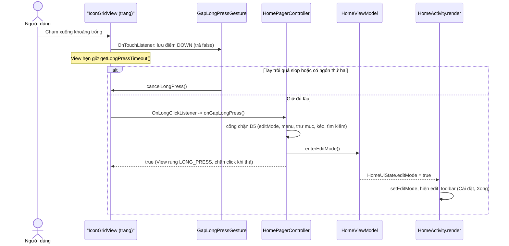

# GP — Nhấn giữ khoảng trống để vào edit mode: đọc trước khi review

**Plan:** [plans/GP-gap-long-press.md](../plans/GP-gap-long-press.md) · **PR:** #8 · **Nhánh:** `fix/gp-gap-long-press`

## 1. Tóm tắt
- Nhấn giữ vào chỗ trống của trang Home (không phải icon, thư mục) thì vào edit mode, rung một lần, như iOS.
- Chạy cả khi trang không có icon. Trước đây ẩn hết app thì Home trống không còn cách nào vào Cài đặt (nút Cài đặt chỉ có trong edit mode).
- Khi Home rỗng (`GridStatus.Empty`), pager và dock nay vẫn hiện (trước đây ẩn cả hai); pill tìm kiếm vẫn ẩn; không còn dòng chữ thông báo nào (chỉ ảnh nền và dock).
- Đã ở edit mode thì nhấn giữ khoảng trống không làm gì thêm. Nhấn giữ dock và hàng pill không đổi (không làm gì).

## 2. Kiến thức nền
- **Nhấn giữ của `View`** (đọc tài liệu/AOSP): `View` đặt hẹn giờ `getLongPressTimeout()` lúc `ACTION_DOWN`. Hết giờ thì gọi `OnLongClickListener`; nếu listener trả `true` thì View **rung `LONG_PRESS`** và **không bắn click** khi thả tay. Nếu trả `false` thì không rung và thả tay vẫn là click.
- **View chỉ tự hủy nhấn giữ khi ngón tay ra khỏi view cộng slop** (đọc AOSP, **chưa tự đo**; kiểm trên máy là kịch bản (b) của Task 1). `IconGridView` là cả một trang nên trôi tay trong trang không hủy; phải gọi [`View.cancelLongPress()`](https://developer.android.com/reference/android/view/View#cancelLongPress()) (API công khai, mô tả đúng việc này: "không muốn menu hiện nếu người dùng nhấn rồi di chuyển").
- **Ai nhận chạm:** `ViewGroup` chỉ gọi `OnTouchListener` của chính nó khi không có con nào nhận `DOWN`. Ô icon/thư mục là con có click nên nuốt `DOWN`; lưới chỉ thấy chạm vào chỗ trống. Vì vậy hai nhấn giữ không trùng nhau.
- **`INVISIBLE` không nhận chạm.** Đó là lý do trạng thái `Empty` phải đổi hiển thị, không chỉ thêm listener.

## 3. Luồng hoạt động

Điểm dễ sai: listener chạm luôn trả `false` (chỉ quan sát). Trả `true` sẽ nuốt chính nhấn giữ và click của View. Cổng chặn trả `false` thì View không rung và thả tay vẫn là click như cũ (thoát edit mode nếu đang ở edit mode).

```mermaid
flowchart TD
    S["renderGridStatus(state)"] --> L{"gridStatus"}
    L -->|Loading| H["pager, pill, dock: INVISIBLE (không đổi)"]
    L -->|Empty| E["pager VISIBLE, dock VISIBLE, pill INVISIBLE"]
    L -->|Ready| R["pager, pill, dock: VISIBLE"]
    E --> T["Trang rỗng nhận nhấn giữ -> edit mode -> nút Cài đặt"]
```

## 4. Thay đổi theo file
| File | Vai trò | Vì sao | Đọc trước? |
|---|---|---|---|
| `ui/home/view/GapLongPressGesture.kt` (mới) | Gắn long click + listener hủy theo slop lên lưới | Hình học nhấn giữ nằm một chỗ, không đụng `IconGridView` (G2c) | Có |
| `ui/home/controller/HomePagerController.kt` | `onGapLongPress` (cổng chặn D5) và `renderGridStatus` | Quyết định khi nào được vào edit mode; hiện pager + dock khi Empty | Có |
| `ui/home/HomePagerAdapter.kt` | Thêm tham số `onGapLongPress`, gắn khi tạo `ViewHolder` | Lưới do adapter tạo | Không |

## 5. Quyết định và đánh đổi
Xem "Vì sao chọn thiết kế này" trong plan. Tóm tắt: dùng nhấn giữ có sẵn của `View` (cùng rung/thời gian với icon, View tự chặn click sau khi nhấn giữ) thay vì tự đếm giờ (sẽ thoát edit mode ngay khi thả tay); không sửa `IconGridView` để nhường G2c; không thêm view phủ vào `activity_home.xml` (file nóng).
- Đánh đổi: trang rỗng hiện cho vuốt giữa các trang rỗng nếu có nhiều hơn một (hiếm); lưới thành "long-clickable" nên TalkBack có thêm hành động nhấn giữ.
- Dock hiện khi Empty (chủ dự án chốt 2026-11-05): sửa lỗi có sẵn là app trong dock không mở được khi mọi app nằm trong dock.
- Dòng chữ "Không có app nào để hiển thị" đã bị xóa hẳn (view `grid_empty_message`, chuỗi `home_grid_empty`) theo chủ dự án: Home rỗng chỉ còn ảnh nền và dock.

## 6. Chỗ cần soi khi review
- Chưa tự đo trên máy ở thời điểm viết: trôi tay trong trang có hủy nhấn giữ không (chỉ có code bảo vệ), thả tay sau nhấn giữ có thoát edit mode không, hai ngón.
- Nhấn giữ khoảng trống ở trang cuối rồi vuốt trái ngay: Library không được mở (`canOpenLibrary` có `!editMode`, `LibraryOverlayController` hỏi lại lúc MOVE).
- Vào edit mode giữa lúc ngón còn chạm: trang bind lại (`notifyItemRangeChanged`) khi tay chưa nhấc; nhấc tay không được bắn click.
- Dock hiện khi Empty: kiểm `DockController`/kính dock không phụ thuộc `Ready`.

## 7. Cách kiểm lại
Live 4. Bố cục thường: giữ khoảng trống (rung, vào edit mode, thả không thoát); giữ rồi trôi tay 12dp mỗi hướng (không vào); vuốt ngang chậm/xuống/trái ở trang cuối (như cũ); giữ icon và thư mục (như cũ); hai ngón. Sau đó ẩn hết app lưới: Home trống, giữ ở giữa → edit mode → Cài đặt → Ứng dụng đã ẩn → bỏ ẩn → quay lại. Chi tiết trong plan.

## 8. Bài học cho AGENTS.md
- 2026-11-05 (đọc code, chờ kiểm máy): nhấn giữ cho một view chiếm cả trang thì phải tự gọi `cancelLongPress()` khi tay trôi quá slop, vì `View` chỉ hủy khi tay ra ngoài view. Listener chạm quan sát luôn trả `false`, để View vẫn tự chặn click sau khi nhấn giữ.
- 2026-11-05 (đọc code): `GridStatus.Empty` từng ẩn pager, pill và dock; view `INVISIBLE` không nhận chạm nên mọi cử chỉ vào edit mode từ Home trống đều chết. Thêm lối vào phải kiểm cả trạng thái hiển thị của chủ nhân cử chỉ.
