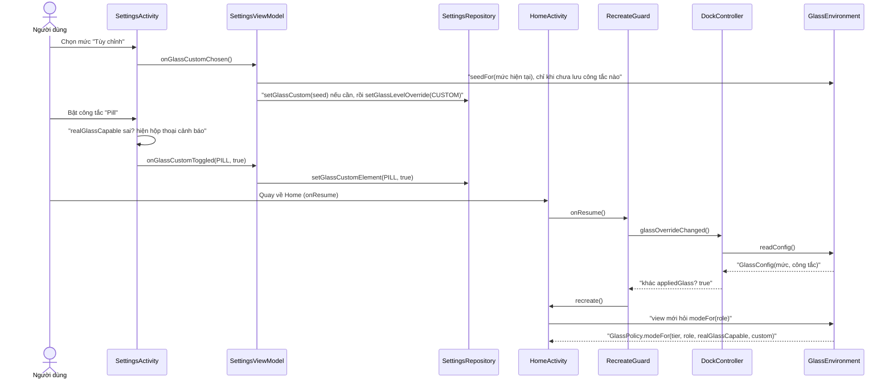
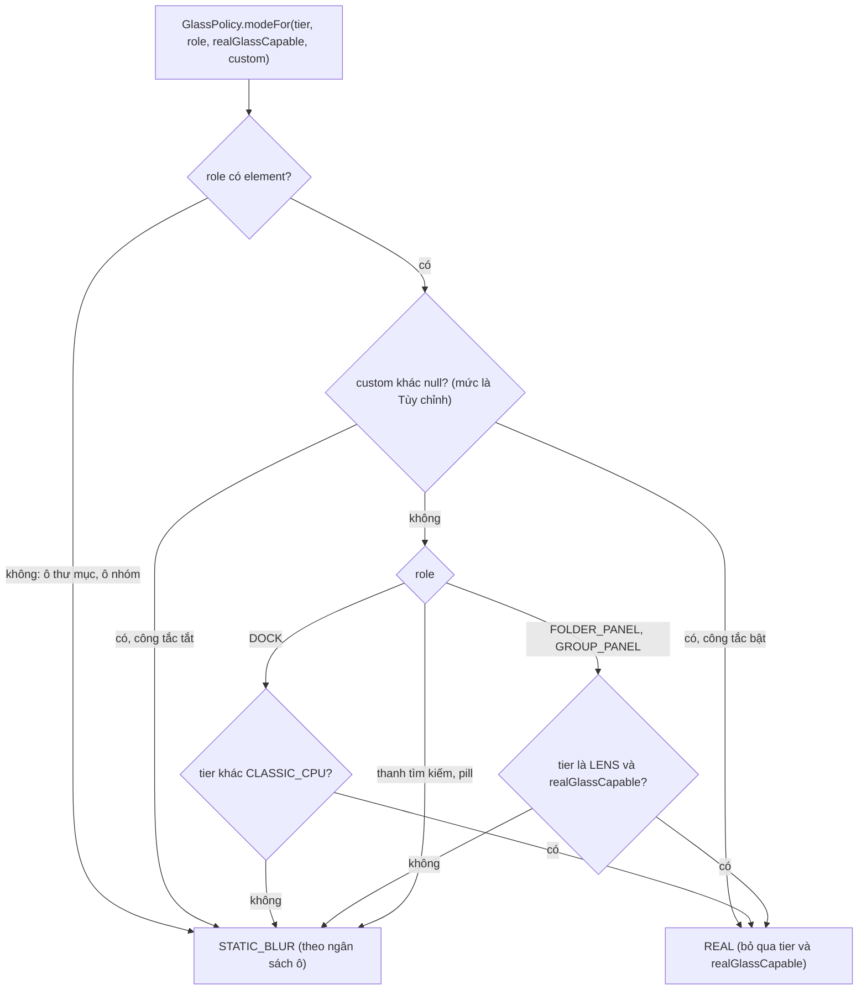
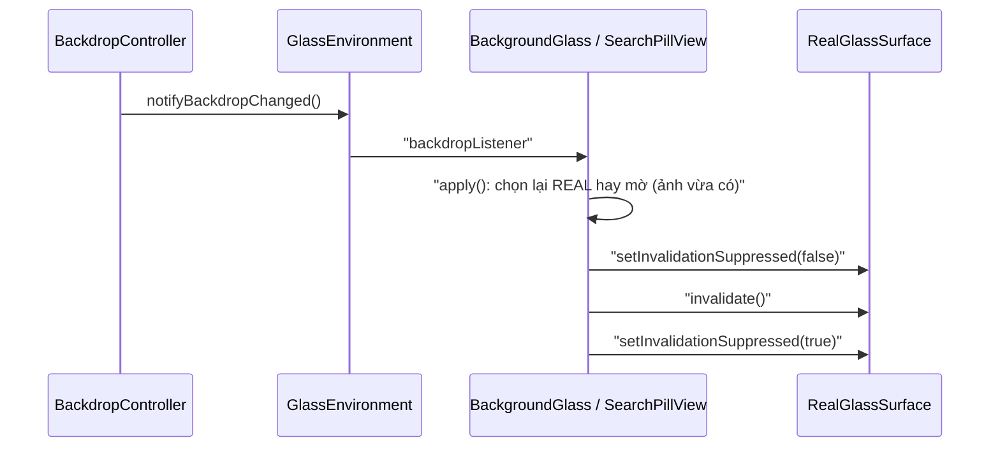

# GS — Kính thật hay kính mờ theo từng phần tử: đọc trước khi review

**Plan:** [plans/GS-glass-settings.md](../plans/GS-glass-settings.md) · **PR:** #10 · **Nhánh:** `feature/gs-glass-settings`

> **Trạng thái: bản nháp viết cùng plan (2026-11-05, sửa theo mức "Tùy chỉnh" cùng ngày), code đang làm.** Mục 3 mô tả luồng theo thiết kế; sau mỗi Task agent đối chiếu sơ đồ với code thật và sửa cho khớp. Các mục 4, 6, 7, 8 hoàn chỉnh ở Task 7.

## 1. Tóm tắt
Mức kính trong Cài đặt có thêm giá trị thứ tư **Tùy chỉnh**. Chọn nó thì cuối màn Cài đặt hiện khối "Kính tùy chỉnh" với bốn công tắc — dock, panel, thanh tìm kiếm, pill — bật là kính thật, tắt là kính mờ. Ba mức Tự động / Ép thấp / Ép cao giữ đúng hành vi cũ và bỏ qua công tắc. Lần đầu chọn Tùy chỉnh, công tắc được đặt theo thứ máy đang hiển thị, nên màn hình không đổi cho tới khi người dùng bật/tắt; sau đó cấu hình được nhớ và giữ khi sang mức khác rồi quay lại. Trên máy Android dưới 13 (API < 33), bật công tắc có hộp thoại cảnh báo có thể chậm. Ô thư mục và ô nhóm Library không có công tắc.

## 2. Kiến thức nền
- **Kính thật và kính mờ.** *Kính thật* là `LiquidGlassView` của thư viện: khúc xạ ảnh nền thời gian thực. Trên Android 13+ chạy bằng shader AGSL (đường "Lens"); dưới 13 thư viện chụp nền bằng CPU (đường "classic"), nặng hơn nhiều. *Kính mờ* là `StaticBlurSurface`/`BackdropBlurDrawable` của dự án: cắt một lát ảnh nền đã làm mờ sẵn, rẻ và chạy từ API 26. Xem [LiquidGlass-Android.md](../LiquidGlass-Android.md) mục 2, 10 và [project_structure.md](../project_structure.md) mục 5.
- **Tier không phải là khả năng.** `GlassTier` (LENS / CLASSIC_GPU / CLASSIC_CPU) suy từ API *và* từ "Mức kính"; "Ép cao" cho tier LENS cả trên máy API 30, nhưng máy đó vẫn chỉ có đường chụp CPU. Vì vậy có thêm `realGlassCapable` (API ≥ 33). Đo được trên Vsmart Live 4: panel kính thật qua đường CPU làm S1 Janky 30,7%, p95 112 ms (AGENTS.md mục GL).
- **`invalidate()` và kính thật.** `LiquidGlassView` tự vẽ lại mỗi khi bất kỳ view nào trong cửa sổ cuộn; dock kính thật khi vuốt trang Janky 72,87% nếu không chặn (TL1). Chặn bằng `GlassSurface.setInvalidationSuppressed`, rồi vẽ lại đúng một lần khi cần (`captureOnce`).
- **`RecreateGuard`.** Thứ gắn lúc dựng View (như `GlassSurface` của dock) không đổi tại chỗ được; Cài đặt chỉ ghi, `HomeActivity.onResume` so giá trị đã áp với giá trị hiện tại và `recreate()` một lần (M8a Task 4, G2b).

## 3. Luồng hoạt động

**Chọn Tùy chỉnh, bật một công tắc và áp (thiết kế):**

`readConfig()` cũng cập nhật chính `GlassEnvironment` trước `recreate()`, nên view dựng lại không đọc phải cấu hình cũ. Tên `glassOverrideChanged` được giữ để không phải sửa `HomeActivity` (file độc quyền); nay nó so cả cấu hình. `GlassConfig` đặt công tắc về "tắt hết" khi mức không phải Tùy chỉnh, nên đổi công tắc ở mức khác không làm Home dựng lại vô ích.

**Một phần tử hỏi "mình vẽ kiểu nào":**

Nhánh `custom = null` chính là bảng hiện tại của dự án, nên ba mức cũ không đổi gì. Công tắc cố ý không hỏi tier: nếu hỏi, một công tắc bật sẽ bị lặng lẽ vô hiệu bởi mức khác với những gì Cài đặt hiển thị.

**Kính thật của thanh tìm kiếm / pill và ảnh nền đổi (thiết kế):**

Ba bước cuối là `captureOnce`: vẽ lại kính đúng một lần rồi chặn lại, không bật `enableDynamicBackground` (vòng vẽ liên tục, đo được ~90 khung dư mỗi lần ở GL).

## 4. Thay đổi theo file
Đọc trước 3 file đánh dấu (★).

| File | Vai trò | Vì sao thêm/sửa | Đọc trước? |
|---|---|---|---|
| `core/glass/GlassPolicy.kt` | Hàm thuần quyết định thật/mờ | Thêm tham số `custom` (công tắc chỉ khi mức Tùy chỉnh), nhánh `DOCK` (quy tắc cũ của factory) | ★ |
| `core/glass/GlassEnvironment.kt` | Singleton giữ cấu hình kính | `config`, `readConfig()` (đọc một lần và làm mới chính nó), `seedFor(level)`, `realGlassCapable` công khai | ★ |
| `ui/home/view/BackgroundGlass.kt` | Gắn kính cho panel, ô nhập, thanh Library | Đường kính thật dùng được cho target lồng nhiều tầng; tự nghe layout/hiển thị của host; chọn lại thật/mờ khi ảnh nền tới | ★ |
| `core/glass/GlassConfig.kt` | Mức kính + công tắc | Công tắc chuẩn hóa về "tắt hết" khi mức ≠ Tùy chỉnh, để so sánh cấu hình không dựng lại Home vô ích | |
| `core/glass/GlassRole.kt` | Vai trò kính | `DOCK` mới, thuộc tính `element` (null = ô thư mục, ô nhóm) | |
| `core/glass/GlassSurfaceFactory.kt` | Tạo kính cho dock | `create(config)` hỏi `GlassPolicy` thay vì tự suy từ tier | |
| `core/glass/GlassTierResolver.kt`, `RealGlassSurface.kt` | Tier; bề mặt kính thật | `CUSTOM` tính như `AUTO`; `getLocationOnScreen` bỏ thêm `translationX/Y` của cha (thanh Library trượt) | |
| `domain/model/GlassCustom.kt`, `GlassLevelOverride.kt`, `LauncherSettings.kt`; `data/settings/*`; `domain/repository/SettingsRepository.kt` | Mô hình + DataStore | `CUSTOM` thêm cuối enum, bốn khóa boolean `glass_custom_*`, `glassCustomSaved` (có khóa nào chưa) | |
| `ui/home/controller/DockController.kt` | Dock + kiểm dựng lại | So cả `GlassConfig` (giữ tên `glassOverrideChanged` để không sửa `HomeActivity`) | |
| `ui/home/view/SearchPillView.kt` | Pill | Thành `FrameLayout` chứa kính thật; lớp nhấn và nội dung vẽ ở `dispatchDraw` | |
| `ui/home/view/CategoryPageView.kt` | Library | Chụp kính thanh một lần khi Library dừng ở vị trí mở | |
| `ui/settings/*`, `res/values/strings.xml` | Cài đặt | Lựa chọn thứ tư của Mức kính; khối "Kính tùy chỉnh" cuối danh sách; hộp thoại cảnh báo API < 33 | |

## 5. Quyết định và đánh đổi
Trỏ về D1–D14 trong plan. Điểm đáng nhớ: một biến quyết định duy nhất (mức kính), công tắc chỉ có nghĩa ở Tùy chỉnh (D3), nên không còn "Ép thấp + dock thật"; công tắc không hỏi tier (D4); gieo công tắc lần đầu để vào Tùy chỉnh không đổi màn hình, sau đó nhớ cấu hình (D8); không áp trần số kính thật vì sẽ tạo trạng thái "Cài đặt nói thật, màn hình vẽ mờ" (D11); pill đổi sang `FrameLayout` thay vì sửa `activity_home.xml` (D7).

## 6. Chỗ cần soi khi review
- **Ba mức cũ phải giống `main`**: `GlassPolicy.modeFor` với `custom = null` chạy đúng bảng cũ; dock là chỗ đổi nhiều nhất (đi qua `GlassPolicy` thay vì factory tự suy). Điều phối đã so ảnh Oppo ở cả ba mức cũ (Home, panel thư mục, tìm kiếm khớp `main`, YMAX 0); Live 4 so bằng số liệu G2/G3 (không hồi quy).
- **Pill**: đổi lớp cha là thay đổi rủi ro nhất; soi `dispatchDraw`/`onDraw` (thứ tự vẽ), `onInterceptTouchEvent`, `PressScale`, TalkBack.
- **`BackgroundGlass` tự nghe layout host**: `explicitHooks` ngăn chụp đôi ở hai panel (host gọi hook tay); nếu thêm host mới gọi hook thì cờ này tự bật.
- **Thanh Library trượt**: kính chỉ được chụp lại khi Library dừng ở vị trí mở; lúc đang trượt nó co như texture. Chỉ được code bảo vệ (+ kiểm tay 6 lần mở lại trên Oppo); phần đang trượt và đổi ảnh nền khi Library mở chưa có kiểm tay riêng, để bài kiểm cuối.
- **Cold start với lựa chọn không mặc định**: `GlassEnvironment` khởi tạo ở cấu hình mặc định rồi cập nhật khi cài đặt phát (có thể nháy sai chế độ một khung); dock không bị vì đọc `readConfig()` trước khi dựng.
- **Cảnh báo API < 33**: chỉ hiện khi bật công tắc trên máy `!realGlassCapable`, không phụ thuộc Ép cao. Chữ cảnh báo chốt theo số đo Task 6.
- **Giới hạn đã biết (không sửa):** lần đầu chuyển từ Ép thấp sang Tùy chỉnh trên máy API ≥ 33, nếu một trang có hơn 6 thư mục, tier đổi từ `CLASSIC_CPU` sang `LENS` nên ngân sách ô thư mục 6 → 24: các thư mục thứ 7 trở đi chuyển từ nền phẳng sang kính mờ. Hiếm, chỉ ảnh hưởng ô thư mục (không có công tắc); trái với câu "vào Tùy chỉnh không đổi màn hình".
- **Kính thật đặt khung bằng `LayoutParams`** (sửa sau review độc lập): ghi cỡ/lề trực tiếp vào `LayoutParams` của kính để `FrameLayout.onLayout` đặt đúng khung; đã kiểm trên Live 4 (gõ chữ trong tìm kiếm với Tùy chỉnh: kính không còn bị chụp lại mỗi phím); chưa kiểm gõ chữ trên Oppo.
- **Gỡ**: `GlassBudget.maxRealGlass` (xóa nếu phép đo bật hết đạt, Task 7) và `HomeViewModel.currentGlassLevelOverride()` (không còn nơi gọi, thuộc file của G2c).

## 7. Cách kiểm lại
1. Cài nhánh lên Oppo (hoặc Live 4). Ảnh nền chi tiết, vài thư mục, Library có nhóm.
2. Cài đặt → Mức kính: chọn lần lượt Tự động, Ép thấp, Ép cao; Home giống bản `main` ở từng mức.
3. Chọn Tùy chỉnh: cuối màn hiện khối "Kính tùy chỉnh" với bốn công tắc; Home chưa đổi. Bật/tắt từng công tắc, về Home (Home dựng lại một lần): dock, panel (mở thư mục, mở nhóm Library), ô nhập tìm kiếm (vuốt xuống), thanh tìm kiếm Library, pill đúng thật/mờ.
4. Trên Live 4: bật công tắc → hộp thoại cảnh báo; Hủy thì công tắc tắt.
5. Chuyển sang Tự động rồi lại Tùy chỉnh: công tắc đã lưu còn nguyên.
6. Đổi ảnh nền khi đang bật kính thật; mở Library, pill vuốt/nhấn giữ, TalkBack với pill.

## 8. Bài học cho AGENTS.md
*(Bản nháp từ code, điều phối gộp sau merge; dòng nào đo được sẽ ghi số khi Task 6 xong.)*
- **(đọc code, 2026-11-05)** Tính vị trí con của một view trong host bằng cách cộng `left - scrollX` của các cha ở giữa, không dùng `offsetDescendantRectToMyCoords`: hàm đó áp ma trận của target, trong khi phép co/dịch của target đã được đồng bộ riêng sang kính, nên kính bị co hai lần.
- **(đọc code, 2026-11-05)** `View.onVisibilityChanged` (và vài callback khác) có thể chạy trong constructor của `View` trước khi trường của lớp con được khởi tạo; kiểm `isAttachedToWindow` trước khi chạm vào trường (pill).
- **(đọc code, 2026-11-05)** Đổi view tự vẽ sang `FrameLayout` để chứa một con: phải `setWillNotDraw(false)`, tự đặt con trong `onLayout` (không gọi `super`, vì con chưa được đo), vẽ phần phủ lên con trong `dispatchDraw`, và chặn chạm ở `onInterceptTouchEvent` nếu con không được nhận chạm.
- **(đọc code, 2026-11-05)** Thêm giá trị vào enum đã lưu trong DataStore: thêm CUỐI và đọc bằng `entries.find` để tên lạ (hoặc APK cũ đọc tệp mới) rơi về mặc định. Biết "đã có cấu hình nào lưu chưa" bằng `prefs.contains(khóa)` thay vì thêm cờ mới.
- **(đọc code, 2026-11-05)** So cấu hình để quyết `recreate()` thì chuẩn hóa phần không có nghĩa ở mức hiện tại (công tắc ngoài Tùy chỉnh về "tắt hết") để đổi chúng không dựng lại Home vô ích.
- **(đọc code, 2026-11-05)** Khối hàng thêm vào màn Cài đặt dùng chung đặt ở CUỐI danh sách: adapter nhóm các hàng giữa hai `Header`, nên không chèn được giữa một nhóm có sẵn mà không tách nhóm đó.
- **(đo được, điều phối, 2026-11-05)** `am_create_activity` trong `logcat -b events` cho 0 trên Oppo A3x, nên không đếm được số lần `recreate()` bằng cách đó trên máy này.
- **(đo được, điều phối, Oppo A3x, 2026-11-05, build `6f0edd1`, 2 lượt mỗi ô)** Bật hết kính thật (dock, panel, ô nhập, thanh Library, pill) không làm đắt thêm so với mức Tự động: vuốt Janky 1.33% so 1.38%, p95 15.08 so 15.02 ms; cảnh 4 kính cùng hiện (Library + panel nhóm) Janky 4.42% so 4.55%, p95 24.95 so 25.12 ms; Home đứng yên 0 khung. Lý do kính thật bổ sung rẻ: luôn chặn `invalidate()` + chụp một lần.
- **(đo được, điều phối, 2026-11-05)** Khi đo Janky một cảnh rung/vuốt, vài ô có một lượt đơn lẻ vọt 64-100 khung > 33 ms (ở cả `main` lẫn nhánh); xen kẽ và lặp cấu hình gốc giữa chừng và cuối mới nhận ra đó là nhiễu máy chứ không phải của cấu hình đang đo.
- **(đo được, điều phối, Vsmart Live 4, 2026-11-05)** Con của `FrameLayout` để `LayoutParams(0, 0)` rồi tự `layout()` bị `FrameLayout.onLayout` đặt về 0x0 ở MỖI lượt layout của host; đổi cỡ đi qua `View.setFrame` (không qua `invalidate()` không đối số mà lớp con chặn), nên một view kính chặn `invalidate()` vẫn bị vẽ lại và xóa bộ đệm. Ghi cỡ/lề thẳng vào `LayoutParams` thay vì đặt thủ công. Đo gõ 12 ký tự trong tìm kiếm với kính ô nhập bật: bản cũ 70-74 khung, 32 khung janky (43-46%), p95 44-57 ms; sau sửa 67-69 khung, 5-7 khung janky (7-10%), p95 19-20 ms; mức Tự động cùng phiên 65-67 khung, 2-4 janky, p95 11-17 ms.
- **(đọc code, review độc lập, 2026-11-05)** Theo dõi "host vừa hiện" bằng `OnLayoutChangeListener` của chính host sẽ không thấy lúc host GONE (host GONE không được layout) nên cờ `wasShown` kẹt ở true; dùng `OnGlobalLayoutListener` của cửa sổ.
- **(đo được, điều phối, Vsmart Live 4 API 30, 2026-11-05, `6f0edd1`)** Vuốt trang (G2) với mức Ép cao (dock thật) và với cả bốn công tắc bật: cùng dải với mức Tự động (tổng khung ~1960, p95 ~12-17 ms, 2-7 khung > 33 ms); chênh giữa hai lượt của cùng một cấu hình lớn hơn chênh giữa các cấu hình, nên đo ít lượt chỉ bắt được chênh lệch lớn. Panel kính thật trên Live 4 không đo ở GS; số đáng tin vẫn là của GL (Janky 30.7%, p95 112 ms), và là lý do của hộp thoại cảnh báo.
- **(đo được, điều phối, 2026-11-05)** Cảnh thứ nhất của một cấu hình `main` trên Live 4 có thể vọt (G3 lượt đầu Janky 13.55%, p95 24.7 ms, rồi 10.18%; lượt cuối phiên 3.69-5.12%): chạy lại cấu hình gốc ở cuối phiên trước khi kết luận cấu hình mới "tốt hơn".
