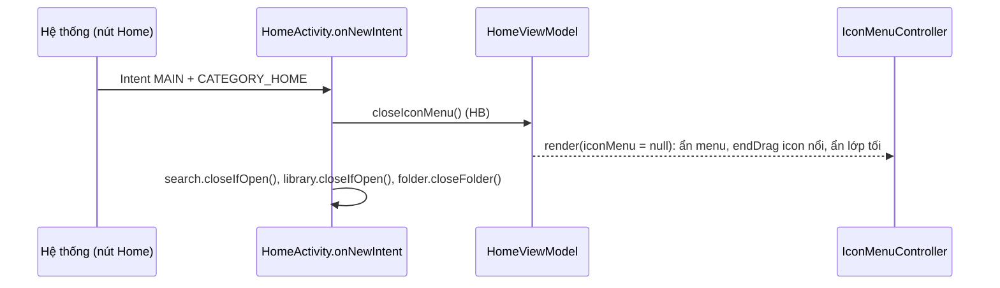

# HB — Nút Home đóng menu nhấn giữ icon

## Tóm tắt
Bấm Home khi menu nhấn giữ icon đang mở (nhất là menu mở từ trong thư mục) để lại menu, icon nổi và lớp tối trên Home. Nay `HomeActivity.onNewIntent` đóng menu trước khi đóng tìm kiếm, Library và thư mục.

## Số đo (đo được, Oppo A3x, 2026-11-10, debug)
| Trường hợp | Trước | Sau |
|---|---|---|
| Menu mở từ thư mục, bấm Home | Menu + icon nổi + lớp tối còn sau 2 s | Đóng hết |
| Menu mở từ lưới Home, bấm Home | (không kiểm trước) | Đóng hết |

## Bài học cho AGENTS.md
- Mỗi lớp phủ tạm (tìm kiếm, Library, thư mục, nhóm, menu nhấn giữ) phải đóng ở **cả** Back và `onNewIntent` (nút Home). Thêm lớp phủ mới thì thêm vào cả hai chỗ.
