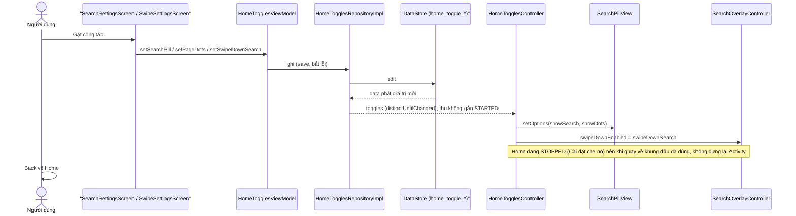
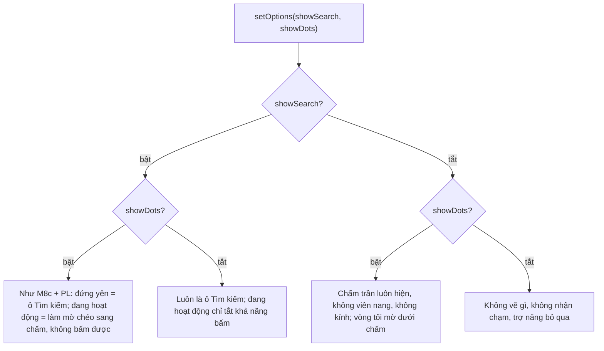
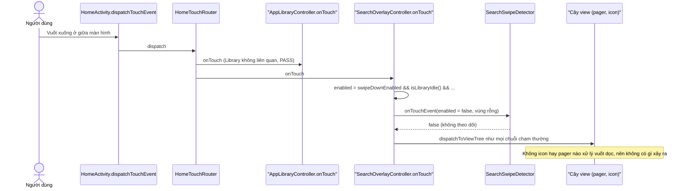

# HT — Công tắc Màn hình chính: đọc trước khi review

**Plan:** [plans/HT-home-toggles.md](../plans/HT-home-toggles.md) · **PR:** #52 · **Nhánh:** `feature/ht-home-toggles`

## 1. Tóm tắt

Ba công tắc mới, áp ngay khi quay về Home mà không khởi động lại launcher:
- **Cài đặt tìm kiếm → "Cách mở":** "Vuốt xuống để tìm kiếm" và "Nút Tìm kiếm trên màn hình" (viên nang phía trên Dock).
- **Lướt màn hình (màn mới, 3.1):** "Hiện chấm trang". Màn này chỉ có một hàng; PT sau này thêm hiệu ứng chuyển trang vào đúng màn này.

Mặc định bật cả ba, tức là Home giống hệt trước HT. "Lướt vòng" của bản nháp **đã bỏ** (chủ dự án, 2026-11-13) vì xung đột với cử chỉ mở App Library ở trang cuối. Trạng thái: code xong cả 4 Task; Live 4 đã kiểm một phần (xem mục 6); Oppo chỉ cho ca kính thật, chưa chạy.

## 2. Kiến thức nền

- **Pill và chấm là một view.** `SearchPillView` (M8c) là viên nang cố định 144x32dp trong dải cao 48dp. Đứng yên nó là ô "Tìm kiếm"; khi pager đang lướt, edit mode hoặc đang kéo icon nó làm mờ chéo sang hàng chấm trang (PL: mỗi chấm đổi màu theo vị trí liên tục). "Đang hoạt động" trong code là `dotsMode` (do `HomePagerController.requestPillMode` đặt).
- **Vuốt xuống tìm kiếm** do `SearchSwipeDetector` nhận ra, đặt trong `SearchOverlayController.onTouch`, chạy trong `HomeTouchRouter.dispatch` **sau** cử chỉ Library. Detector chỉ quan sát chuỗi chạm; điều kiện bật `enabled` truyền theo từng sự kiện. (đọc code)
- **Controller sau R1** là lớp Kotlin thường, dựng ở `HomeActivity.onCreate`; thứ tự dựng là hành vi.
- **DataStore** phát lại giá trị hiện tại cho bộ thu mới và `Flow` của repository có `distinctUntilChanged`, nên Home chỉ phản ứng khi một trong ba công tắc đổi. ([tài liệu DataStore](https://developer.android.com/topic/libraries/architecture/datastore))
- **Home nhận cài đặt theo ba đường** (đọc code): `HomeViewModel` đọc `settings` vào `HomeUiState`; `GlassEnvironment` (singleton) báo listener; `RecreateGuard` dựng lại Activity ở `onResume` cho thứ gắn lúc dựng View. HT dùng đường thứ tư: một controller thu flow riêng, vì ba công tắc chỉ là cờ lúc chạy.

## 3. Luồng hoạt động

**Gạt một công tắc ở Cài đặt rồi quay về Home.**

Điểm dễ sai: thu **không** dùng `repeatOnLifecycle(STARTED)` có chủ đích. Nếu có, giá trị mới chỉ áp sau khi Home hiện lại và có thể nháy một khung với trạng thái cũ. Trước emission đầu, view giữ mặc định (bật cả ba).

**Bốn tổ hợp nút tìm kiếm × chấm trang** (toàn bộ nằm trong `SearchPillView`, `morphTarget()`):

Mọi tổ hợp giữ nguyên dải 48dp (không `requestLayout`), nên `GridMetrics.Cells`, cỡ icon và dock không đổi.

**Vuốt xuống khi bị tắt.**

Thanh thông báo hệ thống không bị đụng: vùng bắt đầu của cử chỉ vốn chừa thanh trạng thái + 48dp (M8b D4).

## 4. Thay đổi theo file

Đường dẫn dưới `app/src/main/java/gambi/global/os26launcher/`.

| File | Vai trò | Vì sao thêm/sửa | Đọc trước? |
|---|---|---|---|
| `ui/home/view/SearchPillView.kt` | `setOptions`, `morphTarget`, `searchClickable`; cổng bấm, a11y, chấm trần | Nơi quyết bốn tổ hợp; kính đi đường sẵn có (`applyGlass` đổi đúng một dòng chọn `mode`) | **Có (1)** |
| `ui/home/controller/HomeTogglesController.kt` | Thu flow, đẩy vào pill và `SearchOverlayController` | Đúng mẫu controller R1 | **Có (2)** |
| `ui/home/controller/SearchOverlayController.kt` | `swipeDownEnabled` + một điều kiện `&&` | Cổng cử chỉ vuốt xuống | **Có (3)** |
| `ui/home/HomeActivity.kt` | 6 dòng thêm: 2 import, `@Inject` repository, một dòng dựng controller | File độc quyền, chỉ để nối | Không |
| `domain/model/HomeToggles.kt`, `domain/repository/HomeTogglesRepository.kt` | Mô hình và interface (mặc định bật cả ba) | Không import `android.*` | Không |
| `data/settings/HomeTogglesRepositoryImpl.kt`, `HomeTogglesKeys.kt` | Ba khóa DataStore `home_toggle_*` | Kho riêng, không sửa `SettingsKeys` (cùng mẫu M8d, WU) | Không |
| `di/HomeTogglesModule.kt` | `@Binds` | Tránh `RepositoryModule` dùng chung | Không |
| `ui/settings/HomeTogglesViewModel.kt` | Trạng thái và ghi cho hai màn | Mẫu `SearchSettingsViewModel` | Không |
| `ui/settings/SwipeSettingsScreen.kt`, `SettingsScreen.kt` | Màn 3.1 (một hàng) và một dòng đăng ký | Công thức thêm màn của G2d | Không |
| `ui/settings/SearchSettingsScreen.kt`, `SettingsRow.kt` | Nhóm "Cách mở" + Header "Tìm trong", ID hàng | Công thức thêm hàng của G2d | Không |
| `res/values/strings.xml`, `colors.xml` | Khối `ht_` (8 chuỗi, `ht_dot_halo`) | Chữ ở tài nguyên | Không |

Không đổi: `HomeViewModel`, `HomeUiState`, `activity_home.xml`, `core/glass/*`, `SettingsKeys`, `LauncherSettings`, `SettingsViewModel`, manifest, Room.

## 5. Quyết định và đánh đổi

- **Kho riêng thay vì `SettingsKeys`/`LauncherSettings`** (HT2): năm file dùng chung đang bị WU/AB/RN chạm; `settings` phát lại cho mọi khóa. Cũng không thêm vào `SearchPreferences` vì `SearchViewModel` dựng lại chỉ mục khi nó đổi.
- **Controller đọc flow, không qua `HomeViewModel`/`HomeUiState`** (HT3): ba cờ không phải state nghiệp vụ và không cần sống qua `recreate()`.
- **Chấm trần luôn hiện khi tắt nút tìm kiếm** (HT9, chủ dự án/điều phối): chỗ trống nên bản nháp "chỉ báo ở cuối màn hình" đúng; không cần kính cho viên nang. Đánh đổi: chấm trắng có thể khó thấy trên nền sáng; giảm bằng vòng tối mờ (`BARE_DOT_HALO`), **chưa nhìn trên máy**.
- **Giữ dải 48dp khi tắt cả hai**: bỏ dải làm `GridMetrics.Cells` đổi và bind lại lưới/dock (vùng từng sinh lỗi dock 0x0).
- **Vuốt xuống tắt = không làm gì**; cho phép tắt cả hai lối mở tìm kiếm không cảnh báo (Cài đặt vào được qua edit mode, Library có thanh tìm kiếm riêng).
- **Bỏ "Lướt vòng"** (HT8): vuốt trái ở trang cuối đã là cử chỉ mở Library mà FX7 và LB mất nhiều vòng mới ổn; vòng sẽ phải sửa `LibraryOverlayController`. Nếu cần lại: xét "chỉ khi Thư viện tắt" sau LO.

## 6. Chỗ cần soi khi review

- **Đã kiểm Live 4 một phần** (điều phối, 2026-11-13, APK md5 `ec9f379e`, code `7e7d6aa`, đo được): hai màn Cài đặt, ba tổ hợp pill/chấm áp khi quay về, bố cục không đổi (bounds giống hệt), vuốt xuống tắt/bật, Library 4 vào/ra. **Chưa kiểm:** nền sáng, kính thật trên Oppo, kéo icon/edit mode/thư mục khi công tắc tắt, các điểm vuốt xuống khác, hàng danh bạ. Chi tiết ở "Kết quả kiểm chứng" của plan.
- **Kính của pill** (đọc code, chưa đo): khi tắt nút, `applyGlass` đi nhánh FLAT sẵn có (bỏ drawable, con kính thật `GONE`); bật lại đi `setRealActive(true)` → `scheduleCapture()` như GS Task 4. Ca có nguy cơ chỉ lộ trên Oppo: Tùy chỉnh + pill kính thật → tắt nút → đổi ảnh nền → bật lại → ảnh chụp pill phải khớp nền.
- **Chấm trần trên nền sáng** (suy luận chưa kiểm chứng): giữ `BARE_DOT_HALO = true` (Live 4 trên ảnh nền đỏ/tối: vòng nhẹ, chấm đọc tốt); ca nền sáng chưa kiểm.
- **Chạm vào dải pill khi nút tắt**: `onInterceptTouchEvent` trả `false` và view không bấm được, nên chạm rơi xuống không có gì bên dưới. Cần xem không có hiệu ứng lạ (vd cử chỉ nhấn giữ khoảng trống của pager không nằm ở dải này).
- **Edit mode với nút bật + chấm tắt**: pill vẫn hiện chữ "Tìm kiếm" nhưng không bấm được (giữ D3 của M8c); có thể khiến người dùng tưởng nút hỏng, ghi nhận để chủ dự án xem.
- **Hàng Cài đặt**: hai Header "Cách mở" / "Tìm trong" dựa vào cách adapter nhóm hàng giữa các Header; chưa thấy trên máy.
- **Ảnh hưởng tới tính năng cũ**: `SearchOverlayController` chỉ thêm một điều kiện `&&` (mặc định true); `setDotsMode` đổi cách tính đích nhưng với cả hai bật cho đúng giá trị cũ.

## 7. Cách kiểm lại

Vsmart Live 4. Dữ liệu: ≥ 4 trang Home, một widget, ảnh nền sáng và tối. Bài kiểm đầy đủ ở mục "Bài kiểm cả tính năng" của plan; tóm tắt:
1. Cài đặt → Cài đặt tìm kiếm / Lướt màn hình: hàng đúng, giữ giá trị sau Back và force-stop.
2. Từng công tắc ở Cài đặt, Back về Home: đổi ngay, không dựng lại Activity.
3. Bốn tổ hợp pill × chấm: vuốt trang, edit mode, kéo icon sang trang tạm.
4. Vuốt xuống tắt/bật ở nhiều điểm; hồi quy vuốt ngang, Library, kéo icon, menu, mép trên.
5. Kính thật (Tùy chỉnh) trên Live 4, rồi Oppo.

## 8. Bài học cho AGENTS.md

Chủ đề đề xuất ghi theo từng dòng.

- **(2026-11-13, đọc code, HT) — `settings-and-data`:** công tắc Home chỉ là cờ lúc chạy thì không cần `RecreateGuard`/`recreate()`; một controller thu flow bằng `lifecycleScope` (không `repeatOnLifecycle(STARTED)`) áp giá trị lúc Home còn khuất. Chỉ dựng lại Activity cho thứ gắn lúc dựng View (mức kính, kiểu icon).
- **(2026-11-13, đọc code, HT) — `settings-and-data`:** thêm khóa vào `SearchPreferences` làm `SearchViewModel` dựng lại chỉ mục (nó thu cả đối tượng); công tắc không liên quan tới nguồn kết quả phải có kho riêng (`HomeTogglesRepository`), cùng mẫu M8d và WU.
- **(2026-11-13, đọc code, HT) — `home-pager-animation`:** muốn ẩn một view trong `LinearLayout` có weight mà không đổi cỡ lưới thì giữ `VISIBLE` và không vẽ; `GONE` làm `GridMetrics.Cells` đổi và bind lại lưới + dock.
- **(2026-11-13, đọc code, HT) — `search`:** cổng cử chỉ vuốt xuống chỉ là một điều kiện trong `enabled` của `SearchSwipeDetector` (detector chỉ quan sát); tắt không đụng thứ tự `HomeTouchRouter` hay các cử chỉ khác. Mép trên vốn thuộc hệ thống (M8b D4) nên thanh thông báo không bị ảnh hưởng.
- **(2026-11-13, đọc code, HT) — `glass`:** ẩn pill đi nhánh `GlassMode.FLAT` sẵn có để tái dùng `setRealActive`/`scheduleCapture`, không thêm alpha lên con kính thật (đường chưa kiểm); chạy ca "tắt → đổi nền → bật" trên Oppo khi pill là kính thật.
- **(2026-11-13, quy trình, HT):** khi một quyết định chủ dự án bỏ hẳn một tính năng giữa chừng (lướt vòng), xóa hàng, Task, khóa DataStore và chữ liên quan khỏi plan cùng lượt rồi grep lại, đừng để hàng mờ "Sắp có" nếu chủ dự án nói "không cả hàng mờ".
