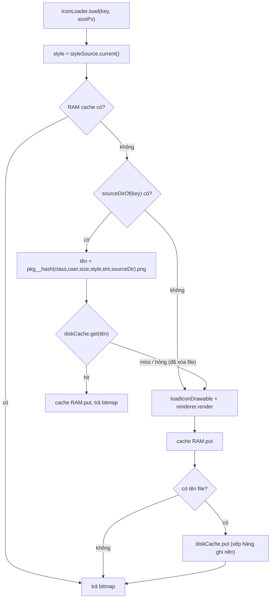
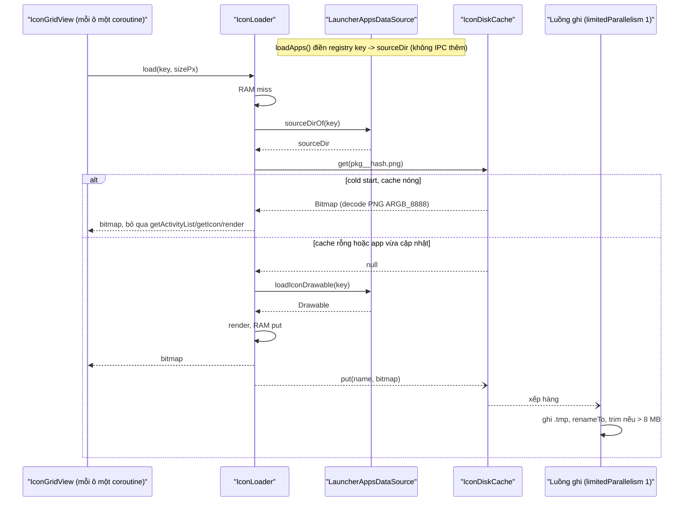

# IC — Cache icon xuống đĩa: đọc trước khi review

**Plan:** [plans/IC-icon-disk-cache.md](../plans/IC-icon-disk-cache.md) · **PR:** # (draft) · **Nhánh:** `feature/ic-icon-disk-cache`

## 1. Tóm tắt
Sau LC, trên Oppo A3x lưới sẵn sàng ~1,6 s nhưng icon cuối chỉ vẽ xong ~2,4 s. Mỗi icon hôm nay đi `getActivityList(package)` (IPC), `getIcon` (nạp drawable) rồi `IconRenderer.render`. IC lưu **bitmap đã render** thành file PNG trong `cacheDir`; lần khởi động sau chỉ đọc một file nhỏ. **Số đo trên Oppo chưa có** (đang chờ máy); Task 1 (đo pha) quyết định cách tiếp cận này có đúng không. Mã đã build xanh, chưa chạy trên máy thật.

## 2. Kiến thức nền
- **`cacheDir`**: thư mục "xóa được" của app, không vào Auto Backup, hệ thống có thể dọn khi thiếu chỗ. Mất cache chỉ làm chậm một lần.
- **`sourceDir`**: đường dẫn APK, đổi mỗi lần cài hoặc cập nhật (LC đã đo). Dùng làm dấu vân tay, không cần IPC thêm vì `loadApps` đã đọc sẵn.
- **Ghi atomic**: ghi `name.tmp` rồi `renameTo`; chết giữa chừng chỉ để lại `.tmp` mồ côi, không bao giờ có file `.png` cụt.
- **`limitedParallelism(1)`**: biến dispatcher IO thành "hàng đợi một luồng" để ghi tuần tự mà không tạo thread riêng.

## 3. Luồng hoạt động





Điểm dễ sai: `put` trả ngay; bitmap được ghi sau đó từ luồng khác nên không được sửa bitmap sau khi trả ra (icon RAM vốn chỉ đọc).

## 4. Vô hiệu hóa

| Tình huống | Phát hiện | Xử lý |
|---|---|---|
| App cập nhật | `sourceDir` đổi nên hash đổi | Miss, render lại; file cũ mồ côi bị dọn khi vượt trần 8 MB |
| App gỡ | Sự kiện REMOVED | `IconCache.evict` (RAM) và `IconDiskCache.evict` (xóa mọi file tiền tố `pkg__`) |
| Cập nhật hệ điều hành | Tên thư mục chứa hash `Build.FINGERPRINT` | Thư mục khác; thư mục `icons-*` cũ bị xóa lúc khởi tạo (trên luồng ghi) |
| Đổi mật độ màn hình / cỡ icon | `sizePx` nằm trong hash | Miss tự nhiên |
| Đổi kiểu icon / màu tô | `style`, `tint` nằm trong hash | Miss; đổi lại kiểu cũ thì file cũ dùng lại được |
| File hỏng / cụt / rỗng | Kiểm 8 byte chữ ký PNG đầu và 12 byte IEND cuối trước khi giải mã; `decodeFile` null/ném cũng tính | Xóa file, rơi về render, ghi lại |

Lưu ý (đo trên Live 4): `BitmapFactory.decodeFile` **chấp nhận PNG bị cắt cụt** và trả bitmap trống (icon trắng), nên chỉ dựa vào null/ngoại lệ là không đủ; vì vậy `get` kiểm IEND trước.
| Ghi lỗi (đầy ổ, IO) | `catch` trong `write` | `Log.w`, xóa `.tmp`, bỏ qua |
| ROM đổi chủ đề icon mà `sourceDir` không đổi | Không phát hiện được | Giới hạn đã biết (xem plan) |

## 5. Thay đổi theo file
| File | Vai trò | Đọc trước? |
|---|---|---|
| `data/apps/IconDiskCache.kt` (mới) | Đọc PNG, ghi nền atomic, trần 8 MB, evict theo tiền tố | **Có** |
| `data/apps/IconLoader.kt` | RAM → đĩa → render; đặt tên file có hash | **Có** |
| `data/apps/LauncherAppsDataSource.kt` | Chỉ `loadApps` (điền registry) và `sourceDirOf` | Có |
| `data/apps/AppRepositoryImpl.kt` | Thêm `IconDiskCache.evict` khi REMOVED | Có |

Không đổi `AppItem`, `AppRepository`, chữ ký `IconLoader.load`, module Hilt (mọi class dùng `@Inject constructor`).

## 6. Quyết định và đánh đổi
- **Evict (Review Focus 7)**: plan nói `IconCache.evict` chưa có nơi gọi; thực tế `AppRepositoryImpl.apps` đã gọi cho **mọi** sự kiện package (M4). IC chỉ thêm xóa đĩa ở REMOVED để giải phóng chỗ. CHANGED/cập nhật không cần xóa đĩa vì `sourceDir` đổi nên tên file đổi. Không xóa đĩa ở ADDED/AVAILABLE/SUSPENDED… vì icon vẫn đúng.
- **Registry ở data source**: `sourceDirs: ConcurrentHashMap` cập nhật cuối `loadApps` bằng `putAll` rồi `retainAll`, dùng lại `stamp` của LC. `stamp` rỗng thì không vào registry (không dùng đĩa).
- **Hash là SHA-1 cắt 16 ký tự hex**, không dùng `String.hashCode` (32 bit, dễ va chạm hơn).
- **Dọn thư mục fingerprint cũ chạy trên luồng ghi**, không trong `init` trực tiếp, để không chặn luồng đang tiêm Hilt. Hiệu quả như plan.
- **Trần 8 MB**: giữ một tổng ước lượng trên luồng ghi, chỉ quét thư mục khi chưa biết hoặc khi vượt trần, tránh quét 350 file mỗi lần ghi. Xóa theo `lastModified` (thời điểm ghi, không cập nhật khi đọc).
- **Cache mọi kích thước icon** (chủ dự án duyệt): mỗi kích thước một file.
- Hạn chế: `get` chạy decode PNG ngay trên luồng gọi (đã ở IO). `trim()` là public nhưng hiện chỉ gọi nội bộ qua `write`.

## 7. Chỗ cần soi khi review
- Bitmap đọc từ đĩa phải giống hệt bitmap render (alpha, góc trong suốt) ở cả ba kiểu icon: **chưa kiểm bằng mắt**.
- `Bitmap.compress` chạy trên luồng ghi, bitmap có thể đang được `IconCellView` vẽ cùng lúc: chỉ đọc nên an toàn, nhưng cần xác nhận không có chỗ tái sử dụng bitmap (recycle).
- Lần cài sạch (cache rỗng) tốn công ghi nền: Review Focus 6 chưa đo.

## 8. Bằng chứng Review Focus
| # | Nội dung | Bằng chứng |
|---|---|---|
| 1 | Hash đổi khi cập nhật/kiểu/sizePx, không đổi khi không đổi | Một phần. Live 4 2026-11-06: đổi kiểu Mặc định → Tô màu → 3D → Mặc định, mỗi kiểu có file riêng (thư mục lên 111 file), quay lại Mặc định ra icon giống hệt lúc đầu (lệch ≤ 1/255). `sourceDir` đổi mỗi lần cài là kết quả LC Task 1. **Chưa thử** `install -r` rồi xem icon app đó render lại |
| 2 | Cache hỏng không làm chết app, được ghi lại | Live 4: file rỗng, file rác, file cụt 100 byte: không crash. **Lỗi tìm ra:** file cụt bị `BitmapFactory` nhận, icon Blynk IoT trống và file không bị xóa. Sửa ở `0ffd482` (kiểm chữ ký PNG và chunk IEND). Kiểm lại: log `icon cache file incomplete, deleting`, file ghi lại đủ 2800 byte, icon hiện đúng |
| 3 | Bitmap đĩa trùng bitmap render, ba kiểu icon | Live 4: chụp màn hình lần vừa render và lần đọc đĩa, 11 icon (lưới và dock): Mặc định, Tô màu, 3D đều lệch tối đa 1/255 (làm tròn). Tô màu và 3D khác nhau 255, tức là có phân biệt kiểu |
| 4 | Ghi ngoài đường găng, atomic, tôn trọng trần | Đọc code: luồng ghi đơn, tmp rồi `renameTo`. Live 4: lần cache rỗng 516 ms so với `main` trung vị 487 ms (một lượt). Thư mục 27 → 111 file sau khi đổi kiểu, chưa chạm trần 8 MB. **Chưa thử** vượt trần |
| 5 | Đổi `Build.FINGERPRINT` thì thư mục cũ bị xóa | chưa kiểm |
| 6 | Cài sạch không chậm hơn `main` quá ngưỡng | Live 4 (một lượt): cửa sổ 516 ms so với 487 ms của `main`. Oppo 2026-11-09 (một lượt): 975 ms so với trung vị 896 ms của `main`, +79 ms (ngưỡng +100 ms). Đạt, mỗi máy chỉ một lượt |
| 7 | `IconCache.evict` được gọi ở REMOVED/CHANGED, hoặc quyết định rõ không cần | Đạt theo code: RAM `evict` đã được gọi cho mọi sự kiện package từ M4; đĩa chỉ dọn ở REMOVED, CHANGED không cần vì `sourceDir` đổi tên file |
| 8 | Chỉ sửa trong Vùng file | `git diff main --stat`: `IconDiskCache.kt`, `IconLoader.kt`, `LauncherAppsDataSource.kt` (`loadApps`, `sourceDirOf`), `AppRepositoryImpl.kt` (một `onEach`), hai file docs. Đạt |

### Số đo Live 4 (2026-11-06, xen kẽ `main` và IC, 11 lượt mỗi bên, 27 icon trang 1 + dock)
Khoảng từ lúc icon đầu tiên được hỏi tới lúc icon cuối nạp xong: `main` trung vị **487 ms** (331-631), IC cache nóng trung vị **277 ms** (169-363), IC cache rỗng 516 ms (1 lượt). Trên `main`, phần chiếm gần hết là `getIcon(0)`: trung vị 52-185 ms mỗi icon, render 2-5 ms, `getActivityList` 1-3 ms. **Oppo chưa đo.**

### Số đo Oppo A3x (2026-11-09, xen kẽ `main` và IC, 35 icon trang 1 + dock, `force-stop` rồi `am start`, chờ 9 s)
Mốc là ms từ lúc tiến trình bắt đầu; "cửa sổ" = từ icon đầu tiên được hỏi tới icon cuối nạp xong. Hai bản đều có cùng log đo.

| Ca | Số lượt | Icon cuối xong: trung vị (nhỏ nhất - lớn nhất) | Cửa sổ icon: trung vị |
|---|---|---|---|
| `main` | 11 | **2820 ms** (2726 - 3341) | 896 ms |
| IC, cache nóng | 12 | **2173 ms** (2074 - 2397) | **234 ms** |
| IC, cache rỗng (lần đầu) | 1 | 2970 ms | 975 ms |

- **Tiết kiệm:** icon cuối xong sớm hơn ~650 ms (-23%); cửa sổ icon giảm ~660 ms (-74%). Thư mục icon sau lần chạy đầu: 35 file, ~456 KB (`du -k`), xa trần 8 MB.
- **Mục tiêu tạm của plan (trung vị ≤ 1,9 s, tệ nhất ≤ 2,1 s) KHÔNG đạt về con số tuyệt đối** (2,17 s và 2,40 s). Lý do đo được: icon đầu tiên chỉ được hỏi từ ~1,87-2,10 s (không phải ~1,6 s như số LC dùng để đặt mục tiêu), nên sàn của IC ở đây là ~1,9 s + ~0,23 s. Phần còn lại trước khi icon được hỏi (khởi động tiến trình, DB, `HomeViewModel`) **ngoài phạm vi IC**. Phần IC chịu trách nhiệm (cửa sổ icon) đã giảm từ ~0,9 s xuống ~0,23 s.
- **Cache rỗng, lần đầu:** cửa sổ 975 ms so với trung vị `main` 896 ms (+79 ms, ngưỡng +100 ms) trên một lượt.
- **Chưa làm:** tách pha `getIcon`/render/IPC trên Oppo (Task 1 Step 3); chỉ đo cửa sổ.

### Bản release trên Oppo A3x (2026-11-09): các số debug ở trên là **bản debug**, không phải cái người dùng cuối chạy
Cùng mã, cùng máy, build `assembleRelease`, ký tạm bằng khóa debug chỉ để đo, cài ở trạng thái mặc định (`dexopt status=verify`); xen kẽ `main` và IC, 35 icon, `force-stop` rồi `am start`:

| Bản | Icon cuối xong, trung vị (nhỏ nhất - lớn nhất) | Cửa sổ icon, trung vị | Mở cửa sổ (`am start -W` TotalTime) |
|---|---|---|---|
| debug `main` | 2822 ms (2726 - 3341), 14 lượt | ~900 ms | ~1250 ms |
| debug IC | 2173 ms (2074 - 2397), 12 lượt | 234 ms | chưa đo |
| **release `main`** | **637 ms** (611 - 682), 8 lượt | ~180 ms | 410 - 447 ms |
| **release IC** | **497 ms** (459 - 739), 8 lượt | ~53 ms | 403 - 450 ms |

- **Bản debug chậm gấp ~4,4 lần bản release** với cùng mã (`debuggable` và không biên dịch trước: `dexopt status=run-from-apk`; biên dịch `-m speed` lên bản debug chỉ đạt `verify`). Bản release không cần biên dịch thêm: `-m speed` không cải thiện thêm (420 - 454 ms so với 375 - 387 ms). Cơ chế chạy chậm của ART cho bản debuggable là kiến thức chung, **chưa đo riêng** từng yếu tố.
- **IC vẫn có ích ở release:** icon cuối sớm hơn ~140 ms (-22%), cửa sổ icon 180 -> 53 ms (-70%). Mục tiêu tạm 1,9 s của plan đặt theo số debug; ở release cả hai bản đều dưới 0,65 s.
- **So với launcher mẫu trên cùng máy** (`com.liquid.os.launcher.smart`, tên activity `com.android.launcher3.Launcher` nên nhiều khả năng là bản dựa trên Launcher3, suy luận chưa kiểm chứng nội bộ): mở cửa sổ 478 - 642 ms; bản release của ta 403 - 450 ms. Hai số đo khác định nghĩa nhẹ (của ta qua `HomeActivity`, của mẫu qua `Launcher` bỏ qua splash) nên chỉ dùng để so cỡ độ lớn.
- Máy đo ở bản release được ký bằng khóa debug và có dòng log đo; **không dùng cho người dùng**.

## 9. Cách kiểm lại (do điều phối chạy)
```
adb shell run-as gambi.global.os26launcher ls -l cache
adb shell run-as gambi.global.os26launcher du -sk cache/icons-v1-*
adb shell am force-stop gambi.global.os26launcher
```
Làm hỏng một file `.png` (rỗng, cụt, rác) rồi mở lại: không crash, icon đúng, file được ghi lại.

## 10. Bài học cho AGENTS.md
- Đề xuất (chờ điều phối duyệt): cache icon đĩa theo tên file chứa dấu vân tay `sourceDir` và tiền tố package, nên cập nhật app tự vô hiệu hóa mà không cần xóa chủ động.
- Plan viết từ đọc code có thể lỗi thời so với `main` (ở đây `IconCache.evict` đã được nối từ M4): kiểm lại bằng grep trước khi coi là phát hiện.
