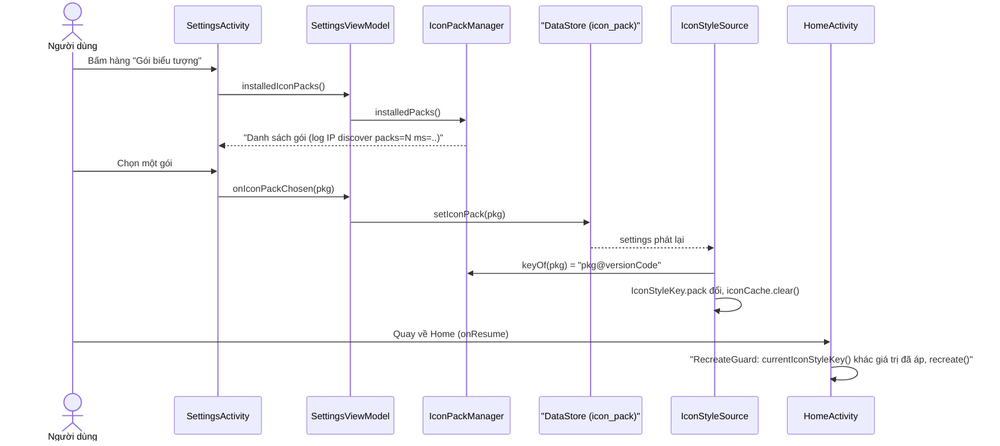
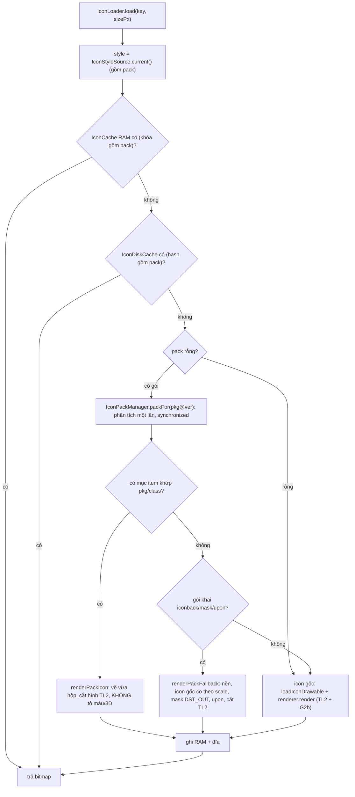
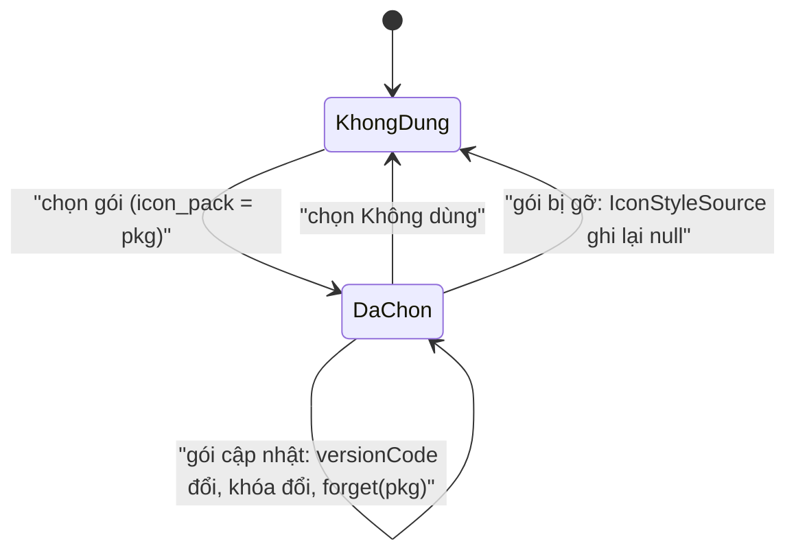

# IP — Gói biểu tượng (icon pack): đọc trước khi review

**Plan:** [plans/IP-icon-packs.md](../plans/IP-icon-packs.md) · **PR:** xem GitHub (draft) · **Nhánh:** `feature/ip-icon-packs`

## 1. Tóm tắt
Người dùng tự cài một app **icon pack** (ví dụ gói phong cách iOS miễn phí trên Google Play), vào Cài đặt > "Gói biểu tượng", chọn gói. Launcher đọc `appfilter.xml` của gói và vẽ icon app từ gói, ở lưới, dock, thư mục, Thư viện, tìm kiếm, không cần khởi động lại (Home tự dựng lại khi quay về). "Không dùng" trả icon gốc. **APK không chứa icon nào của Apple hay của bên thứ ba**: ảnh chỉ đọc lúc chạy từ gói người dùng tự cài. Gói bị gỡ thì launcher tự về "Không dùng".

## 2. Kiến thức nền
- **Icon pack (chuẩn ADW/Nova):** một app Android bình thường, không có màn hình launcher, chứa ảnh icon và một file `appfilter.xml` ánh xạ "activity của app X" sang "tên ảnh trong gói". Launcher nào hỗ trợ thì đọc file này. Tài liệu: [Lawnchair — icon packs](https://docs.lawnchair.app/developers/concepts/icon-packs). *(đọc tài liệu)*
- **Gói tự quảng bá bằng intent filter** trong manifest (không có đăng ký trung tâm); launcher tìm bằng `PackageManager.queryIntentActivities`. *(đọc tài liệu + manifest mẫu)*
- **Package visibility (Android 11+):** app chỉ thấy package khác nếu khai `<queries>` khớp; dự án không dùng `QUERY_ALL_PACKAGES` nên khai từng intent (AGENTS.md mục M2, 2026-10-19).
- **`createPackageContext(pkg, 0)`:** lấy `Resources` và `AssetManager` của gói để đọc XML và ảnh mà không cài đặt gì.
- **`appfilter.xml`:** thẻ `item component="ComponentInfo{pkg/cls}" drawable="tên"`; `iconback img1="..."` (nền cho app không có mục, có thể nhiều ảnh); `iconmask` (mặt nạ); `iconupon` (lớp phủ trên cùng); `scale factor="0.8"` (co icon gốc). *(đọc tài liệu Lawnchair + gist bên dưới; Lawnchair ghi thuộc tính là `img`, nhiều gói dùng `img1`, code nhận mọi thuộc tính bắt đầu bằng `img`)*

## 3. Luồng hoạt động

### 3.1 Tìm gói và chọn trong Cài đặt

Các intent tìm gói (cả trong `IconPackManager.DISCOVERY_INTENTS` lẫn `<queries>`), nguồn: manifest mẫu [Infamous_Development](https://www.github.com/InfamousProductions/Infamous_Development/blob/master/AndroidManifest.xml), tài liệu Lawnchair:

| Loại | Giá trị |
|---|---|
| action | `org.adw.launcher.THEMES`, `org.adw.ActivityStarter.THEMES` (Lawnchair ghi tên này), `com.novalauncher.THEME`, `com.anddoes.launcher.THEME`, `com.gau.go.launcherex.theme` |
| `MAIN` + category | `com.anddoes.launcher.THEME`, `com.teslacoilsw.launcher.THEME`, `com.fede.launcher.THEME_ICONPACK` |

Chỉ gói tìm được `appfilter.xml` (res/xml, res/raw hoặc assets) mới hiện trong danh sách.

Chọn gói chỉ **ghi**; làm mới do `IconStyleSource` (RAM) và `RecreateGuard` của Home (view) đảm nhiệm, y như G2b. Điều này không đổi kiến trúc.

### 3.2 Phân tích, giải icon, cache

Dưới các sơ đồ:
- **Khóa cache:** RAM `IconCache.cacheKey` thêm `^pkg@ver` chỉ khi có gói; đĩa `IconLoader.diskName` thêm `|pack=pkg@ver` chỉ khi có gói. Về "Không dùng" thì khóa y hệt trước IP nên icon gốc đã cache còn dùng được (không phải render lại).
- **Ghép icon dự phòng:** theo gist [MajeurAndroid](https://gist.github.com/MajeurAndroid/a51869e826b9a283a173b65e923857f8): nền vẽ kín; icon gốc đặt giữa, kích thước = `scale` x hộp; mặt nạ vẽ bằng `PorterDuff.Mode.DST_OUT` (**điểm đục của mặt nạ xóa icon**, tức mặt nạ thường là "phần bị cắt bỏ"); iconupon phủ cuối. *(đọc mã nguồn bên thứ ba, chưa đối chiếu trên gói thật; nếu gói iOS của chủ dự án ra icon bị cắt ngược thì đổi một dòng xfermode trong `IconRenderer.renderPackFallback`)*
- **Hình TL2 vẫn cắt icon gói**, và Tô màu/3D bị bỏ qua với icon gói: xem plan, mục "Các quyết định thiết kế".

## 4. Thay đổi theo file
| File | Vai trò | Đọc trước? |
|---|---|---|
| `data/apps/IconPackManager.kt` | Tìm gói, phân tích `appfilter.xml`, cache theo `pkg@ver`, tra drawable | **Có** |
| `data/apps/IconLoader.kt` | `renderFromPack` chèn trước đường cũ; `diskName` nối `pack` | **Có** |
| `data/apps/IconStyleSource.kt` | Khóa gồm gói; nghe gỡ/cập nhật, tự về "Không dùng" | **Có** |
| `data/apps/IconRenderer.kt` | `renderPackIcon`, `renderPackFallback` | Không |
| `data/apps/IconCache.kt` | Khóa RAM thêm `pack` | Không |
| `domain/model/IconStyle.kt`, `LauncherSettings.kt`, `IconPackInfo.kt`, `domain/repository/IconPackRepository.kt`, `SettingsRepository.kt` | Mô hình + giao diện | Không |
| `data/settings/SettingsKeys.kt`, `SettingsRepositoryImpl.kt` | Khóa DataStore `icon_pack` | Không |
| `ui/settings/*`, `res/values/strings.xml` | Hàng + hộp thoại chọn gói | Không |
| `ui/home/HomeViewModel.kt` | `currentIconStyleKey` thêm `pack` | Không |
| `AndroidManifest.xml`, `di/RepositoryModule.kt` | `<queries>`, bind | Không |

## 5. Quyết định và đánh đổi
Xem plan, mục "Vì sao chọn thiết kế này" và D1–D8. Ngắn gọn: chọn icon pack chuẩn ADW/Nova (A) thay vì tự vẽ hay đóng gói icon (B, C) vì pháp lý và độ phủ; icon gói bị cắt hình TL2 (đồng nhất lưới); dự phòng dùng iconback/mask/upon của gói thay vì icon gốc để lưới không lộn xộn.

## 6. Chỗ cần soi khi review
- **Chưa kiểm tay (agent không có máy):** mọi thứ trên máy thật. Đặc biệt (a) `<queries>` có đủ để thấy gói thật của chủ dự án không; (b) `LauncherApps.Callback` có báo gỡ/cập nhật của một package **không phải app launcher** không (nếu không, lưới an toàn là `currentIconStyleKey` ở `onResume`; nhưng `IconStyleSource` sẽ chỉ tự về "Không dùng" khi settings phát lại hoặc icon được hỏi lại); (c) chiều DST_OUT của mặt nạ.
- `IconPackManager.packFor` giữ `synchronized` trong lúc phân tích: các coroutine nạp icon khác chờ. Đúng ý (một lần), nhưng nếu gói rất lớn thì lần nạp đầu trễ bằng thời gian phân tích. Cần số đo (mục 8).
- Khối `Source`/XML: `getXml` cho `res/xml` là nhị phân đã biên dịch; `res/raw` và `assets` là văn bản. Ba nhánh khác nhau, chỉ nhánh `res/xml` là phổ biến nhất.
- `PackData.drawable` gọi `getIdentifier` mỗi lần (chậm hơn tra bảng); chấp nhận vì mỗi icon chỉ một lần rồi vào cache đĩa.
- Đường không gói phải y hệt `main` (khóa RAM, hash đĩa, hành vi).
- `SettingsViewModel` thêm một flow `packLabel` trên `Dispatchers.IO`.

## 7. Cách kiểm lại
Xem "Bài kiểm cả tính năng" trong plan. Gói gợi ý (chỉ tên, chủ dự án tự tìm trên Google Play; chưa tải, chưa cài, chưa kiểm giấy phép): **một gói icon phong cách iOS miễn phí** bất kỳ có bản "free" chuẩn ADW/Nova (tìm "iOS icon pack" trên Google Play) và một gói chuẩn hóa như **Delta Icon Pack** hoặc **Whicons** để đối chứng (các gói này thường khai đủ intent Nova/ADW). Cần chủ dự án tự xác nhận gói có chạy với launcher chuẩn ADW/Nova.

## 8. Bài học cho AGENTS.md
- **Thêm một chiều vào khóa cache thì kiểm đủ ba tầng:** RAM (`IconCache`), đĩa (`diskName`), view (`RecreateGuard`). Khóa mới chỉ nối khi khác mặc định để cache cũ còn dùng. *(đọc code)*
- **Đừng lưu cờ "đã chọn X" mà không có đường thoát khi X biến mất:** `IconStyleSource` ghi lại `null` khi gói gỡ; plan phải ghi sẵn trạng thái này. *(thiết kế)*
- **Chuẩn không có đăng ký trung tâm thì phải liệt kê từng intent và khớp `<queries>` từng dòng:** thiếu một dòng = gói không hiện, không có lỗi. *(đọc tài liệu; chờ kiểm máy)*
- **`flow.map {...} + if/else` cần ngoặc quanh `if`:** `list + if (c) a else b + x` nối `x` vào nhánh `else`. Bắt gặp khi thêm hàng Cài đặt (build vỡ nhưng có thể vô tình qua nếu kiểu khớp). *(đo được, build)*
- **Sửa file CRLF bằng script thì tôn trọng kết thúc dòng:** kiểm `grep -c $'\r$'` bằng số dòng. *(đo được)*

## 9. Số đo (điều phối làm; agent không có máy)
Điều phối đo trên Oppo A3x (release build, ghi rõ debug hay release; AGENTS.md mục RB) và Live 4. Log có tag `IP`:
| Thứ cần ghi | Lấy ở đâu | Gợi ý |
|---|---|---|
| Số gói tìm được, thời gian | `IP discover packs=N ms=..` khi mở hộp thoại | < 100 ms |
| Phân tích gói | `IP parse items=N skipped=.. back=.. mask=.. upon=.. ms=..` (một lần mỗi tiến trình mỗi gói) | số mục và ms của gói thật; mục tiêu tạm < 300 ms cho ~3000 mục *(suy luận chưa kiểm chứng)* |
| Icon cuối vẽ xong, chưa chọn gói | log `onDraw` như LC/IC | không chậm hơn `main` (cùng build) |
| Icon cuối vẽ xong, có gói, đĩa rỗng (lần đầu sau khi chọn) | như trên | ghi lại để biết chi phí lần đầu |
| Icon cuối vẽ xong, có gói, đĩa ấm | như trên | gần số "chưa chọn gói" (IC) |
| Dung lượng thư mục `icons-v1-*` sau khi thử 2 gói | `adb shell run-as ... du` (debug) | còn dưới trần 8 MB (IC); gói thứ hai làm file gói đầu bị dọn dần |
Cũng ghi: gói nào, có `iconback/mask/upon` không, bao nhiêu app rơi vào dự phòng.
