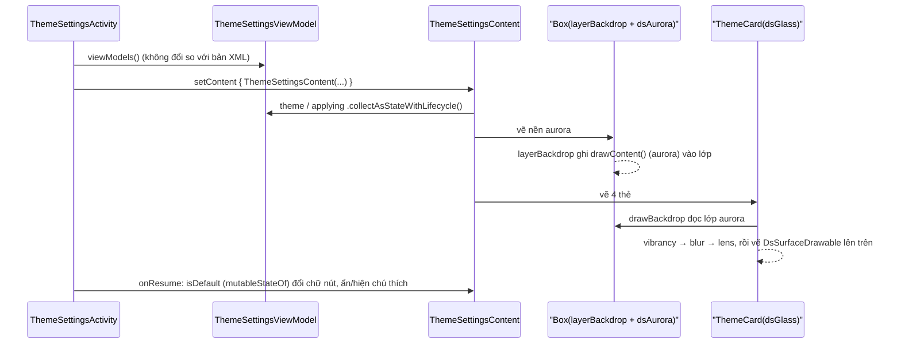
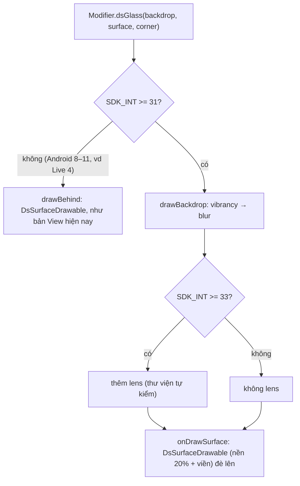

# JC — Thử Compose + kính Backdrop: đọc trước khi review

**Plan:** [plans/JC-compose-pilot.md](../plans/JC-compose-pilot.md) (tiếng Anh, ngoại lệ đã ghi ở `AGENTS.md`)

## 1. Tóm tắt

Pilot trả lời câu hỏi: có nên viết lại tầng UI bằng Jetpack Compose (giữ `data`/`domain`/ViewModel, gọi là "hướng B") và dùng thư viện kính Backdrop của Kyant0 thay `liquidglass` QWEA0 hay không.

Đã làm: nâng Kotlin lên 2.4.10, thêm Compose và Backdrop; chuyển màn 1.1 "Màn hình chính mặc định" sang Compose (bản phát hành được); dựng một probe Home Compose chỉ có ở bản debug; đo trên **Samsung SM-A176B, Android 16** (máy của chủ dự án, không phải Live 4 hay Oppo).

**Kết luận: đi tiếp có điều kiện** (mục 6). Mọi ngưỡng đo được trên Samsung đều đạt, nhưng chưa có số trên Live 4 (máy yếu, Android 11, chỉ có đường dự phòng không kính) và Oppo, và còn ba rủi ro cần xử lý trước khi viết Home Compose.

## 2. Kiến thức nền

- **Compose** (đọc tài liệu): UI viết bằng hàm Kotlin `@Composable` thay vì layout XML. Trạng thái đổi thì Compose tự gọi lại hàm để vẽ lại phần bị ảnh hưởng ("recomposition"). Trong dự án này Compose chạy song song với View: một Activity gọi `setContent { ... }` thay cho `setContentView(binding.root)`.
- **`AndroidView`** (đọc tài liệu): cách nhúng một View cũ vào cây Compose. Màn 1.1 nhúng `DsNavBar`, `DsButton`, `DsBadgeView`, `TextClock` như vậy để giữ đúng hình kính DS3 đã kiểm.
- **Backdrop** (đọc mã nguồn thư viện, `io.github.kyant0:backdrop:2.0.1`): kính chỉ dành cho Compose, gồm hai nửa:
  - `Modifier.layerBackdrop(backdrop)` đặt lên vùng làm nền: ghi phần vẽ của vùng đó vào một lớp đồ họa.
  - `Modifier.drawBackdrop(backdrop, shape, effects)` đặt lên bề mặt kính: đọc lớp đó, áp hiệu ứng (`vibrancy`, `blur`, `lens`) rồi vẽ lại trong khung bo.
  - `blur` chỉ chạy từ API 31, `lens` (khúc xạ mép) từ API 33; thư viện tự bỏ qua dưới mức đó. Dưới API 31, `drawBackdrop` vẫn vẽ lại nền nhưng **không** hiệu ứng nào, nên dự án tự rẽ sang `DsSurfaceDrawable` (đo được: máy Samsung API 36 có kính thật; đường dưới API 31 chưa chạy trên máy nào).
  - Kính chỉ khúc xạ được thứ nằm **trong cùng cây Compose**. Đây là lý do chính của hướng B: muốn dock, thư mục, search pill ở Home có kính Backdrop thì cả màn Home phải là Compose.

## 3. Luồng hoạt động

### 3.1 Màn 1.1 vẽ kính thế nào

`layerBackdrop` ghi phần vẽ nằm **sau** nó trong chuỗi modifier. Viết `.dsAurora().layerBackdrop(...)` thì lớp ghi rỗng và kính không có gì để vẽ (lỗi thật đã gặp, mục 7). Probe Home dùng cùng cấu trúc: lớp ghi chứa ảnh nền và lưới icon, dock và pill nằm ngoài lớp và đọc nó.

### 3.2 Chọn kiểu kính theo API

Lớp bề mặt luôn là `DsSurfaceDrawable`, nên kính vẫn theo thanh "Bo góc"/"Độ bóng" của Cài đặt kính và nhìn đúng DS3. Bán kính bo lấy từ `DsCorners.radiusPx` theo cỡ đo được.

## 4. Thay đổi theo file

| File | Vai trò | Vì sao thêm/sửa | Đọc trước? |
|---|---|---|---|
| `build.gradle.kts`, `app/build.gradle.kts`, `gradle/libs.versions.toml` | Build | KGP 2.4.10 (Backdrop build bằng Kotlin 2.4.10), plugin Compose, Compose BOM `2026.09.00`, Backdrop 2.0.1 | Có |
| `core/glass/compose/DsGlass.kt` | Bề mặt kính Compose dùng chung | Rẽ nhánh theo API; bán kính để trong state cho lambda đọc lúc vẽ | **Có** |
| `core/designsystem/compose/DsText.kt` | Kiểu chữ DS cho Compose | Họ font đủ 4 độ đậm; không `lineHeight` cho khớp màn XML | Có |
| `core/designsystem/compose/DsViews.kt` | Nhúng `DsNavBar`, `DsButton`, `DsBadgeView` | Giữ đúng hình DS3 tới plan JD | Không |
| `core/designsystem/compose/DsAuroraBackground.kt` | Nền aurora trong cây Compose | Backdrop chỉ thấy thứ vẽ trong lớp ghi | Không |
| `ui/settings/ThemeSettingsContent.kt` | Giao diện màn 1.1 + `ThemeCard` | Thẻ viết lại bằng Compose vì `drawBackdrop` không áp lên `AndroidView` | **Có** |
| `ui/settings/ThemeSettingsActivity.kt` | Activity màn 1.1 | `setContent` thay ViewBinding; hành vi giữ nguyên | Có |
| `src/debug/.../ComposeHomeProbeActivity.kt`, `src/debug/AndroidManifest.xml` | Probe Home (chỉ debug) | Đo kính trên ảnh nền và lưới/pager Compose | Không |

## 5. Số đo (đo được, Samsung SM-A176B, Android 16, 2026-11-19)

Máy đặt cỡ chữ 0,9 và bật "Chữ đậm". Launcher mặc định trong lúc đo là One UI (Home của OS26 mở thẳng bằng `am start`).

| Chỉ số | XML / Home thật | Compose / probe | Ngưỡng Q2 | Đạt? |
|---|---|---|---|---|
| APK release (chưa ký) | 7 344 641 B | 8 015 762 B (+671 121 B ≈ +655 KiB) | ≤ +2 MB | Đạt |
| Method / class trong dex | 18 998 / 2 911 | 25 520 / 4 150 (+6 522 / +1 239) | (ghi lại) | — |
| Mở 1.1 lần đầu, vừa cài, trung vị 10 lượt | 138 ms | 272 ms (+134) | ≤ +100 ms (đo trên Live 4) | **Không** |
| Mở 1.1 lần đầu, sau `speed-profile` | 127,5 ms | 170,5 ms (+43) | ≤ +100 ms | Đạt |
| Mở 1.1 lần thứ hai, vừa cài | 113,5 ms | 140,5 ms (+27) | (ghi lại) | — |
| Mở 1.1 lần thứ hai, sau `speed-profile` | 113 ms | 112,5 ms | (ghi lại) | — |
| Cuộn 1.1, Janky | — | — | ≤ +5 điểm % (đo trên Oppo) | Không đo được: nội dung vừa màn, không cuộn |
| Lật trang 20 lần, Janky (3 lượt, bản debug) | 4,46 / 4,78 / 4,92 % | 3,14 / 4,77 / 4,83 % | ≤ +5 điểm % | Đạt |
| Lật trang, 95th percentile | 34 ms | 53–77 ms | (ghi lại) | Đuôi kém hơn |
| Nhìn so với bản XML | — | Khớp (lệch ~3 px); khi bật "Chữ đậm" chữ thường bên Compose đậm hơn | Không khác | Đạt, có ghi chú |
| Bản release R8 | — | Màn 1.1 mở được, trạng thái "chưa mặc định" đúng, không crash | Chạy | Đạt |
| Probe có trong release | — | 0 file dex | Không có | Đạt |

**Đo bổ sung trên Oppo PKD130 (dòng A3x, Android 14, 720×1604, máy yếu), JD Task 1, 2026-11-19** (chủ dự án không có Live 4):

| Chỉ số | XML / Home thật | Compose / probe | Ngưỡng | Đạt? |
|---|---|---|---|---|
| Mở 1.1 lần đầu, vừa cài | 229,5 ms | 473 ms (+243,5) | — | Gấp đôi tới khi có profile |
| Mở 1.1 lần đầu, sau `speed-profile` | 218,5 ms | 265,5 ms (+47) | ≤ +100 ms | Đạt |
| Mở 1.1 lần thứ hai, vừa cài / sau profile | 171,5 / 162 ms | 221,5 / 179 ms | (ghi lại) | — |
| Lật trang 20 lần, Janky (3 lượt, debug) | 24,5–31,0 % | 12,1–19,0 % | ≤ +5 điểm % | Đạt (probe tốt hơn) |
| Cuộn 1.1, Janky | không so được (layout vừa màn, không cuộn) | 1,73 % | ≤ +5 điểm % | — |

Đường không kính (API < 31) vẫn chưa chạy trên máy thật nào; JD Task 8 xem bằng máy ảo API 30.

Ghi chú cách đo:
- "Mở lần đầu" = `force-stop`, mở trang chủ Cài đặt (tiến trình mới), chạm mục 1.1, đọc dòng `Displayed ...ThemeSettingsActivity` của `logcat`. "Lần thứ hai" = back rồi chạm lại trong cùng tiến trình.
- Lật trang so hai thứ không hoàn toàn cùng điều kiện: Home thật là bản debug View có widget đồng hồ/thời tiết và kính QWEA0; probe là bản **debug** Compose (Compose ở bản debug chạy chậm hơn nhiều so với release) và không có widget. Số này cho biết thứ tự độ lớn, chưa phải phép so chính xác.
- Đo khi đang kéo icon bằng `input motionevent`: 74% Janky, **không dùng được** (mỗi lệnh là một tiến trình, sự kiện chạm chỉ ~10 lần/giây). Cần kéo bằng tay thật.

## 6. Kết luận cho hướng B: đi tiếp có điều kiện

**Vì sao đi tiếp:**
- Bộ build AGP 9.3.3 + KGP 2.4.10 + KSP 2.3.11 + Hilt 2.60.1 chạy ổn (U1).
- Compose dựng lại được màn DS3 gần như từng pixel, dùng lại ViewModel và repository không sửa dòng nào (U2, D8).
- Chi phí dung lượng nhỏ (+655 KiB) và chi phí mở màn khi đã có profile chấp nhận được (+43 ms) (U3).
- Kính Backdrop trên ảnh nền thật đẹp hơn rõ so với bề mặt tĩnh; lưới 3 trang + 2 lớp kính trong bản debug vẫn lật trang ngang Home View (U4, trên Samsung).

**Điều kiện trước khi viết plan JH (Home Compose):**
1. **Đo trên Live 4 và Oppo.** Ngưỡng mở màn của Q2 đặt cho Live 4; máy đó yếu hơn nhiều và chỉ có đường dự phòng. Đo lại bảng ở mục 5 trên cả hai máy, cùng các mục kiểm tay còn mở của Task 2 và Task 3.
2. **Profile cho Compose.** Lần mở đầu ngay sau khi cài chậm gấp đôi (+134 ms) cho tới khi có `speed-profile`. Plan JD phải có việc tạo baseline profile cho các màn Compose (Macrobenchmark hoặc viết tay như `baseline-prof.txt` hiện có) và đo lại lúc "vừa cài".
3. **Đuôi khung hình chậm của lưới.** 95th percentile của probe 53–77 ms so với 34 ms. Plan JH đo lại bằng bản release và kéo tay thật trước khi khóa thiết kế lưới.
4. Q5 vẫn mở: Android 8–11 không có kính thật với Backdrop, còn QWEA0 hiện cho các máy đó blur CPU. Cần chủ dự án chốt trước JH.

**Ước lượng lại:** JD 1,5–2,5 tuần (thêm việc baseline profile), JH 6–8 tuần, JS 3–4 tuần, JX 1 tuần. Tổng **12–17 tuần → 13–18 tuần**.

## 7. Chỗ cần soi khi review

- `DsGlass.kt`: hai lambda `shape`/`effects` phải **đọc** state lúc vẽ. Node của Backdrop giữ lambda của lần dựng đầu; lambda bắt sẵn bán kính 0 làm kính góc vuông (đo được).
- `ThemeSettingsContent.kt` và probe: `layerBackdrop` phải đứng trước phần vẽ nền trong chuỗi modifier (đo được: đảo thứ tự thì kính không vẽ gì, kể cả khi tăng sáng 50%).
- `DsText.kt`: cố ý không đặt `lineHeight`. Màn XML thực tế dùng khoảng dòng tự nhiên của font (51 px/dòng phụ đề) chứ không phải 17sp của `ds_type.xml`.
- Khi bật "Chữ đậm" của hệ thống, Compose làm đậm mọi chữ, màn XML chỉ làm đậm chữ semibold. Chưa sửa; quyết ở plan JD theo hướng nào đúng với người dùng.
- Không có test tự động (quy ước dự án); mọi kết luận ở mục 5 là đo tay trên một máy.

## 8. Cách kiểm lại

- Màn 1.1: Cài đặt → "Màn hình chính mặc định".
- Probe (bản debug): `adb shell am start -n gambi.global.os26launcher/gambi.global.os26launcher.debug.ComposeHomeProbeActivity`.
- Lật trang: `adb shell dumpsys gfxinfo gambi.global.os26launcher reset`, vuốt 20 lần, rồi `adb shell dumpsys gfxinfo gambi.global.os26launcher`.
- Mở màn bản release: ký theo `knowledgements/RB-release-build.md` mục 7, rồi `adb shell cmd package compile -m speed-profile -f gambi.global.os26launcher` trước khi đo lượt "sau profile".
- Kiểm thử trên máy có cài launcher khác: app `com.babydola.launcherios` bật hộp thoại quảng cáo "Uninstall successfully! OS26 Launcher" mỗi lần cài đè; app mình không bị gỡ.
- `uiautomator dump` liệt kê cả chữ của các trang pager đang dựng sẵn ngoài màn; muốn biết trang đang hiện thì dùng ảnh chụp.

## 9. Bài học (chép vào `lessons/glass.md` và `lessons/design-system.md` khi chốt plan)

- Backdrop: `layerBackdrop` ghi `drawContent()`, nên nền phải đứng sau nó trong chuỗi modifier (2026-11-19, đo được).
- Backdrop: lambda truyền cho `drawBackdrop` bị giữ từ lần dựng đầu; giá trị đổi theo cỡ phải để trong state và đọc trong lambda (2026-11-19, đo được).
- Backdrop: shape phải là `CornerBasedShape`, `lens` ném lỗi với shape khác; độ cao khúc xạ ≤ bán kính góc (2026-11-19, đọc mã nguồn).
- Muốn chứng minh kính thật sự vẽ trên nền mượt: tạm thêm `colorControls(brightness = 0.5f)` (2026-11-19, đo được).
- `lineHeight` của `ds_type.xml` không có tác dụng trên các màn XML hiện tại (2026-11-19, đo được); cần xem lại ở plan JD.
- Compose ngay sau khi cài chậm hơn nhiều ở lần mở đầu cho tới khi có profile; đo luôn cả hai lượt "vừa cài" và "sau `speed-profile`" (2026-11-19, đo được).
