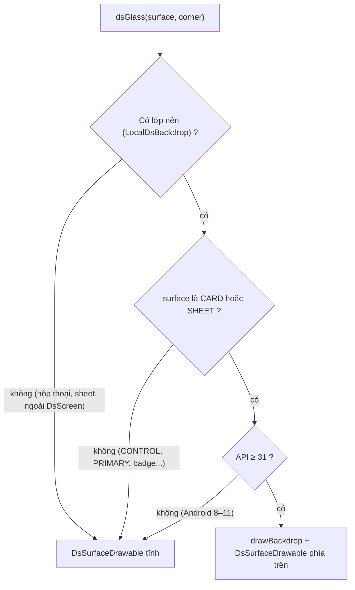
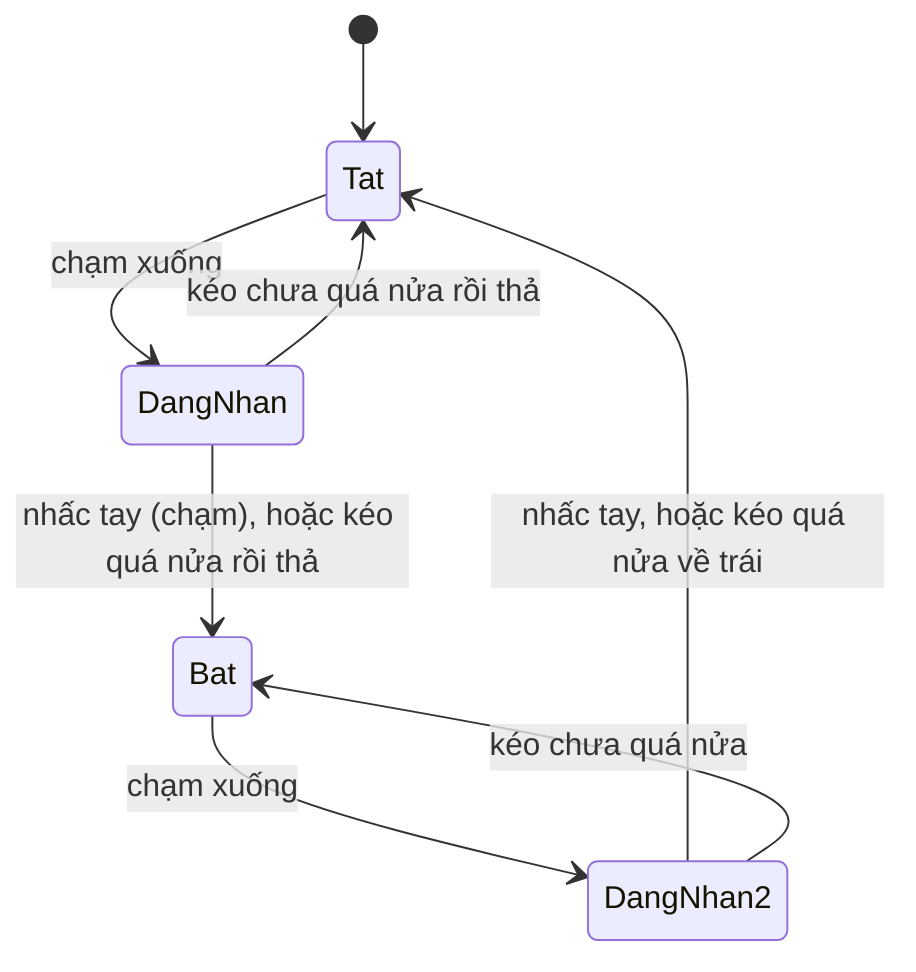

# JD — Design system bằng Compose: đọc trước khi review

**Plan:** [plans/JD-compose-design-system.md](../plans/JD-compose-design-system.md) (tiếng Anh, ngoại lệ ở `AGENTS.md`)

## 1. Tóm tắt

Bước 2 của hướng B (viết lại tầng UI bằng Compose). JD làm ba việc:

1. **Cửa đo (Task 1):** đo lại JC trên máy yếu thật của chủ dự án (Oppo PKD130, Android 14, 720p; chủ dự án không có Live 4). Qua cửa: màn 1.1 Compose mở chậm hơn XML 47 ms sau khi có profile (ngưỡng 100 ms).
2. **Bộ thành phần Compose (Task 2–7):** đủ các thành phần DS3 mà các plan sau cần, đặt trong `core/designsystem/compose/` và `core/glass/compose/`, cạnh bộ View cũ (bộ View giữ tới plan JX).
3. **Đổi giao diện kiểu iOS (F1–F7, chủ dự án duyệt):** không còn giữ y hệt bản XML. Màn 1.1 là màn đầu tiên dùng toàn bộ (Task 9).

Kiểm trên Oppo bằng adb, do Claude chạy theo yêu cầu của chủ dự án. Chưa kiểm: đường không kính Android 8–11 (không có máy), chữ lớn nhất + chữ đậm, TalkBack thật, xoay màn.

## 2. Kiến thức nền

- **CompositionLocal** (đọc tài liệu): giá trị "phủ xuống" mọi composable con mà không phải truyền qua tham số. JD dùng `LocalDsBackdrop` để mọi `dsGlass` trong màn tự lấy lớp nền của màn.
- **Modifier chain** (đọc tài liệu): thứ tự modifier là thứ tự vẽ/đo. Hai bẫy đã gặp đều là thứ tự: `layerBackdrop` phải đứng trước phần vẽ nền (JC), và hiệu ứng nhấn chia hai modifier vì "co cả phần tử" phải đứng đầu còn "phủ lớp nhấn" phải đứng sau phần cắt góc (Task 3).
- **Touch slop** (đọc tài liệu): quãng ngón tay phải đi trước khi hệ thống coi là kéo. Dưới ngưỡng đó là chạm. Thanh trượt bản đầu bỏ qua ngưỡng này nên cuộn dọc cũng đổi giá trị (mục 7).
- **Hai bộ DS song song:** `DsButton` (View) và `compose.DsButton` (Compose) cùng tên nhưng khác package. File nào cần cả hai thì import một cái bằng bí danh.

## 3. Luồng hoạt động

### 3.1 Một màn Compose dựng trên DS

```mermaid
sequenceDiagram
    participant A as "Activity (setContent)"
    participant S as DsScreen
    participant L as "Box(layerBackdrop + dsAurora)"
    participant N as DsNavBar
    participant C as "Thành phần (DsButton, DsCardGroup...)"
    participant G as "Modifier.dsGlass"
    participant E as GlassEnvironment
    A->>S: DsScreen(title, onBack) { ... }
    S->>L: vẽ aurora, ghi làm lớp backdrop
    S->>S: CompositionLocalProvider(LocalDsBackdrop provides lớp)
    S->>N: thanh nav (khi có title/onBack)
    S->>C: nội dung màn
    C->>G: dsGlass(surface, corner)
    G->>E: rememberGlassLook() nghe thay đổi thông số kính
    G-->>G: CARD/SHEET + API ≥ 31: drawBackdrop (vibrancy, blur, lens, viền sáng); còn lại: DsSurfaceDrawable tĩnh
```

Màn chỉ cần gọi `DsScreen`; thứ tự `layerBackdrop` → `dsAurora`, inset, thanh nav đều do khung lo. Thành phần không phải nhận tham số nền.

### 3.2 Bề mặt nào được kính thật (D9)



### 3.3 Công tắc (F3)



Khi đang nhấn/kéo, núm giãn rộng 6 dp như iOS. Chỉ báo `onCheckedChange` khi trạng thái thật sự đổi.

## 4. Thay đổi theo file

| File | Vai trò | Vì sao thêm/sửa | Đọc trước? |
|---|---|---|---|
| `core/glass/compose/DsGlass.kt` | Bề mặt kính | Theo `GlassLook`, viền sáng F1, `LocalDsBackdrop`, chỉ CARD/SHEET có kính thật (D9) | **Có** |
| `core/glass/compose/GlassLookState.kt` | `rememberGlassLook()` | Kính đổi ngay khi kéo thanh trong Cài đặt kính | Có |
| `core/glass/GlassTuning.kt` | Quy đổi thông số | `backdropBlurDp/LensDp/HighlightAlpha/HighlightWidthScale`; ở mặc định ra đúng số JC | Có |
| `core/designsystem/compose/DsScreen.kt` | Khung màn | Lo thứ tự lớp nền, inset, thanh nav | **Có** |
| `.../compose/DsText.kt` | 11 kiểu chữ | F7: line height Figma; đủ 4 độ đậm cho "Chữ đậm" | Có |
| `.../compose/DsPress.kt` | Nhấn kiểu iOS | F2, tách `dsPressable` + `dsPressHighlight` | Có |
| `.../compose/DsButton.kt`, `DsSmall.kt` | Nút, chip, badge, ô icon | Bản Compose của DS3 | Không |
| `.../compose/DsNavBar.kt`, `DsSearchField.kt` | Thanh nav, ô tìm | Bản Compose của DS3 | Không |
| `.../compose/DsRow.kt` | Hàng, card nhóm, công tắc | F3; `DsCardGroup` kiểu `LazyColumn` (`row(...)`, `item {}`) | Có |
| `.../compose/DsSegmented.kt`, `DsSlider.kt` | Segmented, thanh trượt | F4; thanh trượt chỉ kéo khi đi ngang | Có |
| `.../compose/DsDialogs.kt` | Hộp thoại, sheet | F5, F6; không kính thật (cửa sổ riêng) | Có |
| `.../compose/DsViews.kt` | (đã xóa) | Không còn ai dùng `AndroidView` bọc view DS | — |
| `ui/settings/ThemeSettingsContent.kt` | Màn 1.1 | Chuyển hẳn sang DS Compose | Không |
| `src/debug/.../DsComposeCatalogActivity.kt` | Catalog debug | Kiểm từng thành phần; cờ `--ez noGlass true` để đo | Không |
| `app/src/main/baseline-prof.txt` | Profile | Thêm `com/kyant/**` | Không |

## 5. Quyết định và đánh đổi

- **F1–F7 (chủ dự án duyệt):** đổi giao diện theo iOS thay vì giữ y bản XML. Hệ quả: trong thời gian chạy song song, màn Compose và màn XML nhìn khác nhau (chữ gọn hơn, có viền sáng, nhấn có co).
- **D9 — kính thật chỉ cho CARD/SHEET** (chủ dự án chốt sau khi đo, đo được trên Oppo, catalog cuộn 20 lần, bản debug):

| Cấu hình | Janky | 50th | 90th |
|---|---|---|---|
| ~15 bề mặt kính thật | 37–40 % | 36 ms | 44–46 ms |
| Tắt lens | 29 % | 32 ms | 40 ms |
| Kính thật chỉ cho card | **10 %** | 22 ms | 28 ms |
| Tắt hẳn kính | 7,8 % | 17 ms | 24 ms |
| Catalog View (so sánh) | 40 % | 15 ms | 28 ms |

  Chi phí nằm ở số bề mặt cùng lấy mẫu nền mỗi khung, không phải ở Compose. Đánh đổi: nút phụ, chip, segmented, ô tìm, nút back là bề mặt tĩnh (trên control nhỏ kính vốn khó thấy). Xem lại nếu máy mạnh cần kính khắp nơi: có sẵn `GlassTierResolver` để phân tầng.
- **Hộp thoại/sheet không kính thật:** cửa sổ riêng nên toạ độ lớp nền không khớp; nền `SHEET` đặc ~94%.
- **Thanh trượt giữ giao diện DS3:** không có mục F nào cho nó.

## 6. Chỗ cần soi khi review

- `DsGlass.kt`: mọi giá trị đổi theo thời gian phải được ĐỌC trong lambda của `drawBackdrop` (bán kính, thông số kính), không bắt sẵn.
- `DsSlider.kt`: hai `pointerInput` — kéo chỉ sau ngưỡng ngang, chạm nhảy khi nhấc tay. Đừng gộp lại thành "đặt giá trị khi chạm xuống".
- `DsDialogs.kt`: độ mờ cửa sổ đi theo hoạt ảnh bằng `snapshotFlow`; `SideEffect` không theo dõi state.
- `DsRow.kt`: đường kẻ đáy cộng lại đệm đầu hàng (vị trí khối chữ đo bên trong phần đệm).
- Không có test tự động; số đo ở mục 5 và plan là đo tay trên một máy (Oppo).

## 7. Lỗi tìm được khi kiểm trên máy (đều đã sửa)

| Lỗi | Nguyên nhân | Sửa |
|---|---|---|
| Thanh trượt đổi giá trị khi vuốt dọc để cuộn (52 → 16) | Đặt giá trị ngay lúc chạm xuống | Kéo chỉ sau touch slop ngang; chạm nhảy khi nhấc tay |
| Hộp thoại không có lớp mờ nền | `SideEffect` đọc hoạt ảnh một lần ở 0 | `snapshotFlow { progress }` → `setDimAmount` |
| Đường kẻ hàng bắt đầu sớm 12 px | Vị trí chữ đo trong phần đệm, lớp vẽ đứng trước đệm | Cộng lại đệm đầu hàng |
| Hai thao tác test sai (không phải lỗi app) | `input tap` song song gộp thành một cú chạm; DOWN→UP không có MOVE bị tính là chạm | Gửi lệnh nối tiếp, có MOVE ở giữa |

## 8. Cách kiểm lại

- Catalog: `adb shell am start -n gambi.global.os26launcher/gambi.global.os26launcher.debug.DsComposeCatalogActivity` (thêm `--ez noGlass true` để tắt kính thật khi đo).
- Catalog View để so: `adb shell am start -n gambi.global.os26launcher/gambi.global.os26launcher.debug.DsCatalogActivity`.
- Màn 1.1: Cài đặt → "Màn hình chính mặc định".
- Đo cuộn: `adb shell dumpsys gfxinfo gambi.global.os26launcher reset`, vuốt lên/xuống 20 lần, rồi `dumpsys gfxinfo`.
- Trên Oppo: chợ ứng dụng (`com.heytap.market`) bật màn "gợi ý cài đặt" sau mỗi `adb install`; màn hình tự khóa nhanh, cần chủ dự án mở khóa.

## 9. Bài học (đã chép vào `lessons/design-system.md`, `lessons/glass.md`)

- Số bề mặt kính thật trên một màn là chi phí chính trên máy yếu; mặc định chỉ card/sheet có kính thật (2026-11-19, đo được).
- Thành phần nhận kéo trong vùng cuộn phải chờ touch slop đúng hướng trước khi đổi giá trị (2026-11-19, đo được).
- `SideEffect` không theo dõi state; muốn đẩy giá trị hoạt ảnh ra API ngoài Compose thì dùng `snapshotFlow` trong `LaunchedEffect` (2026-11-19, đo được).
- Gọi hàm mở rộng (`composed`, `colorControls`...) bằng tên đầy đủ không biên dịch; phải import (2026-11-19, lỗi biên dịch).
- Test cử chỉ bằng `adb input`: lệnh chạy song song gộp sự kiện; DOWN→UP ở chỗ khác không MOVE được tính là chạm; `screencap` (~250 ms) không bắt được hoạt ảnh ngắn (2026-11-19, đo được).
