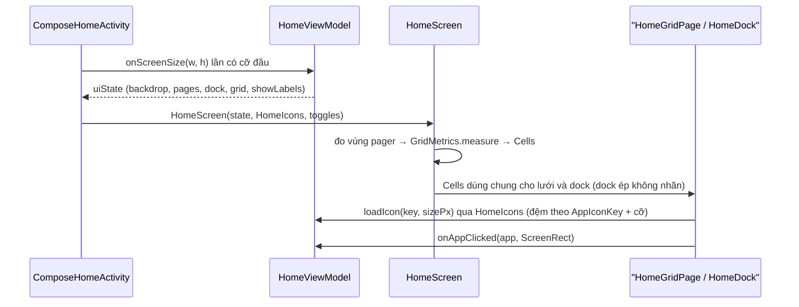

# JH1 — Home Compose tĩnh: đọc trước khi review

**Plan:** [plans/JH1-compose-home-static.md](../plans/JH1-compose-home-static.md) (tiếng Anh, ngoại lệ ở `AGENTS.md`)

## 1. Tóm tắt

Bước 3a của hướng B. JH1 làm hai việc:

1. **Khóa luật bố cục bằng test (Task 1):** 101 unit test JVM cho 11 planner trong `domain/layout/` và `GridMetrics`. Đây là test "đặc tả hiện trạng": ghi lại kết quả hôm nay để JH2 (kéo-thả trong Compose) không vô tình đổi luật. Chủ dự án cho phép ngoại lệ này ngày 2026-11-19.
2. **Vẽ Home thật bằng Compose (Task 2–6):** ảnh nền, các trang lưới (app, thư mục, widget tự vẽ, widget app dạng thẻ rỗng), pill tìm kiếm/chấm trang, dock kính thật. Dữ liệu là `HomeViewModel` thật. Chạy trong `debug.ComposeHomeActivity`, song song Home View; Home View không đổi một dòng nào.

Kết quả (bản release, profile): trên Oppo Compose Home lướt mượt hơn Home View (janky 0,5–1,2 % so với 1,0–1,7 %; p90 12–13 ms so với 18–20 ms); trên Samsung kém hơn một chút (janky 4,7–5,0 % so với 4,1–4,6 %; p90 31–32 ms so với 25–28 ms). Mở nguội Compose ngang hoặc nhanh hơn trên cả hai máy. Hình học trùng Home View sau hai lần sửa.

Chưa kiểm: widget và thư mục trên màn (bố cục của chủ dự án không có), lưới 5 × 6 / tắt nhãn trên máy, cỡ chữ 1,3, đổi ảnh nền lúc Home khuất, API < 31, TalkBack.

## 2. Kiến thức nền

- **Characterization test** (test đặc tả hiện trạng): chạy code hiện tại, ghi kết quả làm đáp án. Không phán đúng sai. Kết quả lạ được ghi chú `// characterization:` trong test, không sửa code (plan D3).
- **`Layout` tùy biến** (đọc tài liệu): nhận danh sách con, tự đo (`measure` với `Constraints.fixed`) và tự đặt (`place`). `HomeGridPage` dùng nó để đặt mỗi item đúng ô như `IconGridView.onLayout`.
- **`weight` trong `Column`** (đo được ở JH1): chia phần còn lại sau các con không trọng số; `padding` gắn sau `weight` nằm trong phần được chia, khác `layout_margin` của `LinearLayout`.

## 3. Luồng hoạt động

Kính: lớp `layerBackdrop` chỉ là ảnh nền. Dock và thẻ widget (CARD) đọc lớp này; thư mục, pill, thẻ widget app vẽ màu phẳng như mặc định của Home View (JD D9).

## 4. Hai chỗ lệch đã sửa (Task 5)

| Lệch | Nguyên nhân | Sửa |
|---|---|---|
| Lưới cao hơn 33 px | Home View chừa đỉnh = max(thanh trạng thái, chỗ pill edit mode) để lưới không nhảy khi vào edit mode | Cùng công thức trong `HomeScreen` |
| Pill thấp 14 px, kính dock thấp 12 px | Lề đáy 8 dp của dock nằm trong phần trọng số | Lề đáy là `Spacer` riêng ngoài trọng số |

Thêm: `enableEdgeToEdge()` vẽ lớp xám sau thanh điều hướng 3 nút; tắt contrast như `SystemBarsController`.

## 5. Số đo (Oppo PKD130, release ký khóa debug, `speed-profile`)

| | Home View | Home Compose |
|---|---|---|
| Janky, 20 lần vuốt | 1,74 % · 1,03 % | 1,17 % · 0,52 % · 1,05 % |
| p90 / p99 | 20/30 · 18/26 ms | 13/22 · 12/18 · 13/20 ms |
| Mở nguội `TotalTime`, 5 lần | 1000 · 985 · 646 · 650 · 628 ms | 676 · 741 · 637 · 784 · 620 ms |
| Đứng yên 5 s | — | 0 khung |

**Samsung SM-A176B (Android 16), cùng cách đo:**

| | Home View | Home Compose |
|---|---|---|
| Janky, 20 lần vuốt | 4,62 % · 4,14 % · 4,58 % | 4,70 % · 4,67 % · 4,95 % |
| p90 / p99 | 25/57 · 26/46 · 28/42 ms | 31/65 · 32/65 · 32/65 ms |
| Mở nguội `TotalTime`, 5 lần | 421 · 371 · 343 · 413 · 340 ms | 332 · 322 · 288 · 332 · 325 ms |

Trên Samsung Compose lướt kém hơn Home View một chút (p90 +5 ms), ngược với Oppo. Compose vẽ ~750 khung mỗi lượt so với ~560 của View (hoạt ảnh dừng trang của pager mặc định dài hơn): JH2 chỉnh fling/snap như `TunedPagerSnapHelper` rồi đo lại cả hai máy.

Lần 3 của Home View bị hộp thoại "Đặt làm màn hình chính" che (0 khung), bỏ. Số janky ở đây thấp hơn nhiều so với JD Task 1 (24,5–31 %) vì cách đo khác: chỉ so trong cùng một lượt đo.

Để đo, `ComposeHomeActivity` được chép tạm sang `src/release` rồi gỡ (không commit).

## 6. Test tìm ra gì (Task 1)

Không có test nào phải sửa code. Bốn hành vi lạ ghi lại để JH2 cân nhắc, chưa sửa:

- `GridRemovePlanner`: icon có `x >= columns` không bị bỏ qua mà đọc như ô của hàng sau.
- `GridReflowPlanner`: không có trang nào vẫn trả `totalPages = 1`.
- `FolderPlanner`: container `0` không được nhận làm nguồn.
- `AppWidgetSizePlanner`: áp ô đích theo từng trục kể cả khi trục kia là 0 (KDoc nói cả hai phải > 0).

## 7. Việc còn mở và lưu ý cho JH2

- Thứ tự dock trên Oppo đổi (Điện thoại ↔ Tin nhắn) trong lúc đo, chưa rõ nguyên nhân. Claude chỉ vuốt ngang ở y = 700 và bấm "Để sau". Chủ dự án xem lại; nếu tái hiện được thì là lỗi của Home View.
- Pager Compose dùng fling mặc định; Home View có `TunedPagerSnapHelper` và hiệu ứng lật trang (`PagerFlipAnimator`). Thuộc JH2, kèm đo lại Samsung (đang kém View p90 +5 ms).
- Huy hiệu thông báo trên icon (`NotificationBadgesController`) chưa có ở Compose: thuộc JH3.
- `ComposeHomeActivity` chỉ mở được bằng adb: `adb shell am start -n gambi.global.os26launcher/gambi.global.os26launcher.debug.ComposeHomeActivity`.
