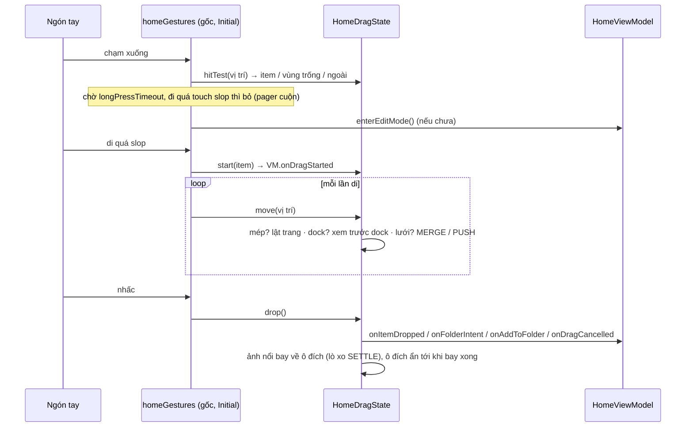

# JH2 — Home Compose: edit mode và kéo-thả — đọc trước khi review

**Plan:** [plans/JH2-compose-home-drag.md](../plans/JH2-compose-home-drag.md) (tiếng Anh, ngoại lệ ở `AGENTS.md`)

## 1. Tóm tắt

Bước 3b của hướng B. Home Compose (vẫn trong `debug.ComposeHomeActivity`) giờ sửa được bố cục:

- **Edit mode:** giữ icon hoặc vùng trống để vào; thoát bằng chạm vùng trống, nút Xong, Back, hoặc khi Activity dừng. Icon rung ±2°, có dấu "−" (app: hộp thoại gỡ có sẵn; widget: hỏi xác nhận). Thanh Cài đặt/Xong ở đỉnh, thanh trạng thái ẩn, pill chuyển sang chấm trang.
- **Kéo-thả:** app, thư mục, widget giữa các trang và dock. Icon nhấc lên phóng 1,1 kèm bóng (H4, kiểu iOS; View vẽ 1×, không bóng). Có xem trước đẩy-dồn (giữ 500 ms), gộp thư mục (giữ 100 ms ở vùng giữa), dock nhường chỗ, lật trang ở mép (24 dp, giữ 500 ms), trang tạm ở cuối.
- **Snap pager:** đường easeOutQuint 450 ms như `TunedPagerSnapHelper`.

Mọi việc ghi đi qua hàm sẵn có của `HomeViewModel` (`onItemDropped`, `onFolderIntent`, `onAddToFolder`, `onDragEdgeBeyondLastPage`...). Không đổi domain, data, Home View.

Kiểm trên Samsung SM-A176B: mọi luồng chính đạt. Dữ liệu app trên máy được sao lưu trước và khôi phục khớp từng byte sau khi thử.

## 2. Kiến thức nền

- **`PointerEventPass.Initial`** (đọc tài liệu): sự kiện chạm đi qua cây ba lượt: Initial (từ cha xuống con), Main (từ con lên cha), Final. Cha đọc ở Initial thấy sự kiện TRƯỚC các con; tiêu thụ ở đó thì con (ô, pager) coi như sự kiện đã bị lấy. JH2 dùng cách này để giành cử chỉ khi đã bắt đầu kéo mà không phá cuộn và bấm thường.
- **Vì sao cử chỉ đặt ở gốc màn, không ở từng ô:** `HorizontalPager` gỡ khỏi composition các trang ở xa trang đang xem. `pointerInput` của ô nguồn bị huỷ giữa chừng khi lật mép hai trang. Home View gặp đúng vấn đề này và cho Activity giữ chạm (`HomeTouchRouter`, Task 7).
- **Characterization test của JH1:** xem trước dùng lại `GridInsertPlanner.plan` trên luồng chính như `IconGridView`, nên xem trước và kết quả ghi DB không thể lệch nhau.

## 3. Luồng hoạt động

## 4. Số đo (Samsung, bản release, profile, 20 lần vuốt × 3)

| | JH1 | JH2 (snap 450 ms) | Home View |
|---|---|---|---|
| Janky | 4,7–5,0 % | 3,7–4,0 % | 4,1–4,6 % |
| p90 / p99 | 31–32 / 65 ms | 31–32 / 73 ms | 25–28 / 42–57 ms |
| Khung mỗi lượt | ~750 | ~955 | ~560 |

Snap mới giảm tỉ lệ khung giật nhưng không giảm p90: mỗi khung vẫn tốn ~31 ms trên Samsung. Nghi phần kính thật (dock, thẻ widget) và vẽ trang; chuyển sang JH4 để profile khi đổi hẳn Home.

## 5. Lỗi gặp khi kiểm và đã sửa

| Lỗi | Nguyên nhân | Sửa |
|---|---|---|
| Icon dock lệch trái trong ô | `Box` mới bọc ô app thiếu căn giữa; ô không nhãn chỉ rộng bằng icon | `contentAlignment = TopCenter` |
| Dấu "−" chạy lên giữa đỉnh icon | Dấu là con của cùng `Box` đó nên cũng bị căn giữa | `Modifier.align(TopStart)` cho dấu |

## 6. Việc còn mở

- Một lần vuốt ngay sau khi thả vào trang tạm thì trang không chuyển; thử lại hai lần đều chạy. Gặp lại thì ghi cách tái hiện.
- Chưa kiểm: kéo bằng hai ngón (adb chỉ giả một ngón), rời trang tạm khi đang kéo (`onGhostPageLeft`).
- Menu nhấn giữ, mở thư mục, kéo app ra khỏi thư mục, bảng chọn widget, huy hiệu thông báo: JH3.
- Chi phí mỗi khung khi lướt trên Samsung: JH4.
