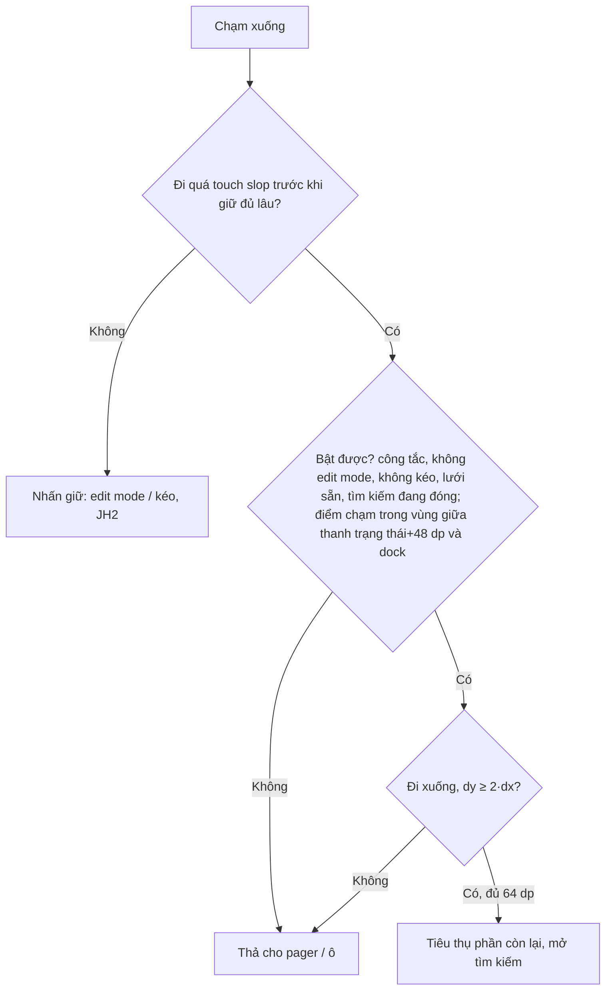

# JH3a — Home Compose: huy hiệu, hộp thoại, Back/Home, tìm kiếm — đọc trước khi review

**Plan:** [plans/JH3a-compose-home-wiring.md](../plans/JH3a-compose-home-wiring.md) (tiếng Anh, ngoại lệ ở `AGENTS.md`)

## 1. Tóm tắt

Bước 3c của hướng B. JH3 cũ quá lớn nên chia ba: JH3a (plan này: phần nối ở mức Activity), JH3b (menu nhấn giữ + thư mục), JH3c (Thư viện + widget).

JH3a làm Home Compose (`debug.ComposeHomeActivity`) giống Home View ở bốn chỗ:

- **Huy hiệu thông báo** trên icon, dock, thư mục (tổng). Cùng nguồn `HomeScreenConfig` + `NotificationBadgeRepository` với Home View; cách vẽ chép từ `IconCellView`.
- **Hộp thoại** hỏi đặt launcher mặc định (dùng lại `DefaultLauncherPromptController`, nên Activity đổi sang `AppCompatActivity`) và hỏi áp ảnh nền.
- **Back** theo thứ tự `HomeBackController`: tìm kiếm → edit mode → đóng màn (chỉ khi chưa là launcher mặc định). **Phím Home** đóng tìm kiếm, thoát edit mode (chỉ thử được khi Home Compose là launcher, JH4).
- **Tìm kiếm:** giữ nguyên `SearchOverlayView` + `SearchViewModel` của View (JH3a D1); mở bằng bấm pill hoặc vuốt xuống ≥ 64 dp.

Kiểm trên Samsung: các đường chính đạt; không ghi dữ liệu bố cục.

## 2. Kiến thức nền

- **`AndroidView` toàn màn và chạm** (đọc tài liệu): trong cây Compose, anh em nằm trên được hỏi trước; một `AndroidView` phủ cả màn có thể giữ chuỗi chạm dù View bên trong đang `GONE`. Lớp tìm kiếm vì vậy được thêm bằng `addContentView`, là View anh em phía trên `ComposeView`: View `GONE` không nhận chạm, Home Compose bên dưới nhận như thường.
- **`internal` lan theo chữ ký:** `NotificationBadges` là `internal`, nên mọi hàm Compose công khai nhận `NotificationBadges.State` phải `internal` theo (Kotlin báo "exposes its internal parameter type").
- **Back nhiều lớp với `BackHandler`:** cái đăng ký sau được hỏi trước (LIFO), giống `OnBackPressedDispatcher` mà `HomeBackController` dùng.

## 3. Luồng vuốt xuống mở tìm kiếm

## 4. Việc còn mở

- Chưa thấy thật: huy hiệu thư mục (không có thư mục chứa app có thông báo), xin quyền Danh bạ, tắt huy hiệu trong Cài đặt — cả hai việc sau đổi trạng thái máy của chủ dự án nên không tự làm.
- Phím Home: JH4.
