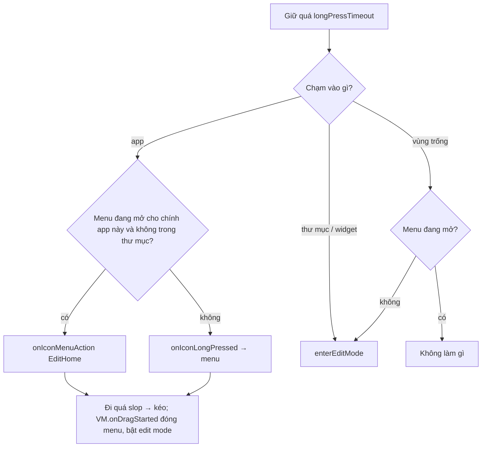

# JH3b — Home Compose: menu nhấn giữ và bảng thư mục — đọc trước khi review

**Plan:** [plans/JH3b-compose-home-menu-folder.md](../plans/JH3b-compose-home-menu-folder.md) (tiếng Anh, ngoại lệ ở `AGENTS.md`)

## 1. Tóm tắt

Bước 3d của hướng B. Home Compose (`debug.ComposeHomeActivity`) có thêm:

- **Menu nhấn giữ icon:** giữ một app (lưới, dock, trong thư mục) khi chưa ở edit mode → menu kính sáng với shortcut, Thông tin ứng dụng, Ẩn, Sửa màn hình chính (không có trong thư mục), Gỡ cài đặt (đỏ). Vị trí dùng lại `IconMenuPlacement.place` của View. Giữ tiếp rồi kéo → menu đóng, bắt đầu kéo (thay quyết định JH2 D1 "giữ = vào edit mode").
- **Bảng thư mục:** bấm thư mục → bảng kính sáng 3 × 3 phóng ra từ ô thư mục; tiêu đề sửa tại chỗ (lưu khi Xong, mất focus, đóng, rời app); bấm app → mở rồi đóng thư mục; edit mode có rung và dấu "−" (hỏi trước như View).
- **Kéo app ra khỏi thư mục:** rời khung bảng → thư mục đóng, kéo tiếp trên lưới; thả trong bảng → bay về.
- Home phía sau mờ (API 31+) và tối khi menu hoặc thư mục mở.

Không đổi `domain/`, `data/`, Home View. Kiểm trên Samsung: 5/5 điểm Review Focus đạt; dữ liệu app được sao lưu trước và khôi phục khớp từng byte.

## 2. Kiến thức nền

- **Thứ tự lớp trong `Box` của Compose:** con khai báo sau vẽ đè con trước. Menu của app trong thư mục phải khai báo SAU bảng thư mục, nếu không nó mở mà bị che (lỗi gặp khi kiểm).
- **Giữ composable để chạy hoạt ảnh đóng:** VM đặt `iconMenu = null` ngay; composable giữ bản cuối (`shown`) trong `remember`, chạy lò xo về 0 rồi mới bỏ. Bảng thư mục làm tương tự.
- **Một chủ cử chỉ:** nhấn giữ, kéo, vuốt xuống đều do `homeGestures` ở gốc quyết định. Menu và bảng thư mục chỉ đăng ký hình học (`HomeDragState.menuOwner`, `folderPanel`) để cử chỉ gốc biết đang chạm vào gì.

## 3. Luồng nhấn giữ (ngoài edit mode)

## 4. Lỗi gặp khi kiểm và đã sửa

| Lỗi | Nguyên nhân | Sửa |
|---|---|---|
| Bảng thư mục màu xanh đen đặc | Nền `DsSurface.SHEET` của DS tối, khác thư mục iOS / View | CARD + lớp `folder_panel_glass_tint` |
| Giữ app trong thư mục không thấy menu | Menu khai báo trước bảng thư mục nên bị che | Đổi thứ tự: bảng trước, menu sau |

## 5. Việc còn mở

- Kiểu chuyển cảnh thư mục khác SMOOTH (FADE/SLIDE/ZOOM/NONE trong Cài đặt): chưa làm.
- Home phía sau chỉ làm tối, không mờ, dưới API 31.
