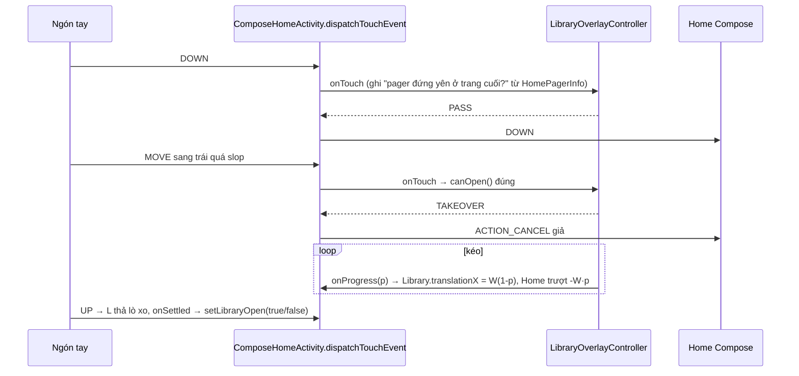

# JH3c — Home Compose: App Library và widget của app khác — đọc trước khi review

**Plan:** [plans/JH3c-compose-home-library.md](../plans/JH3c-compose-home-library.md) (tiếng Anh, ngoại lệ ở `AGENTS.md`)

## 1. Tóm tắt

Bước 3e của hướng B. Home Compose (`debug.ComposeHomeActivity`) có thêm:

- **App Library:** vuốt qua trang thật cuối → Thư viện trượt vào, Home trượt sang trái theo ngón tay. Hai kiểu (thư mục, A–Z), bảng nhóm, thanh tìm kiếm, nền ảnh nền mờ. Đóng bằng vuốt phải, Back, phím Home. Các View của Thư viện giữ nguyên (thêm bằng `addContentView`), cử chỉ dùng lại nguyên `LibraryOverlayController`.
- **Widget của app khác:** `AppWidgetHostView` thật trong khung kính như widget tự vẽ, thay thẻ trống của JH1.

JH3 cũ được chia tiếp: bảng chọn widget, luồng thêm widget và bảng thời tiết sang **JH3d**.

Kiểm trên Samsung: 5/5 điểm Review Focus đạt, không ghi dữ liệu bố cục.

## 2. Kiến thức nền

- **Cử chỉ ngoài Compose:** `Activity.dispatchTouchEvent` thấy mọi chạm trước cây View (cả `ComposeView`). `LibraryOverlayController` trả PASS (cho đi tiếp), TAKEOVER (gửi `ACTION_CANCEL` giả để Compose huỷ nhấn giữ/cuộn, rồi nuốt), CONSUME (nuốt). Giống `HomeTouchRouter` của View.
- **Đọc trạng thái Compose từ ngoài:** cử chỉ Thư viện cần biết "pager đứng yên ở trang cuối" lúc chạm xuống. `HomeScreen` ghi vào `HomePagerInfo` (đối tượng thường, cập nhật trong `SideEffect`); Activity đọc trực tiếp, không cần state.
- **Tiến độ đọc lúc vẽ:** `libraryProgress: () -> Float` đọc trong `graphicsLayer`, nên mỗi khung kéo chỉ vẽ lại, không dựng lại cây Compose.
- **View cũ tìm View theo id:** nền mờ và kính ô nhóm tìm `R.id.backdrop_image` bằng `rootView.findViewById`. Compose không có View này → thêm một `ImageView` ẩn cùng id, cùng ảnh nền.

## 3. Luồng mở Thư viện

## 4. Lỗi gặp khi kiểm và đã sửa

| Lỗi | Nguyên nhân | Sửa |
|---|---|---|
| Nền Thư viện xám phẳng, ô nhóm không kính | `blurredWallpaperScrim` và kính ô nhóm tìm `R.id.backdrop_image`, chỉ Home View có | `ImageView` ẩn cùng id trong `ComposeLibraryHost`, nhận `HomeUiState.backdrop` |

## 5. Việc còn mở

- JH3d: bảng chọn widget (bấm và kéo để thêm), luồng thêm widget app (bind, configure), bảng thời tiết.
- Thư viện vẫn là View (viết lại ở JS).
