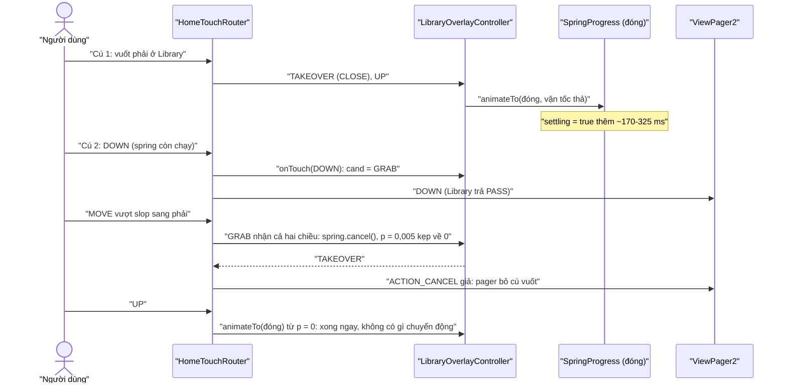
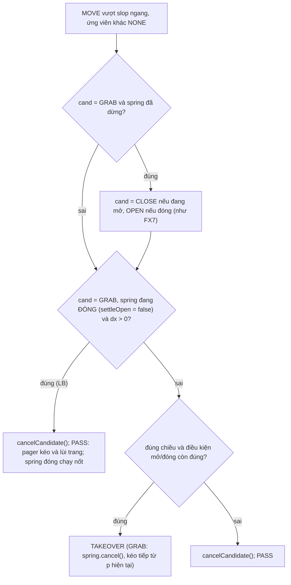

# LB — Vuốt ngược từ App Library về các trang Home: đọc trước khi review

**Plan:** [plans/LB-library-back-swipe.md](../plans/LB-library-back-swipe.md) · **PR:** #44 · **Nhánh:** `fix/lb-library-back-swipe`

## 1. Tóm tắt

Ở App Library, vuốt phải về trang cuối rồi vuốt phải nhanh tiếp thì cú vuốt thứ hai bị nuốt: ngón tay chạy mà trang không đi, cú thứ ba mới lùi trang. Nguyên nhân: cú thứ hai chạm xuống lúc spring đóng Library còn chạy, nên Library "bắt lấy" chính nó (cơ chế `GRAB` của FX7 vòng 4) dù Library đã gần như ra khỏi màn hình. Sửa: lúc spring đang **đóng**, cú vuốt **sang phải** không còn bị Library bắt, pager nhận nó và lùi một trang; spring đóng chạy nốt. Một file, 8 dòng mã.

## 2. Kiến thức nền

- **App Library là lớp phủ ngoài pager** (G2a D17): `LibraryOverlayController` giữ một tiến độ `p` (0 = đóng, 1 = mở); `AppLibraryController.applyLibraryProgress` dịch Library và cả lớp Home theo cùng `p`. Pager (`ViewPager2`) không biết gì về Library.
- **Thứ tự nhận chạm** (`HomeTouchRouter.dispatch`): mỗi sự kiện đi qua Library trước, rồi tìm kiếm, rồi mới xuống cây view (pager). Library trả `PASS` (không liên quan), `TAKEOVER` (vừa tiếp quản: router gửi một `ACTION_CANCEL` giả cho cây view, pager bỏ cử chỉ đó) hoặc `CONSUME`.
- **Slop** (`ViewConfiguration.scaledTouchSlop`): quãng ngón phải đi trước khi một view coi đó là kéo. Library quyết tiếp quản hay không đúng ở `MOVE` vượt slop; trước đó pager đã nhận `DOWN` và các `MOVE` nhỏ, nên nếu Library trả `PASS` thì pager kéo liền mạch, không mất gì.
- **Spring ngắt được (`GRAB`, FX7 vòng 4):** chạm xuống lúc spring mở/đóng còn chạy thành ứng viên `GRAB`; vượt slop thì dừng spring và kéo Library tiếp từ `p` hiện tại. Mục đích: đóng rồi mở lại ngay (hoặc ngược lại) không bị rơi cú vuốt.
- **Thời gian spring đóng còn chạy:** `AppLibraryMotion.SWIPE_SETTLE_SPRING` (độ cứng 600, tới hạn) dừng khi `|p| < 0,0015`. Sau cú đóng 750 px, spring chạy thêm ~170-325 ms tùy tốc độ (log Task 0: 191 ms cho cú 80 ms), nhưng từ ~100-200 ms Library chỉ còn vài px trên màn hình (log Task 0: `p = 0,0023` ở 250 ms, tức 2,5 px).

## 3. Luồng hoạt động

### 3.1 Trước khi sửa: cú thứ hai bị nuốt

Log Task 0 (bản `main` + log tạm, 10/10 lượt hỏng): `DOWN cand=GRAB settling=true settleOpen=false p=0.005` rồi `TAKEOVER cand=GRAB p=0.005 dx=75`, `UP p=0.0`. Cú 3 tới khi `settling` đã tắt nên vào pager bình thường: luôn mất đúng một cú.

### 3.2 Sau khi sửa: quyết ở `MOVE` vượt slop

Dễ sai: điều kiện `candidate == GRAB` ở nhánh mới đã ngụ ý `settling == true`, vì nhánh trước đổi `GRAB` thành `CLOSE`/`OPEN` khi spring đã dừng. Nhánh mới **không** cắt spring: Home còn trượt nốt vài px về chỗ trong lúc pager bắt đầu kéo (cùng chiều), nên không có bước nhảy. Vuốt trái lúc spring đóng (mở lại) và mọi chiều lúc spring mở vẫn đi đường `GRAB` cũ.

## 4. Thay đổi theo file

| File | Vai trò | Vì sao sửa | Đọc trước? |
|---|---|---|---|
| `ui/home/LibraryOverlayController.kt` | Cử chỉ + tiến độ của lớp phủ Library | Nhánh mới trong `ACTION_MOVE` vượt slop; KDoc lớp và `Candidate.GRAB` | **Có** (file duy nhất) |

## 5. Quyết định và đánh đổi

Xem plan, "Vì sao chọn thiết kế này" (phương án A) và "Quyết định đã chốt" (chủ dự án chốt Q1 2026-11-12: vuốt phải nhanh lúc Library đang đóng luôn lùi một trang). Phương án bỏ: chốt Library đóng ngay (nhảy một khung), chuyển phần kéo dư cho pager bằng `fakeDrag` (lớn, rủi ro, bài học FX7 7c), spring cứng hơn (chỉ thu hẹp cửa sổ), ngưỡng `p` (vẫn nuốt cú vuốt ở trên ngưỡng). Đánh đổi: cú thứ hai rất sớm thì trang đi nhanh hơn ngón một chút vì Home còn trượt nốt; `RecyclerView` đọc toạ độ đã trừ `translationX` của `home_content` nên vận tốc pager thấy thấp hơn ngón một ít (suy luận, vẫn xa trên ngưỡng fling).

## 6. Chỗ cần soi khi review

- Nhánh mới đứng **sau** khối đổi `GRAB` → `CLOSE`/`OPEN` và **trước** kiểm chiều; chỉ `cancelCandidate()` + `PASS`, không đụng `spring`, `settling`, `progress`.
- `settleOpen` là đích của lần `animateTo` gần nhất (cả từ cử chỉ lẫn `snapTo(animate = true)`, ví dụ nút Home đóng Library), nên ca "bấm Home rồi vuốt phải ngay" cũng đi nhánh mới.
- Chưa kiểm bằng script: kéo icon trong edit mode ở trang cuối (TL1 Task 9; nhánh `OPEN` không đổi), cảm giác ở tay thật. Chủ dự án thử ở bài kiểm cuối.

## 7. Cách kiểm lại

Vsmart Live 4, launcher mặc định, debug, dữ liệu có ≥ 3 trang. Từ App Library vuốt phải nhanh 3-4 lần về trang 1: mỗi cú lùi đúng một trang. Rồi trang 1 → Library 4 cú nhanh (FX7), đóng rồi mở lại ngay, bấm Home khi Library mở. Script: `Swiper` (giờ phần cứng, ASYNC), ma trận ở plan Task 2.

**Đã đo (agent, Live 4, debug, 2026-11-12; bảng đầy đủ ở plan Task 2):** chiều ngược nhịp chủ dự án **18/18** (`main` 3/18); hai cú 6/6 (`main` 0/6); quét khoảng nghỉ 15/15 (`main` 9/15); chiều thuận FX7 18/18; xen kẽ FX7 18/18; nút Home, chạm giữa chừng, mở/đóng chậm đều đạt. Không khung > 50 ms; khung hình các ca có Library trượt dao động như nhau ở `main` và bản sửa. Chưa chạy bằng script: kéo icon ở trang cuối trong edit mode.

## 8. Bài học cho AGENTS.md

- (home-pager-animation, đo được Live 4 + log, 2026-11-12) Hoạt ảnh ngắt được chỉ nên bắt cú vuốt **ngược** chiều hoạt ảnh đang chạy (hoặc khi phía sau không còn gì để cuộn); cú vuốt **cùng** chiều đóng thuộc lớp phía sau (pager). `GRAB` của FX7 bắt cả hai chiều nên cú vuốt phải ngay sau khi đóng Library bị nuốt ở `p ≈ 0,005` (`main`: 3/18 ở nhịp chủ dự án). Lúc đuôi spring gần như vô hình (vài px) vẫn là lúc nó "bắt" chạm.
- (permissions-and-device-testing, đo được, 2026-11-12) Ma trận kiểm cử chỉ ngắt được phải có cả ca cùng chiều (vuốt tiếp), không chỉ xen kẽ đảo chiều; đọc trạng thái cuối bằng `dumpsys activity top` (chữ ký bố cục ô của `IconGridView` ở `left = 0`, cờ hiển thị `library_view`) đủ để đếm cú vuốt mất mà không cần bản có log.
