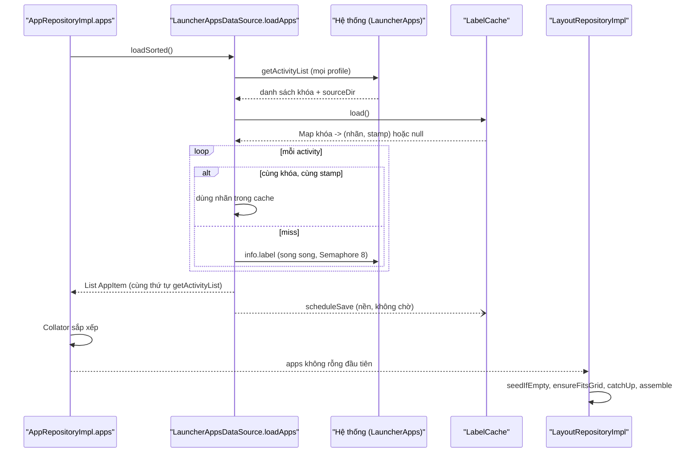
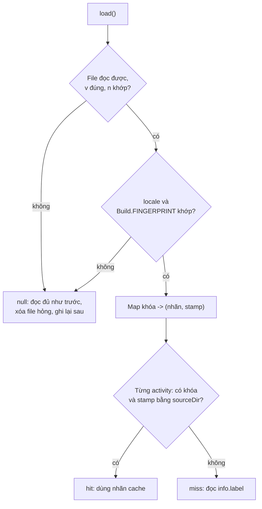

# LC — Cache nhãn app xuống đĩa: đọc trước khi review

**Plan:** [plans/LC-label-cache.md](../plans/LC-label-cache.md) · **PR:** #11 · **Nhánh:** `feature/lc-label-cache`

## 1. Tóm tắt
Trên Oppo A3x (345 app) màn Home trống ~5,3 giây ở lần mở nguội vì phải đọc nhãn từng app. LC lưu nhãn vào một file nhỏ (~81 KB); lần sau chỉ đọc nhãn app mới hoặc vừa cập nhật. Đo: Oppo 6,2–6,5 s → ~1,6 s tới lúc có lưới; Live 4 ~1,6 s → ~1,2 s. Chưa đạt hết ngưỡng: xem mục 6.

## 2. Kiến thức nền
- **`getActivityList`**: hệ thống trả danh sách activity mở được của từng user profile. Rẻ (~140 ms trên Oppo, đo ở P1) vì chỉ liệt kê. **`getLabel`** đắt (~15 ms/app trên Oppo) vì phải nạp tài nguyên chuỗi của từng APK.
- **`sourceDir`**: đường dẫn APK của app. Từ Android 8 đường dẫn có hậu tố ngẫu nhiên và đổi mỗi lần cài hoặc cập nhật. Dự án dùng nó làm "dấu vân tay" (`stamp`): cùng khóa, cùng `sourceDir` thì nhãn không đổi. Đã **đo** `sourceDir` đổi khi cài lại chính app mình trên cả hai máy; việc cập nhật qua store chưa đo (suy luận cùng cơ chế).
- **`AtomicFile`**: ghi ra file tạm rồi đổi tên; chết giữa chừng vẫn còn bản cũ nguyên vẹn.
- **`noBackupFilesDir`**: thư mục riêng của app mà Auto Backup không sao lưu, nên cache không bị khôi phục sang máy khác.

## 3. Luồng hoạt động



Điểm dễ sai: danh sách khóa **không bao giờ** lấy từ cache. Cache chỉ là bảng tra nhãn; app đã gỡ không thể hiện lại.



## 4. Thay đổi theo file
| File | Vai trò | Vì sao | Đọc trước? |
|---|---|---|---|
| `data/apps/LabelCache.kt` (mới) | Đọc, kiểm hợp lệ, ghi nền nguyên tử file JSON | Gói toàn bộ chuyện đĩa và vô hiệu hóa; mọi lỗi rơi về null | **Có** |
| `data/apps/LauncherAppsDataSource.kt` | `loadApps()` dùng cache; thêm `Loaded` nội bộ | Chỗ duy nhất quyết hit hay miss, và chỉ ghi nhãn đọc thành công | **Có** |
| `docs/plans`, `docs/knowledgements` | Plan, tài liệu này | — | — |

Không đổi `AppRepositoryImpl.kt`, `AppItem`, `AppRepository`, file nóng, hay module Hilt.

## 5. Quyết định và đánh đổi
- **D2 kiểm chứng trước (không "hiện cache rồi refresh")**: tiết kiệm có thể thêm chỉ ~140 ms nhưng sẽ hiện app ma, chạy `catchUp` với tập khóa sai, và phát hai lần (rủi ro kiểu M7). Chủ dự án duyệt.
- **D1 file JSON, không Room/DataStore**: Room bị khóa schema và Q6; DataStore ghi lại cả file cài đặt và phát lại flow settings.
- **D4 locale hoặc fingerprint khác = bỏ cả cache**: nhãn sai ngôn ngữ còn tệ hơn chờ.
- **D7 không kiểm lại nhãn nền (Task 4 bỏ)**: nhãn đổi mà app không cập nhật là hiếm; chấp nhận sai cho tới khi app cập nhật, đổi ngôn ngữ/OS, hoặc xóa dữ liệu app.
- Chỉ cache chuỗi nhãn; `category` và `isSystem` đã nằm trong `getActivityList` nên không cần.

## 6. Chỗ cần soi khi review
- **Đã trượt, cần chủ dự án biết:** Oppo cache nóng trung vị ~1580 ms (mục tiêu 1500; tệ nhất 1648 < 1800); Live 4 chưa có cache ~+155 ms (một lượt; giới hạn +50). Cái sau chỉ xảy ra lần đầu sau cài hoặc đổi ngôn ngữ.
- **Chưa đo:** khởi động lại máy; sự kiện package khi chạy; so thứ tự sắp; icon vẽ xong; work profile; đổi ngôn ngữ thật và đổi fingerprint (chỉ mô phỏng bằng sửa `locale`); cập nhật app qua store.
- **Không tách pha:** chỉ có "sort xong" và "pages đầu tiên", nên chưa biết ~1580 ms nằm ở cache, `seed/catchUp` hay `HomeViewModel`. Tách pha mới xuống dưới 1500 được.
- Review Focus 1 (không app ma), 4 (thứ tự), 5 (nguyên tử) mới chỉ có bằng chứng từ code.

## 7. Cách kiểm lại
```
adb shell run-as gambi.global.os26launcher ls -l no_backup
adb exec-out run-as gambi.global.os26launcher cat no_backup/app_label_cache.json
adb shell run-as gambi.global.os26launcher sh -c "echo '{}' > no_backup/app_label_cache.json"
adb shell am force-stop gambi.global.os26launcher
```
Làm hỏng file rồi mở lại: phải về đọc đủ (Oppo ~6,6 s), không crash, file được ghi lại hợp lệ. Đo thời gian: dùng patch log từ lúc tiến trình bắt đầu trên bản sao bỏ đi, so xen kẽ với `main`.

## 8. Bài học cho AGENTS.md
- Đọc nhãn là nút cổ chai (~84% thời gian tới lưới trên Oppo); hết nhãn thì ~1,6 s, và phần còn lại chưa được tách để biết (nút cổ chai kế tiếp chưa đo).
- Cache theo kiểu "khóa luôn từ hệ thống, cache chỉ trả lời nhãn" tránh cả lớp lỗi app ma và phát hai lần; nên dùng lại cho cache khác (icon, danh mục).
- `sourceDir` đổi mỗi lần cài (đo trên Android 11 và 14) là dấu vân tay rẻ, không cần IPC; app hệ thống cập nhật qua store nằm dưới `/data/app/` (46 gói trên Oppo, 31 trên Live 4).
- Cache chỉ nên giữ phần đắt nhất (nhãn); ghi nền, nguyên tử, mọi lỗi rơi về đường cũ.
- Với nhiều nhánh cùng build một máy: đo trên bản sao bỏ đi, không commit patch đo.
