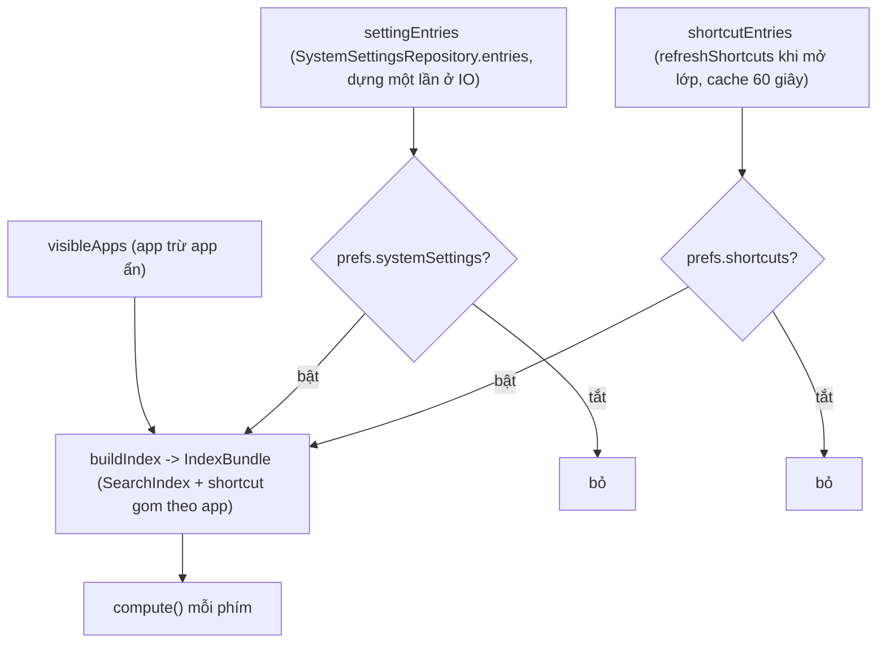
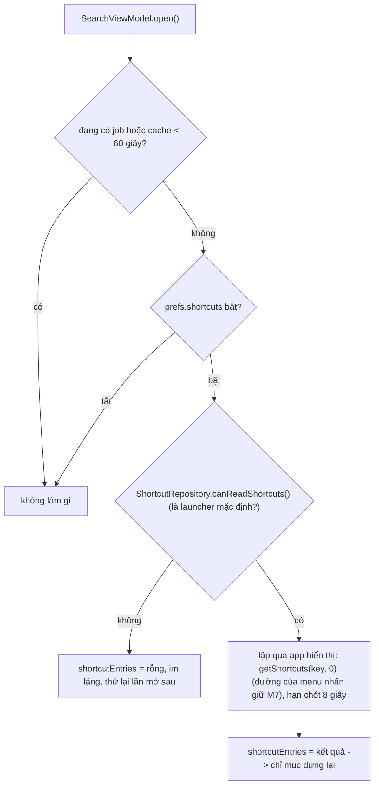
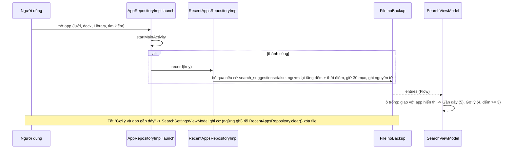

# M8d — Phần còn lại của tìm kiếm: đọc trước khi review

Plan: [plans/M8d-search-extras.md](../plans/M8d-search-extras.md). Nhãn: **đo được** (trên máy thật), **đọc tài liệu**, **suy luận chưa kiểm chứng**. Kết quả đo trên máy của Task 2 và kiểm tay shortcut còn **để trống** ở cuối file cho tới khi điều phối chạy xong.

## 1. Tóm tắt

Ô tìm kiếm của M8b chỉ biết app. M8d thêm ba thứ:

1. **Cài đặt hệ thống** (Wi-Fi, Bluetooth, Màn hình... 25 mục) khi gõ từ 2 ký tự, bấm để mở đúng màn Cài đặt.
2. **Shortcut của app** (vd "Chụp ảnh tự sướng" của Camera): khớp nhãn riêng của shortcut, và hiện tối đa 3 shortcut ngay dưới app đứng đầu kết quả. Chỉ có khi Os26Launcher là launcher mặc định.
3. **Ô trống** không còn chỉ là dòng "Nhập tên ứng dụng": hiện "Gần đây" (5 app mở mới nhất từ launcher) và "Gợi ý" (4 app mở từ 3 lần trở lên).

Thêm một khối "Tìm kiếm" ở cuối màn Cài đặt: ba công tắc (Cài đặt hệ thống, Lối tắt ứng dụng, Gợi ý và app gần đây) và nút "Xóa lịch sử mở app".

Không đổi schema Room, không thêm quyền, không thêm thư viện, không sửa file độc quyền.

## 2. Kiến thức nền

- **Package visibility (Android 11+):** app chỉ "thấy" package khác nếu được khai trong `<queries>`. Khai `<intent>` làm package khớp intent đó thấy được **cả package**, không chỉ intent đó. Vì vậy `SETTINGS`/`HOME_SETTINGS` đã khai từ M1 làm cả `com.android.settings` thấy được, nên các action `android.settings.WIFI_SETTINGS`... resolve được mà không cần khai thêm (**đo được** 2026-11-05 trên Live 4: 32/32 action resolve).
- **Một action có thể có nhiều trình xử lý.** Trên Oppo, `WIFI_SETTINGS` có 3 trình xử lý, một trong số đó là app ngoài (`com.instabridge.android`) (**đo được**). Trên Live 4, `NFC_SETTINGS` và `APPLICATION_DEVELOPMENT_SETTINGS` có hai trình xử lý cùng package nên `startActivity` trần sẽ hiện hộp chọn app (`ResolverActivity`) (**đo được**). Cách tránh: chỉ nhận trình xử lý của hệ thống rồi mở bằng `ComponentName` cụ thể.
- **Shortcut chỉ đọc được khi launcher là mặc định** (`LauncherApps.hasShortcutHostPermission`), theo AGENTS.md M7 Task 10. Khi không phải mặc định, mọi lời gọi `getShortcuts` ném `SecurityException`.
- **Auto Backup** sao lưu thư mục dữ liệu app (gồm DataStore `launcher_prefs`) lên đám mây khi `allowBackup="true"`; `noBackupFilesDir` thì không. Lịch sử mở app là dữ liệu riêng tư nên nằm ở `noBackupFilesDir` (đọc tài liệu; kiểm bằng review code, chưa thử khôi phục backup). Ba cờ bật/tắt của khối Tìm kiếm vẫn ở DataStore.

## 3. Luồng hoạt động

### 3.1 Gõ một truy vấn

```mermaid
sequenceDiagram
    participant U as Người dùng
    participant V as SearchOverlayView
    participant VM as SearchViewModel
    participant IDX as SearchIndex
    participant D as Dispatchers.Default
    U->>V: gõ "wifi"
    V->>VM: onQueryChanged("wifi")
    VM->>D: mapLatest { compute(Inputs) }
    D->>IDX: search("wifi") (chuẩn hóa truy vấn, quét chuỗi đã chuẩn hóa sẵn)
    IDX-->>D: App / Setting / Shortcut, đã xếp hạng và cắt theo loại
    D->>D: withTopHitShortcuts (kèm tối đa 3 shortcut của app đứng đầu)
    D-->>VM: SearchUiState(results)
    VM-->>V: uiState (StateFlow) -> render
    U->>V: bấm một hàng
    V->>VM: onResultTapped(SearchResult, rect)
    alt App
        VM->>VM: AppRepository.launch -> ghi lịch sử nếu thành công
    else Setting
        VM->>VM: SystemSettingsRepository.open(id)
    else Shortcut
        VM->>VM: ShortcutRepository.startShortcut(key, id)
    end
    VM-->>V: thành công: close(); thất bại: LaunchFailed -> Toast, giữ lớp
```

### 3.2 Các nguồn vào chỉ mục



### 3.3 Shortcut và launcher mặc định



### 3.4 Lịch sử, gợi ý và tắt công tắc



## 4. Thay đổi theo file

| Vùng | File | Việc |
|---|---|---|
| domain | `search/SearchResult.kt` | `SearchKind` (luật từng loại: số ký tự tối thiểu, số kết quả tối đa), `SearchResult` (App / Setting / Shortcut / Header) |
| domain | `search/SearchIndex.kt` | chỉ mục chuẩn hóa dựng sẵn; hạng 0-4; cắt theo loại |
| domain | `model/` `SearchSettingEntry`, `ShortcutEntry`, `RecentApp`, `SearchPreferences`; `repository/` `SystemSettingsRepository`, `RecentAppsRepository`, `SearchPreferencesRepository` | kiểu dữ liệu và cổng |
| data | `search/SystemSettingsCatalog`, `SystemSettingsRepositoryImpl` | danh mục 25 mục, chọn trình xử lý hệ thống, mở bằng component |
| data | `search/RecentAppsRepositoryImpl` (file noBackup), `SearchPreferencesRepositoryImpl`, `SearchPrefsKeys` (cờ ở DataStore) | lưu trữ |
| data | `apps/AppRepositoryImpl` | ghi lịch sử khi `launch` thành công |
| data/domain | `ShortcutRepository(.Impl)` | thêm `canReadShortcuts()` |
| di | `SearchModule` | binding riêng, không sửa `RepositoryModule` |
| ui | `search/SearchViewModel`, `SearchUiState`, `SearchResultAdapter` | nối các nguồn, ô trống, hàng mới |
| ui | `settings/SearchSettingsBlock`, `SearchSettingsViewModel` + vài dòng thêm ở `SettingsActivity`, `SettingsRow` | khối Cài đặt tự đứng được |
| res | `item_search_result.xml` (dòng phụ), `item_search_header.xml`, `ic_search_setting.xml`, `strings.xml` | giao diện và chữ |

## 5. Quyết định và đánh đổi

- **Lịch sử của launcher, không dùng UsageStats:** không cần quyền "truy cập dữ liệu sử dụng", đếm được số lần mở. Đổi lại lịch sử bắt đầu rỗng và không thấy app mở từ thông báo/widget. Xem bảng so sánh trong plan.
- **Ghi lịch sử ở `AppRepositoryImpl.launch`:** một điểm chung của mọi lần mở app, nên không phải sửa `HomeViewModel` (độc quyền). Hệ quả (chủ dự án chốt 2026-11-05): ghi cả lần mở từ App Library, và không loại riêng package của launcher.
- **Lịch sử ở file `noBackupFilesDir`, không ở DataStore:** review độc lập chỉ ra `launcher_prefs` nằm trong Auto Backup nên lịch sử sẽ rời máy. Không loại cả `launcher_prefs` khỏi backup (mất cài đặt khác), không đổi `allowBackup`.
- **Chỉ mục dựng sẵn + `mapLatest` ở Default:** M8b chuẩn hóa lại mọi nhãn mỗi phím trên Main. **Đo được** trên Oppo 344 app: p50 giảm từ khoảng 70-80 ms xuống 5-7 ms (~14 lần), nhưng mục tiêu p95 <= 4 ms **không đạt** (p95 7-9 ms, đỉnh 22-43 ms; chưa rõ nguyên nhân đỉnh). Xem mục 7.
- **1 ký tự chỉ ra app; Cài đặt/shortcut từ 2 ký tự; tối đa 5 mỗi loại:** để truy vấn như `a` không bị nhiễu bởi 25 mục Cài đặt và hàng trăm shortcut.
- **Shortcut chỉ khớp nhãn riêng, cộng "top hit":** nếu khớp theo nhãn app cha thì gõ `cam` đổ cả shortcut của Camera ra. Top hit theo cách iOS 17 cho shortcut của app đứng đầu mà không làm nhiễu các truy vấn khác.
- **Một biểu tượng bánh răng chung cho Cài đặt:** rẻ, nhất quán; đổi lại không phân biệt mục bằng hình.
- **Im lặng khi không phải launcher mặc định:** không nhắc trong kết quả; trạng thái nằm ở hàng "Lối tắt cần đặt làm launcher mặc định" trong Cài đặt.
- **Tắt "Gợi ý và app gần đây" = xóa lịch sử:** hiện hộp xác nhận; ViewModel ghi cờ trước (ngừng ghi lịch sử) rồi xóa file; nếu bước nào lỗi thì Toast và hàng được dựng lại từ trạng thái thật.

## 6. Chỗ cần soi khi review

1. `SearchViewModel.compute/withTopHitShortcuts`: tổng shortcut <= 5 sau khi chèn top hit; app đứng đầu phải là `App` (không phải Cài đặt) mới chèn.
2. `refreshShortcuts`: kiểm công tắc và `canReadShortcuts()` TRƯỚC cache 60 giây (mất quyền thì xóa shortcut ngay); hạn chót 8 giây giữ kết quả đã có; `shortcutJob` không chạy chồng.
3. `RecentAppsRepositoryImpl`: Mutex quanh mọi thao tác, `AtomicFile`, gộp theo `ComponentKey`, cắt 30 mục, dòng hỏng khi đọc bị bỏ qua; không ghi khi đã tắt gợi ý; dọn khóa DataStore cũ một lần.
4. `SystemSettingsRepositoryImpl.build`: chỉ `FLAG_SYSTEM`, loại `ResolverActivity`, mở bằng component; lỗi bắt `RuntimeException` rồi báo `LaunchFailed`.
5. `SettingsActivity`: các điểm thêm đều là khối riêng; thử bỏ khối ra thì màn cũ còn nguyên.
6. `AppRepositoryImpl` giờ phụ thuộc `RecentAppsRepository`: kiểm Hilt không có vòng.
7. Hành vi M8b: ô trống ở chế độ "show all" từ App Library vẫn liệt kê a-z, không hiện Gần đây.

## 7. Cách kiểm lại

Xem "Bài kiểm cả tính năng" trong plan. Hai phần đo/kiểm riêng, điều phối chạy:

**Task 2 (Oppo A3x 344 app, rồi Live 4 87 app), APK có `M8dTiming`:** `logcat -c`; `dumpsys gfxinfo gambi.global.os26launcher reset`; mở tìm kiếm, gõ nhanh `d, di, die, dien, dient, dienth` rồi `a, ab, abc, c, ca, cam`, xóa về rỗng giữa các lượt, khoảng 4 lượt; `dumpsys gfxinfo gambi.global.os26launcher`; `logcat -d -s M8D`. Cần: tổng khung, số khung > 33 ms, p95; các dòng `index ...` và `n=20 new p50/p95 | m8b p50/p95`.

**Shortcut (Live 4, đã đặt launcher mặc định tạm):** `logcat -d -s SearchViewModel` lấy dòng "shortcut index: N entries from M apps in X ms"; rồi các bước kiểm tay trong plan Task 3-6.

### Kết quả đo

| Phép đo | Máy | Kết quả |
|---|---|---|
| Thời gian tính mỗi phím, bản mới vs M8b (p50/p95) | Oppo A3x | **đo được** (2 lượt x 4 nhóm 20 phím): mới p50 4,6-7,6 ms, p95 7,3-43,3 ms; M8b p50 67-82 ms, p95 88-180 ms. Nhanh ~14x ở p50, **trượt mục tiêu p95 <= 4 ms** |
| Thời gian tính mỗi phím, bản mới vs M8b | Live 4 | |
| gfxinfo khi gõ nhanh | Oppo A3x | **đo được**: mới 353/355 khung, janky 27,2%/30,4%, p95 khung 101/117 ms; `main` 300/314 khung, janky 45,0%/42,7%, p95 109/109 ms. Bàn phím đang hiện nên p95 khung chưa quy được cho code này |
| Thời gian dựng chỉ mục shortcut | Live 4 | **đo được** (bản rebase `bf567a4`): 197 ms |
| Số shortcut thu được | Live 4 | **đo được**: 85 mục từ 83 app |

Oppo A3x: hành vi shortcut **chưa đo** (chủ dự án không đặt launcher mặc định trên Oppo).

## 8. Bài học cho AGENTS.md

- **`<queries>` mở tầm nhìn theo package, không theo action:** một `<intent>` đã khai làm cả package khớp nó thấy được; đo `resolveActivity` cho từng action trước khi khai thêm (M8d: 32/32 action Settings resolve được mà không khai thêm gì).
- **Một `ACTION_*_SETTINGS` có thể có app ngoài đăng ký (Instabridge cho `WIFI_SETTINGS` trên Oppo) hoặc hai trình xử lý cùng package (`NFC_SETTINGS` trên Live 4):** chỉ nhận trình xử lý `FLAG_SYSTEM`, loại `ResolverActivity`, mở bằng `ComponentName`.
- **Oppo bỏ dòng logcat khi in dồn:** log dài 30 dòng liên tiếp trên Oppo A3x bị cắt sau khoảng 15 dòng; gom thành một dòng tóm tắt hoặc ghi ra file.
- **Dữ liệu riêng tư không để trong DataStore/SharedPreferences của app** nếu `allowBackup="true"`: đặt ở `noBackupFilesDir` (ghi nguyên tử bằng `AtomicFile`, như `LabelCache` và lịch sử tìm kiếm của M8d).
- **Khóa DataStore riêng của một tính năng định nghĩa trong package của tính năng** (`data/search/SearchPrefsKeys`) để khỏi chen vào `SettingsKeys` dùng chung.
- **Điểm chung ghi lịch sử mở app là `AppRepositoryImpl.launch`:** không ghi từng ViewModel (HomeViewModel là file độc quyền).
