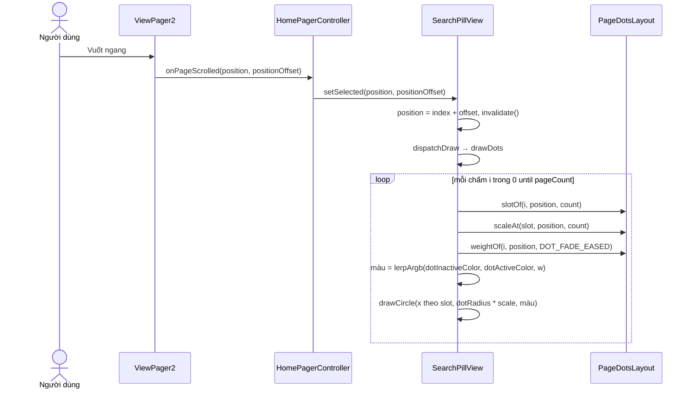
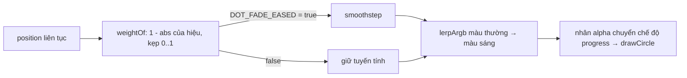

# PL — Chấm trang cross-fade: đọc trước khi review

**Plan:** [plans/PL-dots-and-launch.md](../plans/PL-dots-and-launch.md) · **PR:** #28 · **Nhánh:** `feature/pl-dots-and-launch`

## 1. Tóm tắt
- Hàng chấm trang trong ô tìm kiếm (chế độ chấm) trước đây có một viên sáng trượt từ chấm này sang chấm kia theo ngón tay.
- Nay mỗi chấm tự đổi màu theo khoảng cách tới vị trí trang liên tục: chấm trang cũ tối dần, chấm trang mới sáng dần, cùng chạy theo vuốt (đảo ngược được nếu thả lại).
- Hàng chấm vẫn trượt theo vuốt khi có hơn 5 trang ("ổ quay số" của M8c không đổi).
- Phần animation mở app từ icon đã HOÃN (nghiên cứu ở plan, mục "Ngoài phạm vi").

## 2. Kiến thức nền
- `ViewPager2.OnPageChangeCallback.onPageScrolled(position, positionOffset, ...)` bắn liên tục khi kéo/lướt; `position + positionOffset` là vị trí trang liên tục. Tài liệu: https://developer.android.com/reference/androidx/viewpager2/widget/ViewPager2.OnPageChangeCallback
- Cross-fade = hai thứ đổi độ đậm ngược chiều. Ở đây độ đậm của chấm i là trọng số `w_i = max(0, 1 − |i − position|)`: tại số nguyên chỉ chấm đúng trang có w = 1; giữa hai trang, hai chấm kề có `w` cộng lại luôn bằng 1.
- Smoothstep `w²(3 − 2w)` làm mượt hai đầu nhưng làm tổng hai chấm kề khác 1; để sau cờ `DOT_FADE_EASED`.

## 3. Luồng hoạt động

`slotOf` và `scaleAt` (vị trí và co ở mép) không đổi so với M8c; chỉ phần màu là mới. Chấm đã trượt ra ngoài cửa sổ (`slot <= -1` hoặc `>= SLOTS`) hoặc `scale <= 0` bị bỏ qua trước khi tính màu.

## 4. Thay đổi theo file
| File | Vai trò | Vì sao thêm/sửa | Đọc trước? |
|---|---|---|---|
| `ui/home/view/SearchPillView.kt` | View ô tìm kiếm/hàng chấm | `drawDots` vẽ mọi chấm bằng màu lerp; bỏ `activeDotPaint` và viên sáng; thêm `lerpArgb`, hằng `DOT_FADE_EASED` | **Có** |
| `ui/home/view/PageDotsLayout.kt` | Số học cửa sổ chấm | Thêm `weightOf`; `activeSlot` không còn được `drawDots` gọi (giữ nguyên, xem mục 6) | **Có** |

## 5. Quyết định và đánh đổi
- Chọn trọng số tuyến tính (phương án A trong plan) vì chỉ phụ thuộc `position`, không trạng thái, đảo ngược được; bỏ animator theo thời gian (không theo ngón tay) và bỏ giữ viên bi.
- Smoothstep để sau một hằng (mặc định tắt); chủ dự án so bằng mắt ở Task 2.
- Đánh đổi: mất điểm nhấn "viên bi"; giữa hai trang cả hai chấm ở 50%.

## 6. Chỗ cần soi khi review
- **Chấm sáng nay cũng chịu `scaleAt`** (trước đây vòng sáng luôn bán kính đầy đủ). Kiểm bằng số, tại `position` nguyên (đọc code, tính tay trên `PageDotsLayout`):
  - `count <= 5`: `scaleAt = 1` với mọi chấm.
  - `count > 5`, `p <= 2`: `windowStart = 0`, chấm sáng ở ô `p ∈ {0,1,2}`; `hiddenLeft = 0`, `hiddenRight = 1` nên scale = `edgeScale(4 − p)` với `4 − p ≥ 2` → 1.
  - `count > 5`, `2 < p < count − 3`: chấm sáng ở ô 2; `edgeScale(2) = 1` cả hai phía → 1.
  - `count > 5`, `p ≥ count − 3`: `windowStart = count − 5`, ô sáng `= p − count + 5 ∈ {2,3,4}`; `hiddenRight = 0`, `hiddenLeft = 1` nên scale = `edgeScale(ô ≥ 2)` → 1.
  - Vậy chấm sáng đầy đủ ở mọi vị trí nguyên. Chỉ khi đang vuốt nó đi qua vùng mép, nơi nó có thể nhỏ hơn một chút. Chưa nhìn trên máy (Task 2). Nếu thấy lạ thì thêm cờ giữ bán kính đầy đủ cho chấm có `w` lớn nhất.
- Chấm sáng nay nằm trong vòng lặp nên thứ tự vẽ theo chỉ số trang (không còn vẽ sau cùng); chấm không chồng nhau nên không ảnh hưởng.
- Alpha: màu chấm thường mang sẵn alpha của `search_pill_dot_inactive`; lerp cả kênh alpha về 255 (màu sáng đặc), rồi nhân alpha `progress` của chế độ chấm. Soi khi đổi chế độ ô tìm kiếm ↔ chấm.
- `activeSlot` còn trong `PageDotsLayout` nhưng không ai gọi (cố ý chưa xoá hàm; điều phối quyết định dọn hay không, không xoá file).
- Không cấp phát trong `drawDots` (`lerpArgb` dùng hàm cục bộ và số nguyên; Kotlin có thể tạo lambda cục bộ nhưng `ch` là hàm cục bộ không capture ngoài `from/to/t`, chi phí không đáng kể, chưa đo).
- Chưa kiểm tay trên máy: màu giữa hai trang, chuyển trang bằng code không animation, TalkBack (`updateDescription` không đổi).

## 7. Cách kiểm lại
Live 4, bản debug đã cài, đặt launcher mặc định; cần ≥ 7 trang (có trang ma) và một cấu hình 3 trang.
1. Vuốt chậm hai trang: chấm cũ tối, chấm mới sáng, không viên bi chạy.
2. Vuốt nửa chừng rồi thả về: đảo ngược mượt, về đúng một chấm sáng.
3. Fling 3 trang; nút lật trang (`PagerFlipAnimator`).
4. 3 trang (hàng đứng yên) và 7 trang (hàng trượt, chấm mép co).
5. Thêm/xoá trang, trang ma, edit mode; TalkBack đọc "trang n/N".
6. So `DOT_FADE_EASED` false/true.

## 8. Bài học cho AGENTS.md
Chủ đề đề xuất: `lessons/home-pager-animation.md`.
- (2026-11-10, đọc code) Muốn hiệu ứng "đi theo ngón tay, đảo ngược được" thì suy trạng thái vẽ trực tiếp từ giá trị liên tục (`position`) trong `onDraw`, không dùng animator theo thời gian ở `onPageSelected`.
- (2026-11-10, đọc tài liệu AOSP) Launcher bên thứ ba không dùng được remote animation: quyền `CONTROL_REMOTE_APP_TRANSITION_ANIMATIONS` là `signature|privileged|recents`, chú thích "Not for use by third-party applications". Animation về home cũng không điều khiển được. Chi tiết trong plan PL, mục nghiên cứu để dành.

## 9. Số đo
| Mục | Máy | Kết quả |
|---|---|---|
| Build `assembleDebug lintDebug` | Windows, worktree PL | Xanh (2026-11-10, nhánh@bdad06a) |
| Cross-fade nhìn bằng mắt: tuyến tính vs smoothstep | Live 4 | chưa đo |
| Chấm sáng có lớn lên ở mép khi vuốt | Live 4 | chưa đo |
| Janky khi vuốt (nếu cần) | Live 4 | chưa đo |
