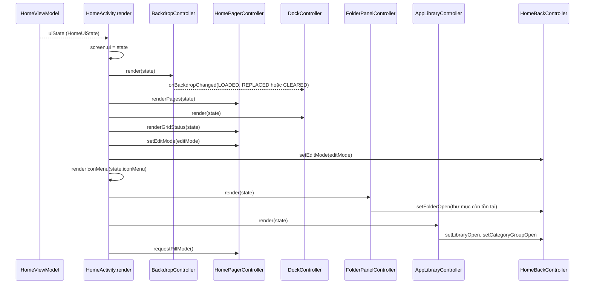
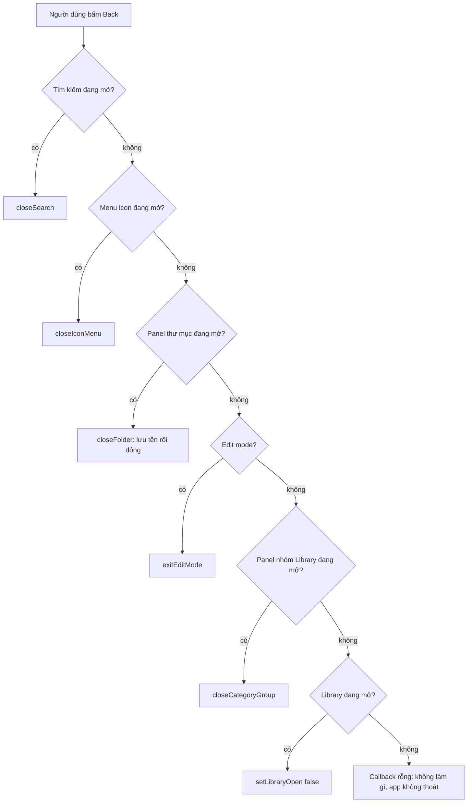
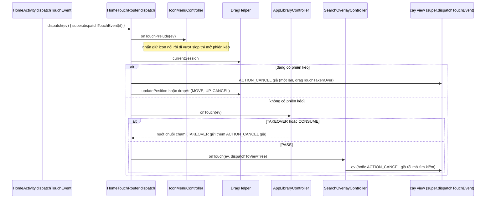

# R1 — Tách `HomeActivity` thành các controller: đọc trước khi review

**Plan:** [plans/R1-home-controllers.md](../plans/R1-home-controllers.md) · **PR:** #5 (R1a, đã merge), #7 (R1b) · **Nhánh:** `refactor/r1-home-controllers`

> Gồm cả **R1a** (Task 1–6, PR #5) và **R1b** (Task 7–11, PR #7: menu icon, tìm kiếm, bộ định tuyến cử chỉ, thanh hệ thống, dọn Activity).

## 1. Tóm tắt

Không có gì đổi với người dùng: Home chạy y như trước. Bên trong, `HomeActivity.kt` (962 dòng) bị cắt bớt: các mối quan tâm chuyển sang các class nhỏ trong `ui/home/controller/`: R1a (Back, thư mục, App Library, dock + kính, ảnh nền + hộp thoại wallpaper, pager + pill), R1b (menu nhấn giữ icon, lớp tìm kiếm, bộ định tuyến chạm, thanh hệ thống). Sau R1a `HomeActivity` còn 557 dòng; sau R1b còn **203 dòng** (đo `wc -l`), chỉ làm: dựng và nối 12 controller trong `onCreate`, `render()` theo thứ tự cũ, `handleEvent`, `onNewIntent`, móc vòng đời. Mục đích là để nhánh hoạt ảnh (AN) và nhánh kiểu icon (G2b) thêm hook của mình vào các file nhỏ này thay vì vào `HomeActivity`.

## 2. Kiến thức nền

- **Controller thuần:** class Kotlin không kế thừa gì của Android, được `HomeActivity.onCreate` dựng sau `setContentView`, nhận `ActivityHomeBinding` (hoặc các view cần dùng), `HomeViewModel` và lambda. Dự án đã có mẫu này từ G2a B2: `LibraryOverlayController`.
- **`OnBackPressedDispatcher` là LIFO:** callback đăng ký sau được hỏi trước (chỉ tính callback đang bật). Vì vậy **thứ tự đăng ký là hành vi**, và R1 gom hết vào `HomeBackController` để thứ tự nằm ở một chỗ. Tài liệu: [OnBackPressedDispatcher](https://developer.android.com/reference/androidx/activity/OnBackPressedDispatcher) (**đọc tài liệu**).
- **`render()` được gọi mỗi khi `HomeUiState` phát:** các đoạn của nó xen kẽ nhau (ảnh nền, trang, dock, trạng thái lưới, edit mode…), nên R1 giữ nguyên thứ tự gọi chứ không gom lại cho "gọn".

## 3. Luồng hoạt động

### 3.1 `HomeUiState` mới đi qua các controller theo đúng thứ tự cũ

Từ R1b, `renderIconMenu` là `iconMenu.render(...)` (`IconMenuController`), và `systemBars.render(editMode)` ẩn/hiện thanh trạng thái ngay sau `pager.setEditMode`/`dockView.setEditMode`. `BackdropController` báo `DockController` qua `BackdropListener`: dock gắn lại nguồn kính khi `LOADED`/`REPLACED`, làm mới kính (`pulseGlassRefresh`) chỉ khi `REPLACED`, và không làm gì khi `CLEARED` (đúng như code cũ). AN đăng ký thêm listener ở cùng chỗ để làm mới kính của các phần tử khác.

### 3.2 Các lớp Back

Thứ tự ưu tiên khi nhiều lớp cùng bật (từ cao xuống thấp), đúng thứ tự `addCallback` đảo ngược trong `HomeBackController.init`: tìm kiếm → menu icon → panel thư mục → edit mode → panel nhóm → Library → callback rỗng. Từng cờ bật/tắt ở hàm render của controller sở hữu lớp đó (`back.setFolderOpen(...)` ở `FolderPanelController.render`, v.v.). Lưu ý `setFolderOpen` bật theo "thư mục còn tồn tại trong `pages`", không chỉ `openFolderId != null`.

### 3.3 Một chạm đi qua `HomeTouchRouter` (R1b)

Điểm dễ sai: thứ tự bốn bước trên là hành vi. Khi đang có phiên kéo, Activity nhận MỌI chạm thay ô nguồn vì `ViewPager2` có thể đã tháo ô nguồn khỏi cây lúc lật trang (bài học M7). `super.dispatchTouchEvent` được truyền vào như một hàm, nên router không cần kế thừa `Activity`.

## 4. Thay đổi theo file

| File | Vai trò | Vì sao thêm/sửa | Đọc trước? |
|---|---|---|---|
| `controller/HomeBackController.kt` | 7 đăng ký Back + `setXxx` | Thứ tự LIFO là hành vi, gom một chỗ | **Có** |
| `controller/HomePagerController.kt` | pager, lật mép, trang tạm, pill | Chuyển nguyên `setupHomePager`, `onDragEdge`, `requestPillMode`; `onFolderClick` giữ chữ ký | **Có** |
| `controller/DockController.kt`, `RecreateGuard.kt` | dock + kính; kiểm tra "dựng lại Activity" | `RecreateGuard` thay `recreateIfGlassOverrideChanged` để G2b thêm check bằng một dòng | **Có** |
| `controller/AppLibraryController.kt` | Library + panel nhóm | Giữ `LibraryOverlayController`; chỗ AN thêm `onAppClick` | |
| `controller/FolderPanelController.kt` | panel thư mục | Hook mở/đóng thư mục của AN | |
| `controller/BackdropController.kt` | ảnh nền, hộp thoại wallpaper, listener ảnh nền | Hook làm mới kính của AN | |
| `controller/HomeScreenState.kt` | `ui` và `search` mới nhất | Thay `lastState`/`lastSearchState` | |
| `controller/HomeTouchRouter.kt` (R1b) | thứ tự xử lý chạm, tiếp quản kéo-thả, nối `DragHelper` | Giữ nguyên `dispatchTouchEvent` | **Có** |
| `controller/IconMenuController.kt` (R1b) | menu nhấn giữ icon, nhấn giữ icon nổi để kéo | Chuyển nguyên văn `renderIconMenu`, `pendingMenuDrag` | |
| `controller/SearchOverlayController.kt` (R1b) | lớp tìm kiếm + cử chỉ vuốt xuống | Chuyển nguyên văn `dispatchWithSearchSwipe`, `searchStartZone` | |
| `controller/SystemBarsController.kt` (R1b) | inset (margin), màu icon thanh hệ thống, ẩn thanh trạng thái khi edit mode | Chuyển nguyên văn `applySystemBarInsets`, `applySystemBarStyling`, `applyStatusBarForEditMode` | |
| `HomeActivity.kt` | nối controller | 962 → 557 (R1a) → 203 dòng (R1b) | |

## 5. Quyết định và đánh đổi

Controller thuần thay vì Fragment, View gốc tùy biến, hàm mở rộng hay Hilt: xem "Vì sao chọn thiết kế này" và D1–D14 trong plan. Đánh đổi chính: thêm một tầng lambda nối, đổi lại AN/G2b không phải mở `HomeActivity`. `Host` interface chỉ còn ở `HomeBackController`.

## 6. Chỗ cần soi khi review

- `git diff --color-moved` so với `76c7032`: mọi dòng bị xóa khỏi `HomeActivity` phải xuất hiện nguyên văn trong controller (trừ tiền tố `binding.`, `screen.ui`, `scope`, `back.setXxx`). Chỗ KHÔNG chuyển nguyên văn (đã kiểm bằng script so khớp dòng): `recreateIfGlassOverrideChanged` thành `RecreateGuard` + `glassOverrideChanged()`; hai dòng dock trong `render()` thành `onBackdropChanged(change)`; callback Back gọi `Host` thay vì `viewModel` trực tiếp; `ViewConfiguration`/`displayMetrics` lấy từ `binding.root` (cũng là Activity).
- Thứ tự `onCreate` (`pager.setup` → `library.setup` → `dock.setup` → `folder.setup`) và `onResume` (`recreateGuard` → `backdrop` → `refreshDefaultLauncher`) giữ nguyên.
- `onDestroy` giữ thứ tự: huỷ lật → đóng hộp thoại → gỡ `DragLayer` → gỡ hẹn giờ pill.
- R1b (so khớp dòng với `main@7030768` bằng script): các dòng khác biệt chỉ là tiền tố: `super.dispatchTouchEvent(x)` thành `dispatchToViewTree(x)`, `resources`/`ViewConfiguration.get(this)` thành `binding.root...`, tham số constructor, `statusBarTopPx` thành `systemBars.statusBarTopPx` qua lambda. Không có dòng nào bị mất.
- Thứ tự trong `onCreate` (Back → `systemBars` dựng → search/iconMenu/pager/folder/library/dock/backdrop/guard/touchRouter dựng → `search.setup`, `iconMenu.setup`, `touchRouter.setup`, `systemBars.setup`, listener pager, `pager.setup`, `library.setup`, `dock.setup`, `folder.setup`, khối "Dòng nối cho AN/G2b") tương ứng thứ tự cũ; các constructor không có tác dụng phụ.
- Chỉ build mới kiểm được; hành vi kiểm bằng S1–S18 của điều phối (xem plan).

## 7. Cách kiểm lại

Danh mục S1–S18 trong plan, so với baseline `origin/main@76c7032`, Vsmart Live 4.

## 8. Bài học cho AGENTS.md

- (2026-11-04, đo) `gradlew --stop` của một nhánh giết build đang chạy của nhánh khác ("Gradle build daemon has been stopped: stop command received") vì chung `GRADLE_USER_HOME`; chạy lại là xanh. Dùng `-Dorg.gradle.daemon.idletimeout=120000` thay vì `--stop` khi nhiều nhánh build song song. Trong PowerShell phải đặt cờ trong dấu nháy (`'-Dorg.gradle.daemon.idletimeout=120000'`).
- (2026-11-04, đo) `Set-Content -Encoding UTF8` của Windows PowerShell 5.1 thêm BOM vào file Kotlin; sửa file nguồn bằng công cụ Edit/Python, không bằng `Set-Content`.
