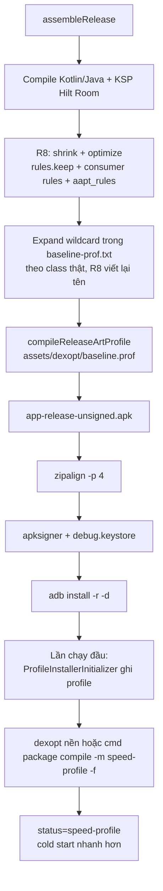

# RB — Bản release đúng nghĩa (R8 + baseline profile): đọc trước khi review

**Plan:** [plans/RB-release-build.md](../plans/RB-release-build.md) · **PR:** #21 (draft) · **Nhánh:** `build/rb-release-build`

## 1. Tóm tắt
- Bật R8 cho bản release (`optimization { enable = true }`), thêm keep rule thật (`app/src/main/keepRules/rules.keep`), thêm baseline profile viết tay (`app/src/main/baseline-prof.txt`), ghi quy trình ký bằng khóa debug và cài đè lên bản debug.
- Không đổi mã Kotlin, layout, manifest, `libs.versions.toml`. Không dependency mới.
- Lý do làm: bản debug khởi động chậm gấp ~4,4 lần release (AGENTS.md, đo 2026-11-09), nên chưa có bản release đúng nghĩa thì không đo được thứ người dùng thấy.
- Kết quả build (agent, chưa chạy trên máy): `assembleRelease` xanh; APK `app\build\outputs\apk\release\app-release-unsigned.apk` (~2,68 MB) có `assets/dexopt/baseline.prof`. Đo khởi động và hồi quy do điều phối làm ở Task 4 của plan.

## 2. Kiến thức nền
- **DSL AGP 9.3.3** (đọc `gradle-api-9.3.3-sources.jar`): `optimization { enable }` là "code shrinking and resource optimization", dùng R8, mặc định `false`; **không cần** `isMinifyEnabled`/`isShrinkResources` riêng. `optimization.keepRules { includeDefault }` mặc định `true` = như `getDefaultProguardFile("proguard-android-optimize.txt")` (cấu hình cuối có đúng file này ở dòng đầu `configuration.txt`). Mọi file trong `src/main/keepRules` được gộp tự động.
- **Baseline profile** là danh sách method/class mà ART biên dịch sẵn (AOT) hoặc nạp sẵn, thay vì để interpreter/JIT làm ở lần chạy đầu. Cờ `H` hot, `S` startup, `P` post-startup, dòng `L...;` là class.
- **`androidx.profileinstaller` 1.4.0** đã có trên classpath release qua `androidx.activity:activity:1.13.0` (đo bằng `dependencyInsight`). Lúc app chạy lần đầu, nó ghi profile trong APK cho ART; hệ thống biên dịch nền sau đó (hoặc ép bằng `cmd package compile -m speed-profile -f`). Máy sideload không có profile từ Play, nên cần bước này.
- **JNI theo tên:** `libnativegauss.so` của thư viện kính xuất hàm `Java_com_example_blur_NativeGauss_*`, `Java_com_example_liquidglass_NativeChromaticDispersion_*`, `Java_com_example_liquidglass_NativeChromaticAberration_*` (không `RegisterNatives`). Đổi tên hoặc gỡ method native của các class đó thì `UnsatisfiedLinkError`.

## 3. Luồng hoạt động

## 4. Thay đổi theo file
| File | Việc |
|---|---|
| `app/build.gradle.kts` | `optimization { enable = true }` thay cho `false` (kèm comment) |
| `app/src/main/keepRules/rules.keep` | `-dontobfuscate`; giữ method `native`; giữ `SourceFile,LineNumberTable` |
| `app/src/main/baseline-prof.txt` | wildcard `HSPL`/`L` cho `gambi/global/os26launcher/**`, `com/example/liquidglass/**`, `com/example/blur/**`, `dagger/**`, `dagger/hilt/**` |

## 5. Quyết định và đánh đổi
- **Chỉ 3 rule trong `rules.keep`** vì phần còn lại đã có sẵn trong cấu hình R8 cuối (đã đối chiếu `configuration.txt`, 680 dòng):
  - Room: `-keep class * extends androidx.room.RoomDatabase { void <init>(); }` (từ AAR Room), nên `LauncherDatabase_Impl` còn nguyên (có trong `seeds.txt`).
  - Hilt/Dagger: rule `hilt-android:2.60.1` giữ `@EntryPoint`/`GeneratedEntryPoint`, và Hilt tự sinh keep cho 5 `@HiltViewModel` (`HomeViewModel`, `AppLibraryViewModel`, `SearchViewModel`, `SearchSettingsViewModel`, `SettingsViewModel`); rule `dagger:2.60.1` về `IdentifierNameString`.
  - DataStore: `-keepclassmembers class * extends ...GeneratedMessageLite { <fields>; }` và keep native của `NativeSharedCounter`.
  - Custom View trong XML (8 view), 3 Activity và `LauncherApp` trong manifest: có trong `seeds.txt` (do `aapt_rules.txt`), không rule tay.
  - Native của kính: rule mặc định của AGP chỉ giữ method (không giữ tên class); rule riêng `-keepclasseswithmembernames,includedescriptorclasses` đảm bảo **không đổi tên**; `seeds.txt` cho thấy mọi method native của `NativeGauss`, `NativeChromaticDispersion`, `NativeChromaticAberration` còn.
- **`-dontobfuscate` lần đầu** (chủ dự án duyệt 2026-11-09): tốc độ đến từ shrink + optimize + profile; đổi tên là nguồn rủi ro chính và làm khó đọc stack trace/perfetto. Xét lại sau hồi quy.
- **Profile wildcard rộng:** AGP expand đúng (khoảng 10 740 dòng sau expand, còn 3 629 dòng sau khi R8 viết lại theo mã đã thu nhỏ; 2 031 dòng của app). Đánh đổi: có thể biên dịch dư.
- **Ký tay** thay vì `signingConfig`: không đưa khóa debug vào cấu hình release.

## 6. Chỗ cần soi khi review
- `usage.txt` (mã bị R8 gỡ, 38 348 dòng): phần app chỉ là lớp `R$*` (hằng số inline), annotation Qualifier (`ApplicationScope`, `DefaultDispatcher`, `IoDispatcher`), `DefaultImpls`, các component Dagger/Hilt không dùng (Fragment, Service, View, ViewWithFragment) và hàm `$default` tổng hợp. Class native của thư viện kính chỉ mất các hàm `$default` tổng hợp, không mất method `native`.
- Dòng có dấu `:` trong `usage.txt` nghĩa là chỉ gỡ một số thành viên của class đó, không phải cả class; xem tay `usage.txt` nếu nghi ngờ.
- `baseline.prof` nhị phân: 1 737 B (chỉ profile AndroidX) lên 2 431 B sau khi thêm file của dự án; số có nghĩa là số dòng ở `app\build\intermediates\combined_art_profile\release\compileReleaseArtProfile\baseline-prof.txt`.

## 7. Cách kiểm lại — quy trình ký, cài, quay lại (điều phối làm theo, PowerShell)
Điều kiện: xác nhận với chủ dự án máy nào đang rảnh (memory `phone-availability`). Đường dẫn `build-tools` lấy bản thật từ SDK của máy (`build-tools\<version>`), không đoán.
1. **Dựng:** `.\gradlew.bat assembleRelease`. Kiểm `app\build\outputs\apk\release\app-release-unsigned.apk` có thời gian mới (bài học `$LASTEXITCODE` cũ).
2. **Căn:** `zipalign -p -f 4 app-release-unsigned.apk app-release-aligned.apk`
3. **Ký:** `apksigner sign --ks $env:USERPROFILE\.android\debug.keystore --ks-pass pass:android --key-pass pass:android --ks-key-alias androiddebugkey --out app-release.apk app-release-aligned.apk`, rồi `apksigner verify --print-certs app-release.apk`; chứng chỉ phải trùng bản debug đang cài.
4. **Sao lưu dữ liệu TRƯỚC khi cài** (release không `debuggable`, sau đó `run-as` hỏng): `adb exec-out run-as gambi.global.os26launcher tar cf - databases files/datastore no_backup > backup.tar` (cùng cách CL). Giữ `.tar` ngoài thư mục repo.
5. **Cài đè:** `adb install -r -d app-release.apk` (cùng chữ ký debug, dữ liệu giữ nguyên).
6. **Sau cài:** Oppo có thể mất launcher mặc định (hộp chọn hiện khi nhấn Home): báo chủ dự án, không tự chọn. Mở app một lần để `profileinstaller` ghi profile, rồi `adb shell cmd package compile -m speed-profile -f gambi.global.os26launcher`, rồi `adb shell dumpsys package gambi.global.os26launcher` (tìm dòng `status=`): phải là `speed-profile`, không phải `verify`.
7. **Đo:** cold start theo cách mốc P1/IC ("icon cuối vẽ xong" và `am start -W`), ghi rõ "bản release". Hồi quy theo danh sách ở plan, Task 4 Step 3; lọc `logcat` các lỗi `UnsatisfiedLinkError`, `ClassNotFoundException`, `NoSuchMethodError`, `NoSuchFieldError`, `AndroidRuntime`.
8. **Quay lại debug:** `.\gradlew.bat assembleDebug`, rồi `adb install -r -d app\build\outputs\apk\debug\app-debug.apk` (cùng chữ ký nên không cần gỡ; `run-as` dùng lại được). Nếu hệ thống từ chối vì chữ ký khác: gỡ app (mất dữ liệu), cài lại, khôi phục từ `backup.tar` bằng `run-as ... tar xf -`; chỉ làm khi chủ dự án đồng ý.
9. **Nếu hồi quy lộ lỗi R8:** thêm keep rule đúng chỗ vào `rules.keep` kèm lý do; để tách nguyên nhân có thể tạm đặt `optimization { enable = false }` hoặc gỡ `baseline-prof.txt` (về phương án C).

## 7b. Số đo (đo được, Oppo A3x, 2026-11-09, điều phối)
| Bản | `TotalTime` trung vị (5 lượt) | APK |
|---|---|---|
| debug | 1198 ms (3 lượt) | 11,2 MB |
| release không R8, mới cài | 422 ms | 7,96 MB |
| release không R8, sau `speed-profile` | 471 ms | 7,96 MB |
| RB (R8 + profile), mới cài | 409 ms | 2,75 MB |
| RB, sau `speed-profile` | 405 ms | 2,75 MB |

`TotalTime` là tới khung hình đầu của cửa sổ, chưa phải lúc icon cuối vẽ xong. Cách đo khi Os26Launcher là launcher mặc định: mở Cài đặt hệ thống lên trên, `force-stop`, rồi `am start -W`; nếu `force-stop` khi Home đang ở trên, hệ thống tự mở lại Home và lượt đo không còn lạnh.

## 8. Bài học cho AGENTS.md
- AGP 9.3.3: bật R8 bằng `optimization { enable = true }` (gồm cả thu nhỏ tài nguyên); không dùng `isMinifyEnabled`. `keepRules.includeDefault` mặc định `true`.
- Muốn biết keep rule có thật sự được áp: đọc `app\build\outputs\mapping\release\configuration.txt` (cấu hình cuối gộp mọi nguồn), `seeds.txt` (cái được giữ), `usage.txt` (cái bị gỡ). Không suy từ trí nhớ về consumer rule của thư viện.
- Thư viện kính không mang keep rule nào cho JNI (chỉ `-dontwarn`); `.so` nối theo tên hàm. Phải giữ method `native` khi bật R8.
- `androidx.profileinstaller` thường đã có sẵn gián tiếp: kiểm bằng `gradlew :app:dependencyInsight --configuration releaseRuntimeClasspath --dependency profileinstaller` trước khi thêm dependency.
- AGP tự gộp `src/main/baseline-prof.txt`, expand wildcard theo class thật, rồi R8 viết lại theo mã đã thu nhỏ; kiểm ở `app\build\intermediates\*_art_profile` và `assets/dexopt/baseline.prof` trong APK.
- `assembleRelease` khi lạnh mất ~2-3 phút (đo 2m47s): chạy nền, chờ `BUILD SUCCESSFUL`, rồi kiểm thời gian APK.
