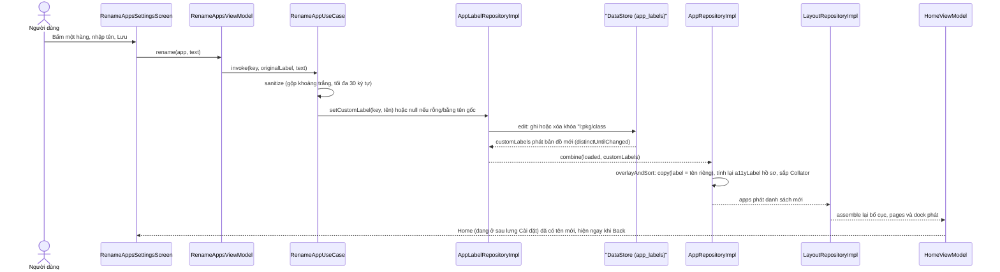
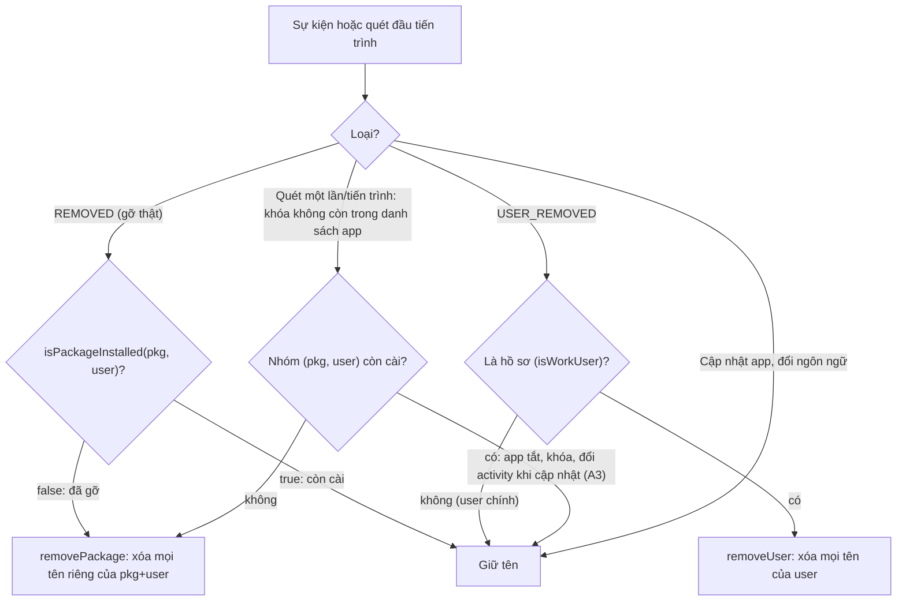
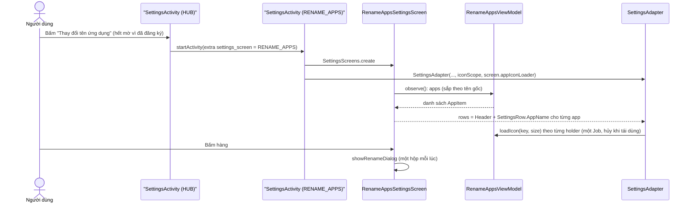

# RN — Thay đổi tên ứng dụng (màn 5.3): đọc trước khi review

**Plan:** [plans/RN-rename-apps.md](../plans/RN-rename-apps.md) · **PR:** #51 · **Nhánh:** `feature/rn-rename-apps`

## 1. Tóm tắt

Trong Cài đặt có thêm mục **"Thay đổi tên ứng dụng"** (màn 5.3 của bản nháp Figma, ô `RENAME_APPS` của trung tâm Cài đặt G2d, trước đó hiện mờ "Sắp có"). Màn là danh sách mọi app (kể cả app đang ẩn), mỗi hàng có icon, tên đang dùng và dòng phụ "Tên gốc: …" nếu đã đổi. Bấm một hàng mở hộp thoại một ô nhập với **Lưu / Khôi phục / Hủy** (Khôi phục chỉ hiện khi app đã đổi tên). Tên mới hiện ở **mọi nơi app xuất hiện** (lưới Home, dock, thư mục, App Library, tìm kiếm, Ứng dụng đã ẩn, trợ năng) và Home cập nhật ngay khi quay lại, không cần khởi động lại. Tìm kiếm khớp cả tên riêng (xếp trước) lẫn tên gốc. Không đổi schema Room, không sửa file độc quyền nào.

**Trạng thái kiểm chứng (khi viết file này):** code đã build xanh (`assembleDebug`) và đã qua review điều phối từng Task; **số đo cold start đã có** (mục 5); **kiểm tay các màn và các kịch bản `pm` trên máy: chưa chạy**, gom vào bài kiểm cuối ở mục 7 và trong plan.

## 2. Kiến thức nền

- **`ComponentKey`.** Một "app" của launcher là một *activity khởi động* chứ không phải một package: `ComponentKey(packageName, className, userSerial)`. `userSerial` là số của user/hồ sơ (user chính 0, hồ sơ công việc số khác), nên "Chrome" cá nhân và "Chrome" công việc là hai khóa khác nhau. Đây cũng là khóa của Room, cache icon, cache nhãn. (đọc code: `domain/model/AppItem.kt`)
- **`LabelCache` (LC).** File `no_backup/app_label_cache.json` giữ **nhãn do hệ thống đặt** để khỏi đọc lại ~87–345 nhãn mỗi lần khởi động (đọc nhãn là phần chậm nhất của cold start). Nó là *cache*: đổi locale hoặc `Build.FINGERPRINT` thì bỏ cả file, nhãn của app có `sourceDir` đổi (cập nhật APK) thì bỏ từng mục. Vì vậy **tên người dùng tự đặt không được nằm ở đó**. (đọc code `LabelCache.kt`, plan LC D1–D7)
- **DataStore Preferences.** Kho khóa-giá trị bất đồng bộ, ghi nguyên tử, đọc qua `Flow` phát lại mỗi khi *bất kỳ* khóa nào trong cùng file đổi. Dự án đã có một file (`launcher_settings`); RN thêm file thứ hai `app_labels`. Quy tắc cũ: `preferencesDataStore` phải là delegate **cấp file**, không đặt trong `object`. (đọc tài liệu + AGENTS.md)
- **`combine` và `stateIn`.** `combine(a, b)` chỉ phát khi **cả hai** nguồn đã có giá trị đầu, rồi phát lại mỗi khi một nguồn đổi. Nhờ đó `AppRepository.apps` phát đúng **một** lần ở lần nạp đầu, với tên riêng đã áp (không có chuyện hiện tên gốc rồi nháy sang tên riêng). `stateIn(WhileSubscribed(5_000))` giữ một nguồn dùng chung cho mọi bên thu.
- **`a11yLabel` của app hồ sơ công việc.** FX5 thêm `AppItem.a11yLabel` ("Chrome (Công việc)", do `PackageManager.getUserBadgedLabel` dịch) chỉ dùng làm `contentDescription`. Với tên riêng, hậu tố này phải tính lại từ **tên mới**.

## 3. Luồng hoạt động

**Đổi tên một app.** Điểm mấu chốt: `AppRepository.apps` là chỗ **duy nhất** áp tên. Mọi nơi hiển thị app đã đọc từ đó (kiểm bằng grep `\.label`), nên không phải sửa Home, thư viện hay tìm kiếm để hiện tên mới.

Giải thích: (1) Đổi tên **không** chạy lại `getActivityList` hay đọc nhãn: chỉ phần phủ `overlayAndSort` chạy lại; `loaded` (nguồn từ hệ thống, nhãn gốc, qua LC) vẫn như cũ. (2) `HomeViewModel` thu `layoutRepository.pages` suốt đời ViewModel nên Home nhận tên mới dù Activity đang dừng; `HomePage`, `PlacedApp`, `DockApp` là data class chứa `AppItem` nên `DiffUtil`/`==` thấy khác và bind lại đúng ô; khóa icon (`AppIconKey`) không chứa nhãn nên icon không nháy. (đọc code, chưa kiểm trên máy) (3) `LayoutRepositoryImpl` chạy lại `placeNewApps` mỗi lần `apps` phát; hàm này idempotent.

**Vòng đời của tên khi app đổi trạng thái.** Tên gắn với khóa component; dọn khi gỡ thật, giữ khi chỉ tắt/khóa.

Không bao giờ xóa vì "vắng khỏi danh sách" (app bị tắt, khóa hay thẻ nhớ tháo cũng vắng): chốt `isPackageInstalled` là cùng nguyên tắc Q11 của FX3. Danh sách app rỗng (hệ thống từ chối) thì quét không kết luận gì.

**Mở màn 5.3 và hộp thoại.**

## 4. Thay đổi theo file

Đường dẫn Kotlin từ `app/src/main/java/gambi/global/os26launcher/`. **Đọc trước:** `data/apps/AppRepositoryImpl.kt` (lớp phủ, quét mồ côi), `ui/settings/RenameAppsSettingsScreen.kt`, `data/apps/AppLabelRepositoryImpl.kt`.

| File | Vai trò | Vì sao thêm/sửa |
|---|---|---|
| `domain/model/AppItem.kt` | Sửa | Thêm `originalLabel` (mặc định = `label`); `label` giờ là **tên hiển thị** |
| `domain/repository/AppLabelRepository.kt` | Tạo | Giao diện `customLabels`, `setCustomLabel`, `removePackage`, `removeUser` |
| `domain/usecase/RenameAppUseCase.kt`, `RestoreAppLabelUseCase.kt` | Tạo | Chuẩn hóa đầu vào (`sanitize`, tối đa 30), rỗng/bằng tên gốc = khôi phục |
| `data/apps/AppLabelKeys.kt`, `AppLabelRepositoryImpl.kt` | Tạo | Khóa `l:<pkg>/<class>#<serial>`, DataStore riêng, lỗi đọc thành bản đồ rỗng |
| `data/apps/AppRepositoryImpl.kt` | Sửa | `loaded` (từ hệ thống, chưa sắp) + `combine` + `overlayAndSort`; dọn tên mồ côi (sự kiện + quét một lần) |
| `data/apps/LauncherAppsDataSource.kt` | Sửa nhỏ | `badgedLabelFor(label, userSerial)` cho `a11yLabel` hồ sơ |
| `di/DataStoreModule.kt`, `RepositoryModule.kt` | Sửa (chỉ thêm) | Provider `@Named("app_labels")`, `@Binds` |
| `ui/search/SearchViewModel.kt` | Sửa 1 chỗ | `keywords = [tên gốc]` khi khác tên riêng |
| `ui/settings/RenameAppsSettingsScreen.kt`, `RenameAppsViewModel.kt` | Tạo | Màn 5.3, hộp thoại, danh sách, nạp icon |
| `ui/settings/SettingsRow.kt`, `SettingsAdapter.kt`, `SettingsScreen.kt`, `SettingsActivity.kt` | Sửa (chỉ thêm) | Hàng `AppName`, holder có icon, `onAppNameClicked`, `appIconLoader`, một dòng ở khung; **xem ghi chú mở rộng công thức G2d bên dưới** |
| `res/layout/item_settings_app_name.xml`, `dialog_rename_app.xml`, `res/values/strings.xml` | Tạo/Sửa | Layout hàng, hộp thoại, khối chuỗi `settings_rename_` ở cuối file |

**Ghi chú: mở rộng công thức "thêm màn" của G2d.** Công thức G2d là "một file `XxxSettingsScreen.kt` + thay một dòng ở `SettingsScreens`". Màn 5.3 **không đủ** với công thức đó vì `SettingsRow.Value.title` là `@StringRes` mà tên app là chuỗi động. Vì vậy RN thêm (chỉ thêm, không đổi cái cũ): (1) kiểu hàng `SettingsRow.AppName` và `AppNameHolder` trong `SettingsAdapter`; (2) callback `onAppNameClicked` (tham số có mặc định ở adapter, phương thức mặc định rỗng ở `SettingsScreen`); (3) **hook nạp icon**: `SettingsScreen.appIconLoader` (mặc định `null`) và hai tham số tùy chọn `iconScope`, `loadIcon` của adapter; `SettingsActivity` truyền `lifecycleScope` và bộ nạp của màn (một dòng). Màn khác không khai báo hook thì không có gì đổi. Nhánh sau cần hàng có chuỗi động hoặc icon (ví dụ 5.2 Thay đổi biểu tượng của CI) nên dùng lại hai thứ này thay vì thêm bản thứ hai.

## 5. Quyết định và đánh đổi

(Chi tiết và so sánh ở plan "Vì sao chọn thiết kế này"; ở đây chỉ phần cốt lõi.)

- **Lưu ở DataStore riêng `app_labels`, mỗi app một khóa** (plan phương án E). Bỏ Room (schema khóa; `launcher_items` là *vị trí*, app ẩn không có hàng), bỏ cột trên `launcher_items`, bỏ chung `launcher_settings` (mỗi lần đổi tên phát lại `settings` cho mọi bên thu và ghi lại cả file; file settings hỏng thì mất cả tên lẫn cài đặt; chính LC đã loại DataStore chung), bỏ file JSON tự viết (không sao lưu, tự viết lại DataStore). Theo gợi ý mẫu của nhánh WU: repository riêng + file khóa riêng, không đụng `SettingsKeys`/`SettingsRepositoryImpl`.
- **Áp tên ở `AppRepositoryImpl.apps`** (overlay), không ở từng chỗ hiển thị: một chỗ, không sửa file độc quyền nào. Đánh đổi: `apps` phát lại sau mỗi lần đổi tên (hiếm), `LayoutRepositoryImpl` chạy lại `placeNewApps` (idempotent).
- **`LabelCache` và cache icon không đổi**: tên riêng áp **sau** `loadApps`, nên cache vẫn chỉ nhận tên gốc; khóa icon không chứa nhãn.
- **Sắp xếp theo tên hiển thị** trong Library, tìm kiếm a–z và danh sách ẩn; riêng màn 5.3 sắp theo **tên gốc** để hàng không nhảy chỗ sau khi lưu.
- **Tìm kiếm khớp cả hai** (Q3): tên riêng là nhãn (hạng 0–2), tên gốc là từ khóa (hạng 3–4).
- **Hộp thoại, không sửa tại chỗ** (Q2): hàng mở rộng trong `RecyclerView` mất ô nhập/tiêu điểm mỗi lần danh sách phát lại.
- **Hạn chế v1 đã biết (Q4):** app cập nhật mà **đổi tên activity khởi động** (A3 của FX3) thì khóa cũ không còn khớp: app hiện lại tên gốc, mục cũ nằm lại (mồ côi, vô hại). Không làm re-point (có thể gán nhầm tên cho activity khác cùng package).
- **Gỡ thật rồi cài lại không giữ tên** (Q5); **tên được Auto Backup sao lưu** (Q7; khóa hồ sơ công việc có thể không khớp sau khôi phục, mục đó tự bị quét như mồ côi).

**Số đo cold start (đo được; điều phối, Vsmart Live 4, 2026-11-13, bản debug của commit `4059aa6` mang log đo tạm, md5 7829bc7e, 6 lần `force-stop` + `am start`; chỉ là số tương đối trong cùng một build, vì bản debug khởi động chậm hơn release khoảng 4 lần).** Ba mốc log: `labels#1` = lần đọc đầu file `app_labels`; `loaded#1` = lần nạp đầu từ hệ thống (trước thay đổi này, đây chính là lần phát đầu của `apps`); `apps#1` = lần phát đầu của `AppRepository.apps` sau khi áp tên. Đơn vị ms từ lúc tiến trình bắt đầu.

| lần | labels#1 | loaded#1 | apps#1 |
|---|---|---|---|
| 1 | 995 | 1068 | 1099 |
| 2 | 942 | 1067 | 1082 |
| 3 | 918 | 1037 | 1050 |
| 4 | 914 | 1020 | 1043 |
| 5 | 934 | 1065 | 1085 |
| 6 | 923 | 1001 | 1021 |

Mọi lần: `labels` size 0, `loaded` size 81, `apps` size 81; **một** lần phát `apps` mỗi lần khởi động (không có `apps#2`). `labels − loaded` = −73 đến −131 ms: đọc file xong **trước** khi nạp từ hệ thống nên không thêm độ trễ. `apps − loaded` = 13–31 ms, đã gồm phép sắp `Collator` trước đây nằm trong `loadSorted`. **Kết luận: không thấy chi phí khởi động khi chưa có tên riêng nào. Chưa đo:** khi có nhiều tên riêng, trên Oppo A3x (345 app), và trên bản release. Log đo tạm đã gỡ (`git revert`, commit `2f1c419`); `grep RN-TMP` rỗng.

## 6. Chỗ cần soi khi review

1. **`AppRepositoryImpl`**: `apps` = `combine(loaded, customLabels)` rồi `flowOn(io)` và `stateIn` (một nguồn dùng chung, phép sắp và IPC của `badgedLabelFor` nằm ngoài luồng chính). `loadBase` giữ nguyên mọi phần phụ cũ (so stamp, dọn icon, `USER_REMOVED` giả).
2. **Dọn mồ côi** (`init` và `sweepOrphanLabels`): mỗi sự kiện bọc `try/catch` (ApplicationScope không có handler); `isPackageInstalled == false` là chốt; `USER_REMOVED` chỉ cho `isWorkUser`; quét một lần/tiến trình, nền, bỏ qua danh sách rỗng. **Chỉ được code bảo vệ, chưa kiểm tay**: gỡ app thật, tắt/bật app, kill launcher giữa lúc gỡ, hồ sơ công việc.
3. **Lỗi lưu trữ không giết `apps`**: `AppLabelRepositoryImpl` biến `IOException` thành bản đồ rỗng; DataStore có `ReplaceFileCorruptionHandler`. Chưa thử làm hỏng file `app_labels` trên máy.
4. **Hộp thoại**: chữ đặt **trước** `InputFilter` (tên gốc dài hơn 30 hiện nguyên); không đổi chữ thì Lưu không làm gì (tránh lưu tên bị cắt); Lưu tắt khi rỗng sau chuẩn hóa; một hộp mỗi lúc; `onDestroy` gỡ listener rồi `dismiss()`.
5. **Hàng có icon** (`AppNameHolder`): một `Job` mỗi holder, hủy khi bind lại và `onViewRecycled`; guard key+stamp sau khi nạp (mẫu `AppLibraryAdapter`, bẫy "icon nhảy sai dòng khi cuộn nhanh").
6. **Không sửa ngoài vùng**: diff không có `ui/home/*`, `data/layout/*`, `LabelCache`, `IconCache`, `IconDiskCache`, `IconLoader`, manifest, schema Room (đã kiểm bằng `git diff origin/main --name-only`).
7. **Ảnh hưởng tới tính năng cũ:** thứ tự sắp xếp nay theo tên hiển thị (không đổi khi chưa có tên riêng); `AppItem` có thêm trường (không ảnh hưởng nơi dựng cũ); thêm callback `LauncherApps` thứ hai (từ `AppRepositoryImpl.init`, như `LayoutRepositoryImpl.init` đã làm).
8. **Chưa đo:** nhiều tên riêng; Oppo; bản release; bộ nhớ khi cuộn hết danh sách 345 app.

## 7. Cách kiểm lại

Bài kiểm tay gộp cho chủ dự án nằm ở mục **"Bài kiểm cả tính năng"** của [plan](../plans/RN-rename-apps.md) (thứ tự thao tác tự nhiên, máy Vsmart Live 4, xác nhận máy rảnh trước khi cài). Tóm tắt các cụm: (A) màn 5.3 và hộp thoại; (B) Home làm mới không khởi động lại; (C) Library, tìm kiếm, ẩn; (D) bền qua `force-stop`; (E) kịch bản `pm` với APK thử FX3 (gỡ, tắt/bật, kill launcher giữa lúc gỡ); (F) tùy chọn: hồ sơ công việc tạm bằng Test DPC; (G) TalkBack; (H) đổi ngôn ngữ; (I) hồi quy.

## 8. Bài học cho AGENTS.md

(Điều phối đưa vào file chủ đề ở `docs/lessons/` sau khi merge. Mỗi dòng có ngày và nhãn nguồn.)

- **`icons-and-app-list`** — Dữ liệu người dùng tự đặt cho một app (tên riêng) áp bằng **lớp phủ sau `loadApps`** ở `AppRepositoryImpl`, không ghi vào cache nhãn LC (cache bị xóa theo locale/fingerprint/stamp) và không vào cache icon (khóa không chứa nhãn). Một chỗ áp là đủ vì mọi nơi hiển thị đều đọc `AppRepository.apps` (đọc code, 2026-11-13). Khóa theo `ComponentKey` gồm `userSerial` để hồ sơ công việc tách riêng (đọc code).
- **`icons-and-app-list`** — Với tên riêng, `a11yLabel` của app hồ sơ phải tính lại từ **tên mới** bằng `getUserBadgedLabel`; hạn chế A3 (đổi activity khi cập nhật thì mất tên riêng) được chấp nhận và ghi rõ (đọc code, 2026-11-13; chưa kiểm trên máy).
- **`startup-performance`** — Thêm một nguồn vào đường nạp `apps` bằng `combine` và một file DataStore riêng: `labels#1` (đọc file) xong trước `loaded#1` (nạp từ hệ thống) 73–131 ms, `apps#1` chỉ sau `loaded#1` 13–31 ms gồm cả phép sắp; một lần phát `apps` mỗi lần khởi động (đo được, Live 4, debug, 6 lần, 0 tên riêng, 2026-11-13). Chưa đo với nhiều tên riêng và trên Oppo.
- **`startup-performance`** — **Build sạch lần đầu trong worktree mới mất 6 phút 32 giây** (`assembleDebug`, máy dev Windows, 2026-11-13, đo được; AGENTS.md ghi "chưa đo"); các lần build tăng dần sau đó 43 giây đến 4 phút 09 giây tùy file đổi (đo được).
- **`settings-and-data`** — Dữ liệu người dùng riêng lẻ, theo khóa động, nên có **file DataStore riêng** (repository riêng, file khóa riêng, `ReplaceFileCorruptionHandler`) thay vì chung `launcher_settings`: tránh phát lại `settings` và tránh mất cài đặt khi file hỏng (đọc code, 2026-11-13). Provider thứ hai cần qualifier (`@Named`); trên tham số constructor dùng `@param:Named` để hết cảnh báo KT-73255 (đo được: cảnh báo biến mất sau khi đổi).
- **`settings-and-data`** — Công thức "thêm màn" của G2d cần mở rộng khi hàng có **chuỗi động** hoặc **icon**: kiểu hàng `AppName`, callback có mặc định, hook `appIconLoader` (mặc định `null`) cho adapter (đọc code, 2026-11-13).
- **`settings-and-data`** — Hộp thoại có ô nhập: đặt chữ **trước** `InputFilter.LengthFilter` và coi "không đổi chữ" là không làm gì, nếu không tên gốc dài hơn giới hạn sẽ bị cắt thành tên riêng ngoài ý muốn (đọc code, 2026-11-13; chưa kiểm trên máy).
- **`permissions-and-device-testing`** (làm việc với agent, không phải máy) — Trong Git Bash, **hai heredoc `<<'EOF'` lồng nhau** (một cho `python`, một cho `cat`) làm cả lệnh lỗi "unexpected EOF" và không áp gì cả; viết file bằng công cụ Write/Edit hoặc dùng dấu kết thúc khác nhau (đo được, 2026-11-13). Công cụ Edit đòi đã `Read` file trong cùng phiên; file Kotlin của dự án là CRLF và Edit giữ đúng CRLF (đo được).
