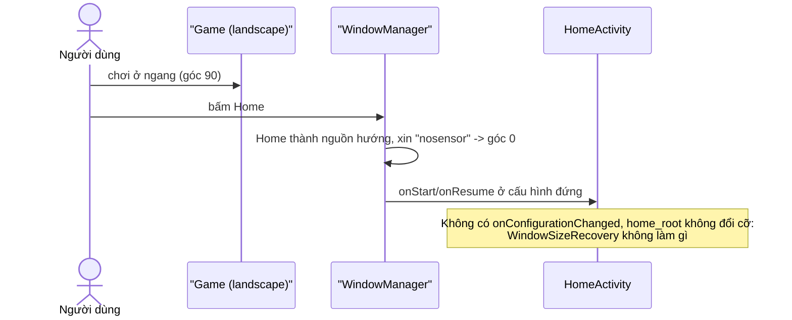
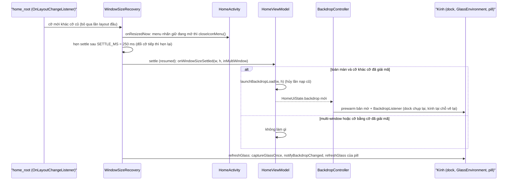

# RR — Hồi phục hướng màn hình: đọc trước khi review

**Plan:** [plans/RR-rotation-recovery.md](../plans/RR-rotation-recovery.md) · **PR:** #43 · **Nhánh:** `fix/rr-rotation-recovery`

## 1. Tóm tắt
Trước RR: mở một game ngang rồi bấm Home thì launcher **ở luôn chiều ngang** (ảnh nền kéo giãn, lưới và dock bị ép thành dải ngang). RR làm hai việc:
1. Home, Cài đặt và "Ứng dụng đã ẩn" xin hướng `nosensor` thay vì `locked`/theo cảm biến: luôn về **hướng tự nhiên** của máy (đứng trên điện thoại), bất kể màn đang xoay thế nào lúc chúng hiện ra.
2. Khi cửa sổ Home thật sự đổi cỡ (split-screen, gập/mở, đổi cỡ màn, máy lớn xoay), `WindowSizeRecovery` dựng lại những thứ chỉ tính một lần theo cỡ màn (ảnh nền, kính, menu nhấn giữ), **một lần**, sau khi cỡ đã đứng yên.

## 2. Kiến thức nền
- **`android:screenOrientation`** (thuộc tính Activity trong manifest, [tài liệu](https://developer.android.com/guide/topics/manifest/activity-element#screen)): Activity đang ở trên cùng toàn màn là **nguồn quyết định hướng** của màn hình (`dumpsys` gọi là `mLastOrientationSource`). Giá trị nó xin quyết định góc xoay:
  - `locked`: "giữ góc xoay hiện tại, dù là gì" (đọc tài liệu `SCREEN_ORIENTATION_LOCKED`). Đang ngang thì giữ ngang — chính là lỗi.
  - `nosensor`: không theo cảm biến, và **không** chịu khóa xoay của người dùng (`user_rotation`), nên rơi về góc 0 = hướng tự nhiên (đọc nguồn AOSP `DisplayRotation`, theo trí nhớ; **đo được** trên Live 4, mục 7). Launcher3 của AOSP dùng đúng giá trị này khi tắt "cho xoay màn hình chính" (đọc nguồn `RotationHelper`).
  - `portrait`: hướng **cố định**; trên Android 12+ Activity hướng cố định có thể bị "letterbox" (đóng khung) trong vùng hiển thị khác tỉ lệ, rủi ro cho split-screen (đọc tài liệu, chưa đo). Vì vậy không chọn.
- **`android:configChanges`**: Home khai `orientation|screenSize|...` nên khi cấu hình đổi, Activity **không** bị dựng lại mà nhận `onConfigurationChanged` (lý do: dựng lại bắt mọi kính chụp lại nền, `project_structure.md` mục 4). Dù không dựng lại, cửa sổ đổi cỡ thì cây view vẫn đo và đặt lại toàn bộ — cái bị bỏ sót chỉ là thứ tính **một lần** theo cỡ.
- **Màn lớn (sw ≥ 600dp) từ Android 16:** app nhắm API 36+ bị bỏ qua yêu cầu hướng cố định, không có cách tắt từ API 37 (đọc tài liệu "Android 16 behavior changes"). Dự án nhắm API 37; RR không làm gì riêng cho màn lớn (D8, giới hạn đã biết), nhưng đường hồi phục vẫn giúp Home bố cục đúng nếu hệ thống cho nó chạy ngang.

## 3. Luồng hoạt động

**Bấm Home khi game ngang đang chạy** (đo được trên Live 4: Home không nhận cấu hình ngang nào):

Trước RR, ở bước thứ ba Home xin `locked` nên WM giữ góc 90.

**Cửa sổ Home đổi cỡ** (split-screen, `wm size`, gập/mở, máy lớn):

- Lần layout đầu (cỡ cũ 0x0) không tính là đổi cỡ: `HomeViewModel.onScreenSize` đã giải mã đúng cỡ đó. Nhờ vậy Activity dựng lại do đổi sáng/tối không giải mã thừa.
- So với cỡ **ViewModel** đã giải mã (sống qua recreate), không so với trạng thái của controller.
- Split-screen không giải mã lại (giữ hành vi M5: ảnh toàn màn + `centerCrop`); ra khỏi split-screen cỡ về bằng cỡ cũ nên cũng không giải mã.

## 4. Thay đổi theo file
| File | Vai trò | Vì sao thêm/sửa | Đọc trước? |
|---|---|---|---|
| `app/src/main/AndroidManifest.xml` | Hướng của Home, Cài đặt, Thư viện | `locked` → `nosensor` (Home); thêm `nosensor` cho `SettingsActivity`, `AppLibraryActivity` (D7) | **Có** |
| `ui/home/controller/WindowSizeRecovery.kt` (mới) | Gom đổi cỡ, chạy việc rẻ ngay, việc đắt sau khi cỡ đứng yên | Chỗ trung tâm duy nhất cho hồi phục; không rải vào `core/glass` hay pager | **Có** |
| `ui/home/HomeViewModel.kt` | `onWindowSizeSettled` + `decodedW/decodedH` | Bitmap ảnh nền được cắt theo tỉ lệ cửa sổ lúc giải mã; cỡ toàn màn đổi thì giải mã lại | **Có** |
| `ui/home/HomeActivity.kt` | Dựng và nối `WindowSizeRecovery`; `onConfigurationChanged` | ~15 dòng thêm, không sửa dòng cũ | |

## 5. Quyết định và đánh đổi
- `nosensor` thay `portrait`/`locked`/code (D1, D7); bảng phương án ở plan, mục "Vì sao chọn thiết kế này".
- Gom việc đắt 250 ms thay vì dựng lại Activity (`recreate`) hay để từng view tự lo (D2, D3).
- Chỉ đóng menu nhấn giữ khi đổi cỡ (D5, chủ dự án chốt): vị trí menu tính lúc mở; các lớp phủ khác tự bố cục lại.
- Không giải mã lại ở multi-window (D4).
- Màn lớn: không làm (D8). Thời gian 0,3-0,6 s ảnh nền sai tỉ lệ ở ca hiếm: chấp nhận (D9).
- App Library không sửa: `translationX` cũ chỉ lộ nếu đổi cỡ đúng lúc đang trượt; p = 0 thì view `GONE`, p = 1 thì `translationX = 0`.

## 6. Chỗ cần soi khi review
- `WindowSizeRecovery.layoutListener`: điều kiện bỏ qua lần layout đầu (old ≤ 0). Sai chỗ này thì mỗi lần dựng lại Activity sẽ chạy hồi phục thừa.
- `runSettle` giữ cờ `pending` khi Activity chưa resumed; `onResume` hẹn lại. `onDestroy` gỡ hẹn giờ và listener.
- `HomeViewModel.onWindowSizeSettled` chặn multi-window **trước** `rememberScreenSize`: nếu nhớ cỡ split-screen vào `lastScreenW/H`, lần nạp lại ở `onResume` (ảnh nền đổi ở Cài đặt) sẽ giải mã theo tỉ lệ nửa màn, trái D4 (điều phối phát hiện khi review). Lưu ý: `BackdropController.onResume` vẫn truyền cỡ `homeRoot` hiện tại vào `reloadBackdropIfChanged` như trước RR, nên đổi ảnh ở Cài đặt rồi quay về Home **đang** split vẫn giải mã theo cỡ split (hành vi cũ, không đổi); ra khỏi split thì `settle` giải mã lại theo cỡ toàn màn.
- `HomeViewModel.launchBackdropLoad` gán `decodedW/H` đồng bộ trước khi chạy coroutine (cùng lý do `shownBackdropVersion`).
- `reloadBackdropIfChanged` (onResume, ảnh đổi ở Cài đặt) cũng đi qua `launchBackdropLoad` nên cập nhật cỡ đã giải mã — có thể là cỡ split-screen nếu đổi ảnh lúc đang split; khi ra khỏi split, settle sẽ giải mã lại theo cỡ toàn màn (đúng).
- Chỉ được code bảo vệ, chưa kiểm tay: máy lớn thật; gập/mở; đổi cỡ đúng lúc đang kéo icon.

## 7. Cách kiểm lại
Máy: Vsmart Live 4, Os26Launcher là launcher mặc định, có ảnh nền người dùng chọn, game ngang `com.example.baocaoltgamethu35`. Ghi lại `accelerometer_rotation`/`user_rotation` trước và trả lại sau. Bài kiểm đầy đủ ở plan, mục "Bài kiểm cả tính năng". Tóm tắt những gì đã đo (agent, 2026-11-12, bản debug):

| Ca | Trước RR (`locked`) | Sau RR |
|---|---|---|
| Game ngang → Home | `SurfaceOrientation: 1`, ảnh 2340x1080 (lỗi) | 5/5 + 3/3 + 5/5 lần: `SurfaceOrientation: 0`, 1080x2340 |
| Khóa xoay ngang (`accelerometer_rotation 0`, `user_rotation 1`) → Home, Cài đặt, "Ứng dụng đã ẩn" | — | cả ba đứng |
| Khởi động nguội lúc game ngang | — | đứng; lần layout đầu đã 1080x2340 |
| `wm size` 1080x1500 / 2340x1080 / `reset` | — | mỗi lần 1 `settle` (~250 ms sau layout) + 1 lần giải mã lại ảnh nền; ảnh nền đúng tỉ lệ, kính khớp |
| Đổi cỡ khi menu nhấn giữ mở | — | menu đóng |
| Đổi cỡ khi thư mục / tìm kiếm / edit mode / Library mở | — | không crash, bố cục lại, giữ trạng thái |
| Sáng/tối | — | không `settle`, không giải mã lại |
| Vào/ra split-screen | — | `settle` nhưng không giải mã lại |

Lệnh hữu ích (Git Bash cần `MSYS_NO_PATHCONV=1`):
- Hướng màn: `adb shell dumpsys input | grep SurfaceOrientation` (0 = đứng). Trên Live 4, `dumpsys window displays` liệt kê cả màn ảo ("Recording Display"...) trước màn 0 nên dễ đọc nhầm `mRotation`.
- Giả lập cửa sổ đổi cỡ mà không cần xoay: `adb shell wm size 1080x1500`, `adb shell wm size 2340x1080`, nhớ `adb shell wm size reset`.
- Vào split-screen: `adb shell am start --windowingMode 3 -n com.android.settings/.Settings`; ra: `--windowingMode 1` rồi Home.

Còn cho chủ dự án kiểm tay: cầm ngang máy ở Home (cảm biến), video theo cảm biến → Home, kéo thanh chia split-screen, nhìn chuyển cảnh game → Home.

## 8. Bài học cho AGENTS.md
- (`home-pager-animation`, 2026-11-12, đo được trên Live 4 + đọc tài liệu) **`screenOrientation="locked"` ghim góc xoay đang có, không phải hướng tự nhiên.** Home được gọi về lúc game ngang đang chạy thì ở ngang luôn. Muốn "hướng tự nhiên, không theo cảm biến" dùng `nosensor` (không chịu cả khóa xoay của người dùng; Launcher3 AOSP cũng dùng khi tắt xoay Home). Kiểm hướng mới phải thử cả chiều "Home được gọi về lúc màn đang ngang", không chỉ "mở app rồi về khi Home đang đứng" như M5 Task 1.
- (`home-pager-animation`, 2026-11-12, đọc code + đo được) **Thiếu `onConfigurationChanged` không làm mất layout lại.** Có `configChanges` thì Activity không dựng lại nhưng cây view vẫn đo/đặt lại khi cửa sổ đổi cỡ. Thứ bị bỏ sót là thứ tính MỘT lần theo cỡ: bitmap ảnh nền (cắt theo tỉ lệ cửa sổ lúc giải mã), ảnh chụp của kính thật, vị trí menu tính lúc mở. Hồi phục chúng ở một chỗ (`WindowSizeRecovery`), gom tới khi cỡ đứng yên, và so với cỡ mà ViewModel đã dùng (sống qua recreate).
- (`home-pager-animation`, 2026-11-12, đo được) **Với `nosensor`, Home dừng không nhận cấu hình ngang của app khác**: về từ game ngang, Gần đây hay khởi động nguội, Home không thấy `onConfigurationChanged` nào và `home_root` không đổi cỡ. Cửa sổ Home chỉ đổi cỡ khi split-screen, `wm size`, gập/mở hoặc máy lớn.
- (`permissions-and-device-testing`, 2026-11-12, đo được) **Đọc hướng màn trên Live 4 bằng `dumpsys input | grep SurfaceOrientation`**, không bằng `dumpsys window displays | grep mRotation`: dump có nhiều màn ảo đứng trước màn 0 nên dòng đầu tìm được là của màn khác. Giả lập "cửa sổ đổi cỡ" không cần xoay bằng `wm size WxH` / `wm size reset`; vào split-screen bằng `am start --windowingMode 3`. Activity `exported=false` không mở được bằng `am start` từ shell — đi qua giao diện.
- (`home-pager-animation`, 2026-11-12, đọc lint) Lint `DiscouragedApi` cảnh báo mọi `screenOrientation` cố định ("ignored ... from Android 16" trên màn sw ≥ 600dp). Dự án chấp nhận (D8); khi nhắm tablet phải làm bố cục ngang thật.
