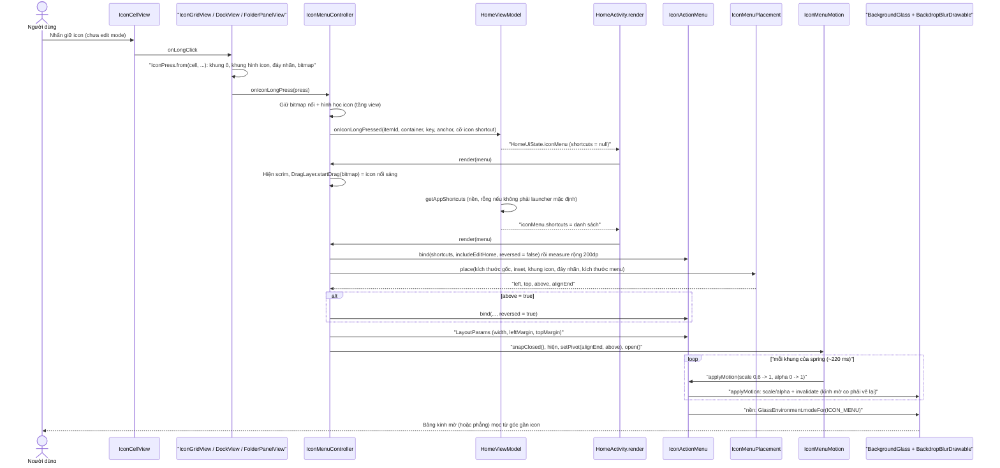
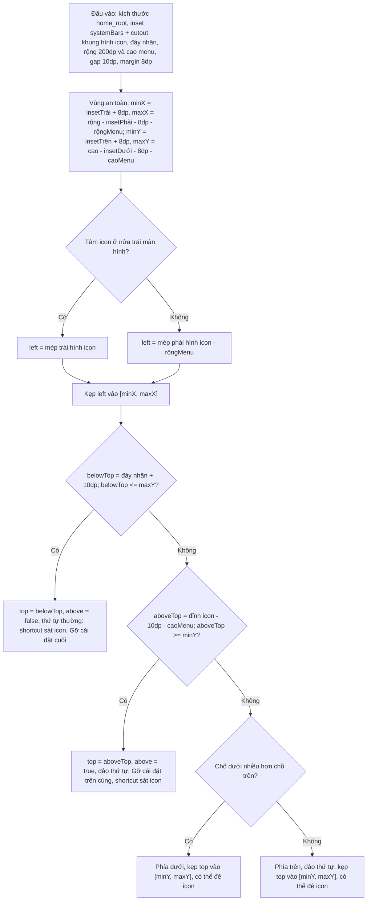
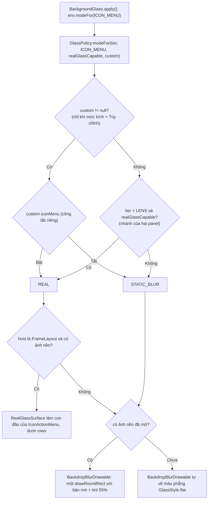
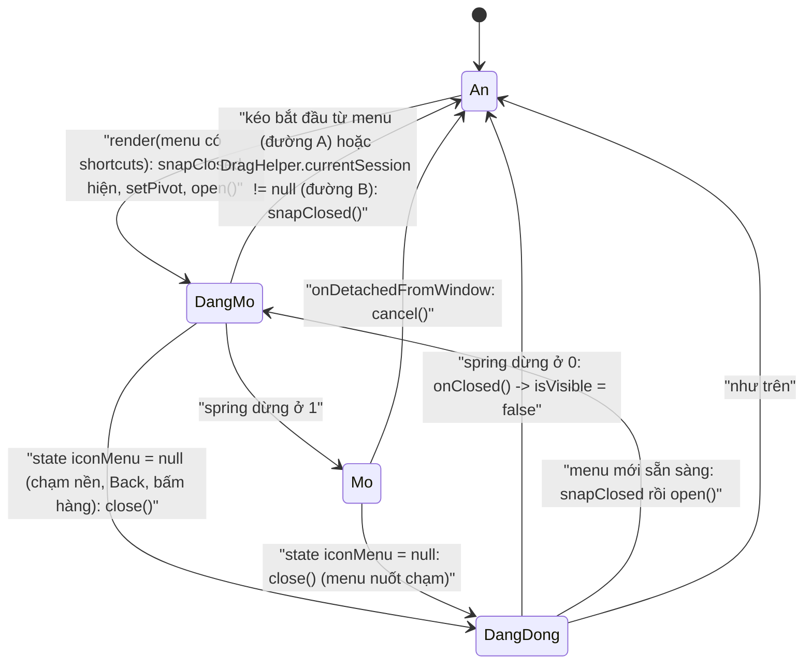

# SM — Menu nhấn giữ icon kiểu kính: đọc trước khi review

**Plan:** [plans/SM-shortcut-menu-glass.md](../plans/SM-shortcut-menu-glass.md) · **PR:** chưa mở · **Nhánh:** `feature/sm-shortcut-menu-glass`

> **Trạng thái:** xong mã và đo Oppo (2026-11-09); chờ chủ dự án xem lần cuối (cảm giác hoạt ảnh, công tắc khi có ảnh nền). Các sơ đồ khớp tên hàm thật; bằng chứng ở plan, mục "Bằng chứng Review Focus", tóm tắt ở mục 7.

## 1. Tóm tắt

Nhấn giữ một icon (lưới Home, dock hoặc trong panel thư mục) vẫn mở menu như M7, nhưng menu giờ học theo mẫu của launcher mẫu trên Oppo: một bảng **kính mờ** bo góc 24dp, rộng 200dp, hàng thấp (35dp nhìn thấy), chữ 15sp, có icon đầu hàng; mọc ngay **dưới** icon, mép menu thẳng mép icon theo nửa màn hình icon đang đứng, thiếu chỗ thì **lật lên trên** và đảo thứ tự hàng. Kính sáng hay tối đi theo chế độ tối của hệ thống. Menu **co + mờ từ góc gần icon** khi mở (~220 ms) và thu lại khi đóng (~150 ms). Kính như panel (thật trên LENS, mờ nơi khác); ở mức kính **Tùy chỉnh** có một công tắc riêng (bật = kính thật, tắt = kính mờ). Nội dung hàng không đổi.

## 2. Kiến thức nền

- **Kính mờ tại chỗ (`BackdropBlurDrawable`, GL):** không phải blur thời gian thực. App giữ sẵn một bản nhỏ đã làm mờ của ảnh nền (`BlurredBackdropCache`, dựng ngoài main thread); mỗi lần vẽ, drawable cắt đúng lát của bản mờ nằm sau vị trí hiện tại của view rồi phủ một lớp tint, tất cả trong **một** lệnh `drawRoundRect`. Vì lấy từ ảnh nền chứ không từ màn hình, kính không thấy icon hay scrim phía sau, nên menu sáng hơn nền đã bị làm tối: đúng như mẫu (đọc code, GL).
- **`GlassPolicy` / `GlassRole` / `GlassStyle`:** role là "phần tử nào", policy là hàm thuần quyết "kính thật hay mờ" theo tier máy, khả năng Lens và mức kính người dùng (GS), style là bộ màu. Menu thêm role `ICON_MENU`, luôn mờ tĩnh (plan D1).
- **Tài nguyên `values-night`:** Android tự chọn `res/values-night/colors.xml` khi hệ thống ở chế độ tối. Đổi chế độ làm Activity được tạo lại nên màu tự đúng mà không cần nghe sự kiện (đọc tài liệu Android "Dark theme").
- **Inset hệ thống:** Home vẽ tràn viền; vùng an toàn để kẹp menu là `WindowInsetsCompat.Type.systemBars() | displayCutout()` (thanh trạng thái, thanh điều hướng, tai thỏ).
- **Z-order trong `FrameLayout`:** con đứng sau trong XML vẽ đè con đứng trước, **trừ khi** con có `elevation` cao hơn. Vì vậy plan bỏ `elevation` của menu (D8).

## 3. Luồng hoạt động

### 3.1 Nhấn giữ icon → menu hiện



Chỗ dễ sai:
- Menu chỉ được đặt chỗ **một lần**, sau khi shortcut nạp xong (giữ quy tắc M7: không nhảy vị trí khi thêm hàng).
- Hình học dùng để đặt menu là **khung hình icon** và **đáy nhãn**, không phải khung ô; còn `IconMenuState.anchor` (khung ô) vẫn dùng cho phép thử "nhấn giữ lại đúng icon nổi" trên scrim.
- Chiều cao menu không đổi khi đảo thứ tự, nên đo một lần với thứ tự thường rồi mới quyết phía.
- Kính không tốn thêm khung khi mở: không có kính thật, không vòng `invalidate()` ngoài lúc spring chạy; bản mờ nhỏ đã có sẵn từ các phần tử kính khác.
- `snapClosed()` TRƯỚC khi hiện: `onClosed` của lần trước sẽ ẩn menu, nên phải gọi nó rồi mới `isVisible = true`, không thì menu bị ẩn ngay.

### 3.2 Luật đặt vị trí (`IconMenuPlacement.place`)



Ví dụ (tính từ số đo Oppo, 2 px/dp): icon hàng 3 cột 3, hình icon [368+28 .. 528−28] = [396..500] px → nửa phải → menu [100..500] px; mẫu đo được [98..498]. Icon dock: dưới không đủ chỗ nên lật lên trên. Ca cuối (đè icon) chỉ xảy ra khi menu cao hơn nửa vùng an toàn, ví dụ chia đôi màn hình.

### 3.3 Kính chọn chế độ thế nào (Task 1, 4; sửa 2026-11-09: D15)



Menu đi cùng nhánh hai panel (chủ dự án 2026-11-09 chọn "công tắc = giao cho người dùng"): kính thật tốn một khung ~24 ms mỗi lần mở (GL Task 7), chấp nhận vì là tùy chọn. `GlassPolicy` không trả `FLAT` cho menu. Lần đầu (D12) menu chỉ có kính mờ tint 72% và công tắc "mờ / phẳng"; chủ dự án bật/tắt không thấy khác biệt (72% so với 95% gần như cùng một bảng sáng) nên đổi sang D15 và hạ tint sáng xuống 55% (`#8CF5F5F7`; tối giữ `#8C1C1C1E`). Màu `shortcut_menu_*` có hai bản: `values/colors.xml` (sáng) và `values-night/colors.xml` (tối); Activity tạo lại khi đổi chế độ tối nên không cần nghe sự kiện.

### 3.4 Công tắc kính của menu trong Cài đặt (Task 4, D15)

```mermaid
sequenceDiagram
    actor U as Người dùng
    participant S as SettingsActivity
    participant VM as SettingsViewModel
    participant R as SettingsRepositoryImpl
    participant GE as GlassEnvironment
    participant BG as "BackgroundGlass (menu)"
    U->>S: Mức kính = Tùy chỉnh
    Note over GE: seedFor(mức trước): iconMenu = real(ICON_MENU), vào Tùy chỉnh không đổi màn hình
    S->>S: "buildGlassCustomRows: 4 hàng cũ + Header 'Menu nhấn giữ icon (bật = kính thật, tắt = kính mờ)' + Switch ID_GLASS_CUSTOM_ICON_MENU"
    U->>S: Gạt công tắc menu
    S->>S: "glassElementOf(row.id) = ICON_MENU; bật mà máy không có kính thật (API < 33) thì hỏi cảnh báo như các hàng khác"
    S->>VM: "onGlassCustomToggled(ICON_MENU, on)"
    VM->>R: "setGlassCustomElement -> prefs[glass_custom_icon_menu] = on"
    R-->>GE: "settings flow phát GlassConfig mới"
    GE-->>BG: "listener: apply() -> modeFor(ICON_MENU) = REAL / STATIC_BLUR"
    Note over BG: menu đổi nền ngay cả khi đang gắn; Home dựng lại ở onResume như các công tắc khác
```

Cùng nghĩa bốn công tắc GS. Khóa vắng đọc thành TẮT (kính mờ): người dùng đã ở Tùy chỉnh từ trước giữ hành vi cũ. Khóa **không** nằm trong `glassCustomSaved` (nếu có, người dùng cũ chưa gieo sẽ bị coi nhầm là đã có cấu hình).

### 3.5 Hoạt ảnh mở/đóng (Task 5)



- `IconMenuMotion.apply(p)`: `scale = 0.6 + 0.4 * p`, `alpha = clamp(p * 2.5)`; co quanh góc gần icon P (`alignEnd`, `above` do `IconMenuPlacement` trả) bằng scale quanh tâm + dịch `(P - tâm)(1 - scale)` (như `PanelMotion`, vì `applyMotion` không đặt pivot của kính thật). Áp lên `rows` và kính thật bằng một `BackgroundGlass.applyMotion`; host (`IconActionMenu`, `FrameLayout`) đứng yên.
- **Kính thật khi co (D17):** chụp theo chỗ đã layout (`setCaptureAtLayoutPosition(true)`, AN Task 9g), `invalidate()` bị chặn, chụp MỘT lần sau khi hiện (đường tự chụp của `BackgroundGlass` khi host từ ẩn sang hiện); không chụp lại theo khung. Kính mờ thì vẽ lại mỗi khung.
- Mở: `Spec(stiffness 700, damping 0.9)`; đóng: `Spec(1400, 1.0)`. Là điểm xuất phát chỉnh tay (chưa đo cảm giác).
- Kính mờ tĩnh bị co thì `BackdropBlurDrawable` phải vẽ lại mỗi khung (đã xử lý ở `BackgroundGlass.applyMotion`, AN Task 2); menu nhỏ nên rẻ.
- Scrim và icon nổi ẩn tức thì (scrim chặn chạm). Menu đang đóng nuốt chạm (`closing` + `dispatchTouchEvent`).
- `hasOverlappingRendering = false` để không tạo lớp offscreen khi alpha < 1.
- Người dùng tắt hoạt ảnh hệ thống: `SpringProgress.animateTo` thành `snapTo`, menu hiện/ẩn tức thì.

## 4. Thay đổi theo file

| File | Vai trò | Vì sao thêm/sửa | Đọc trước? |
|---|---|---|---|
| `ui/home/controller/IconMenuPlacement.kt` | Hàm thuần đặt menu | Luật popup kiểu Launcher3 (plan D5, D6) | **Có** |
| `ui/home/view/IconActionMenu.kt` | View menu | Kính, kích thước, đảo thứ tự, icon đầu hàng, `applyMotion`, nuốt chạm khi đóng | **Có** |
| `ui/home/view/IconMenuMotion.kt` | Spring mở/đóng | Hoạt ảnh (D13, D14) | **Có** |
| `ui/home/controller/IconMenuController.kt` | Nối menu vào Home | Giữ hình học icon, gọi luật đặt, chạy mở/đóng, snap khi kéo | **Có** |
| `core/glass/GlassRole.kt`, `GlassStyle.kt`, `GlassPolicy.kt`, `GlassEnvironment.kt` | Role, màu, luật, gieo | `ICON_MENU`, nhánh công tắc (D1, D12) | |
| `domain/model/GlassCustom.kt`, `data/settings/*`, `ui/settings/*`, `strings.xml` | Công tắc | Task 4 (D12) | |
| `ui/home/view/IconPress.kt` + `IconCellView` + 3 nơi tạo | Dữ liệu nhấn giữ | Khung hình icon + đáy nhãn (plan D7) | |
| `res/values*/colors.xml`, `dimens.xml`, drawable (kể cả 4 vector `ic_shortcut_menu_*`) | Tài nguyên | Khối `shortcut_menu_*`, bản tối | |

Vector icon lấy nguyên path từ `google/material-design-icons` (Apache 2.0), hệ toạ độ `0 -960 960 960` nên bọc trong `<group translateY="960">`.

## 5. Quyết định và đánh đổi

Tóm tắt (chi tiết ở "Vì sao chọn thiết kế này" và D1–D11 của plan):
- **Đổi từ K1 sang K2 (D15, 2026-11-09):** ban đầu kính mờ tĩnh vì kính thật tốn một khung ~24 ms mỗi lần mở; chủ dự án không thấy khác biệt giữa bật/tắt công tắc nên chọn kính thật như panel, một khung đó chấp nhận vì là tùy chọn. Công tắc "Panel" của Tùy chỉnh vẫn không áp cho menu (có công tắc riêng).
- **Role riêng `ICON_MENU`** thay vì dùng lại `FOLDER_PANEL`: màu sáng/tối riêng, luật panel không lan sang menu.
- **Luật vị trí theo khung hình icon**, không theo khung ô: mép menu thẳng mép icon như mẫu.
- **Đảo thứ tự khi lật lên**: hàng phá hủy luôn xa icon (và xa ngón tay vừa nhấc).
- **Công tắc riêng, cùng nghĩa GS** (D15): bật = kính thật, tắt = kính mờ, tách dưới tiêu đề riêng; ngoài Tùy chỉnh menu đi nhánh panel (kính thật trên LENS). Thay D12 (mờ / phẳng).
- **Spring thay cho ValueAnimator** (D13) và **không so le hàng** (không rẻ).
- **Hộp chạm 39dp liền nhau**, nhìn như hàng 35dp + khe 4dp của mẫu.
- **Chữ 15sp**: đo được chữ mẫu ≈ chữ cũ; cảm giác nhỏ hơn đến từ bảng hẹp và hàng thấp.

## 6. Chỗ cần soi khi review

- Luật đặt ở các ca biên (dock, hàng cuối, panel thư mục, menu 8 hàng, inset); `alignEnd` khớp điểm xoay.
- Đường kẻ khi đảo thứ tự.
- `BackgroundGlass.attach/detach` cân bằng; `IconMenuMotion.cancel()` qua `onDetached`.
- Z-order sau khi bỏ `elevation`.
- Hồi quy M7 Task 10 (`pendingMenuDrag`, đường B, thư mục).
- Công tắc: `glassCustomSaved` không có khóa mới; mọi `when` trên `GlassElement` đầy đủ; không cảnh báo API < 33.
- Hoạt ảnh: `snapClosed()` trước `isVisible = true`; render(null) lặp lại lúc đang đóng không làm gì hại; chạm bị nuốt khi đóng; `startDragFromMenu` snap.

## 7. Cách kiểm lại

Oppo A3x, Os26Launcher là launcher mặc định, có ảnh nền. Xem "Bài kiểm cả tính năng" trong plan (13 bước). Trên máy: nhấn giữ icon ở cột 1-2, 3-4, hàng cuối, dock, trong thư mục, app có shortcut (Chrome); bật/tắt công tắc trong Cài đặt > Mức kính > Tùy chỉnh; đóng giữa lúc mở; kéo từ menu; Animator duration scale = off; đo `gfxinfo` mở/đóng 20 lần so với `main`.

### Kết quả đo trên Oppo A3x (2026-11-09, APK debug `ff4663b`, điều phối)

- **Vị trí (đo được, `uiautomator`):** icon hàng 3 cột 3 (nửa phải) -> menu [100,637]-[500,973] = 400 px (200 dp), mép phải thẳng mép phải icon; mẫu đo [98,640]-[498,1132]. Hàng 3 cột 2 (nửa trái) -> [220,637]-[620,973], mép trái thẳng mép trái icon. Icon dock (Tin nhắn) -> lật lên [220,1000]-[620,1336], đáy menu cách đỉnh icon 20 px (10 dp), "Gỡ cài đặt" ở trên cùng. Hàng cao 78 px, 4 hàng.
- **Hình (ảnh chụp):** kính trắng mờ, icon đường nét, hàng gỡ màu đỏ, icon được nhấn vẫn sáng trên scrim, giống mẫu.
- **Khung hình (`dumpsys gfxinfo`, 8 chu kỳ mở+Back sau 1 khởi động, xen kẽ hai lượt):** `main` 112 khung, 8 và 9 janky, p99 34-36 ms; SM 489 khung, 10 và 9 janky, p99 34 ms. Khoảng 1 khung janky mỗi lần mở đã có ở `main`; SM không thêm janky (nhiều khung hơn vì có hoạt ảnh).
- **Công tắc (đo trên bản D12 cũ, cần đo lại với D15):** có tiêu đề riêng và hàng "Kính cho menu nhấn giữ", mặc định bật khi vào Tùy chỉnh từ "Ép cao"; tắt thì menu vẽ màu phẳng đồng nhất (230,230,234). Khác biệt ON/OFF bằng mắt chưa xác nhận vì máy chưa có ảnh nền.
- **Chưa kiểm:** sáng/tối, icon trong panel thư mục, cảm giác hoạt ảnh bằng mắt, mẫu có đảo thứ tự hàng không (Task 2 Step 0). Live 4: chưa kiểm (máy bận).

## 8. Bài học cho AGENTS.md

- (2026-11-09, chủ dự án thử) Một công tắc phải tạo khác biệt NHÌN THẤY: "kính mờ tint 72%" và "phẳng 95%" cho hai bảng gần như giống nhau nên người dùng tưởng công tắc hỏng. Chọn hai trạng thái khác nhau rõ (kính thật so với kính mờ) và tint kính mờ đủ trong (khoảng 55%) để thấy màu ảnh nền.

- (2026-11-09, đo được trên ảnh chụp Oppo) "Chữ trông nhỏ hơn" chưa chắc là cỡ chữ nhỏ hơn: chữ menu mẫu cao bằng chữ của ta (chữ "T" 20 px cả hai), khác biệt cảm nhận đến từ bảng hẹp và hàng thấp. Đo chiều cao glyph trên ảnh (PIL) trước khi đổi `textSize`.
- (2026-11-09, đọc code) Hoạt ảnh kết thúc bằng một callback ẩn view (`onSettled` -> `isVisible = false`) thì mọi đường "đặt về 0 rồi hiện lại" phải gọi snap TRƯỚC khi đặt `isVisible = true`, vì snap phát callback ẩn.
- (2026-11-09, đọc code) Công tắc `GlassElement` mới: khóa vắng đọc thành TẮT (hành vi cũ) và không đưa vào `glassCustomSaved`; `seedFor` gieo đúng thứ đang hiện.
