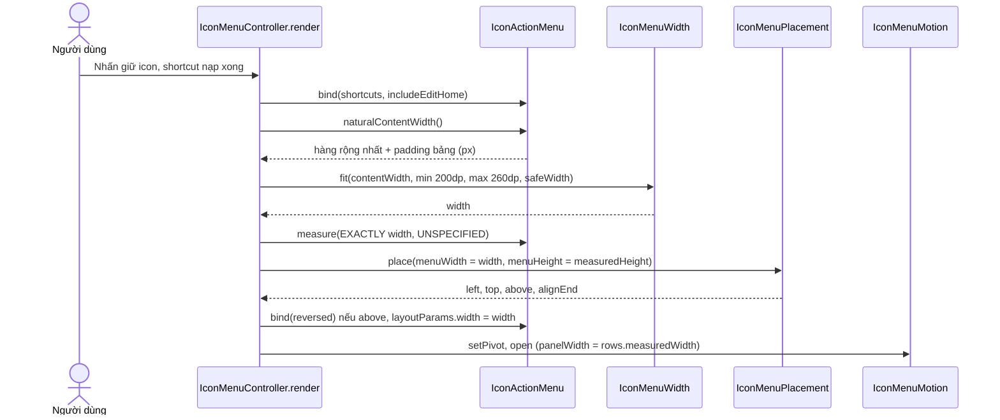
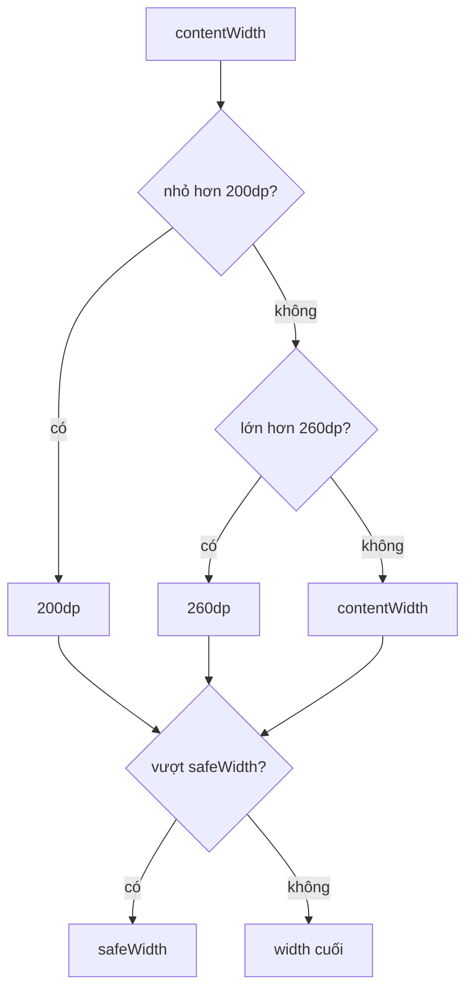

# SW — Menu icon rộng theo chữ: đọc trước khi review

**Plan:** [plans/SW-menu-width-fit.md](../plans/SW-menu-width-fit.md) · **PR:** draft của nhánh · **Nhánh:** `fix/sw-menu-width-fit`

## 1. Tóm tắt
Menu nhấn giữ icon trước đây rộng cố định 200dp nên khi cỡ chữ hệ thống lớn (Live 4, `font_scale` 1,15) nhãn tiếng Việt bị cắt "...". Giờ bảng rộng vừa chữ của hàng dài nhất, nhưng luôn trong khoảng 200 đến 260dp và không tràn vùng an toàn. Cỡ chữ nhỏ/vừa: vẫn đúng 200dp như cũ.

## 2. Kiến thức nền
- **`font_scale`**: hệ số người dùng chọn ở Cài đặt > Cỡ chữ. Đơn vị `sp` nhân với số này, `dp` thì không. Vì vậy chữ 15sp to ra còn bảng 200dp thì đứng yên. (đọc tài liệu Android)
- **`TextPaint.measureText`**: đo bề rộng một dòng chữ theo cỡ chữ hiện tại của `TextView`, không cần layout. (đọc tài liệu Android)
- **`MeasureSpec.EXACTLY`**: ép view đúng bề rộng cho trước, con `MATCH_PARENT` bên trong theo đó; nên bề rộng phải biết **trước** khi đo.

## 3. Luồng hoạt động

Điểm dễ sai: thứ tự. Bề rộng phải chốt trước `measure` (vì `EXACTLY`), nên `naturalContentWidth()` đọc thẳng paint và padding của các hàng đã `bind`, không dựa vào `measuredWidth`. Inset phải lấy trước bước fit (đã dời lên trước `measure`).

## 4. Thay đổi theo file
| File | Vai trò | Vì sao | Đọc trước? |
|---|---|---|---|
| `ui/home/controller/IconMenuWidth.kt` | Luật `clamp` + `safeWidth`, hàm thuần | Tách luật khỏi View | Có |
| `ui/home/view/IconActionMenu.kt` | `naturalContentWidth()` | Chỉ menu biết hàng và padding | Có |
| `ui/home/controller/IconMenuController.kt` | Dùng bề rộng fit cho measure, placement, layout params | Một nguồn bề rộng duy nhất | Có |
| `res/values/dimens.xml` | `shortcut_menu_min_width` 200dp, `shortcut_menu_max_width` 260dp; bỏ `shortcut_menu_width` | Thay số cố định bằng khoảng | Không |

## 5. Quyết định và đánh đổi
Chọn nở theo chữ (A) thay vì 2 dòng (B) hay co chữ (C); lý do và bảng so sánh ở plan, mục "Vì sao chọn thiết kế này". Phần cố định ≈ 60dp nên chỗ cho chữ từ 140dp lên tới 200dp (suy luận từ `dimens.xml`, chưa kiểm chứng bằng số đo).

## 6. Chỗ cần soi khi review
- `naturalContentWidth()` bỏ qua view không phải `TextView` (đường kẻ) và chỉ cộng bề rộng icon + `compoundDrawablePadding` khi hàng thật sự có icon (shortcut không có icon thì không cộng). (đọc code)
- Chữ đo bằng `ceil(measureText)`: nếu layout làm tròn khác, hàng dài nhất có thể thiếu 1px và "..." đúng ca biên. (suy luận chưa kiểm chứng)
- Menu gần mép: `safeWidth` kẹp bề rộng trước, `IconMenuPlacement.place` kẹp vị trí sau; hai bước dùng cùng công thức vùng an toàn. Màn hẹp hơn 200dp + 2 lề thì `safeWidth` thắng `min`, chữ "..." thay vì bảng tràn. (đọc code)
- `IconMenuMotion` lấy `panelWidth` từ `rows.measuredWidth` đã đo ở bề rộng fit nên điểm xoay `±panelWidth/2` đúng ở bề rộng mới; chưa nhìn hoạt ảnh trên máy. (đọc code, chờ kiểm tay)

## 7. Cách kiểm lại
Live 4, `font_scale` 1,15: giữ icon có shortcut, icon thường, icon sát hai mép, icon ở hàng thấp (menu mọc lên trên). Đổi `font_scale` 0,85 và 1,0: bảng phải đúng 200dp. Oppo A3x: không đổi so với trước.

## 8. Bài học cho AGENTS.md
- (2026-11-09, đọc code) Popup đo `EXACTLY` theo dp cố định sẽ cắt chữ khi `font_scale` lớn, vì `sp` co giãn mà `dp` không. Kích thước popup chứa chữ nên suy ra từ chữ (đo bằng paint của chính view) rồi kẹp trong khoảng.
- (2026-11-09, đo được bởi điều phối) Oppo (`font_scale` 0,9) vừa chữ còn Live 4 (1,15) bị cắt: một máy đạt không chứng minh máy kia đạt; test giao diện có chữ phải đổi `font_scale`.
- (2026-11-09, đọc code) Worktree mới không có `local.properties` (đã gitignore) nên Gradle không thấy SDK và báo thiếu license; copy từ thư mục chính trước khi build.

## Số đo
Đo được (điều phối, 2026-11-09, APK debug `2c5b022`, bề rộng lấy từ `uiautomator dump` của `icon_action_menu`):

| Máy | `font_scale` | Icon thử | Bề rộng bảng | Nhãn |
|---|---|---|---|---|
| Vsmart Live 4 (3 px/dp) | 1,15 | Dragon Boy (trái), Drive (phải), Chess 2D, Chrome (dock, menu trên icon) | 213,3 dp cả 4 | đủ chữ, không "..." (trước SW: 200 dp, "Thông tin ứng dụng" và "Sửa màn hình chính" bị cắt) |
| Oppo A3x (2 px/dp) | 0,9 | Battery Animation (trái), Call Screen (phải), Chrome (dock) | 200,0 dp cả 3 | như bản SM |

Chưa đo: hàng shortcut app (máy không đặt Os26Launcher làm mặc định nên không có shortcut), hoạt ảnh mở/đóng (chủ dự án xem ở bài kiểm cuối).
